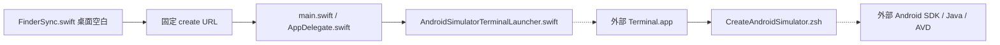
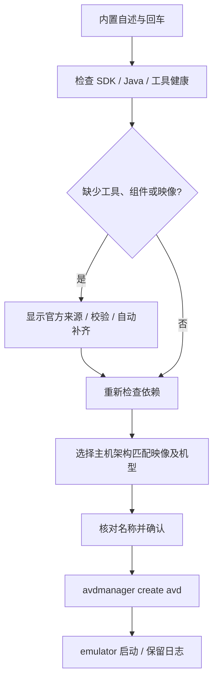

# 桌面右键新建 Android 模拟器


<!-- jobs-toc:start -->
<!-- jobs-toc:source {"v":2,"token":"[toc]"} -->
<details>
<summary>📚 目录（点击展开 / 收起）</summary>

- [🔥 前言](#%E5%89%8D%E8%A8%80)
- [一、运行与依赖](#jobs-toc-heading-2)
- [二、安装单元与目录](#jobs-toc-heading-3)
- [三、调用流程与验证](#jobs-toc-heading-4)

</details>
<!-- jobs-toc:end -->

---

## 🔥 <span id="前言">前言</span>

菜单安装与卸载统一使用 [图形管理入口](./【MacOS】管理Android模拟器Finder扩展.app)。直接打开面板，选择“安装 / 更新”或“卸载”并勾选当前范围内的功能；默认空选，点击操作按钮即确认。每项显示等待、正在安装 / 卸载、成功或失败；底部日志实时滚动，可选择复制或复制全部。运行中锁定选择和关闭入口，结束后保留结果与日志。首次打开或面板源码更新后会在后台编译，失败以桌面提示和启动日志说明。

原同名 `.command` 入口保留，终端只负责唤起独立 GUI，随后结束启动脚本；本次启动任务结束后自动关闭对应终端页，安装 / 卸载、进度与实时日志均由 GUI 后台处理。已有交互 Shell 中手工调用时保留原工作会话。内部实现为 `Scripts/ManageExtension.zsh`；完整仓内单功能入口使用总面板的受限范围。可独立复制的包须整体保留 `.command`、`.app`、Scripts、工程源码和资源。

启动器按自身位置定位配套文件，不依赖本机固定目录或启动时的工作目录。`.command` 会把当前包目录传给同名 App；直接打开 App 无法定位 `Scripts` 时，按提示选择同时包含同名 App 与 `Scripts/` 的原始目录，取消选择不会执行安装或卸载。

> Jobs 维护的独立 macOS Finder 扩展。仅在系统桌面空白处显示“新建 Android 模拟器”，打开 Terminal 完成环境检查、选择机型及系统映像、创建并启动 Android AVD。

| 入口 | 行为 |
| --- | --- |
| 桌面空白右键 | 新建 Android AVD，不要求 Flutter 项目。 |
| 普通文件夹空白、选中的文件 / 文件夹 | 不显示本菜单。 |
| [管理入口：安装 / 更新](./【MacOS】管理Android模拟器Finder扩展.command) | 选择安装模式后立即执行，只增加对应功能，保留其它已装菜单。 |
| [管理入口：卸载](./【MacOS】管理Android模拟器Finder扩展.command) | 选择卸载模式后立即执行，只移除对应菜单，保留其它功能与业务数据。 |

当前菜单安装由 [JobsDesktopTools](../JobsDesktopTools/README.md) 统一承载。本目录的管理入口只启停 `android-simulator-create` 这一叶；需要同仓 `JobsDesktopTools/` 源码。聚合扩展按固定顺序排列三项新建、两项修复和动态文件显示开关，保留逐叶选择；普通目录背景仅显示文件开关。安装产物统一在 `../JobsDesktopTools/work/DerivedData/Build/Products/Debug/JobsDesktopTools.app`，安装／卸载日志统一为系统临时目录 `JobsDesktopToolsInstall.log`。本目录原工程、旧 Bundle ID、旧 URL 和隔离回归仍保留，后文源码标识用于兼容实现参考，不是当前安装器注册目标。

## <span id="jobs-toc-heading-2" data-jobs-toc="v2">一、运行与依赖</span><!-- jobs-toc:heading-end -->

安装依赖 macOS 12.0+、完整 [**Xcode**](https://developer.apple.com/xcode/) 及 macOS SDK；创建 Android 模拟器使用 [**Android SDK Command-line Tools**](https://developer.android.com/tools)、可用 Java、`sdkmanager`、`avdmanager`、`emulator` 与匹配主机架构的系统映像。SDK 位置由当前环境和标准安装位置发现，不写死本机路径。

首屏明确说明影响后，回车即授权本次自动体检并补齐必要工具链，健康组件复用，不再逐层询问是否安装。SDK 根目录不存在时自动建立；Java 优先复用配置项、[**Android Studio**](https://developer.android.com/studio) 内置 JBR 或现有安装，均不可用才从 Adoptium 官方源安装可校验的用户级 [**Temurin 21**](https://adoptium.net/installation/archives/)，仅对本次进程设置 `JAVA_HOME`。Command-line Tools 缺失、损坏或仅有 Android CLI 下载启动器时，从 Google 官方元数据选择已验证传统 CLI 契约的稳定兼容版 21.0 归档（匹配主机架构或官方通用 macOS 包），校验长度、摘要和 ZIP 内容，在 SDK 同卷 `0700` 私有目录解压并排他发布独立版本，保留原有工具；缺失 emulator 自动补装，损坏时仅通过官方管理器重装 emulator 工具包，保留 AVD 与系统映像。每层修复后立即复检，失败显示阶段与日志并停止，不循环下载。

Command-line Tools 23.0 的 `sdkmanager` 会转调 Android CLI 下载启动器，即使 `--version` 也可能联网下载额外程序；不能据此认定工具包损坏，也不能把它用于承诺离线的 `--check`。本入口静态识别并跳过该包装器，保留 23.0，优先复用本地传统工具；缺失才新增 21.0，不覆盖 `latest`。21.0 的归档地址、字节长度和摘要始终读取官方清单；官方不再提供该版本时明确停止，不静默转用不同命令契约。

受限网络下，curl 下载与 Java `sdkmanager` 查询 / 安装共用本次代理。顺序为 `ANDROID_SIM_PROXY`、`https_proxy` / `HTTPS_PROXY`、`all_proxy` / `ALL_PROXY`，最后读取 macOS 已启用的 HTTPS / HTTP / SOCKS 静态代理；不修改任何持久设置。支持 `http://主机:端口`、`socks5://主机:端口`（不含认证信息），`direct` 强制本次直连；保留 `NO_PROXY` 对 Google 仓库的直连排除。PAC 和认证代理需使用 Android Studio SDK Manager，或提供可用的本地静态代理。例如：

```shell
ANDROID_SIM_PROXY=http://127.0.0.1:7890 /bin/zsh ./Scripts/CreateAndroidSimulator.zsh --prepare
```

没有完整本地映像时自动读取官方稳定清单，用户选择系统映像后直接安装；SDK 许可证交由官方工具交互，本人阅读接受，不自动同意。创建前仍确认型号、系统与名称，绝不覆盖已有同名 AVD，不删除已有设备，不改系统代理、Shell 配置或开发目录。

在本目录执行：

```shell
/bin/zsh ./Scripts/CreateAndroidSimulator.zsh --help
/bin/zsh ./Scripts/CreateAndroidSimulator.zsh --check
/bin/zsh ./Scripts/CreateAndroidSimulator.zsh --prepare
/bin/zsh ./Scripts/CreateAndroidSimulator.zsh --create
/bin/zsh ./Scripts/CreateAndroidSimulator.zsh
```

`--check` 只读检查，不联网、不安装组件、不建日志、不创建或启动设备；`--prepare` 首屏回车后仅体检和自动补齐工具链，完成即退出，不查询系统映像或创建设备；`--create` 直接进入新建流程，桌面右键固定使用此参数；无参数保留启动已有 AVD / 新建的选择。交互运行先展示内置自述，再按回车继续；可用时使用 fzf，缺失或损坏时使用编号选择。空列表不会进入无效选择，失败可以修复后重新运行。创建与启动结果以及本次日志位置在终端中显示。宿主诊断日志是系统临时目录中的 `JobsAndroidSimulatorCreator.log`，安装日志为 `JobsAndroidSimulatorCreatorInstall.log`。

## <span id="jobs-toc-heading-3" data-jobs-toc="v2">二、安装单元与目录</span><!-- jobs-toc:heading-end -->

```text
./
├── JobsAndroidSimulatorCreator.xcodeproj/
├── JobsAndroidSimulatorCreator/       # 后台宿主与安全终端转发
├── JobsAndroidSimulatorFinderSync/    # 仅桌面空白菜单
├── JobsAndroidSimulatorShared/        # 桌面白名单、固定 URL 请求
├── Scripts/                          # 自包含创建核心与注册帮助脚本
├── Tests/                            # 隔离脚本、传输、宿主和安装回归
└── 【MacOS】管理Android模拟器Finder扩展.command
```

| 标识 | 值 |
| --- | --- |
| Scheme / App | `JobsAndroidSimulatorCreator` |
| 扩展产品 | `JobsAndroidSimulatorFinderSync.appex` |
| 宿主 Bundle ID | `com.jobs.androidsimulatorcreator` |
| 扩展 Bundle ID | `com.jobs.androidsimulatorcreator.findersync` |
| 总面板功能 ID | `android-simulator-create` |
| 唯一业务 URL | `jobsandroidsimulatorcreator://simulator/create`，不接受外部路径、脚本或附加参数。 |

原业务核心不依赖 `JobsCommand@Flutter` 仓库；菜单入口统一安装相邻 JobsDesktopTools。实际产物与登记身份见上方聚合说明，安装后保留该 App；旧 App / 资源不删除。

## <span id="jobs-toc-heading-4" data-jobs-toc="v2">三、调用流程与验证</span><!-- jobs-toc:heading-end -->





开发回归与构建方式见 [Scripts 说明](./Scripts/README.md)。隔离测试使用假 SDK 和临时目录，不下载映像或操作真实设备；构建检查不等于真实 Finder / Windows 桌面验收。右键无法打开终端时，检查系统设置“隐私与安全性 → 自动化”中本宿主控制 Terminal 的授权。

桌面挂载验证基线（2026-10-22）：宿主和传输隔离回归、macOS 两 target Debug 构建、深度签名、打包脚本字节核对及本机注册通过，真实 Desktop 目录空白菜单已显示 iOS / Android 两项。当时本机尚缺命令行工具与完整 ARM 系统映像，未下载安装归档或创建真实 AVD。

受限网络兼容验证基线（2026-10-23）：Android 隔离测试 58 组 / 425 断言覆盖 CLI 启动器、兼容工具并存、官方清单、代理传递、NO_PROXY、凭据脱敏及现有创建保护。本机官方 21.0 归档的长度 / 摘要、独立安装、`--check`、`--prepare` 和通过现有系统代理查询映像均已验证；这不代表系统映像下载、许可证接受或真实 AVD 创建已验收。扩展产物已做签名和资源字节核对，真实模拟器创建仍需交互验收。

<a id="🔚" href="#前言">回到首页</a>
