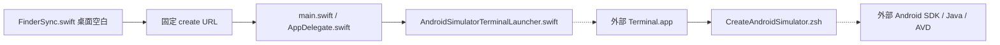
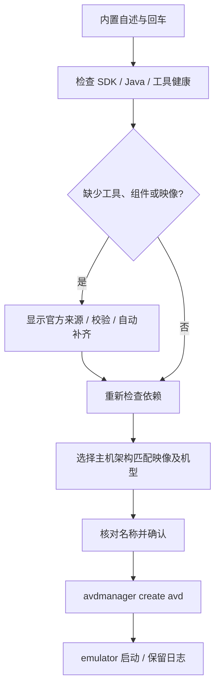

# 桌面右键新建 Android 模拟器


<!-- jobs-toc:start -->
<!-- jobs-toc:source {"v":2,"token":"[toc]"} -->
<details>
<summary>📚 目录（点击展开 / 收起）</summary>

- [🔥 前言](#%E5%89%8D%E8%A8%80)
- [一、运行与依赖](#jobs-toc-heading-2)
- [二、安装单元与目录](#jobs-toc-heading-3)
- [三、调用流程与验证](#jobs-toc-heading-4)

</details>
<!-- jobs-toc:end -->

---

## 🔥 <span id="前言">前言</span>

> Jobs 维护的独立 macOS Finder 扩展。仅在系统桌面空白处显示“新建 Android 模拟器”，打开 Terminal 完成环境检查、选择机型及系统映像、创建并启动 Android AVD。

| 入口 | 行为 |
| --- | --- |
| 桌面空白右键 | 新建 Android AVD，不要求 Flutter 项目。 |
| 普通文件夹空白、选中的文件 / 文件夹 | 不显示本菜单。 |
| [独立安装](./【MacOS】安装Android模拟器Finder扩展.command) | 回车安装；任意非空输入跳过；构建并注册本功能，刷新 Finder。 |
| [独立卸载](./【MacOS】卸载Android模拟器Finder扩展.command) | 核对注册路径后输入 `YES`，只移除本功能 App / appex；保留 Android SDK、AVD 与系统映像。 |

## <span id="jobs-toc-heading-2" data-jobs-toc="v2">一、运行与依赖</span><!-- jobs-toc:heading-end -->

安装依赖 macOS 12.0+、完整 [**Xcode**](https://developer.apple.com/xcode/) 及 macOS SDK；创建 Android 模拟器使用 [**Android SDK Command-line Tools**](https://developer.android.com/tools)、可用 Java、`sdkmanager`、`avdmanager`、`emulator` 与匹配主机架构的系统映像。SDK 位置由当前环境和标准安装位置发现，不写死本机路径。

首屏明确说明影响后，回车即授权本次自动体检并补齐必要工具链，健康组件复用，不再逐层询问是否安装。SDK 根目录不存在时自动建立；Java 优先复用配置项、[**Android Studio**](https://developer.android.com/studio) 内置 JBR 或现有安装，均不可用才从 Adoptium 官方源安装可校验的用户级 [**Temurin 21**](https://adoptium.net/installation/archives/)，仅对本次进程设置 `JAVA_HOME`。Command-line Tools 缺失或损坏时自动从 Google 官方元数据选择匹配主机架构的稳定归档，校验长度、摘要和 ZIP 内容，在 SDK 同卷 `0700` 私有目录解压并排他发布独立版本，保留原有工具；缺失 emulator 自动补装，损坏时仅通过官方管理器重装 emulator 工具包，保留 AVD 与系统映像。每层修复后立即复检，失败显示阶段与日志并停止，不循环下载。

没有完整本地映像时自动读取官方稳定清单，用户选择系统映像后直接安装；SDK 许可证交由官方工具交互，本人阅读接受，不自动同意。创建前仍确认型号、系统与名称，绝不覆盖已有同名 AVD，不删除已有设备，不改系统代理、Shell 配置或开发目录。

在本目录执行：

```shell
/bin/zsh ./Scripts/CreateAndroidSimulator.zsh --help
/bin/zsh ./Scripts/CreateAndroidSimulator.zsh --check
/bin/zsh ./Scripts/CreateAndroidSimulator.zsh --prepare
/bin/zsh ./Scripts/CreateAndroidSimulator.zsh --create
/bin/zsh ./Scripts/CreateAndroidSimulator.zsh
```

`--check` 只读检查，不联网、不安装组件、不建日志、不创建或启动设备；`--prepare` 首屏回车后仅体检和自动补齐工具链，完成即退出，不查询系统映像或创建设备；`--create` 直接进入新建流程，桌面右键固定使用此参数；无参数保留启动已有 AVD / 新建的选择。交互运行先展示内置自述，再按回车继续；可用时使用 fzf，缺失或损坏时使用编号选择。空列表不会进入无效选择，失败可以修复后重新运行。创建与启动结果以及本次日志位置在终端中显示。宿主诊断日志是系统临时目录中的 `JobsAndroidSimulatorCreator.log`，安装日志为 `JobsAndroidSimulatorCreatorInstall.log`。

## <span id="jobs-toc-heading-3" data-jobs-toc="v2">二、安装单元与目录</span><!-- jobs-toc:heading-end -->

```text
./
├── JobsAndroidSimulatorCreator.xcodeproj/
├── JobsAndroidSimulatorCreator/       # 后台宿主与安全终端转发
├── JobsAndroidSimulatorFinderSync/    # 仅桌面空白菜单
├── JobsAndroidSimulatorShared/        # 桌面白名单、固定 URL 请求
├── Scripts/                          # 自包含创建核心与注册帮助脚本
├── Tests/                            # 隔离脚本、传输、宿主和安装回归
├── 【MacOS】安装Android模拟器Finder扩展.command
└── 【MacOS】卸载Android模拟器Finder扩展.command
```

| 标识 | 值 |
| --- | --- |
| Scheme / App | `JobsAndroidSimulatorCreator` |
| 扩展产品 | `JobsAndroidSimulatorFinderSync.appex` |
| 宿主 Bundle ID | `com.jobs.androidsimulatorcreator` |
| 扩展 Bundle ID | `com.jobs.androidsimulatorcreator.findersync` |
| 总面板功能 ID | `android-simulator-create` |
| 唯一业务 URL | `jobsandroidsimulatorcreator://simulator/create`，不接受外部路径、脚本或附加参数。 |

整目录可以独立拷走构建，不依赖相邻功能或 `JobsCommand@Flutter` 仓库。独立安装的产物在 `./work/DerivedData/`，总安装的产物在上级仓库 `work/JobsAndroidSimulatorCreatorDerivedData/`。系统直接注册对应位置的 App，使用期间保留产物目录；两种安装方式共用 Bundle ID，安装器会核对并注销旧副本。

## <span id="jobs-toc-heading-4" data-jobs-toc="v2">三、调用流程与验证</span><!-- jobs-toc:heading-end -->





开发回归与构建方式见 [Scripts 说明](./Scripts/README.md)。隔离测试使用假 SDK 和临时目录，不下载映像或操作真实设备；构建检查不等于真实 Finder / Windows 桌面验收。右键无法打开终端时，检查系统设置“隐私与安全性 → 自动化”中本宿主控制 Terminal 的授权。

桌面挂载验证基线（2026-10-22）：宿主和传输隔离回归、macOS 两 target Debug 构建、深度签名、打包脚本字节核对及本机注册通过，真实 Desktop 目录空白菜单已显示 iOS / Android 两项。当时本机尚缺命令行工具与完整 ARM 系统映像，未下载安装归档或创建真实 AVD。

自动补齐验证（2026-10-23）：50 组 / 356 断言通过。已真实运行 `--prepare`，首屏回车后自动下载约 155 MB 的 Google 官方 ARM Command-line Tools 23.0，完成长度与摘要校验、同卷暂存、独立版本安装及健康复检；SDK、Java 21 与 emulator 直接复用。已重新构建安装本机扩展，打包脚本与独立双击脚本逐字节一致，深度签名与精确注册路径核对通过。未下载系统映像、接受 SDK 许可证或创建真实 AVD；设备创建仍单独验收。

<a id="🔚" href="#前言">回到首页</a>
