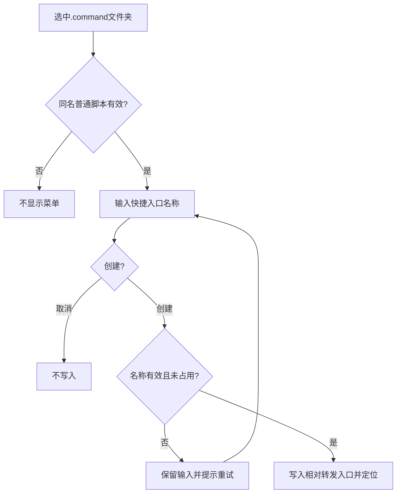

# JobsCommandShortcutCreator · 创建脚本快捷入口


<!-- jobs-toc:start -->
<!-- jobs-toc:source {"v":2,"token":"[toc]"} -->
<details>
<summary>📚 目录（点击展开 / 收起）</summary>

- [🔥 前言](#%E5%89%8D%E8%A8%80)
- [一、使用方式](#usage)
- [二、安装、卸载与独立复制](#management)
- [三、源码与写入边界](#implementation)
- [四、构建与验证](#validation)

</details>
<!-- jobs-toc:end -->

---

## 🔥 <span id="前言">前言</span>

在 [**macOS Finder**](https://support.apple.com/guide/mac-help/welcome/mac) 中，对内含同名脚本的 `.command` 文件夹右键，选择 **创建脚本快捷入口…**，即可在文件夹旁生成可双击运行的 `.command` 转发脚本。此功能由 Jobs 维护，使用独立功能标识 `command-shortcut-create`，可通过总面板或本包管理入口单独安装、更新和卸载。

例如，选中 `split.command/`，其内部须有 `split.command` 普通脚本文件；创建后结构如下：

```text
当前目录/
├── split.command/
│   ├── split.command
│   └── README.md
└── split（快捷入口）.command
```

入口是普通文本脚本，使用相对路径执行 `./split.command/split.command`，传递所有参数并保留真实退出码。它与 macOS 系统“制作替身”不同，也不是符号链接；生成时不执行内部业务脚本。入口与功能文件夹一起移动后仍可使用；只移动入口、或给功能文件夹 / 内部脚本改名，会导致配套路径失效。

## 一、<span id="usage">使用方式</span> <a href="#前言" style="font-size:17px; color:green;"><b>🔼</b></a> <a href="#🔚" style="font-size:17px; color:green;"><b>🔽</b></a>

1、双击 [管理脚本快捷入口 Finder 扩展](./【MacOS】管理脚本快捷入口Finder扩展.command)，或打开旁边同名 [GUI App](./【MacOS】管理脚本快捷入口Finder扩展.app)。选择“安装 / 更新”，勾选“创建脚本快捷入口”，点击操作按钮。

2、在 Finder 的文件列表或侧边栏中，右键一个名称以 `.command` 结尾、且内部含同名普通脚本的真实文件夹。多选、普通文件、不合格目录及目录空白处不显示此菜单；文件夹和脚本均不接受符号链接。

3、点击 **创建脚本快捷入口…**，输入以 `.command` 结尾的入口文件名，再点击“创建”。默认使用 `原名（快捷入口）.command`；同级已有原名 `.command` 文件夹，入口不能使用与文件夹完全相同的名称。可改成清楚的中文用途名称。

4、成功后 Finder 定位选中新入口。双击入口运行配套脚本，由原脚本负责自述和确认。原脚本及其 README 不会被改写；入口不复制业务实现。

同名文件、目录和链接一律保留并提示更换名称；取消、Esc 或关闭不创建入口。名称必须以 `.command` 结尾，不接受路径分隔符、冒号、换行和控制字符。创建失败会显示具体原因，保留名称以便重试。最终写入使用排他创建，避免同名竞争覆盖已有内容。

## 二、<span id="management">安装、卸载与独立复制</span> <a href="#前言" style="font-size:17px; color:green;"><b>🔼</b></a> <a href="#🔚" style="font-size:17px; color:green;"><b>🔽</b></a>

要求 macOS 12+、完整 [**Xcode**](https://developer.apple.com/xcode/) 及 macOS SDK。源码使用 <u>[**Swift**](https://www.swift.org/)</u> 5 语言模式，依赖系统 AppKit、FinderSync、Foundation；无第三方业务依赖，不要求 Python、Node.js 或其它外部语言运行时。

公开 `.command` 仅启动 GUI 并结束任务；安装、卸载及可复制日志均在面板内进行，空选、取消和关闭不执行业务。完整仓中的入口转交上级面板并限定本功能，单独复制时使用随包面板。需要整体保留本目录的管理 `.command` / 同名 `.app`、`Scripts/`、`Shared/`、宿主与扩展源码以及 `.xcodeproj`。

管理面板支持白天 / 黑夜 / 跟随系统，以及简体中文 / 繁体中文 / 藏文 / 英文 / 日文 / 法文 / 西班牙文 / 德文 / 俄罗斯文 / 韩文和跟随系统。创建入口对话框也提供主题及语言切换，共用当前用户偏好。

首次打开默认勾选“使用「应用程序」中的联合 App 安装 / 卸载”和“安装成功后清除此轮构建产物”，可手动取消。应用程序路线将完整功能模块收进 `Jobs自定义右键菜单.app`，源码移走后已装功能仍可用；构建目录路线须保留 `work/` 中实际登记的 App。清理只在本模块安装成功后进行，独立清理须验证已安装副本及登记，不清理源码或创建的入口。停止安装只在完成当前安装单元后停止。

卸载仅移除所选位置的本功能模块及登记，保留原脚本、README 和已生成入口；另一位置副本及其它功能保留。系统可能要求启用 Finder 扩展、授予目录访问权限或“App 管理”权限，请按系统设置提示处理。启动器无法定位外置 `Scripts/` 时，可选择原始功能包目录；取消不安装、不卸载。

在本目录执行以下命令只打开面板并预设操作，仍需勾选并点击按钮：

```shell
/bin/zsh ./【MacOS】管理脚本快捷入口Finder扩展.command \
  --action install \
  --features command-shortcut-create

/bin/zsh ./【MacOS】管理脚本快捷入口Finder扩展.command \
  --action uninstall \
  --features command-shortcut-create
```

| 对象 | 标识 / 位置 |
| --- | --- |
| 功能 ID | `command-shortcut-create` |
| 宿主 / 扩展 ID | `com.jobs.commandshortcutcreator` / `com.jobs.commandshortcutcreator.findersync` |
| URL 请求 | `jobscommandshortcutcreator://create?p=<base64url目录>&id=<UUID>` |
| 构建产物 | `./work/DerivedData/Build/Products/Debug/JobsCommandShortcutCreator.app` |
| 内嵌扩展 | App 内 `Contents/PlugIns/JobsCommandShortcutCreatorFinderSync.appex` |
| 管理日志 | 系统临时目录中的 `JobsCommandShortcutCreatorManage.log`，面板另存会话日志 |
| 管理锁 | `./work/.manager-lock` |
| 部署边界 | [App 部署支持库说明](./Scripts/【MacOS】AppDeployment.zsh/README.md) |

## 三、<span id="implementation">源码与写入边界</span> <a href="#前言" style="font-size:17px; color:green;"><b>🔼</b></a> <a href="#🔚" style="font-size:17px; color:green;"><b>🔽</b></a>

| 目录 / 文件 | 职责 |
| --- | --- |
| `JobsCommandShortcutCreator.xcodeproj` | 独立宿主及 Finder 扩展两个构建 target，无自动注册 Build Phase |
| `JobsCommandShortcutCreator/main.swift`、`AppDelegate.swift` | 启动宿主，唯一请求 ID 去重，串行处理创建请求 |
| `JobsCommandShortcutCreator/CommandShortcutDialog/` | 文件名输入、主题及十语切换 |
| `JobsCommandShortcutCreator/CommandShortcutController/` | 取消、创建、错误重试与 Finder 定位 |
| `JobsCommandShortcutCreator/CommandShortcutService/` | 校验目标与名称，生成相对转发脚本，排他写入并设置执行权限 |
| `JobsCommandShortcutCreator/CommandShortcutInterface/` | 编辑菜单与界面调用 |
| `JobsCommandShortcutCreatorFinderSync/` | 单目录菜单、tag 请求快照、点击复核和明确宿主投递 |
| `Shared/` | 目录判定、URL 编解码、宿主定位、十语及原生工厂支持 |
| [Scripts](./Scripts/README.md) | 管理面板、安装 / 卸载 worker 和部署资源 |




Finder 菜单使用递增 tag 保存最多 64 份目标快照，点击后消费并复核，不随后来切换窗口或选择而改变目标。宿主明确定位当前 `.appex` 所属 App 并核验身份，不使用未知的 URL scheme 默认处理器。外部 URL 只传递目录和请求 ID，不能携带待执行命令；生成仍须用户在对话框确认。

入口使用 `/bin/zsh` 定位包内同名 `.command`，再按原 shebang 选择系统 zsh、bash 或 sh（含对应 `/usr/bin/env` 形式），传递参数并保留退出码。这些常见 Shell 脚本无须已有执行权限；其它解释器要求原脚本已可执行，由系统按其 shebang 启动，无法解析时明确报错。包内脚本仍由原文件维护，生成器不调用其业务，不修改脚本权限或内容。入口自身赋予运行所需的执行权限。完整结构中文、空格及 Shell 特殊字符路径通过安全引用处理。

## 四、<span id="validation">构建与验证</span> <a href="#前言" style="font-size:17px; color:green;"><b>🔼</b></a> <a href="#🔚" style="font-size:17px; color:green;"><b>🔽</b></a>

以下构建不会运行本包安装器，不调用 PlugInKit 或重启 Finder：

```shell
xcodebuild \
  -project ./JobsCommandShortcutCreator.xcodeproj \
  -scheme JobsCommandShortcutCreator \
  -configuration Debug \
  -destination 'platform=macOS' \
  -derivedDataPath ./work/DerivedData \
  build
```

隔离构建及文件行为验证与真实 Finder 菜单验收分别记录。系统菜单可见性、实际创建对话框、受保护目录授权和真实双击运行，须在安装后核验；单纯构建通过不代表功能已经安装或启用。

<a id="🔚" href="#前言" style="font-size:17px; color:green; font-weight:bold;">我是有底线的➤点我回到首页</a>
