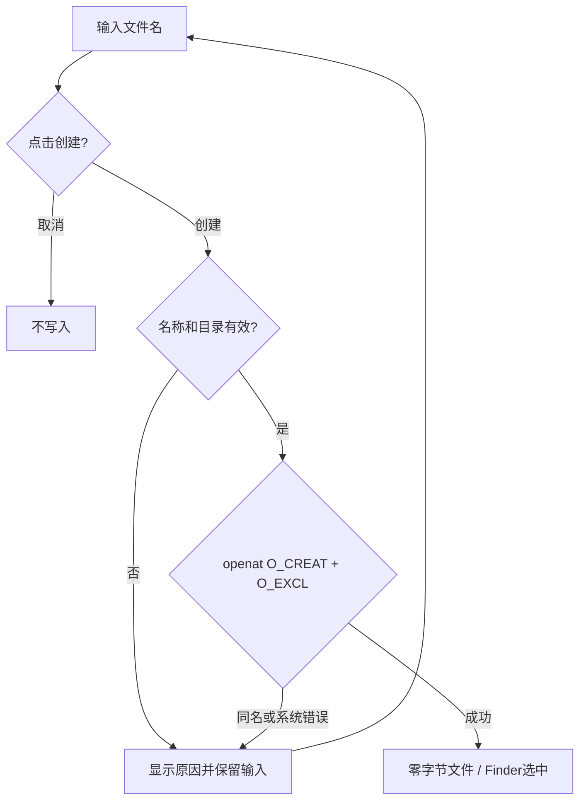

# JobsFileCreator · 新建文件


<!-- jobs-toc:start -->
<!-- jobs-toc:source {"v":2,"token":"[toc]"} -->
<details>
<summary>📚 目录（点击展开 / 收起）</summary>

- [🔥 前言](#%E5%89%8D%E8%A8%80)
- [一、使用方式](#usage)
- [二、安装与卸载](#management)
- [三、源码与创建边界](#implementation)
- [四、构建与验证](#validation)

</details>
<!-- jobs-toc:end -->

---

## 🔥 <span id="前言">前言</span>

在 [**macOS Finder**](https://support.apple.com/guide/mac-help/welcome/mac) 桌面和文件夹空白处提供 **📃 新建文件…**，输入文件名即可创建空白文件。由 Jobs 维护，作为独立安装单元 `file-create` 接入总管理面板。Windows 使用系统已有的新建菜单。

## 一、<span id="usage">使用方式</span> <a href="#前言" style="font-size:17px; color:green;"><b>🔼</b></a> <a href="#🔚" style="font-size:17px; color:green;"><b>🔽</b></a>

1、双击 [新建文件管理入口](./【MacOS】管理新建文件Finder扩展.command)，或直接打开同名 [GUI App](./【MacOS】管理新建文件Finder扩展.app)。在面板选择“安装 / 更新”，勾选“新建文件”，点击操作按钮。默认空选，不勾选不能执行；底部显示可复制的实时日志和逐项状态。

2、安装成功后在桌面或普通文件夹空白处右键，选择 **📃 新建文件…**。菜单只出现在文件夹背景；文件、多选、侧边栏和工具栏不显示此项。目标固定为这次右键激发菜单的目录，随后切换 Finder 窗口不会改变创建位置。

3、默认文件名是 `未命名.txt`，已选中可直接输入替换。输入对话框及改名重试统一显示 macOS 通用文件图标。可以使用 `.md`、`.json`、无扩展名等自定义名称；剪切、复制、粘贴、全选支持标准快捷键。点击“创建”生成零字节文件并在 Finder 中定位选中；点击“取消”不写入。

同名文件、目录或链接已经存在时会提示改名，保留原内容。空白名称、`.`、`..`、`/`、`:`、控制字符和换行均拒绝。权限不足、只读磁盘或空间不足显示具体系统错误，可修改名称重试或取消。创建的是空白文件，不生成 Word、Excel 等格式的文档模板。

## 二、<span id="management">安装与卸载</span> <a href="#前言" style="font-size:17px; color:green;"><b>🔼</b></a> <a href="#🔚" style="font-size:17px; color:green;"><b>🔽</b></a>

要求 macOS 12+、完整 [**Xcode**](https://developer.apple.com/xcode/) 和 macOS SDK；工程使用 <u>[**Swift**](https://www.swift.org/)</u> 5 语言模式及系统 AppKit、FinderSync、Foundation，无第三方业务依赖。首次打开管理面板会在本目录 `work/` 缓存编译程序。

公开 `.command` 仅启动 GUI，随后结束。独立启动的完成终端页由 GUI 精确关闭；在已有交互 Shell 手动调用时保留工作会话。安装、卸载及日志均在普通层级的 GUI 内完成，运行中锁定操作，结束后保留结果。面板确认即执行，无额外终端确认。

完整仓中入口转交上级总面板并限定本功能；需要独立复制时，整体保留本目录的 `.command`、同名 `.app`、`Scripts/`、工程、Shared 和宿主 / 扩展源码，使用随包单功能面板。

启动器按自身位置定位配套文件，不依赖本机固定目录或启动时的工作目录。`.command` 会把当前包目录传给同名 App；直接打开 App 无法定位 `Scripts` 时，按提示选择同时包含同名 App 与 `Scripts/` 的原始目录，取消选择不会执行安装或卸载。

每项失败后，点击红色带下划线的“失败，见日志”，会新建 Terminal 会话并用 `cat` 显示本次完整会话日志；现有任务继续，已有终端保留。“日志文件”按钮仍用于在 Finder 中定位原始日志。

| 操作 | 影响范围 |
| --- | --- |
| 安装 / 更新 | 构建本 App，核对身份及签名，向 LaunchServices 和 PlugInKit 注册并启用本扩展，刷新 Finder |
| 卸载 | 停用本扩展，注销可核验的本功能登记副本；保留源码、构建产物和已创建的文件，刷新 Finder |
| 取消 / 关闭 / 空选 | 不执行安装或卸载 |

在本目录执行以下命令会打开面板并预设操作，仍需勾选并点击按钮：

```shell
/bin/zsh ./【MacOS】管理新建文件Finder扩展.command \
  --action install \
  --features file-create

/bin/zsh ./【MacOS】管理新建文件Finder扩展.command \
  --action uninstall \
  --features file-create
```

系统设置可能要求手动开启 Finder 扩展。桌面、文稿、下载等受保护目录访问由系统向宿主询问授权；拒绝后会显示创建失败。宿主为非沙盒工具，不使用 Terminal 或自动化权限；Finder 扩展保持沙盒，只负责读取目录上下文并转交请求。

| 对象 | 标识 / 位置 |
| --- | --- |
| 功能 ID | `file-create` |
| 宿主 / 扩展 ID | `com.jobs.filecreator` / `com.jobs.filecreator.findersync` |
| URL 请求 | `jobsfilecreator://create?p=<base64url目录>&id=<UUID>` |
| 宿主唤起 | 从正在运行的扩展定位所属 App，明确投递 URL；不依赖该 scheme 的系统默认处理器，也不替换为其它路径的运行副本 |
| 构建产物 | `./work/DerivedData/Build/Products/Debug/JobsFileCreator.app` |
| 内嵌扩展 | App 内 `Contents/PlugIns/JobsFileCreatorFinderSync.appex` |
| 管理日志 | 系统临时目录中的 `JobsFileCreatorManage.log`；GUI 另保留会话日志 |
| 管理互斥锁 | `./work/.manager-lock` |

操作失败先检查日志。残留管理锁只能在确认没有任务运行后处理，不能并行启动第二个管理任务。安装和卸载只改变本项扩展登记，不触发实际文件创建。

首次安装可能出现构建成功、登记命令返回成功，但系统索引仍查不到扩展的情况。总管理器和独立入口会后台初始化宿主并最多重新登记一次；只有当前精确路径显示已启用才报告成功。恢复失败仍返回错误并保留日志，不把旧副本或仅构建完成当作安装成功。

## 三、<span id="implementation">源码与创建边界</span> <a href="#前言" style="font-size:17px; color:green;"><b>🔼</b></a> <a href="#🔚" style="font-size:17px; color:green;"><b>🔽</b></a>

| 入口 | 职责 |
| --- | --- |
| `JobsFileCreatorFinderSync/FinderSync.swift` | 仅对有效文件夹背景生成菜单；以递增菜单 tag 关联扩展内的目标快照，点击复核该目录并明确唤起所属宿主 |
| `Shared/FileCreationContext/` | 核验本地目录及可读取的目录类型 |
| `Shared/FileCreationRequest/` | 严格校验 URL 参数并传递目录、唯一请求 ID |
| `Shared/FileCreatorHost/` | 按当前内嵌扩展路径定位宿主，核对 App 身份及执行文件声明 |
| `JobsFileCreator/main.swift`、`AppDelegate.swift` | 强持有委托，接收系统 URL，按唯一请求去重并串行展示对话框 |
| `JobsFileCreator/FileCreationController/` | 管理输入、取消、失败重试和成功定位 |
| `JobsFileCreator/FileCreationService/` | 校验名称并通过目录描述符排他创建文件 |
| [Scripts](./Scripts/README.md) | GUI 启动、后台安装与卸载 |




创建空文件的效果相当于在右键目录执行 `touch`，实现直接调用系统文件 API，不把目录或文件名拼接成 Shell 命令。创建时以打开的目录描述符为边界，使用 `O_EXCL` 防止检查后发生竞争而覆盖已有文件，`O_NOFOLLOW` 拒绝同名链接；系统 `umask` 决定实际文件权限。已有同名对象时提示改名，不修改其内容或时间戳。外部 URL 不能携带文件名或任意命令，仍需用户点击“创建”。

宿主从当前 `.appex` 的 `Contents/PlugIns` 所属 App 动态定位，整个功能包复制或改名后仍按实际位置解析。缺少完整宿主或启动失败时显示具体原因，不触发系统“选取应用程序”窗口；缺失或被删除的目标目录要求重新打开右键菜单，不回退到其它 Finder 窗口或工作目录。

Finder 跨进程传递菜单时不依赖 `representedObject`。扩展以不复用的递增 tag 保存最多 64 份目录请求，支持不同 Finder 窗口同时持有菜单；点击后消费该请求，过期、重复或已淘汰的菜单项提示重新右键，不转用其它目录。

## 四、<span id="validation">构建与验证</span> <a href="#前言" style="font-size:17px; color:green;"><b>🔼</b></a> <a href="#🔚" style="font-size:17px; color:green;"><b>🔽</b></a>

以下构建不带本仓自动注册阶段，不调用 PlugInKit 或重启 Finder。Xcode 可能自行登记宿主 App 的 LaunchServices 信息，这不代表菜单已经安装或启用：

```shell
xcodebuild \
  -project ./JobsFileCreator.xcodeproj \
  -scheme JobsFileCreator \
  -configuration Debug \
  -destination 'platform=macOS' \
  -derivedDataPath ./work/DerivedData \
  build

ruby ./Tests/FileCreationTests.rb
ruby ./Tests/FinderDispatchTests.rb
ruby ./Tests/InstallerTests.rb
```

测试使用临时目录和边界替身，覆盖目录上下文、特殊字符传输、请求拒绝、排他创建、同名文件 / 目录 / 链接保护、并发竞争、取消和失败重试，以及生产委托入口。Finder 生产菜单回归先复制其支持的菜单属性、清空 `representedObject` 后再触发 action，覆盖右键后切换窗口、多份菜单并存、重复及淘汰 tag 拒绝、菜单目录失效、按搬迁后的路径定位宿主、拒绝其它 App 身份、禁止默认 scheme 处理器回退及异步启动失败。安装回归复制 worker 到临时目录并硬替换系统写命令，覆盖参数拒绝、安装顺序、构建失败、互斥锁、跳过刷新、精确卸载和独立复制后的 GUI 范围。源码构建与隔离测试不等于真实 Finder 右键验收；系统扩展开关、受保护目录授权和实际输入框交互需在本机安装后核验。

<a id="🔚" href="#前言" style="font-size:17px; color:green; font-weight:bold;">我是有底线的➤点我回到首页</a>
