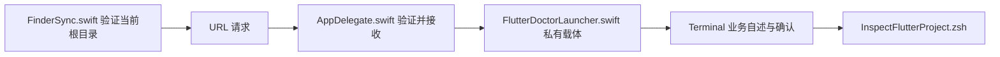

> 本功能的右键入口已迁入 [JobsFlutterTools](../JobsFlutterTools/README.md)。以下保留旧独立工程的实现说明；新安装使用统一菜单与项目 FVM。原“Flutter项目体检”在新菜单中称为“原生Flutter项目体检”。

# JobsFlutterDoctor


<!-- jobs-toc:start -->
<!-- jobs-toc:source {"v":2,"token":"[toc]"} -->
<details>
<summary>📚 目录（点击展开 / 收起）</summary>

- [🔥 前言](#%E5%89%8D%E8%A8%80)
- [一、菜单与 SDK 范围](#section-1)
- [二、安装与卸载](#section-2)
- [三、终端与只读检查](#section-3)
- [四、工程与请求链](#section-4)
- [五、验证与排查](#section-5)

</details>
<!-- jobs-toc:end -->

---

## 🔥 <span id="前言">前言</span>

独立的 [**macOS**](https://www.apple.com/macos/) [**Finder**](https://support.apple.com/zh-cn/102339) 右键扩展，为当前 [**Flutter**](https://flutter.dev/) 项目提供“Flutter 项目体检”。项目由 Jobs 维护，状态为维护中。宿主在后台转交请求，业务在系统 Terminal 中交互执行。

运行当前项目所用 SDK 的 `flutter doctor -v`，同时保留命令退出码和诊断报告。即使命令返回 0，只要报告存在 `[!]`、`[✗]`、`[x]` 或 `Doctor found issues`，最终仍返回失败。诊断会访问工具链、设备与网络，并可能更新 SDK 自身缓存；不会清理项目、拉依赖或自动修复环境。

本目录是 [MacOS@Extension](../README.md) 中的普通源码目录；保留自己的宿主 App、Finder 扩展、Xcode 工程和独立安装 / 卸载脚本。业务资源完整打包在 App 中，旧源码工程仍可独立构建供调试；运行时不需要 SourceTree 或其它扩展目录。

| 操作 | 实际行为 |
| --- | --- |
| 总管理器勾选“Flutter 项目体检” | 构建 `JobsFlutterTools` 并只增加本项菜单，可与其它功能分别选择 |
| [管理入口：安装 / 更新](./【MacOS】管理Flutter项目体检Finder扩展.command) | 选择安装模式后立即执行，只增加对应功能，保留其它已装菜单。 |
| Finder 单选 Flutter 根目录或根目录内空白处 | 二次校验项目后打开 Terminal，展示业务自述与目标 |
| [管理入口：卸载](./【MacOS】管理Flutter项目体检Finder扩展.command) | 选择卸载模式后立即执行，只移除对应菜单，保留其它功能与业务数据。 |

## <span id="section-1">一、菜单与 SDK 范围</span> <a href="#前言" style="font-size:17px; color:green;"><b>🔼</b></a> <a href="#🔚" style="font-size:17px; color:green;"><b>🔽</b></a>

只接受当前层 `pubspec.yaml` 以 `dependencies.flutter.sdk: flutter` 声明 Flutter 的真实普通目录，不递归搜索，不接受文件包、目录符号链接、多选、普通 Dart 包或 `ios/` 子目录。系统桌面空白处隐藏此功能；桌面上选中的 Flutter 项目仍可使用。

SDK 顺序为项目 `.fvm/flutter_sdk`，再到 PATH 中可执行的 Flutter。发现 [**FVM**](https://fvm.app/) 配置但项目 SDK 缺失时停止，提示先安装 / 切换项目 SDK，不回退到全局 SDK；Dart 必须来自选定的同一 SDK，不跨 SDK 混用。不会修改全局 Flutter 默认版本。

体检报告有异常不会显示“全部通过”，不会自动安装 SDK、Xcode 或 Android 工具。

## <span id="section-2">二、安装与卸载</span> <a href="#前言" style="font-size:17px; color:green;"><b>🔼</b></a> <a href="#🔚" style="font-size:17px; color:green;"><b>🔽</b></a>

菜单安装与卸载统一使用 [图形管理入口](./【MacOS】管理Flutter项目体检Finder扩展.app)。直接打开面板，选择“安装 / 更新”或“卸载”并勾选当前范围内的功能；默认空选，点击操作按钮即确认。每项显示等待、正在安装 / 卸载、成功或失败；底部日志实时滚动，可选择复制或复制全部。运行中锁定选择和关闭入口，结束后保留结果与日志。首次打开或面板源码更新后会在后台编译，失败以桌面提示和启动日志说明。

原同名 `.command` 入口保留，终端只负责唤起独立 GUI，随后结束启动脚本；本次启动任务结束后自动关闭对应终端页，安装 / 卸载、进度与实时日志均由 GUI 后台处理。已有交互 Shell 中手工调用时保留原工作会话。内部实现为 `Scripts/ManageExtension.zsh`；完整仓内单功能入口使用总面板的受限范围。可独立复制的包须整体保留 `.command`、`.app`、Scripts、工程源码和资源。

启动器按自身位置定位配套文件，不依赖本机固定目录或启动时的工作目录。`.command` 会把当前包目录传给同名 App；直接打开 App 无法定位 `Scripts` 时，按提示选择同时包含同名 App 与 `Scripts/` 的原始目录，取消选择不会执行安装或卸载。

本入口转交 [JobsFlutterTools](../JobsFlutterTools/README.md)，只管理 `native-doctor,harmony-doctor`，需要保留同仓聚合工程源码。旧宿主、扩展与 Xcode 工程仍供实现参考和隔离验证；常规菜单安装不再注册本目录的旧独立扩展。

需要 macOS 12+、完整 [**Xcode**](https://developer.apple.com/xcode/) 与 macOS SDK。安装成功后启用本入口对应功能并保留其它已装选择；卸载仅减去对应功能，仍有其它项时保留共享 App 和登记，最后一项才停用聚合扩展。源码、用户工程、SDK、模拟器、业务数据和既有业务配置保留；安装与卸载只管理菜单，不执行菜单业务。操作完成后刷新 Finder，请先结束 Finder 文件搬移。

安装日志为系统临时目录中的 `JobsFlutterToolsInstall.log`；卸载日志为聚合管理入口同名 `.log`，以面板底部日志为准。

也可从 [总管理面板](../【MacOS】🧩管理Finder扩展.command) 选择一个或多个功能，在同一面板切换安装 / 更新或卸载。

## <span id="section-3">三、终端与只读检查</span> <a href="#前言" style="font-size:17px; color:green;"><b>🔼</b></a> <a href="#🔚" style="font-size:17px; color:green;"><b>🔽</b></a>

在本目录运行以下命令，不安装 Finder 扩展：

```shell
/bin/zsh ./Scripts/InspectFlutterProject.zsh \
  --check \
  "/路径/Flutter项目"
```

`--check` 只检查项目声明、SDK 选择和任务计划，不调用 Flutter / Dart、不写业务日志。`--help` 显示参数。位置参数最后可选 `doctor`、`pub-get` 或 `clean-get`，Finder 默认仅运行 `doctor`；`pub-get` 会写入依赖，`clean-get` 还会清理项目构建缓存并须在终端输入精确 `YES`。实际执行去掉 `--check`，在终端阅读自述并回车继续；`Ctrl+C` 取消。选项可放在项目路径前后，路径包含空格或中文时保持引用。

## <span id="section-4">四、工程与请求链</span> <a href="#前言" style="font-size:17px; color:green;"><b>🔼</b></a> <a href="#🔚" style="font-size:17px; color:green;"><b>🔽</b></a>

```text
./
├── JobsFlutterDoctor.xcodeproj/          # 宿主与 Finder Extension，共享 Scheme
├── JobsFlutterDoctor/                   # 后台宿主、日志与 Terminal 派发
├── JobsFlutterDoctorFinderSync/         # 菜单上下文与点击时重新校验
├── JobsFlutterDoctorShared/             # 精确 Flutter 判定与 URL 请求
├── Scripts/                 # 自包含业务资源与构建后启用入口
├── Tests/                   # 临时项目、假脚本与路径隔离验证
├── 【MacOS】管理Flutter项目体检Finder扩展.command
└── README.md
```

| 配置 | 值 |
| --- | --- |
| 工程 / Scheme | `JobsFlutterDoctor.xcodeproj` / `JobsFlutterDoctor` |
| 宿主 / Bundle ID | `JobsFlutterDoctor.app` / `com.jobs.JobsFlutterDoctor` |
| 扩展 / Bundle ID | `JobsFlutterDoctorFinderSync.appex` / `com.jobs.JobsFlutterDoctor.FinderSyncExtension` |
| Finder 请求 | `jobsflutterdoctor://doctor?path=...`，只允许一个绝对路径参数 |
| 打包业务资源 | `Scripts/InspectFlutterProject.zsh` |
| 运行窗口 | 无管理窗口或 Dock 图标，完成初始化和全部派发后退出 |



Terminal 仅收到一条物理单行命令。多行业务代码和用户路径留在私有载体，目录权限 `0700`、脚本 `0600`；路径按数据传递，单引号、反斜线、命令替换和控制字符不进入 Terminal 输入流。正常退出、失败或可捕获中断时只清理本次载体，保留业务日志和其它并发请求。

构建阶段的 `Scripts/EnableFinderExtension.zsh` 默认负责注册并刷新本扩展；外层安装器与隔离构建使用 `JOBS_SKIP_FINDER_EXTENSION_BUILD_PHASE=1` 跳过该阶段的系统修改。

## <span id="section-5">五、验证与排查</span> <a href="#前言" style="font-size:17px; color:green;"><b>🔼</b></a> <a href="#🔚" style="font-size:17px; color:green;"><b>🔽</b></a>

`Tests/FlutterProjectBehaviorTests.swift` 覆盖 Flutter 清单、误判排除、畸形 URL、特殊路径、载体权限、退出码、中断和并发清理，只运行假业务脚本，不启动 Terminal。总仓 `Tests/DesktopFinderMenuTests.rb` 验证桌面背景隐藏、项目菜单及点击回调；`Tests/FlutterInstallerIntegrationTests.rb` 核对安装与卸载映射。

| 现象 | 排查 |
| --- | --- |
| 菜单未出现 | 确认只选一个 Flutter 根目录，检查系统扩展开关和清单格式 |
| 点击后无 Terminal | 查看 `JobsFlutterDoctor.log`，核对请求接收 / 派发状态和 Terminal 自动化权限 |
| 提示 FVM 项目 SDK 不可用 | 在终端按项目配置执行 FVM 安装 / 切换，然后重试 |
| 业务失败 | 查看 Terminal 与业务日志；失败码会保留，不把部分成功当成整体成功 |
| 卸载后菜单短暂残留 | 重新打开 Finder 窗口或注销登录，检查 `pluginkit` 对应固定 Bundle ID |

源码、隔离回归和构建验证不能代替目标设备的 Finder 菜单与真实项目业务验收。本工程未自动执行真实业务、安装启用或重启 Finder。

<a id="🔚" href="#前言" style="font-size:17px; color:green; font-weight:bold;">我是有底线的➤点我回到首页</a>
