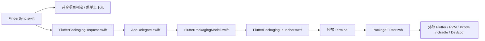
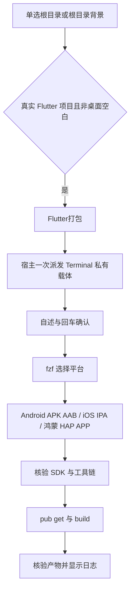
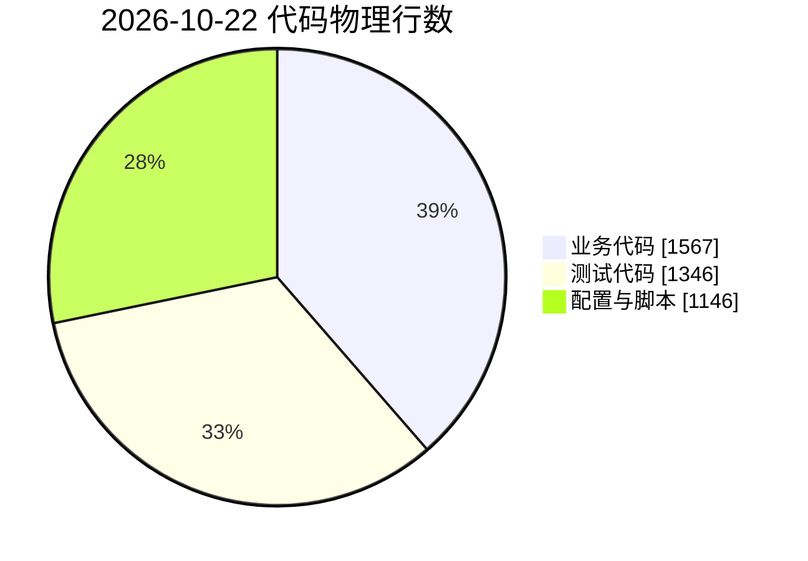

# JobsFlutterPackager · Flutter打包


<!-- jobs-toc:start -->
<!-- jobs-toc:source {"v":2,"token":"[toc]"} -->
<details>
<summary>📚 目录（点击展开 / 收起）</summary>

- [🔥 前言](#%E5%89%8D%E8%A8%80)
- [一、行为速览](#jobs-toc-heading-2)
- [二、安装与卸载](#jobs-toc-heading-3)
- [三、运行与日志](#jobs-toc-heading-4)
- [四、目录与调用边界](#jobs-toc-heading-5)
- [五、验证与维护基线](#jobs-toc-heading-6)

</details>
<!-- jobs-toc:end -->

---

## 🔥 <span id="前言">前言</span>

> Jobs 维护的独立 [**macOS**](https://www.apple.com/macos/) [**Finder**](https://support.apple.com/guide/mac-help/welcome/mac) 扩展。仅在真实 [**Flutter**](https://flutter.dev/) 项目根文件夹或该目录背景显示一个“Flutter打包”菜单，点击后在 [**Terminal**](https://support.apple.com/guide/terminal/welcome/mac) 用 [**fzf**](https://github.com/junegunn/fzf) 选择 [**iOS**](https://developer.apple.com/ios/) / [**Android**](https://developer.android.com/) / [**HarmonyOS**](https://developer.huawei.com/consumer/cn/harmonyos/)（鸿蒙）。

## <span id="jobs-toc-heading-2" data-jobs-toc="v2">一、行为速览 <a href="#前言" style="font-size:17px; color:green;"><b>🔼</b></a> <a href="#🔚" style="font-size:17px; color:green;"><b>🔽</b></a></span><!-- jobs-toc:heading-end -->

| 项目 | 实际行为 |
| --- | --- |
| 菜单 | 单项 `Flutter打包`；Android / iOS / 鸿蒙平台在终端选择 |
| 可见目标 | 单选普通项目文件夹或项目根目录背景；当前层 `pubspec.yaml` 声明 `dependencies.flutter.sdk: flutter` |
| 隐藏目标 | 多选、普通文件、普通 Dart 项目、仅 `flutter_test`、链接文件夹或链接清单、父目录、`ios/` / `android/` / `ohos/` 平台子目录、桌面空白 |
| Android | fzf 再选 APK、AAB 或两者；默认 `release`，按模式 / flavor 核验非空产物，可复用 [**Gradle**](https://gradle.org/) 缓存 |
| iOS | `flutter build ipa`；需要完整 Xcode、项目签名和导出配置，只将此次新导出的 IPA 视为成功 |
| 鸿蒙 | fzf 再选 HAP、APP 或两者；使用鸿蒙适配 SDK 的 `flutter build hap` / `flutter build app`，要求已有 `ohos/` 工程及 DevEco 工具链 |
| SDK | 优先项目 `.fvm/flutter_sdk`；固定 [**FVM**](https://fvm.app/) 不静默切全局 SDK。鸿蒙允许显式指定适配 SDK，固定本地 SDK 缺失时停止 |
| 工程影响 | 运行 `flutter pub get`，随后构建并写入项目 `build/`；不主动 clean，不安装或升级工具 |
| 取消与失败 | 运行自述后回车继续；fzf 中 Esc / Ctrl+C 取消。缺依赖、构建失败或无匹配产物均停止并记录 |

功能源码位于本目录，安装后全部业务脚本随 App 打包；不依赖原 [**Sourcetree**](https://www.sourcetreeapp.com/) 脚本路径。原 Android / iOS 脚本继续保留。

鸿蒙入口同样只接受当前层 Flutter 根目录。项目尚无 `ohos/` 时仍可选择其它平台，选择鸿蒙会在依赖解析前明确停止；纯 ArkTS / ArkUI 工程不显示此 Flutter 菜单。HAP 为安装模块，APP 为发布包，详见[华为包型说明](https://developer.huawei.com/consumer/cn/doc/doccenter-getting-started/application-package-glossary)。普通 Android / iOS Flutter SDK 不能代替[鸿蒙适配 SDK](https://gitcode.com/CPF-Flutter/flutter_flutter)。

## <span id="jobs-toc-heading-3" data-jobs-toc="v2">二、安装与卸载 <a href="#前言" style="font-size:17px; color:green;"><b>🔼</b></a> <a href="#🔚" style="font-size:17px; color:green;"><b>🔽</b></a></span><!-- jobs-toc:heading-end -->

运行 [安装入口](./【MacOS】安装Flutter打包Finder扩展.command)，阅读自述后直接回车安装；任意非空输入（包括空格）跳过，EOF 停止。入口验证完整 [**Xcode**](https://developer.apple.com/xcode) 与 macOS SDK，只构建本工程，校验两个 Bundle ID、签名和脚本资源，再注册当前 App 与扩展。它会注销同 ID 的旧路径登记但保留旧 App 文件，最后初始化宿主并刷新 Finder。

- 宿主 ID：`com.jobs.JobsFlutterPackager`。
- 扩展 ID：`com.jobs.JobsFlutterPackager.findersync`。
- 构建产物：`./work/DerivedData/Build/Products/Debug/JobsFlutterPackager.app`。系统依赖该路径启动扩展，安装后保留。
- URL：`jobsflutterpackager://package/run?project=<URL编码的绝对路径>`，只接受唯一 `project` 参数。
- 首次操作按系统提示允许宿主控制 Terminal；菜单未出现时到系统设置的 Finder 扩展中检查启用状态。

运行 [卸载入口](./【MacOS】卸载Flutter打包Finder扩展.command)，先回车查看路径，再精确输入 `YES` 才卸载。只注销本扩展及已核验宿主，删除其 App 构建产物并刷新 Finder；保留源码、Flutter SDK、项目和已生成的 IPA / APK / AAB。卸载不终止已经在终端开始的 Flutter 构建。

安装前不需要 Flutter / fzf。使用打包菜单时必须有健康 fzf；缺少时显示 `brew install fzf` 并停止，不自动安装。Android 要求 JDK 17 和项目现有 Android / Gradle 环境；iOS 项目含 Podfile 时要求已有 [**CocoaPods**](https://cocoapods.org/)。

鸿蒙要求工程已有 `ohos/build-profile.json5`、`ohos/oh-package.json5`，并准备可用 Node.js / npm、ohpm、Hvigor（`hvigorw`）、Java 和 HarmonyOS SDK。SDK 根目录通过 `DEVECO_SDK_HOME` 指定，兼容 `HOS_SDK_HOME`；可用 `DEVECO_STUDIO_HOME` / `TOOL_HOME` 指定 DevEco 应用或命令行工具。未指定时仅自动采用唯一已安装的 DevEco，多个版本要求明确选择。所有工具都执行健康检查，再核对每个所选包型的 CLI 能力；不安装升级、不改签名、不创建平台目录。

`OHOS_SDK_HOME` 与 `DEVECO_SDK_HOME` 的 SDK 结构不同，不无条件互设。现有 Flutter 的 `ohos-sdk` 配置可能优先于环境变量，实际构建以 SDK 配置与日志为准。Java 沿用既有配置或 DevEco JBR；profile 模式要求工程已有相应 `buildModeSet`。环境路径细节见[鸿蒙适配项目环境指导](https://gitcode.com/CPF-Flutter/flutter_samples/blob/master/ohos/docs/03_environment/OpenHarmony-flutter环境搭建指导.md)。

## <span id="jobs-toc-heading-4" data-jobs-toc="v2">三、运行与日志 <a href="#前言" style="font-size:17px; color:green;"><b>🔼</b></a> <a href="#🔚" style="font-size:17px; color:green;"><b>🔽</b></a></span><!-- jobs-toc:heading-end -->

右键入口不询问项目路径。也可以直接执行业务脚本：

```shell
/bin/zsh ./Scripts/PackageFlutter.zsh \
  --project /path/to/flutter-app \
  --mode release \
  --flavor production \
  --target apk
```

`--mode` 支持 `release` / `debug` / `profile`；`--target` 为 Android 产物预设，支持 `apk` / `appbundle` / `all`，平台仍由 fzf 选择。也支持 `BUILD_MODE`、`FLAVOR`、`BUILD_TARGET`，`OPEN_AFTER_BUILD=0` 关闭成功后打开产物目录。iOS IPA 流程依赖项目实际支持的模式与签名，失败保留 Flutter 原始诊断。

鸿蒙可用 `--ohos-target hap|app|all` / `OHOS_BUILD_TARGET` 预设产物，省略时由 fzf 选择、首项为 HAP。`--flutter-sdk` / `FLUTTER_OHOS_SDK` 仅指定鸿蒙适配 SDK 根目录，优先于本地 FVM 和 PATH。工程声明 FVM 而本地 SDK 不可用时，鸿蒙分支停止且不隐式下载。鸿蒙使用工程默认 product / target，传入非空 `--flavor` / `FLAVOR` 时停止，避免部分 SDK 对未知 flavor 静默回退 default。

```shell
/bin/zsh ./Scripts/PackageFlutter.zsh \
  --project /path/to/flutter-app \
  --flutter-sdk /path/to/flutter-ohos \
  --ohos-target all \
  --mode release
```

```shell
/bin/zsh ./Scripts/PackageFlutter.zsh \
  --check \
  --project /path/to/flutter-app

/bin/zsh ./Scripts/PackageFlutter.zsh --help
```

`--check` 仅验证参数与项目身份，不运行 Flutter、不创建业务日志、不等待输入。`--help` 仅显示帮助。

| 日志 / 产物 | 位置 |
| --- | --- |
| 安装诊断 | 系统临时目录的 `JobsFlutterPackagerInstall.log` |
| 构建后注册 | 系统临时目录的 `JobsFlutterPackagerBuildPhase.log` |
| 宿主派发 | 系统临时目录的 `JobsFlutterPackager.log` |
| 每次业务运行 | 系统临时目录的 `JobsFlutterPackager.*/PackageFlutter.log`，终端显示实际位置 |
| 卸载诊断 | 系统临时目录的 `【MacOS】卸载Flutter打包Finder扩展.log` |
| Android | 项目 `build/app/outputs/flutter-apk/` 或 `build/app/outputs/bundle/` |
| iOS | 项目 `build/ios/ipa/`；仅归档未导出 IPA 会报告失败 |
| 鸿蒙 | 项目 `build/ohos/` 汇总目录，或 `ohos/build/`、`ohos/entry/build/` 等模块的 `outputs/` 目录 |

业务需要解析依赖、下载缺失依赖和构建。没有离线演示或假包回退；失败不把旧 IPA 当作成功，不执行 `flutter clean`、全局环境修改、Git 提交或推送。

鸿蒙核对非空 HAP / APP，允许构建命令成功后复用现有增量产物并提示核对模式和签名；`-unsigned` 包会明确警告。生成包不代表真机安装、签名校验或应用市场审核通过。工具路径仅作用于当前终端进程及子进程。

## <span id="jobs-toc-heading-5" data-jobs-toc="v2">四、目录与调用边界 <a href="#前言" style="font-size:17px; color:green;"><b>🔼</b></a> <a href="#🔚" style="font-size:17px; color:green;"><b>🔽</b></a></span><!-- jobs-toc:heading-end -->

```text
./
├── JobsFlutterPackager.xcodeproj/
├── JobsFlutterPackager/                 # 后台宿主、Terminal 启动、扩展状态与日志
├── JobsFlutterPackagerFinderSync/       # 单项菜单、点击时重验上下文
├── JobsFlutterPackagingShared/          # 项目判定、URL、桌面策略、系统创建工厂
├── Scripts/                            # 自包含打包脚本与构建后启用，见就近 README
├── Tests/                              # 隔离行为回归，不运行真实 Flutter 构建
├── 【MacOS】安装Flutter打包Finder扩展.command
└── 【MacOS】卸载Flutter打包Finder扩展.command
```





路径由 URLComponents 传输；Terminal 仅接收物理单行启动命令。每次载体目录权限为 `0700`、脚本为 `0600`，项目路径作为独立参数，退出只清理本次私有载体。宿主在同次运行中只接受首个合法打包请求，避免双 URL 回调重复弹出终端；后台派发完成后退出。

## <span id="jobs-toc-heading-6" data-jobs-toc="v2">五、验证与维护基线 <a href="#前言" style="font-size:17px; color:green;"><b>🔼</b></a> <a href="#🔚" style="font-size:17px; color:green;"><b>🔽</b></a></span><!-- jobs-toc:heading-end -->

记录日期：2026-10-22。工程使用 Swift 5 语言模式，最低 macOS 12.0；宿主与 Finder 扩展两个 target，均为本仓 Jobs 自有源码。没有 CocoaPods、Swift Package 或其它直接链接的第三方依赖，也没有独立锁文件。Flutter / fzf / FVM / Xcode / Gradle / DevEco / ohpm / Hvigor 是用户环境工具，版本由目标机器及业务项目管理。

本目录是父仓普通功能目录，没有独立 Git 历史或子模块；提交历史遵循 `../` 所在 macOS 扩展仓。它没有前端页面、网络接口、服务端、数据库或定时任务；系统交互为 Finder、Terminal、LaunchServices 和 PlugInKit，日志保存在系统临时目录，未采集遥测、证书或凭据。

代码规模按 2026-10-22 本目录实际文件的物理行数（含注释 / 空行）统计；业务包含生产 Swift 与 `PackageFlutter.zsh`，测试包含 `Tests/` 的 Swift / Ruby，配置与脚本包含安装 / 卸载、启用脚本及 Xcode 工程 / scheme / plist / entitlements。排除文档、图片和构建产物；占比的分母是下表三类行数之和。

| 类别 | 文件数 | 行数 | 行数占比 |
| --- | --- | --- | --- |
| 业务代码 | 10 | 1,567 | 38.6% |
| 测试代码 | 4 | 1,346 | 33.2% |
| 配置与脚本 | 9 | 1,146 | 28.2% |
| 第三方依赖（排除） | 0 | 0 | — |



隔离回归覆盖 Flutter 判定、链接拒绝、单选 / 背景 / 桌面过滤、特殊路径 URL 往返、Terminal 私有载体权限 / 清理 / 退出码，以及独立安装的旧副本注销、失败停止与交互门禁。运行原生行为测试时编译共享源码、终端启动器和 `./Tests/FlutterProjectBehaviorTests.swift`；安装器测试为：

```shell
ruby ./Tests/InstallerRegistrationTests.rb
```

打包业务假工具链回归为 55 项 / 507 断言，覆盖 Android / iOS 原流程和鸿蒙 HAP / APP / all、普通 SDK 拒绝、DevEco 健康检查、FVM / 显式 SDK 优先级、取消、失败退出码、空包、两类输出目录与增量产物提示；共享菜单边界回归 58 断言、AppDelegate 单次派发回归 5 断言通过。使用私有假工具与临时项目，没有运行真实 Flutter / Hvigor 构建、注册扩展或安装工具。

```shell
ruby ./Tests/PackagingShellTests.rb
```

隔离构建时设置 `JOBS_SKIP_FINDER_EXTENSION_BUILD_PHASE=1`，使用系统临时目录的独立 DerivedData，阻止本工程自定义阶段启用扩展或重启 Finder。本机 Xcode 27.1 仍会自动执行 LaunchServices 登记，`REGISTER_APP_WITH_LAUNCH_SERVICES=NO` 和 `LS_REGISTER_URL=NO` 不能阻止它；验证结束后须只注销本次临时 App 的精确路径，并确认其 PlugInKit 记录已移除。构建与资源验证不能替代真实安装、Finder 菜单、Terminal 自动化权限或真实签名打包验收。

<a id="🔚" href="#前言" style="font-size:17px; color:green; font-weight:bold;">我是有底线的➤点我回到首页</a>
