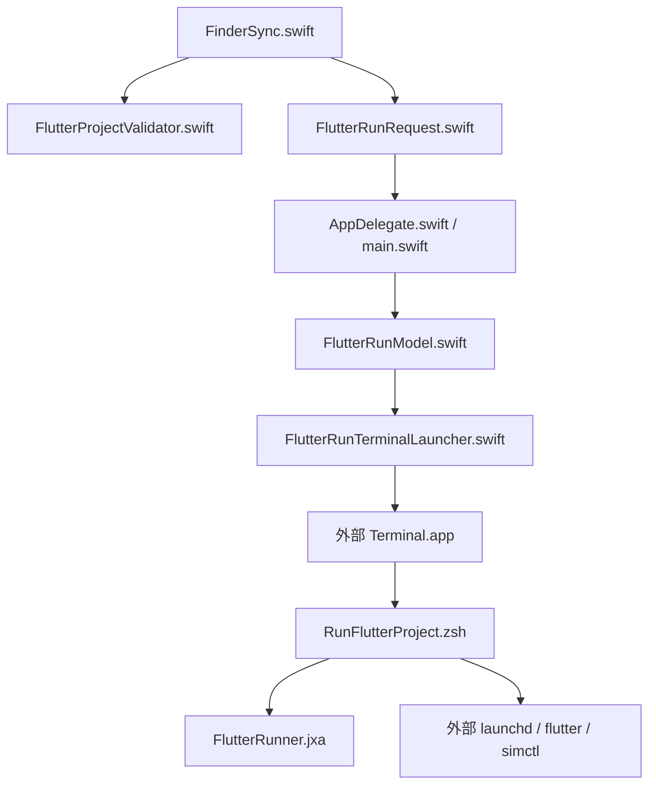
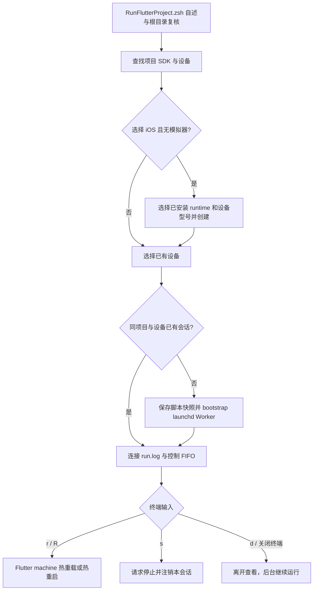
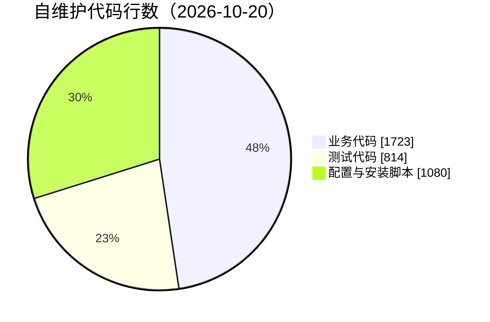

# JobsFlutterRunner：右键运行 [**Flutter**](https://flutter.dev/) 项目


<!-- jobs-toc:start -->
<!-- jobs-toc:source {"v":2,"token":"[toc]"} -->
<details>
<summary>📚 目录（点击展开 / 收起）</summary>

- [🔥 前言](#%E5%89%8D%E8%A8%80)
- [一、安装与卸载](#install)
  - [【MacOS】安装Flutter运行Finder扩展.command](#jobs-toc-heading-3)
  - [【MacOS】卸载Flutter运行Finder扩展.command](#jobs-toc-heading-4)
- [二、运行与环境](#use)
- [三、后台、日志与停止](#lifecycle)
- [四、目录与实现边界](#structure)
- [五、构建、验证与排查](#verify)
- [六、工程口径与依赖](#metrics)

</details>
<!-- jobs-toc:end -->

---

## 🔥 <span id="前言">前言</span>

**菜单范围：桌面空白处不显示本功能；文件夹与项目菜单仍按下文条件显示。桌面上选中的项目文件夹不受此空白菜单规则影响。**

面向 Jobs 与 macOS 开发人员的独立 Finder 扩展：仅在 Flutter 项目根目录显示“运行 Flutter 项目”，设备选择、构建日志和控制操作都在 Terminal 中完成。状态：维护中；负责人：Jobs。关闭 Terminal 只离开日志，Flutter 由当前登录用户会话的 launchd 继续托管。

| 项目 | 实际行为 |
| --- | --- |
| 菜单条件 | 精确目录自身的 `pubspec.yaml` 声明 `dependencies.flutter.sdk: flutter`；普通目录才接受，不递归查找，也不把 `flutter_test` 当作项目依据。 |
| 设备 | 枚举 `flutter devices --machine`，按项目已有平台目录过滤可运行目标，在终端用 fzf 上下键选择并可直接输入关键字筛选；未安装 fzf 或非终端时回退编号输入。支持重新加载、iOS 模拟器及 Android AVD 入口。 |
| fzf 选择 | 终端内所有列表（设备、模拟器型号、iOS 系统版本、Android AVD）统一走 fzf：`↑/↓` 移动、输入即筛选、回车确认、`Esc` 取消。环境变量 `JOBS_FLUTTER_RUNNER_FZF=0` 可强制关闭并回到编号输入。 |
| iOS 模拟器缺失 | 内置查询设备型号与已安装 iOS runtime、选择、创建、启动和等待就绪流程；型号按有无可搭配系统优先推荐，选定型号后只列匹配该型号的系统；创建结果不明确时不自动重试，明确不兼容需输入 `r` 才重选；缺 runtime 时提示在 Xcode Settings → Components（旧版 Platforms）安装。新模拟器命名与[独立初始化脚本](<../../../JobsCommand@iOS/其他/【MacOS】📱双击初始化iOS模拟器.command/README.md>)一致：`型号名@年.月.日 时:分:秒-进程号`，重名追加 ` (2)`。模拟器界面按当前 Xcode 定位：Xcode 27 为 `Contents/Applications/DeviceHub.app`，旧版为 `Contents/Developer/Applications/Simulator.app`；界面打不开只提示，不终止运行。新建模拟器后等设备进入 Flutter 列表：新 FVM 版本首次冷启动较慢，读取超时依次为 120 / 60 / 30 / 30 秒，共 4 次后才判定未识别。 |
| Android 模拟器 | 项目含 `android/` 时可列出 Android SDK 已配置的 AVD，选择后交给独立 launchd job 启动；不创建 AVD，启动后返回设备列表。 |
| 终端与后台 | `launchd` 管理独立 `flutter run --machine`；终端实时追踪会话 `run.log`。关闭窗口、Ctrl+C 或 `d` 只断开查看；`s` 明确停止。 |
| 继续查看 | 再次右键同一项目，选择同一设备，连接已有会话；不重复启动同一项目和设备。 |
| SDK | 优先使用项目 `.fvm/flutter_sdk/bin/flutter`；缺失或断链时读取 `.fvmrc` / `.fvm/fvm_config.json` 声明的版本并用本机 fvm 补齐——本机缓存已有该版本只重建链接、不下载，缓存没有才确认后下载；其次终端 PATH 中的 Flutter。不安装或升级全局 Flutter / Xcode。 |

本目录是 [MacOS@Extension](../README.md) 单仓管理的普通源码工程，可整体复制并独立构建、安装和卸载；没有独立 `.git` 或 `.gitmodules`。父仓实际关联及两平台地址见[父仓速览](../README.md#前言)，不为本工程创建已撤销的独立远端。

## 一、<span id="install">安装与卸载</span> <a href="#前言" style="font-size:17px; color:green;"><b>🔼</b></a> <a href="#🔚" style="font-size:17px; color:green;"><b>🔽</b></a>

两个入口都是工程根目录下裸露的双击脚本，独立于总仓安装器；本工程可单独拷走安装，不依赖其它工程源码。

### <span id="jobs-toc-heading-3" data-jobs-toc="v2">[【MacOS】安装Flutter运行Finder扩展.command](./【MacOS】安装Flutter运行Finder扩展.command)</span><!-- jobs-toc:heading-end -->

> **目的：** 独立构建、注册并启用本工程的“运行 Flutter 项目”Finder 扩展。

- 先决条件是完整 [**Xcode**](https://developer.apple.com/xcode/)：脚本体检 `xcodebuild`、macOS SDK、`pluginkit` 等系统命令与工具链健康，缺失时明确停止；也可使用父仓安装面板勾选“运行 Flutter 项目”。
- 直接回车安装，输入任意字符（包括空格）后回车跳过；安装器会构建、启用本扩展并重启 Finder，确认前显示影响范围。
- 构建产物固定在 `./work/DerivedData/Build/Products/Debug/`。安装过程不运行目标 Flutter 项目、不安装 SDK；日志为系统临时目录中的 `JobsFlutterRunnerInstall.log`。

### <span id="jobs-toc-heading-4" data-jobs-toc="v2">[【MacOS】卸载Flutter运行Finder扩展.command](./【MacOS】卸载Flutter运行Finder扩展.command)</span><!-- jobs-toc:heading-end -->

> **目的：** 停用、注销本功能的 Finder 菜单，并移除已登记的自有 App 构建产物。

- 阅读内置自述并回车，先展示真实注册路径，输入 `YES` 才移除经 Bundle ID 核验的 App 并刷新 Finder。
- 只移除菜单与宿主，不停止已经独立运行的 Flutter 会话；卸载前先按[第三章](#lifecycle)方式输入 `s` 停止。
- 保留工程源码、会话日志与用户数据。日志为系统临时目录中的 `【MacOS】卸载Flutter运行Finder扩展.log`。

## 二、<span id="use">运行与环境</span> <a href="#前言" style="font-size:17px; color:green;"><b>🔼</b></a> <a href="#🔚" style="font-size:17px; color:green;"><b>🔽</b></a>

需要 macOS 12.0 及以上、完整 [**Xcode**](https://developer.apple.com/xcode/)、可用 Flutter SDK，以及目标设备对应的平台工具。iOS 使用当前 Xcode 的 `xcrun simctl`；不会自动运行 `brew install`、安装 Xcode runtime 或修改 `xcode-select`。Android 设备需已通过 Flutter 自身的工具链检查；AVD 需预先在 Android Studio Device Manager 中配置。

1、在 Finder 右键单个真实 Flutter 项目文件夹，或进入该项目后右键空白处，点击“运行 Flutter 项目”。宿主为 `LSUIElement` 后台进程，不创建管理窗口或 Dock 图标；Terminal 转发完成后退出。

2、在终端阅读自述后回车继续，非空输入取消；用 `↑/↓` 选择实际设备，回车确认，`Esc` 取消（未安装 fzf 时回退为输入编号）。设备按项目已有的 `ios/`、`android/`、`macos/`、`web/` 等平台目录过滤。设备列表为空时可重新加载；有 `ios/` 才提供 iOS 模拟器入口，有 `android/` 才提供已有 Android AVD 启动入口。iOS 缺 runtime 时按明确提示先在 Xcode 安装，再重新加载。

3、查看实时日志。输入 `r` 热重载、`R` 热重启、`s` 停止、`d` 离开；构建阶段尚无 Flutter appId 时，热重载会提示稍后重试。终端关闭不作为停止信号。

也可在本目录直接运行源码脚本，必须与 `FlutterRunner.jxa` 保持同目录：

```shell
/bin/zsh -l ./Scripts/RunFlutterProject.zsh \
  --project '/实际 Flutter 项目根目录'
```

离线运行需要目标依赖和平台工具已在本机准备完整，是否足够由 Flutter 判断；脚本保留失败日志供排查。

## 三、<span id="lifecycle">后台、日志与停止</span> <a href="#前言" style="font-size:17px; color:green;"><b>🔼</b></a> <a href="#🔚" style="font-size:17px; color:green;"><b>🔽</b></a>

每个项目路径与设备 ID 生成独立会话，数据位于当前用户资源库的 `Application Support/JobsFlutterRunner/sessions/`。会话保存两份脚本快照、`job.plist`、`run.log`、控制 FIFO 及进程退出状态。Terminal 中的路径会精确打印，可用于排查；新运行会归档旧 `run.log`，不会覆盖旧构建日志。

终端将 machine 协议转换为 `[依赖]`、`[进行]`、`[完成]`、`[警告]`、`[错误]`、`[成功]` 等中文日志。依赖版本列表与已知系统索引噪声折叠；快捷指令 / Spotlight 的 `WF*` 参数转换与缺失扩展诊断合并为一条 `[提示]`，不再仅因含 `Failed` 就标成 Flutter 错误。停维依赖名称、SPM 不兼容插件名、应用输出、错误堆栈、非零索引错误计数与未知事件保留；machine 协议中的应用错误不会被系统诊断规则折叠。仅收到 `app.started` 才显示“应用已启动”；提交后台任务或开始编译均不表示启动成功。原始 `run.log` 不做过滤，热重载 / 停止仍读取完整协议。重新连接会重放本次会话日志，便于查看完整构建过程；输入控制命令后回车，不再让提示符与异步日志挤在同一行。

真实运行回归还发现并修复了 macOS Dart 对读写模式 FIFO 不响应的问题：保活 fd 仍用读写模式，Flutter stdin 改为单独只读打开。真实 Flutter 已返回热重载成功（code 0），不再只依靠假 Flutter 进程验收控制通道。

日志回归：`ruby Tests/FlutterRunnerLogTests.rb`，覆盖成功与警告分级、失败堆栈、未知 / 损坏协议、SPM 插件名、分段 UTF-8、末尾半行及非零退出码。Shell 测试在临时工作目录运行，夹具不写入源码目录。

`launchctl bootstrap gui/<当前 UID>` 将 Worker 交给当前桌面登录会话托管，不依赖 Finder 宿主或 Terminal 的进程生命周期。它支持关闭终端后继续运行；注销、关机、Flutter 自身退出或明确停止仍会结束进程，不是开机自启或崩溃自动重启服务。再次启动同一项目与设备时重新连接。

| 日志 | 位置 / 内容 |
| --- | --- |
| `JobsFlutterRunner.log` | 系统临时目录；后台宿主启动、请求接收、Terminal 转发与退出诊断。 |
| `JobsFlutterRunner.XXXXXX` | 系统临时目录；终端操作、设备发现与 launchd 诊断，首屏显示本次文件名。 |
| `run.log` | 用户资源库会话目录；Flutter 构建与运行的完整 machine 日志。 |
| `JobsFlutterRunnerInstall.log` / `JobsFlutterRunnerBuildPhase.log` | 系统临时目录；安装或 Xcode 构建时的扩展注册诊断。 |

停止时再次右键并选择相同设备，输入 `s`，脚本先请求 Flutter 停止，再注销该会话 job，保留日志。卸载 Finder 扩展只移除菜单与宿主，不停止已经独立运行的 Flutter 会话；卸载前可先按上述方式停止，卸载入口见[第一章](#install)。

## 四、<span id="structure">目录与实现边界</span> <a href="#前言" style="font-size:17px; color:green;"><b>🔼</b></a> <a href="#🔚" style="font-size:17px; color:green;"><b>🔽</b></a>

```text
./
├── JobsFlutterRunner.xcodeproj/                 # 两个原生 target 与共享 Scheme
├── JobsFlutterRunner/                          # 无窗口后台宿主与 Terminal 载体
├── JobsFlutterRunFinderSync/                    # 菜单可见性与点击时重新验证
├── JobsFlutterRunShared/                        # 精确项目识别与 URL 数据协议
├── Scripts/                                    # 运行、JSON 与构建后启用脚本
├── Tests/FlutterRunTransportTests.swift         # 特殊路径、权限与清理隔离检查
├── Tests/FlutterRunnerShellTests.rb             # 运行 / 后台生命周期隔离检查
├── Tests/FlutterRunnerJSONTests.rb              # JSON、YAML、设备与 plist 参数检查
├── Tests/FlutterRunLaunchdSmoke.rb              # 真 launchd + 假 Flutter 的断连存活检查
├── 【MacOS】安装Flutter运行Finder扩展.command      # 独立安装入口（裸露双击脚本）
└── 【MacOS】卸载Flutter运行Finder扩展.command      # 精确卸载入口（裸露双击脚本）
```

Finder 在显示菜单和点击时分别检查项目，避免菜单打开后切换路径误执行。URL scheme 为 `jobsflutterrunner://run`，路径只作为数据参数；重复、畸形及含 NUL 的 URL 拒绝。终端请求载体使用私有目录与权限，路径中的空格、引号、反斜线、控制符均按数据转义；后台启动前再保存会话脚本，载体清理不影响 Worker。

App Bundle 的业务资源恰为 `RunFlutterProject.zsh` 与 `FlutterRunner.jxa`。`EnableFinderExtension.zsh` 只在 Xcode Build Phase 使用，不是业务资源；隔离构建用 `JOBS_SKIP_FINDER_EXTENSION_BUILD_PHASE=1` 跳过项目自定义启用阶段。





## 五、<span id="verify">构建、验证与排查</span> <a href="#前言" style="font-size:17px; color:green;"><b>🔼</b></a> <a href="#🔚" style="font-size:17px; color:green;"><b>🔽</b></a>

仅构建本工程并跳过自定义扩展启用阶段（构建产物在本目录 `work/`，不会运行目标 Flutter 项目）：

```shell
JOBS_SKIP_FINDER_EXTENSION_BUILD_PHASE=1 xcodebuild \
  -project ./JobsFlutterRunner.xcodeproj \
  -scheme JobsFlutterRunner \
  -configuration Debug \
  -destination "platform=macOS,arch=$(uname -m)" \
  -derivedDataPath ./work/DerivedData \
  build
```

Xcode 自带的 `RegisterWithLaunchServices` 仍会登记构建 App 及发现其中的 appex；这与主动 `pluginkit -e use` 启用、打开宿主和重启 Finder 是不同步骤。隔离验证完成后，需按本次构建的精确路径注销临时登记；不对已正式安装的产物执行此清理。自动阶段实现见 [Swift 官方构建源码](https://github.com/swiftlang/swift-build/blob/main/Sources/SWBTaskConstruction/TaskProducers/OtherTaskProducers/ProductPostprocessingTaskProducer.swift)。

原生路径与请求隔离验证：

```shell
xcrun swiftc \
  ./JobsFlutterRunShared/FlutterProjectValidator/FlutterProjectValidator.swift \
  ./JobsFlutterRunShared/FlutterRunRequest/FlutterRunRequest.swift \
  ./JobsFlutterRunner/FlutterRunTerminalLauncher/FlutterRunTerminalLauncher.swift \
  ./Tests/FlutterRunTransportTests.swift \
  -o ./work/FlutterRunTransportTests
./work/FlutterRunTransportTests
ruby ./Tests/FlutterRunnerShellTests.rb
ruby ./Tests/FlutterRunnerJSONTests.rb
ruby ./Tests/FlutterRunnerLogTests.rb
ruby ../Tests/FlutterInstallerIntegrationTests.rb
```

用真实 launchd 和临时假 Flutter 验证终端退出、HUP 后存活、日志增长、重连、热重载与停止；仅创建并清理临时会话，不触碰用户项目或 Finder：

```shell
ruby ./Tests/FlutterRunLaunchdSmoke.rb
```

| 现象 | 处理 |
| --- | --- |
| 普通目录没有菜单 | 正常门禁；选择项目根目录，核对根 `dependencies.flutter.sdk: flutter`，不选择目录快捷方式。 |
| 菜单点击无 Terminal | 检查系统“隐私与安全性 → 自动化”中宿主控制 Terminal 的授权，并检查宿主日志；重新安装完整 App 可修复 URL 注册。 |
| 没有可用设备 | 在终端重新加载，核对项目平台目录；iOS 可进入内置初始化；Android 可选择已配置 AVD，列表为空时先在 Android Studio 配置，或连接已授权真机。 |
| `simctl` 或 runtime 不可用 | 选择完整 Xcode，在 Xcode Settings → Components（旧版 Platforms）安装对应 iOS runtime 后重试；脚本不替代 Xcode 下载。 |
| `Unable to find application named 'Simulator'` | Xcode 26 / 27 已把模拟器界面改名为 `DeviceHub.app` 并移到 `Xcode.app/Contents/Applications`。本脚本按 `xcrun --find simctl` 反推 Xcode 目录定位该应用，不再依赖 LaunchServices 里的 `Simulator` 名称；需在旧 Xcode 上复现时，请确认 `Contents/Developer/Applications/Simulator.app` 仍在。 |
| 模拟器已启动但界面没弹出 | 设备已 boot 并确认就绪，界面打开失败只记日志、不影响 Flutter 运行；可在 Xcode → Devices and Simulators 手动打开，或按日志里的 UDID 自行 `xcrun simctl boot`。 |
| 项目声明了 FVM 但 SDK 未就绪 | 常见于换机：`.fvm/flutter_sdk` 仍指向旧机器路径（如 `/Users/<旧用户名>/fvm/versions/x`）而成为断链。脚本读 `.fvmrc` / `.fvm/fvm_config.json` 的版本声明，回车后自动补齐——本机 FVM 缓存已有该版本就只重建链接（秒级、不下载），没有才 `fvm install` 下载；找不到 fvm 命令时提示安装。 |
| `fvm use` 后仍没有 `.fvm/flutter_sdk` | fvm 在声明版本已一致时可能只写配置、不重建链接；脚本会按本机缓存兜底重建链接，无需手动处理。 |
| 新建模拟器后卡在"正在读取 Flutter 设备列表" | 新装 FVM 版本的首次 `flutter devices` 要重建 flutter_tools，常超过 30 秒。本脚本在新建模拟器后的读取按 120 / 60 / 30 / 30 秒共重试 4 次，失败时会把 Flutter 最近 5 行输出写入日志；多次超时仍失败时先手动跑一次 `flutter doctor` 完成初始化。 |
| 构建失败 | 查看 `run.log`，按 Flutter 报错修复目标依赖、签名或 SDK；脚本不会把已提交后台任务等同于启动成功。 |
| `Failed to index parameter type` / `Failed to check availability in Spotlight` | 若主体为 `WF*`、`ActionKit`、`is.workflow.actions.*`，属于 macOS 快捷指令索引诊断。运行器折叠为一条系统提示，完整内容仍在 `run.log`；索引末尾 `Errored: 0` 只表示该索引过程的结果，不代表 Flutter 已构建成功。 |
| 长时间停在 `Fetching from …SwiftyGif.git` 等依赖地址 | Flutter 正在等待 Xcode 的 Swift Package Manager 取包。Flutter 3.44 起默认启用并自动迁移，首次运行会下载插件的原生依赖，见[官方说明](https://docs.flutter.dev/packages-and-plugins/swift-package-manager/for-app-developers)。检查该会话的 Flutter、`xcodebuild -resolvePackageDependencies` 与 Git 子进程及后续日志；有存活进程且无最终退出码时，不能凭系统索引消息判定构建失败。 |
| `Target Integrity`：部署目标低于 15.0 | 新版 Xcode 要求 iOS 部署目标至少 15.0。项目 `Runner` 侧会由 Flutter 自动升级，但 `ios/Podfile` 的 `post_install` 里若显式写了 `IPHONEOS_DEPLOYMENT_TARGET = '13.0'`，生成的 `Pods.xcodeproj` 仍会是 13.0 并导致构建失败。把该值改为 `'15.0'`，再 `cd ios && pod install` 重新生成 Pods 即可；`pod install` 关于 base configuration 的提示在 Flutter 项目中通常可忽略。 |
| 卸载 | 使用[独立卸载脚本](#jobs-toc-heading-4)，先展示路径，输入 `YES` 才移除经 Bundle ID 核验的 App 并刷新 Finder。 |

验证日期：2026-10-21。Debug 原生构建、App / appex 深度签名、两份业务资源逐字节核对、路径 / URL / 私有载体检查通过；父安装映射 19 项 / 108 断言，运行 Shell 39 项 / 192 断言，JSON helper 28 项 / 323 断言均通过。真实 launchd 配合假 Flutter 的入口退出、HUP 存活、日志增长、崩溃后重新运行、重连、热重载与停止通过；该冒烟测试需要当前桌面登录会话的 `launchctl bootstrap gui/<UID>` 权限，非 GUI 上下文会按设计提示失败。隔离构建自动产生的临时 LaunchServices / PlugInKit 登记已精确注销，该隔离测试阶段未启用此扩展或打开宿主，也不安装 SDK 或触碰用户项目。安装后的真实应用运行补验见下段；Finder 菜单实际点击及新建模拟器未做本轮自动化验收。

内置模拟器初始化修复记录（2026-10-21）：来源为用户新电脑反馈"没有 iOS 模拟器时，机型 / 系统选择被询问两次"。根因是创建失败后直接退回设备列表，用户再次选择 iOS 入口便进入第二轮询问。现行实现把型号与系统分别列出，型号按本机有无可搭配系统优先推荐，选定型号后只列匹配该型号的系统；创建结果不明确（超时 / 权限 / 其它错误）时不自动重试，只有 Xcode 明确写出 `Incompatible device` 且用户输入 `r` 才重新选择。策略与 `JobsIOSSimulatorCreator` 平行核心保持一致。

FVM SDK 自动补齐（2026-10-21）：来源为用户换机后右键运行报"项目声明了 FVM，但本地 `.fvm/flutter_sdk` 尚未就绪"，实际是该链接仍指向旧机器路径（`/Users/jobs/fvm/versions/3.47.7`）而成为断链，本机 FVM 缓存里已经有 3.47.7。现行实现读 `.fvmrc` / `.fvm/fvm_config.json` 的声明版本，回车确认后用本机 fvm 补齐：缓存命中只重建链接不下载，缓存缺失才 `fvm install`；`fvm use` 只写配置不建链接时按本机缓存兜底重建；始终校验 `.fvm/flutter_sdk/bin/flutter` 可执行。找不到 fvm 命令时给出安装提示，不自动安装 Homebrew 或 fvm，也不改动全局 Flutter。

新建模拟器后设备识别等待修复（2026-10-21）：来源为用户新电脑（Xcode 27.1 + FVM 3.35.3）右键运行，模拟器创建、boot、就绪与 Device Hub 全部成功，但随后 `flutter devices --machine` 在 30 秒内未返回，3 次重试后判定未识别而失败。原因是新 FVM 版本首次冷启动要重建 flutter_tools，远超 30 秒。现行实现把"等待 Flutter 识别新建模拟器"抽为独立函数：读取超时依次为 120 / 60 / 30 / 30 秒共 4 次，每次失败打印 Flutter 最近 5 行输出；普通设备刷新仍是 30 秒。

模拟器界面定位修复（2026-10-21）：来源为用户新电脑（Xcode 27.1）右键运行报 `Unable to find application named 'Simulator'` 并终止。原因是 Xcode 26 / 27 已把模拟器界面改名为 `DeviceHub.app` 并移到 `Xcode.app/Contents/Applications`，不再有 `Contents/Developer/Applications/Simulator.app`，`open -a Simulator` 因此查不到应用。现行实现用 `xcrun --find simctl` 反推 Xcode 目录，依次尝试 `Simulator.app`（新旧两个位置）与 `DeviceHub.app`，命中哪个用哪个；`Simulator.app` 仍带 `-CurrentDeviceUDID`，`DeviceHub` 只打开并提示按设备名选中。设备已 boot 且就绪确认通过后，界面打开失败只提示、不再终止运行。

内置模拟器命名规则（2026-10-21）：与 [`【MacOS】📱双击初始化iOS模拟器.command`](<../../../JobsCommand@iOS/其他/【MacOS】📱双击初始化iOS模拟器.command/README.md>) 同款命名：`型号名@年.月.日 时:分:秒-进程号`，例如 `iPhone 18 Pro@2026.10.21 11:31:49-35685`；时间取创建时刻，进程号为本脚本进程，同秒重复创建也不会撞名。创建前刷新 `xcrun simctl list devices --json`，与既有设备重名时依次追加 ` (2)`、` (3)`。型号列表里的"（本机无可搭配系统）"与系统列表里的"（未确认支持）"标注只用于选择，不进入设备名。

本次日志整理补验：日志格式化 4 项 / 57 断言通过；已在当前注册的 App 路径重建并通过签名及脚本资源比对。使用该 App 内的运行脚本连接真实 iPhone 18 Pro 模拟器，收到 `app.started`，热重载与热重启均返回 code 0。上述安装前隔离验收与本次真实运行验收分别记录；未把 CLI 调用脚本等同于自动点击 Finder 菜单。

## 六、<span id="metrics">工程口径与依赖</span> <a href="#前言" style="font-size:17px; color:green;"><b>🔼</b></a> <a href="#🔚" style="font-size:17px; color:green;"><b>🔽</b></a>

统计日期 2026-10-20，按本目录的 Xcode 工程及源码核对：一个独立安装单元、一个 Finder 动作、两个原生 target；宿主 GUI 页面为零，URL 请求入口一个，不计为 HTTP / RPC API。无后端服务、数据库、MQ、外部业务系统集成或定时任务；launchd 会话 job 属于用户主动启动的本地运行任务。无独立 Git 历史，建库 / 提交 / 贡献者口径见父仓。Swift 编译模式 `5.0`，最低 macOS `12.0`；未引入 SPM、Pods 或第三方源码包，无相关锁文件。

代码规模按本目录现存自维护文本统计，排除 README、`work/`、个人 `xcuserdata` 与生成产物；测试单列。业务包含原生 Swift、运行 zsh 与 JXA，配置包含 Xcode / plist / entitlements、构建启用脚本和安装 / 卸载入口；按行数计算占比，统计日期 2026-10-20。

| 类别 | 文件数 | 行数 | 行数占比 |
| --- | ---: | ---: | ---: |
| 业务代码 | 9 | 1,723 | 47.64% |
| 测试代码 | 4 | 814 | 22.50% |
| 配置与安装脚本 | 10 | 1,080 | 29.86% |
| 第三方源码（排除） | 0 | 0 | — |



| 直接工具 | 版本 / 来源与许可 | 用途与边界 |
| --- | --- | --- |
| Flutter / Dart | 项目 SDK 或 PATH 实际版本；[官方源码](https://github.com/flutter/flutter)，[BSD-3-Clause](https://github.com/flutter/flutter/blob/master/LICENSE) | 外部 CLI 运行目标项目，版本由目标决定；未随扩展分发 SDK。 |
| Xcode / simctl | 当前选中的本机 Xcode；[Apple 官方工具](https://developer.apple.com/xcode/)，Apple 软件许可 | 原生构建与模拟器查询 / 创建，未随工程分发。 |
| zsh / launchctl / osascript | macOS 自带系统命令 | 本地会话生命周期、JSON 与 Terminal 转发。 |

运行会更新目标 Flutter 项目依赖 / 构建目录，并可能访问目标自身配置的依赖源；仅内置模拟器创建会改变模拟器列表。没有代理修改、密钥复制、自动开机任务、通知 / 相机 / 定位 / 支付能力或服务端鉴权。日志可能包含项目路径与目标应用输出，分享前按实际内容检查。工具版本不由本扩展锁定，健康 SDK 不代表目标项目兼容性或全部工具版本已通过审计。

<a id="🔚" href="#前言" style="font-size:17px; color:green; font-weight:bold;">我是有底线的➤点我回到首页</a>
