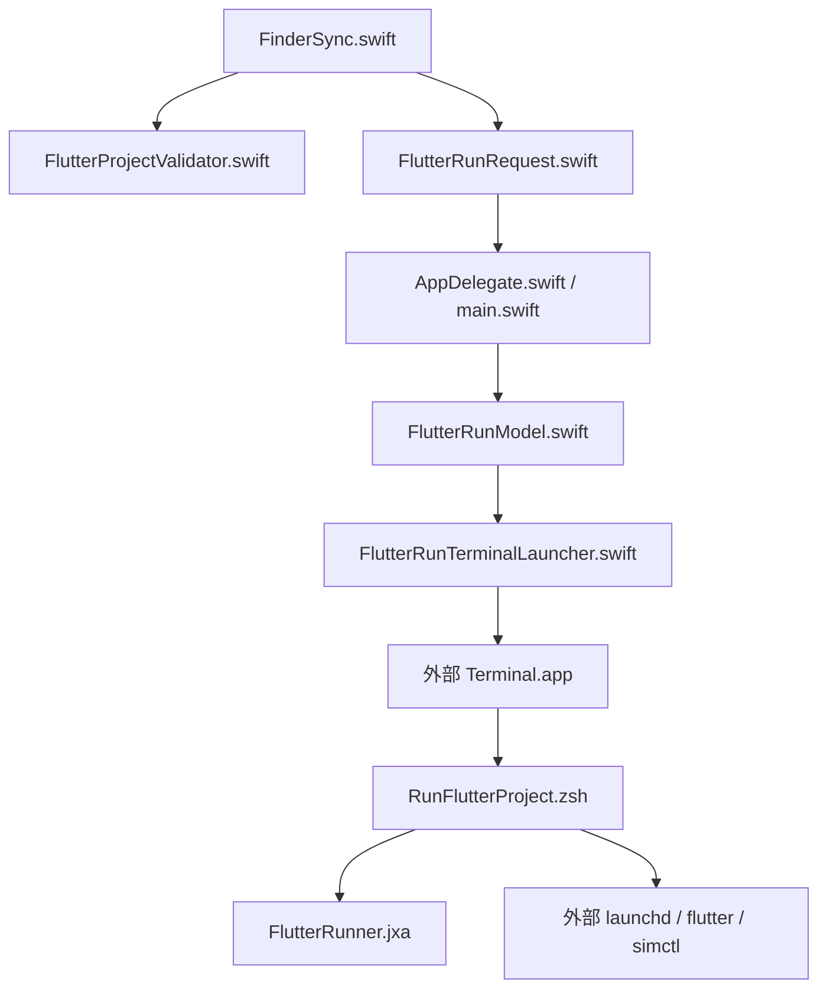
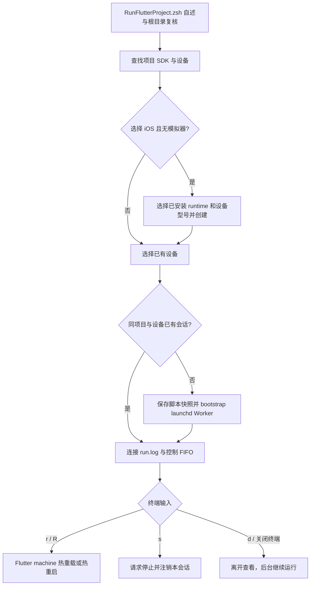
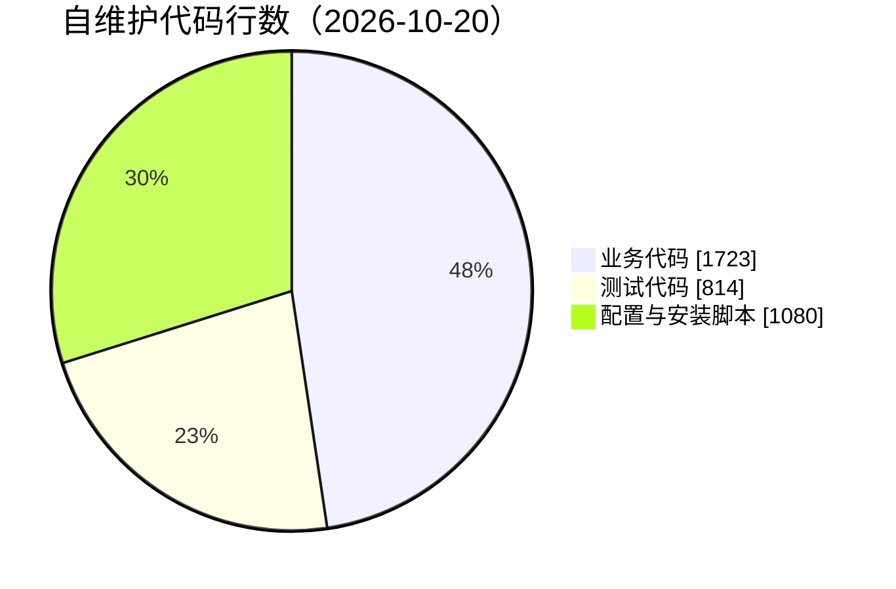

# JobsFlutterRunner：右键运行 [**Flutter**](https://flutter.dev/) 项目


<!-- jobs-toc:start -->
<!-- jobs-toc:source {"v":2,"token":"[toc]"} -->
<details>
<summary>📚 目录（点击展开 / 收起）</summary>

- [🔥 前言](#%E5%89%8D%E8%A8%80)
- [一、运行与环境](#use)
- [二、后台、日志与停止](#lifecycle)
- [三、目录与实现边界](#structure)
- [四、构建、验证与排查](#verify)
- [五、工程口径与依赖](#metrics)

</details>
<!-- jobs-toc:end -->

---

## 🔥 <span id="前言">前言</span>

**菜单范围：桌面空白处不显示本功能；文件夹与项目菜单仍按下文条件显示。桌面上选中的项目文件夹不受此空白菜单规则影响。**

面向 Jobs 与 macOS 开发人员的独立 Finder 扩展：仅在 Flutter 项目根目录显示“运行 Flutter 项目”，设备选择、构建日志和控制操作都在 Terminal 中完成。状态：维护中；负责人：Jobs。关闭 Terminal 只离开日志，Flutter 由当前登录用户会话的 launchd 继续托管。

| 项目 | 实际行为 |
| --- | --- |
| 菜单条件 | 精确目录自身的 `pubspec.yaml` 声明 `dependencies.flutter.sdk: flutter`；普通目录才接受，不递归查找，也不把 `flutter_test` 当作项目依据。 |
| 设备 | 枚举 `flutter devices --machine`，按项目已有平台目录过滤可运行目标，在终端按编号选择；支持重新加载、iOS 模拟器及 Android AVD 入口。 |
| iOS 模拟器缺失 | 内置查询设备型号与已安装 iOS runtime、选择、创建、启动和等待就绪流程；缺 runtime 时提示在 Xcode Settings → Components（旧版 Platforms）安装。 |
| Android 模拟器 | 项目含 `android/` 时可列出 Android SDK 已配置的 AVD，选择后交给独立 launchd job 启动；不创建 AVD，启动后返回设备列表。 |
| 终端与后台 | `launchd` 管理独立 `flutter run --machine`；终端实时追踪会话 `run.log`。关闭窗口、Ctrl+C 或 `d` 只断开查看；`s` 明确停止。 |
| 继续查看 | 再次右键同一项目，选择同一设备，连接已有会话；不重复启动同一项目和设备。 |
| SDK | 优先使用项目 `.fvm/flutter_sdk/bin/flutter`，其次终端 PATH 中的 Flutter；不安装或升级 SDK。 |

本目录是 [MacOS@Extension](../README.md) 单仓管理的普通源码工程，可整体复制并独立构建、安装和卸载；没有独立 `.git` 或 `.gitmodules`。父仓实际关联及两平台地址见[父仓速览](../README.md#前言)，不为本工程创建已撤销的独立远端。

## 一、<span id="use">运行与环境</span> <a href="#前言" style="font-size:17px; color:green;"><b>🔼</b></a> <a href="#🔚" style="font-size:17px; color:green;"><b>🔽</b></a>

需要 macOS 12.0 及以上、完整 [**Xcode**](https://developer.apple.com/xcode/)、可用 Flutter SDK，以及目标设备对应的平台工具。iOS 使用当前 Xcode 的 `xcrun simctl`；不会自动运行 `brew install`、安装 Xcode runtime 或修改 `xcode-select`。Android 设备需已通过 Flutter 自身的工具链检查；AVD 需预先在 Android Studio Device Manager 中配置。

1、使用父仓安装面板勾选“运行 Flutter 项目”，或双击[独立安装入口](./【MacOS】安装Flutter运行Finder扩展.command/README.md)。安装器会构建、启用本扩展并重启 Finder；确认前显示影响范围。

2、在 Finder 右键单个真实 Flutter 项目文件夹，或进入该项目后右键空白处，点击“运行 Flutter 项目”。宿主为 `LSUIElement` 后台进程，不创建管理窗口或 Dock 图标；Terminal 转发完成后退出。

3、在终端阅读自述后回车继续，非空输入取消；按编号选择实际设备。设备按项目已有的 `ios/`、`android/`、`macos/`、`web/` 等平台目录过滤。设备列表为空时可重新加载；有 `ios/` 才提供 iOS 模拟器入口，有 `android/` 才提供已有 Android AVD 启动入口。iOS 缺 runtime 时按明确提示先在 Xcode 安装，再重新加载。

4、查看实时日志。输入 `r` 热重载、`R` 热重启、`s` 停止、`d` 离开；构建阶段尚无 Flutter appId 时，热重载会提示稍后重试。终端关闭不作为停止信号。

也可在本目录直接运行源码脚本，必须与 `FlutterRunner.jxa` 保持同目录：

```shell
/bin/zsh -l ./Scripts/RunFlutterProject.zsh \
  --project '/实际 Flutter 项目根目录'
```

离线运行需要目标依赖和平台工具已在本机准备完整，是否足够由 Flutter 判断；脚本保留失败日志供排查。

## 二、<span id="lifecycle">后台、日志与停止</span> <a href="#前言" style="font-size:17px; color:green;"><b>🔼</b></a> <a href="#🔚" style="font-size:17px; color:green;"><b>🔽</b></a>

每个项目路径与设备 ID 生成独立会话，数据位于当前用户资源库的 `Application Support/JobsFlutterRunner/sessions/`。会话保存两份脚本快照、`job.plist`、`run.log`、控制 FIFO 及进程退出状态。Terminal 中的路径会精确打印，可用于排查；新运行会归档旧 `run.log`，不会覆盖旧构建日志。

`launchctl bootstrap gui/<当前 UID>` 将 Worker 交给当前桌面登录会话托管，不依赖 Finder 宿主或 Terminal 的进程生命周期。它支持关闭终端后继续运行；注销、关机、Flutter 自身退出或明确停止仍会结束进程，不是开机自启或崩溃自动重启服务。再次启动同一项目与设备时重新连接。

| 日志 | 位置 / 内容 |
| --- | --- |
| `JobsFlutterRunner.log` | 系统临时目录；后台宿主启动、请求接收、Terminal 转发与退出诊断。 |
| `JobsFlutterRunner.XXXXXX` | 系统临时目录；终端操作、设备发现与 launchd 诊断，首屏显示本次文件名。 |
| `run.log` | 用户资源库会话目录；Flutter 构建与运行的完整 machine 日志。 |
| `JobsFlutterRunnerInstall.log` / `JobsFlutterRunnerBuildPhase.log` | 系统临时目录；安装或 Xcode 构建时的扩展注册诊断。 |

停止时再次右键并选择相同设备，输入 `s`，脚本先请求 Flutter 停止，再注销该会话 job，保留日志。卸载 Finder 扩展只移除菜单与宿主，不停止已经独立运行的 Flutter 会话；卸载前可先按上述方式停止。

## 三、<span id="structure">目录与实现边界</span> <a href="#前言" style="font-size:17px; color:green;"><b>🔼</b></a> <a href="#🔚" style="font-size:17px; color:green;"><b>🔽</b></a>

```text
./
├── JobsFlutterRunner.xcodeproj/                 # 两个原生 target 与共享 Scheme
├── JobsFlutterRunner/                          # 无窗口后台宿主与 Terminal 载体
├── JobsFlutterRunFinderSync/                    # 菜单可见性与点击时重新验证
├── JobsFlutterRunShared/                        # 精确项目识别与 URL 数据协议
├── Scripts/                                    # 运行、JSON 与构建后启用脚本
├── Tests/FlutterRunTransportTests.swift         # 特殊路径、权限与清理隔离检查
├── Tests/FlutterRunnerShellTests.rb             # 运行 / 后台生命周期隔离检查
├── Tests/FlutterRunnerJSONTests.rb              # JSON、YAML、设备与 plist 参数检查
├── Tests/FlutterRunLaunchdSmoke.rb              # 真 launchd + 假 Flutter 的断连存活检查
├── 【MacOS】安装Flutter运行Finder扩展.command/     # 独立安装入口与自述
└── 【MacOS】卸载Flutter运行Finder扩展.command/     # 精确卸载入口与自述
```

Finder 在显示菜单和点击时分别检查项目，避免菜单打开后切换路径误执行。URL scheme 为 `jobsflutterrunner://run`，路径只作为数据参数；重复、畸形及含 NUL 的 URL 拒绝。终端请求载体使用私有目录与权限，路径中的空格、引号、反斜线、控制符均按数据转义；后台启动前再保存会话脚本，载体清理不影响 Worker。

App Bundle 的业务资源恰为 `RunFlutterProject.zsh` 与 `FlutterRunner.jxa`。`EnableFinderExtension.zsh` 只在 Xcode Build Phase 使用，不是业务资源；隔离构建用 `JOBS_SKIP_FINDER_EXTENSION_BUILD_PHASE=1` 跳过项目自定义启用阶段。





## 四、<span id="verify">构建、验证与排查</span> <a href="#前言" style="font-size:17px; color:green;"><b>🔼</b></a> <a href="#🔚" style="font-size:17px; color:green;"><b>🔽</b></a>

仅构建本工程并跳过自定义扩展启用阶段（构建产物在本目录 `work/`，不会运行目标 Flutter 项目）：

```shell
JOBS_SKIP_FINDER_EXTENSION_BUILD_PHASE=1 xcodebuild \
  -project ./JobsFlutterRunner.xcodeproj \
  -scheme JobsFlutterRunner \
  -configuration Debug \
  -destination "platform=macOS,arch=$(uname -m)" \
  -derivedDataPath ./work/DerivedData \
  build
```

Xcode 自带的 `RegisterWithLaunchServices` 仍会登记构建 App 及发现其中的 appex；这与主动 `pluginkit -e use` 启用、打开宿主和重启 Finder 是不同步骤。隔离验证完成后，需按本次构建的精确路径注销临时登记；不对已正式安装的产物执行此清理。自动阶段实现见 [Swift 官方构建源码](https://github.com/swiftlang/swift-build/blob/main/Sources/SWBTaskConstruction/TaskProducers/OtherTaskProducers/ProductPostprocessingTaskProducer.swift)。

原生路径与请求隔离验证：

```shell
xcrun swiftc \
  ./JobsFlutterRunShared/FlutterProjectValidator/FlutterProjectValidator.swift \
  ./JobsFlutterRunShared/FlutterRunRequest/FlutterRunRequest.swift \
  ./JobsFlutterRunner/FlutterRunTerminalLauncher/FlutterRunTerminalLauncher.swift \
  ./Tests/FlutterRunTransportTests.swift \
  -o ./work/FlutterRunTransportTests
./work/FlutterRunTransportTests
ruby ./Tests/FlutterRunnerShellTests.rb
ruby ./Tests/FlutterRunnerJSONTests.rb
ruby ../Tests/FlutterInstallerIntegrationTests.rb
```

用真实 launchd 和临时假 Flutter 验证终端退出、HUP 后存活、日志增长、重连、热重载与停止；仅创建并清理临时会话，不触碰用户项目或 Finder：

```shell
ruby ./Tests/FlutterRunLaunchdSmoke.rb
```

| 现象 | 处理 |
| --- | --- |
| 普通目录没有菜单 | 正常门禁；选择项目根目录，核对根 `dependencies.flutter.sdk: flutter`，不选择目录快捷方式。 |
| 菜单点击无 Terminal | 检查系统“隐私与安全性 → 自动化”中宿主控制 Terminal 的授权，并检查宿主日志；重新安装完整 App 可修复 URL 注册。 |
| 没有可用设备 | 在终端重新加载，核对项目平台目录；iOS 可进入内置初始化；Android 可选择已配置 AVD，列表为空时先在 Android Studio 配置，或连接已授权真机。 |
| `simctl` 或 runtime 不可用 | 选择完整 Xcode，在 Xcode Settings → Components（旧版 Platforms）安装对应 iOS runtime 后重试；脚本不替代 Xcode 下载。 |
| 构建失败 | 查看 `run.log`，按 Flutter 报错修复目标依赖、签名或 SDK；脚本不会把已提交后台任务等同于启动成功。 |
| 卸载 | 使用[独立卸载入口](./【MacOS】卸载Flutter运行Finder扩展.command/README.md)，先展示路径，输入 `YES` 才移除经 Bundle ID 核验的 App 并刷新 Finder。 |

验证日期：2026-10-20。Debug 原生构建、App / appex 深度签名、两份业务资源逐字节核对、路径 / URL / 私有载体检查通过；父安装映射 19 项 / 108 断言，运行 Shell 13 项 / 50 断言，JSON helper 18 项 / 252 断言均通过。真实 launchd 配合假 Flutter 的入口退出、HUP 存活、日志增长、崩溃后重新运行、重连、热重载与停止通过。隔离构建自动产生的临时 LaunchServices / PlugInKit 登记已精确注销，未启用此扩展或打开宿主。Finder 菜单签名加载、模拟器创建和真实目标 App 生命周期仍需安装后验收；测试不安装 SDK 或触碰用户项目。

## 五、<span id="metrics">工程口径与依赖</span> <a href="#前言" style="font-size:17px; color:green;"><b>🔼</b></a> <a href="#🔚" style="font-size:17px; color:green;"><b>🔽</b></a>

统计日期 2026-10-20，按本目录的 Xcode 工程及源码核对：一个独立安装单元、一个 Finder 动作、两个原生 target；宿主 GUI 页面为零，URL 请求入口一个，不计为 HTTP / RPC API。无后端服务、数据库、MQ、外部业务系统集成或定时任务；launchd 会话 job 属于用户主动启动的本地运行任务。无独立 Git 历史，建库 / 提交 / 贡献者口径见父仓。Swift 编译模式 `5.0`，最低 macOS `12.0`；未引入 SPM、Pods 或第三方源码包，无相关锁文件。

代码规模按本目录现存自维护文本统计，排除 README、`work/`、个人 `xcuserdata` 与生成产物；测试单列。业务包含原生 Swift、运行 zsh 与 JXA，配置包含 Xcode / plist / entitlements、构建启用脚本和安装 / 卸载入口；按行数计算占比，统计日期 2026-10-20。

| 类别 | 文件数 | 行数 | 行数占比 |
| --- | ---: | ---: | ---: |
| 业务代码 | 9 | 1,723 | 47.64% |
| 测试代码 | 4 | 814 | 22.50% |
| 配置与安装脚本 | 10 | 1,080 | 29.86% |
| 第三方源码（排除） | 0 | 0 | — |



| 直接工具 | 版本 / 来源与许可 | 用途与边界 |
| --- | --- | --- |
| Flutter / Dart | 项目 SDK 或 PATH 实际版本；[官方源码](https://github.com/flutter/flutter)，[BSD-3-Clause](https://github.com/flutter/flutter/blob/master/LICENSE) | 外部 CLI 运行目标项目，版本由目标决定；未随扩展分发 SDK。 |
| Xcode / simctl | 当前选中的本机 Xcode；[Apple 官方工具](https://developer.apple.com/xcode/)，Apple 软件许可 | 原生构建与模拟器查询 / 创建，未随工程分发。 |
| zsh / launchctl / osascript | macOS 自带系统命令 | 本地会话生命周期、JSON 与 Terminal 转发。 |

运行会更新目标 Flutter 项目依赖 / 构建目录，并可能访问目标自身配置的依赖源；仅内置模拟器创建会改变模拟器列表。没有代理修改、密钥复制、自动开机任务、通知 / 相机 / 定位 / 支付能力或服务端鉴权。日志可能包含项目路径与目标应用输出，分享前按实际内容检查。工具版本不由本扩展锁定，健康 SDK 不代表目标项目兼容性或全部工具版本已通过审计。

<a id="🔚" href="#前言" style="font-size:17px; color:green; font-weight:bold;">我是有底线的➤点我回到首页</a>
