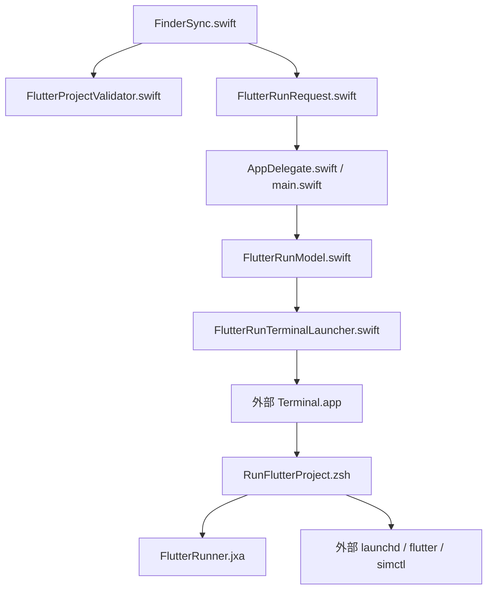
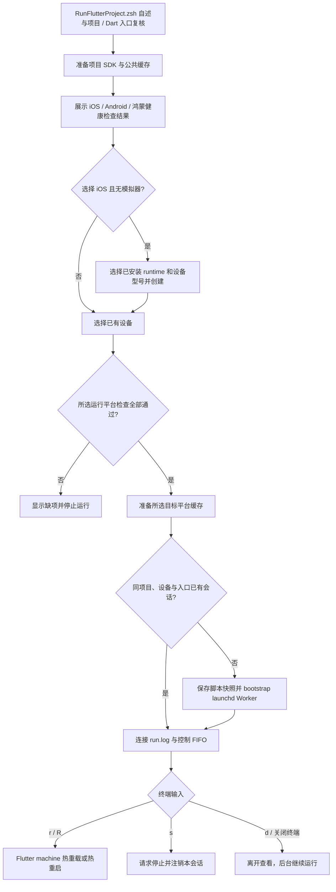
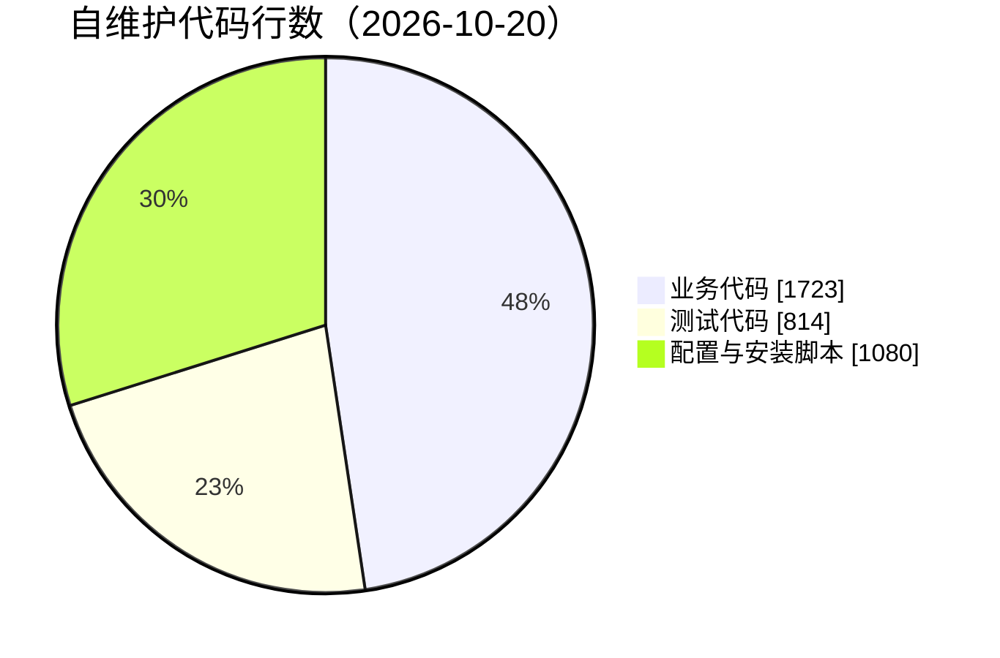

> 本功能的右键入口已迁入 [JobsFlutterTools](../JobsFlutterTools/README.md)。以下保留旧独立工程的实现说明；新安装使用统一菜单与项目 FVM。原“Flutter项目体检”在新菜单中称为“原生Flutter项目体检”。

# JobsFlutterRunner：右键运行 [**Flutter**](https://flutter.dev/) 项目


<!-- jobs-toc:start -->
<!-- jobs-toc:source {"v":2,"token":"[toc]"} -->
<details>
<summary>📚 目录（点击展开 / 收起）</summary>

- [🔥 前言](#%E5%89%8D%E8%A8%80)
- [一、安装与卸载](#install)
- [二、运行与环境](#use)
- [三、后台、日志与停止](#lifecycle)
- [四、目录与实现边界](#structure)
- [五、构建、验证与排查](#verify)
- [六、工程口径与依赖](#metrics)
  - [SDK获取前网络检测](#jobs-toc-heading-8)

</details>
<!-- jobs-toc:end -->

---

## 🔥 <span id="前言">前言</span>

**独立 Dart Demo：** 在 Finder 中右键 Flutter 工程内单个真实 `.dart` 文件，直接选择当前右键层的“▶️ 从终端运行 Flutter Demo”，不再进入只有这一项的工具分组。该独立扩展直接提供运行叶子；统一工具包的单项菜单展开行为见其说明，原文件与工程上下文校验保持一致。文件菜单只开放已启用的运行功能；最近的 `pubspec.yaml` 必须声明 Flutter SDK，不越过嵌套的其它包。Terminal 确认后沿用现有 FVM、环境体检和设备选择，将选中文件作为 `flutter run -t` 的真实目标；运行前拒绝无可识别 `main()` 的辅助文件。不同项目、设备和入口各自保存后台会话，重新打开同一入口才重连该入口日志。主题由 Finder 跟随系统；新增 Demo 标题支持管理面板的十种语言选择。当前安装与真实运行状态见[Demo 资产盘点](../../项目相关报告/Flutter-Demo独立运行资产盘点.md#validation)，源码或隔离通过不能代替 Finder 菜单与设备验收。

**鸿蒙连接可见性：** “目前已有的真实设备”同时读取当前 SDK 的可运行设备、HDC 连接及系统 USB 调试设备。HDC 未安装或当前 SDK／工程尚未适配时，明确列出“鸿蒙 USB 设备 — 已连接，环境未就绪”，选择后在同一运行流程准备缺失的鸿蒙 SDK、配套工具、平台和依赖，复检通过后只等待原设备并继续运行；诊断标识始终不直接作为 Flutter 设备 ID。准备失败、取消、插件不支持或原设备身份变化均停止本轮，不自动改选其它设备。已显示的同一可运行设备按精确身份去重；普通华为外设不冒充鸿蒙设备。

**运行前环境体检：** 项目 SDK 与公共缓存准备完成后，先展示 iOS、Android、OpenHarmony 三端状态，再选择设备；仅本次运行平台必须全部通过，其它平台缺项不阻断。检查 SDK 构建能力、当前依赖索引和平台工具链；鸿蒙额外检查 DevEco／HDC／OHPM／Hvigor／Java、`ohos/` 工程结构及原生插件声明。可自动补齐的目标缺项在当前流程准备并复检；检查超时、结果无法解析、体检资源缺失或准备后仍未通过时停止，不进入目标预缓存或后台运行。体检本身不安装工具、不切换 SDK、不生成平台源码；选中鸿蒙连接项或环境未就绪的真实鸿蒙设备后，当前流程会备份配置并直接承接准备，不要求另找入口。准备只执行一次，之后有界重查原设备，不重复获取 SDK 或构建。原始检查输出保存在操作日志旁的 `.preflight.*` 文件。检查通过仍需以实际构建和设备启动结果验收。

公共依赖索引在首次体检前先与本轮选定 SDK 核对；缺失或指向其它 SDK 时，在当前工程使用同一 Flutter 执行 `pub get` 后复检。公共只读探针超时或因信号退出时直接停止并保留退出码，不再执行 `pub get`。索引仍无效就停止，不进入无关 Android 工具或许可证准备；索引有效后才按仍缺失的目标平台组件继续。Android 许可必须是本轮命令退出成功且末尾明确报告全部接受，兼容成功句末有无句点及终端 CR／ANSI 差异，不自动代为接受许可。

**下载版本与组件：** 运行器在 SDK 安装 / 首次补齐及选定平台预缓存之前，先展示项目声明 Flutter、实际解析的 SDK 根路径、本地 Git 精确 tag / 提交或本地版本记录、下载宿主架构、目标平台和 Engine 提交；不靠执行 Flutter / Dart 探测版本。Git 查询只读、禁止隐式联网且单次最多 5 秒，无法确认就明确未解析。Darwin 下载架构按物理 ARM 能力识别，兼容 Rosetta。Dart 目标版本只采信 SDK 明确声明，或与目标 Engine 一致的版本 JSON / 当前缓存 stamp；`.old` 和不匹配的缓存不当作本次目标。尚无可信记录时显示“版本尚未解析，待目标 SDK 下载完成后确认”，目标版本展示不代表已经安装验收。

已打开的终端使用启动时的脚本快照，源码改动不替换当前下载进程；安装 / 更新菜单后重新发起才加载新的上下文展示。版本上下文与重试提示进入本次操作日志，原生机器输出文件及退出码保持原路径。

**SDK 获取策略：** 必需 SDK 的下载、安装中的网络获取及 Flutter 首次启动补齐 Dart / 引擎组件，默认失败自动持续重试，直到成功或用户按 Ctrl+C / 结束进程；不再询问是否重试，也不设次数或总时长上限。退避默认为 2、4、8、16、30 秒；`JOBS_SDK_RETRY_DELAY` / `JOBS_SDK_RETRY_MAX_DELAY` 可配置。保留工具原生进度与已有缓存，每次获取输出追加保存到原日志旁的 `.attempts.log`；版本选择、真正的许可证 / 权限操作及原始入口确认保留。确定的权限、磁盘、架构、参数或不存在版本错误直接说明原因并停止；项目构建与代码生成失败不整体重放。`--check` / `--help` 继续只读。

设备枚举前先检查所选 SDK 的公共缓存；完整本地 stamp、组件目录及工具依赖均就绪时直接复用，不新增联网前提。否则先执行 `flutter precache --universal`，沿用本次网络选路、真实进度和持续重试，单次窗口为 1800 秒，直到就绪或 `Ctrl+C` 结束；这一步不下载所有目标平台。输出保存到 `<操作日志>.discovery-sdk`；每次尝试结束后，将输出和退出码追加到 `<操作日志>.discovery-sdk.attempts.log`，中断时保留当次日志。公共组件完成后才运行短时 `flutter devices --machine`，避免机器模式下的隐式下载被设备查询超时反复中止。

运行和打包在实际 `run` / `build` 前，先为已选设备 / 打包平台执行对应 `flutter precache --ios|--android|--web|--macos|--ohos`，平台资源获取失败持续重试；不会因此反复构建 App。鸿蒙先检查适配 SDK 是否支持 `--ohos`，不支持时在构建前明确说明。

**菜单范围：桌面空白处不显示本功能；文件夹与项目菜单仍按下文条件显示。桌面上选中的项目文件夹不受此空白菜单规则影响。**

面向 Jobs 与 macOS 开发人员的独立 Finder 扩展：在 Flutter 项目根目录显示“从终端运行 Flutter 项目”，在其中单个 `.dart` 文件显示“从终端运行 Flutter Demo”，设备选择、构建日志和控制操作都在 Terminal 中完成。状态：维护中；负责人：Jobs。关闭 Terminal 只离开日志，Flutter 由当前登录用户会话的 launchd 继续托管。

| 项目 | 实际行为 |
| --- | --- |
| 菜单条件 | 精确目录自身的 `pubspec.yaml` 声明 `dependencies.flutter.sdk: flutter`；普通目录才接受，不递归查找，也不把 `flutter_test` 当作项目依据。 |
| 设备 | 公共 SDK 就绪后先分已有／新建两组；已有目标按工程平台过滤，新建始终提供 iOS／Android／Harmony。创建成功后精确等待本轮新设备就绪并自动运行当前工程。 |
| fzf 选择 | 终端内所有列表（设备、模拟器型号、iOS 系统版本、Android AVD）统一走 fzf：`↑/↓` 移动、输入即筛选、回车确认、`Esc` 取消。环境变量 `JOBS_FLUTTER_RUNNER_FZF=0` 可强制关闭并回到编号输入。 |
| iOS 模拟器 | 已有组只启动现有设备；新建组调用随包桌面创建器，按匹配型号和已安装 Runtime 创建并启动。不安装 Xcode / Runtime、不删除其它设备，创建结果不明确时保留诊断，不盲目重试。 |
| Android 模拟器 | 已有组按 AVD 名精确启动并等待被 Flutter 识别；新建组复用桌面创建器，准备所需工具链、型号与系统镜像，再按原许可和确认执行。 |
| 终端与后台 | `launchd` 管理独立 `flutter run --machine`；终端实时追踪会话 `run.log`。关闭窗口、Ctrl+C 或 `d` 只断开查看；`s` 明确停止。 |
| 继续查看 | 再次右键同一项目根目录或同一个 Dart 入口，选择同一设备，连接该目标的已有会话；切换 Demo 入口会建立独立会话。 |
| SDK | 优先使用项目 `.fvm/flutter_sdk/bin/flutter`；缺失或断链时读取 `.fvmrc` / `.fvm/fvm_config.json` 声明的版本并用本机 fvm 补齐——本机缓存已有该版本只重建链接、不下载，缓存没有时自动下载，失败持续重试；其次终端 PATH 中的 Flutter。不安装或升级全局 Flutter / Xcode。 |

本目录是 [MacOS@Extension](../README.md) 单仓管理的普通源码工程，可整体复制并独立构建、安装和卸载；没有独立 `.git` 或 `.gitmodules`。父仓实际关联及两平台地址见[父仓速览](../README.md#前言)，不为本工程创建已撤销的独立远端。


**安装 / 卸载位置：** 面板提供“使用「应用程序」中的联合 App 安装 / 卸载”复选框，首次打开默认勾选，可手动取消。不勾选时沿用本地 `work` 内的构建产物；勾选时将所选功能统一安装到 `/Applications/Jobs自定义右键菜单.app`，面板同时显示这个联合 App 的名字。完整宿主及其扩展收在联合 App 内，不再为本轮所选功能生成其它顶层 App。安装到应用程序后，清理仓库构建输出或移走源码不影响已安装功能；构建目录模式仍须保留正在使用的 App。两种方式都保留各功能自身的工具链依赖。

**安装后清理：** 仅在“安装 / 更新”且勾选应用程序路线时，显示“安装成功后清除此轮构建产物”；首次打开默认勾选，可手动取消。保持勾选时，只有当前模块部署、登记和提交全部成功才清理本轮对应的 DerivedData；卸载模式隐藏但保留当前选择，返回安装时恢复；构建目录路线隐藏并清空该选项。失败安装保留构建产物，清理失败会提示并保留已安装功能；不会整目录清理所有 `work`、其它模块或源码。

卸载按同一复选框选定的位置执行，所选位置没有 App 时保留另一位置及其功能配置；共享宿主仍有未卸载菜单时保留 App，最后一项移除后注销并删除该功能模块；联合 App 的最后一个模块移除后才删除外层 `Jobs自定义右键菜单.app`。切换位置安装会把登记切到新位置，构建目录中的另一份产物保留；所选功能的旧版顶层自有 App 在成功提交后收拢至联合 App，未知 App 不覆盖或删除。完整说明见[App 部署支持库](./Scripts/【MacOS】AppDeployment.zsh/README.md)。


**独立清理与停止：** 安装位置与安装后自动清理两个复选框紧邻排列，窄窗按需换行；红色“🧹 清除构建产物”按钮位于底部主操作按钮右侧，安装 / 更新和卸载两种模式保持一致。应用程序路线显示红底白字的“🧹 清除构建产物”按钮，安装 / 卸载页签均可单独清理当前勾选功能，不要求重新安装；没有勾选或正在执行任务时禁用。“安装成功后清除此轮构建产物”复选框仅在应用程序安装模式出现，首次打开默认勾选，可手动取消。构建目录路线隐藏并清空自动清理复选框，独立清理按钮保持显示但禁用，避免清除正在使用的产物。清理须核验已安装联合 App、精确扩展登记与来源占用，失败保留运行功能，不清理源码或其它模块。

安装中原操作按钮改为“停止安装”。点击只请求完成当前共享 App 安装单元后停止，不终止其编译、签名、登记或回滚；后续单元标记“未执行”，不计失败或已完成百分比。同一共享 App 的叶功能一起提交。清理使用独立计时，不覆盖安装或卸载耗时。

**App 管理授权：** 新版 GUI 从名称固定的 `Jobs右键菜单管理面板.app` 运行。若 macOS 拒绝修改联合 App，面板显示授权入口并停止后续安装；在“系统设置 → 隐私与安全性 → App 管理”中添加 / 启用实际负责的管理面板后重试。此权限用于允许 App 更新或删除其它 App，参见 [Apple 官方说明](https://support.apple.com/en-au/guide/mac-help/mchl211c911f/mac)。普通目录可写不能替代此授权，不使用提权运行整个安装器或修改 TCC 数据库。

## 一、<span id="install">安装与卸载</span> <a href="#前言" style="font-size:17px; color:green;"><b>🔼</b></a> <a href="#🔚" style="font-size:17px; color:green;"><b>🔽</b></a>

菜单安装与卸载统一使用 [图形管理入口](./【MacOS】管理Flutter运行Finder扩展.app)。直接打开面板，选择“安装 / 更新”或“卸载”并勾选当前范围内的功能；默认空选，点击操作按钮即确认。功能整行可切换勾选，失败日志入口保留独立动作，拖动、滚动和执行中不误选。每项显示等待、正在安装 / 卸载、成功或失败；底部日志实时滚动，可选择复制或复制全部。运行中锁定选择，关闭直接退到 Dock（程序坞）及系统状态栏，不询问、不打断任务；空闲关闭时选择后台或完全退出，默认后台。状态项可恢复原面板，完成后继续驻留供查看结果与日志。首次打开或面板源码更新后会在后台编译，失败以桌面提示和启动日志说明。

原同名 `.command` 入口保留，终端只负责唤起独立 GUI，随后结束启动脚本；本次启动任务结束后自动关闭对应终端页，安装 / 卸载、进度与实时日志均由 GUI 后台处理。已有交互 Shell 中手工调用时保留原工作会话。内部实现为 `Scripts/【MacOS】ManageExtension.zsh/【MacOS】ManageExtension.zsh`；完整仓内单功能入口使用总面板的受限范围。可独立复制的包须整体保留 `.command`、`.app`、Scripts、工程源码和资源。

启动器按自身位置定位配套文件，不依赖本机固定目录或启动时的工作目录。`.command` 会把当前包目录传给同名 App；直接打开 App 无法定位 `Scripts` 时，按提示选择同时包含同名 App 与 `Scripts/` 的原始目录，取消选择不会执行安装或卸载。

本入口转交 [JobsFlutterTools](../JobsFlutterTools/README.md)，只管理 `run`，需要保留同仓聚合工程源码。旧宿主、扩展与 Xcode 工程仍供实现参考和隔离验证；常规菜单安装不再注册本目录的旧独立扩展。

需要 macOS 12+、完整 [**Xcode**](https://developer.apple.com/xcode/) 与 macOS SDK。安装成功后启用本入口对应功能并保留其它已装选择；卸载仅减去对应功能，仍有其它项时保留共享 App 和登记，最后一项才停用聚合扩展。源码、用户工程、SDK、模拟器、业务数据和既有业务配置保留；安装与卸载只管理菜单，不执行菜单业务。操作完成后刷新 Finder，请先结束 Finder 文件搬移。

安装日志为系统临时目录中的 `JobsFlutterToolsInstall.log`；卸载日志为聚合管理入口同名 `.log`，以面板底部日志为准。

也可从 [总管理面板](../【MacOS】🧩管理Finder扩展.command) 选择一个或多个功能，在同一面板切换安装 / 更新或卸载。

## 二、<span id="use">运行与环境</span> <a href="#前言" style="font-size:17px; color:green;"><b>🔼</b></a> <a href="#🔚" style="font-size:17px; color:green;"><b>🔽</b></a>

需要 macOS 12.0 及以上、完整 [**Xcode**](https://developer.apple.com/xcode/)、可用 Flutter SDK，以及目标设备对应的平台工具。iOS 使用当前 Xcode 的 `xcrun simctl`；不会自动运行 `brew install`、安装 Xcode runtime 或修改 `xcode-select`。Android 支持在已有组启动 AVD，在新建组复用桌面创建器准备工具链、选择型号与系统镜像并确认创建，详见[Android 初始化与运行](./Scripts/README.md#runtime)。

1、在 Finder 右键单个真实 Flutter 项目文件夹，或进入该项目后右键空白处，点击“从终端运行 Flutter 项目”。宿主为 `LSUIElement` 后台进程，不创建管理窗口或 Dock 图标；Terminal 转发完成后退出。

- 在终端阅读自述后回车继续，非空输入取消。设备选择分为“目前已有的真实设备”“虚拟设备”和“其他运行目标（桌面 / Web）”，另有重新加载入口。设备选择器只显示一列可读名称，不把内部设备 ID、TSV 字段或选择器行标识显示成第二列，也不显示冗余的取消操作行；Esc／Ctrl+C 取消和子层左方向键返回保留，普通确认菜单的取消项不受影响；确认后仍按所选行精确绑定原设备，同名设备不会按名称误连。真实设备组只展示当前已连接的手机及鸿蒙连接诊断，不混入模拟器；桌面、浏览器和自定义平台保留在其他目标中。虚拟设备组按 iOS、Android、Harmony 分别进入子菜单，每组先列已有实例，最后一项为“新建 iOS / Android / Harmony 虚拟设备”（按所在系统显示实际名称）；无已有实例时仍可选择新建，不隐式执行创建。

选定虚拟设备系统后，先在当前流程完成宿主环境体检、兼容正式更新、缺失组件准备与复检，再展示已有实例及新建入口。启动环境不先改工程 SDK、生成 `ohos/` 或检查第三方插件；已有实例、数据及镜像保持原样，运行中的实例直接复用，失败不改选其它设备。新建在当前终端复用桌面创建器及原有自述、许可和最终确认，不要求其它创建扩展已安装，也不要求当前工程已有对应平台目录。创建并启动成功后，通过本轮私有回执承接精确标识：Android 按 AVD 名等待开机后匹配 serial，iOS 按 UDID、Harmony 按实例端口及 HDC 核验同一 Flutter ID；就绪后自动继续原工程预缓存与 `flutter run`，无需二次选择。取消、无有效回执或等待失败均不运行其它设备；工程缺对应平台目录时保留新设备并返回分组。

菜单不再显示“取消本轮运行”；`Esc` / `Ctrl+C` 结束选择，`←` 逐层返回真正上一层，文本模式用 `b` 返回。平台实例列表最后始终为新建项，返回通过按键完成；返回保留本轮已准备并复检的工具。`↑/↓` 移动、回车确认、输入可筛选；创建器继续沿用各自原有确认。SDK 下载上下文、环境准备与 Flutter 构建运行等里程碑标题统一红色粗体；正文保留原信息配色，纯文本环境和落盘日志不含颜色控制码。

**体检、准备与日志：** 每个平台的缺项逐行显示，合格为绿色勾、失败为红色叉。所选 iOS / Android 环境缺失时直接补齐并复检；所选 Harmony 沿原设备身份准备 SDK、工具、平台和依赖。其它未就绪平台按“回车后台补齐；任意字符加回车不补”选择，运行日志可输入 `e` 停止经身份复核的本工程后台任务；后台只写隔离缓存和工程草稿，不修改当前运行工程、FVM 或依赖索引；实际选用时再应用项目集成并复检，插件适配、许可和授权不冒充自动完成。SDK 下载上下文对照官网当前最新稳定 SDK、本机环境和工程 FVM 声明／解析结果，官网查询失败明确未知，不自动升级工程绑定。URL 统一绿色下划线，错误正文红色，结构日志保留原标签并加 emoji；纯文本及原始日志不含 ANSI。iOS Pod 下载遇到明确网络断流会保留锁及原设备，在本任务内切换 Git HTTP/1.1 并持续重试依赖获取，成功后继续原设备；认证、校验、版本冲突与编译错误不误重试。

3、查看实时日志。输入 `r` 热重载、`R` 热重启、`s` 停止运行、`e` 停止本工程后台环境准备、`d` 离开；构建阶段尚无 Flutter appId 时，热重载会提示稍后重试。终端关闭不作为停止信号。

也可在本目录直接运行源码脚本，必须与 `FlutterRunner.jxa` 保持同目录：

```shell
/bin/zsh -l ./Scripts/RunFlutterProject.zsh \
  --project '/实际 Flutter 项目根目录'
```

离线运行需要目标依赖和平台工具已在本机准备完整，是否足够由 Flutter 判断；脚本保留失败日志供排查。

## 三、<span id="lifecycle">后台、日志与停止</span> <a href="#前言" style="font-size:17px; color:green;"><b>🔼</b></a> <a href="#🔚" style="font-size:17px; color:green;"><b>🔽</b></a>

单文件 Demo 以项目路径、设备 ID 与实际 Dart 入口路径共同生成独立会话；项目根目录运行默认入口时，继续使用原有项目路径与设备 ID 会话键，兼容已有会话。数据位于当前用户资源库的 `Application Support/JobsFlutterRunner/sessions/`。会话保存两份脚本快照、`job.plist`、`run.log`、控制 FIFO 及进程退出状态。Terminal 中的路径会精确打印，可用于排查；新运行会归档旧 `run.log`，不会覆盖旧构建日志。

终端将 machine 协议转换为 `[依赖]`、`[进行]`、`[完成]`、`[警告]`、`[错误]`、`[成功]` 等中文日志。依赖版本列表与已知系统索引噪声折叠；快捷指令 / Spotlight 的 `WF*` 参数转换与缺失扩展诊断合并为一条 `[提示]`，不再仅因含 `Failed` 就标成 Flutter 错误。停维依赖名称、SPM 不兼容插件名、应用输出、错误堆栈、非零索引错误计数与未知事件保留；machine 协议中的应用错误不会被系统诊断规则折叠。仅收到 `app.started` 才显示“应用已启动”；提交后台任务或开始编译均不表示启动成功。原始 `run.log` 不做过滤，热重载 / 停止仍读取完整协议。重新连接会重放本次会话日志，便于查看完整构建过程；输入控制命令后回车，不再让提示符与异步日志挤在同一行。

FIFO 控制通道使用读写模式的保活 fd，Flutter stdin 单独以只读模式打开。真实 Flutter 热重载回归返回成功（code 0）；此证据只覆盖控制通道，设备与工程仍按实际运行验收。

日志回归：`ruby Tests/FlutterRunnerLogTests.rb/FlutterRunnerLogTests.rb`，覆盖成功与警告分级、失败堆栈、未知 / 损坏协议、SPM 插件名、分段 UTF-8、末尾半行及非零退出码。Shell 测试在临时工作目录运行，夹具不写入源码目录。

`launchctl bootstrap gui/<当前 UID>` 将 Worker 交给当前桌面登录会话托管，不依赖 Finder 宿主或 Terminal 的进程生命周期。它支持关闭终端后继续运行；注销、关机、Flutter 自身退出或明确停止仍会结束进程，不是开机自启或崩溃自动重启服务。再次启动同一项目、设备与 Dart 入口时重新连接；项目根目录运行只重连其原默认入口会话。

| 日志 | 位置 / 内容 |
| --- | --- |
| `JobsFlutterRunner.log` | 系统临时目录；后台宿主启动、请求接收、Terminal 转发与退出诊断。 |
| `JobsFlutterRunner.XXXXXX` | 系统临时目录；终端操作、设备发现与 launchd 诊断，首屏显示本次文件名。 |
| `run.log` | 用户资源库会话目录；Flutter 构建与运行的完整 machine 日志。 |
| `JobsFlutterRunnerInstall.log` / `JobsFlutterRunnerBuildPhase.log` | 系统临时目录；安装或 Xcode 构建时的扩展注册诊断。 |

停止时再次右键原项目根目录或同一个 Dart 入口，并选择相同设备，输入 `s`，脚本先请求 Flutter 停止，再注销该会话 job，保留日志。卸载 Finder 扩展只移除菜单与宿主，不停止已经独立运行的 Flutter 会话；卸载前可先按上述方式停止，卸载入口见[第一章](#install)。

## 四、<span id="structure">目录与实现边界</span> <a href="#前言" style="font-size:17px; color:green;"><b>🔼</b></a> <a href="#🔚" style="font-size:17px; color:green;"><b>🔽</b></a>

```text
./
├── JobsFlutterRunner.xcodeproj/                 # 两个原生 target 与共享 Scheme
├── JobsFlutterRunner/                          # 无窗口后台宿主与 Terminal 载体
├── JobsFlutterRunFinderSync/                    # 菜单可见性与点击时重新验证
├── JobsFlutterRunShared/                        # 精确项目识别与 URL 数据协议
├── Scripts/                                    # 运行、JSON 与构建后启用脚本
├── Tests/FlutterRunTransportTests.swift         # 特殊路径、权限与清理隔离检查
├── Tests/FlutterRunnerShellTests.rb             # 运行 / 后台生命周期隔离检查
├── Tests/FlutterRunnerJSONTests.rb              # JSON、YAML、设备与 plist 参数检查
├── Tests/FlutterRunLaunchdSmoke.rb              # 真 launchd + 假 Flutter 的断连存活检查
└── 【MacOS】管理Flutter运行Finder扩展.command
```

Finder 在显示菜单和点击时分别检查项目，避免菜单打开后切换路径误执行。URL scheme 为 `jobsflutterrunner://run`，路径只作为数据参数；重复、畸形及含 NUL 的 URL 拒绝。终端请求载体使用私有目录与权限，路径中的空格、引号、反斜线、控制符均按数据转义；后台启动前再保存会话脚本，载体清理不影响 Worker。

App Bundle 的业务资源包括 `RunFlutterProject.zsh`、`FlutterRunner.jxa`、`SimulatorCreators/` 和[运行前体检模块](./Scripts/【MacOS】Flutter运行前体检.zsh/README.md)；启动载体保留完整相对结构。`EnableFinderExtension.zsh` 只在 Xcode Build Phase 使用，不是业务资源；隔离构建用 `JOBS_SKIP_FINDER_EXTENSION_BUILD_PHASE=1` 跳过项目自定义启用阶段。





## 五、<span id="verify">构建、验证与排查</span> <a href="#前言" style="font-size:17px; color:green;"><b>🔼</b></a> <a href="#🔚" style="font-size:17px; color:green;"><b>🔽</b></a>

仅构建本工程并跳过自定义扩展启用阶段（构建产物在本目录 `work/`，不会运行目标 Flutter 项目）：

```shell
JOBS_SKIP_FINDER_EXTENSION_BUILD_PHASE=1 xcodebuild \
  -project ./JobsFlutterRunner.xcodeproj \
  -scheme JobsFlutterRunner \
  -configuration Debug \
  -destination "platform=macOS,arch=$(uname -m)" \
  -derivedDataPath ./work/DerivedData \
  build
```

Xcode 自带的 `RegisterWithLaunchServices` 仍会登记构建 App 及发现其中的 appex；这与主动 `pluginkit -e use` 启用、打开宿主和重启 Finder 是不同步骤。隔离验证完成后，需按本次构建的精确路径注销临时登记；不对已正式安装的产物执行此清理。自动阶段实现见 [Swift 官方构建源码](https://github.com/swiftlang/swift-build/blob/main/Sources/SWBTaskConstruction/TaskProducers/OtherTaskProducers/ProductPostprocessingTaskProducer.swift)。

原生路径与请求隔离验证：

```shell
xcrun swiftc \
  ./JobsFlutterRunShared/FlutterProjectValidator/FlutterProjectValidator.swift \
  ./JobsFlutterRunShared/FlutterRunRequest/FlutterRunRequest.swift \
  ./JobsFlutterRunner/FlutterRunTerminalLauncher/FlutterRunTerminalLauncher.swift \
  ./Tests/FlutterRunTransportTests.swift \
  -o ./work/FlutterRunTransportTests
./work/FlutterRunTransportTests
ruby Tests/FlutterRunnerShellTests.rb/FlutterRunnerShellTests.rb
ruby Tests/FlutterRunnerAndroidTests.rb/FlutterRunnerAndroidTests.rb
ruby Tests/FlutterRunnerJSONTests.rb/FlutterRunnerJSONTests.rb
ruby Tests/FlutterRunnerLogTests.rb/FlutterRunnerLogTests.rb
ruby ../Tests/FlutterInstallerIntegrationTests.rb/FlutterInstallerIntegrationTests.rb
```

用真实 launchd 和临时假 Flutter 验证终端退出、HUP 后存活、日志增长、重连、热重载与停止；仅创建并清理临时会话，不触碰用户项目或 Finder：

```shell
ruby Tests/FlutterRunLaunchdSmoke.rb/FlutterRunLaunchdSmoke.rb
```

| 现象 | 处理 |
| --- | --- |
| 普通目录没有菜单 | 正常门禁；选择项目根目录，核对根 `dependencies.flutter.sdk: flutter`，不选择目录快捷方式。 |
| 菜单点击无 Terminal | 检查系统“隐私与安全性 → 自动化”中宿主控制 Terminal 的授权，并检查宿主日志；重新安装完整 App 可修复 URL 注册。 |
| 没有可用设备 | 在终端重新加载，核对项目平台目录；iOS 可进入内置初始化；Android 可选择已配置 AVD，列表为空时先在 Android Studio 配置，或连接已授权真机。 |
| 同一次选择出现上下两份菜单 | 运行器使用 fzf 全屏临时界面，退出恢复日志，避免内嵌高度绘制留下残影；更新已安装 App 后重新右键发起，旧终端仍使用启动时的脚本快照。 |
| Device Hub 空白，运行器却列出 iOS 模拟器 | 检查 Device Hub 过滤器是否为 `Physical Devices`，改为 `All Devices` / `Simulators`，并展开 `Available` 分组。运行器从 CoreSimulator 读取全部可用模拟器，包括 Shutdown 设备；历史测试设备按 UUID 注销，勿直接删除设备目录或共享 Runtime。 |
| `simctl` 或 runtime 不可用 | 选择完整 Xcode，在 Xcode Settings → Components（旧版 Platforms）安装对应 iOS runtime 后重试；脚本不替代 Xcode 下载。 |
| `Unable to find application named 'Simulator'` | Xcode 26 / 27 已把模拟器界面改名为 `DeviceHub.app` 并移到 `Xcode.app/Contents/Applications`。本脚本按 `xcrun --find simctl` 反推 Xcode 目录定位该应用，不再依赖 LaunchServices 里的 `Simulator` 名称；需在旧 Xcode 上复现时，请确认 `Contents/Developer/Applications/Simulator.app` 仍在。 |
| 模拟器已启动但界面没弹出 | 设备已 boot 并确认就绪，界面打开失败只记日志、不影响 Flutter 运行；可在 Xcode → Devices and Simulators 手动打开，或按日志里的 UDID 自行 `xcrun simctl boot`。 |
| 项目声明了 FVM 但 SDK 未就绪 | 常见于换机：`.fvm/flutter_sdk` 仍指向旧机器路径（如 `/Users/<旧用户名>/fvm/versions/x`）而成为断链。脚本读 `.fvmrc` / `.fvm/fvm_config.json` 的版本声明，回车后自动补齐——本机 FVM 缓存已有该版本就只重建链接（秒级、不下载），没有才 `fvm install` 下载；找不到 fvm 命令时提示安装。 |
| `fvm use` 后仍没有 `.fvm/flutter_sdk` | fvm 在声明版本已一致时可能只写配置、不重建链接；脚本会按本机缓存兜底重建链接，无需手动处理。 |
| 模拟器已启动，但 Flutter 设备查询持续超时 | `flutter --version` 成功不代表公共制品完整；`devices --machine` 也可能先隐式补下载，且机器模式不显示进度。运行器先单独补齐公共组件，查看 `<操作日志>.discovery-sdk` 的真实下载与重试结果；完成后普通枚举为 30 秒，模拟器识别按 120 / 60 / 30 / 30 秒重试，失败保留最近输出。已打开的旧终端须重新发起；不要据此重复创建或删除模拟器。 |
| 构建失败 | 查看 `run.log`，按 Flutter 报错修复目标依赖、签名或 SDK；脚本不会把已提交后台任务等同于启动成功。 |
| `Failed to index parameter type` / `Failed to check availability in Spotlight` | 若主体为 `WF*`、`ActionKit`、`is.workflow.actions.*`，属于 macOS 快捷指令索引诊断。运行器折叠为一条系统提示，完整内容仍在 `run.log`；索引末尾 `Errored: 0` 只表示该索引过程的结果，不代表 Flutter 已构建成功。 |
| 长时间停在 `Fetching from …SwiftyGif.git` 等依赖地址 | Flutter 正在等待 Xcode 的 Swift Package Manager 取包。Flutter 3.44 起默认启用并自动迁移，首次运行会下载插件的原生依赖，见[官方说明](https://docs.flutter.dev/packages-and-plugins/swift-package-manager/for-app-developers)。检查该会话的 Flutter、`xcodebuild -resolvePackageDependencies` 与 Git 子进程及后续日志；有存活进程且无最终退出码时，不能凭系统索引消息判定构建失败。 |
| `Target Integrity`：部署目标低于 15.0 | 新版 Xcode 要求 iOS 部署目标至少 15.0。项目 `Runner` 侧会由 Flutter 自动升级，但 `ios/Podfile` 的 `post_install` 里若显式写了 `IPHONEOS_DEPLOYMENT_TARGET = '13.0'`，生成的 `Pods.xcodeproj` 仍会是 13.0 并导致构建失败。把该值改为 `'15.0'`，再 `cd ios && pod install` 重新生成 Pods 即可；`pod install` 关于 base configuration 的提示在 Flutter 项目中通常可忽略。 |
| 卸载 | 使用[本功能管理入口](./【MacOS】管理Flutter运行Finder扩展.command)，选定卸载后立即执行，移除经 Bundle ID 核验的 App 并刷新 Finder，无需终端二次确认。 |

验证日期：2026-10-21。Debug 原生构建、App / appex 深度签名、两份业务资源逐字节核对、路径 / URL / 私有载体检查通过；父安装映射 19 项 / 108 断言，运行 Shell 39 项 / 192 断言，JSON helper 28 项 / 323 断言均通过。真实 launchd 配合假 Flutter 的入口退出、HUP 存活、日志增长、崩溃后重新运行、重连、热重载与停止通过；该冒烟测试需要当前桌面登录会话的 `launchctl bootstrap gui/<UID>` 权限，非 GUI 上下文会按设计提示失败。隔离构建自动产生的临时 LaunchServices / PlugInKit 登记已精确注销，该隔离测试阶段未启用此扩展或打开宿主，也不安装 SDK 或触碰用户项目。安装后的真实应用运行补验见下段；Finder 菜单实际点击及新建模拟器未做本轮自动化验收。

内置模拟器初始化修复记录（2026-10-21）：来源为用户新电脑反馈"没有 iOS 模拟器时，机型 / 系统选择被询问两次"。根因是创建失败后直接退回设备列表，用户再次选择 iOS 入口便进入第二轮询问。现行实现把型号与系统分别列出，型号按本机有无可搭配系统优先推荐，选定型号后只列匹配该型号的系统；创建结果不明确（超时 / 权限 / 其它错误）时不自动重试，只有 Xcode 明确写出 `Incompatible device` 且用户输入 `r` 才重新选择。策略与 `JobsIOSSimulatorCreator` 平行核心保持一致。

FVM SDK 自动补齐（2026-10-21）：来源为用户换机后右键运行报"项目声明了 FVM，但本地 `.fvm/flutter_sdk` 尚未就绪"，实际是该链接仍指向旧机器路径（`/Users/jobs/fvm/versions/3.47.7`）而成为断链，本机 FVM 缓存里已经有 3.47.7。现行实现读 `.fvmrc` / `.fvm/fvm_config.json` 的声明版本，自动用本机 fvm 补齐（入口原始确认仍保留）：缓存命中只重建链接不下载，缓存缺失才 `fvm install`；`fvm use` 只写配置不建链接时按本机缓存兜底重建；始终校验 `.fvm/flutter_sdk/bin/flutter` 可执行。找不到 fvm 命令时给出安装提示，不自动安装 Homebrew 或 fvm，也不改动全局 Flutter。

设备发现与 SDK 获取分开执行：首次 `devices` 在枚举前仍可能下载 `sky_engine`、`flutter_gpu` 和 patched SDK 等公共制品，不能只用 `--version` 成功判断缓存完整。运行器先完成公共制品准备，再进入设备查询；模拟器识别读取依次为 120 / 60 / 30 / 30 秒共 4 次，每次失败打印最近输出，普通设备刷新为 30 秒。设备查询失败不删除已启动模拟器。

模拟器界面定位修复（2026-10-21）：来源为用户新电脑（Xcode 27.1）右键运行报 `Unable to find application named 'Simulator'` 并终止。原因是 Xcode 26 / 27 已把模拟器界面改名为 `DeviceHub.app` 并移到 `Xcode.app/Contents/Applications`，不再有 `Contents/Developer/Applications/Simulator.app`，`open -a Simulator` 因此查不到应用。现行实现用 `xcrun --find simctl` 反推 Xcode 目录，依次尝试 `Simulator.app`（新旧两个位置）与 `DeviceHub.app`，命中哪个用哪个；`Simulator.app` 仍带 `-CurrentDeviceUDID`，`DeviceHub` 只打开并提示按设备名选中。设备已 boot 且就绪确认通过后，界面打开失败只提示、不再终止运行。

内置模拟器命名规则（2026-10-21）：与 [`【MacOS】📱双击初始化iOS模拟器.command`](<../../../JobsCommand@iOS/其他/【MacOS】📱双击初始化iOS模拟器.command/README.md>) 同款命名：`型号名@年.月.日 时:分:秒-进程号`，例如 `iPhone 18 Pro@2026.10.21 11:31:49-35685`；时间取创建时刻，进程号为本脚本进程，同秒重复创建也不会撞名。创建前刷新 `xcrun simctl list devices --json`，与既有设备重名时依次追加 ` (2)`、` (3)`。型号列表里的"（本机无可搭配系统）"与系统列表里的"（未确认支持）"标注只用于选择，不进入设备名。

本次日志整理补验：日志格式化 4 项 / 57 断言通过；已在当前注册的 App 路径重建并通过签名及脚本资源比对。使用该 App 内的运行脚本连接真实 iPhone 18 Pro 模拟器，收到 `app.started`，热重载与热重启均返回 code 0。上述安装前隔离验收与本次真实运行验收分别记录；未把 CLI 调用脚本等同于自动点击 Finder 菜单。

## 六、<span id="metrics">工程口径与依赖</span> <a href="#前言" style="font-size:17px; color:green;"><b>🔼</b></a> <a href="#🔚" style="font-size:17px; color:green;"><b>🔽</b></a>

统计日期 2026-10-20，按本目录的 Xcode 工程及源码核对：一个独立安装单元、一个 Finder 动作、两个原生 target；宿主 GUI 页面为零，URL 请求入口一个，不计为 HTTP / RPC API。无后端服务、数据库、MQ、外部业务系统集成或定时任务；launchd 会话 job 属于用户主动启动的本地运行任务。无独立 Git 历史，建库 / 提交 / 贡献者口径见父仓。Swift 编译模式 `5.0`，最低 macOS `12.0`；未引入 SPM、Pods 或第三方源码包，无相关锁文件。

代码规模按本目录现存自维护文本统计，排除 README、`work/`、个人 `xcuserdata` 与生成产物；测试单列。业务包含原生 Swift、运行 zsh 与 JXA，配置包含 Xcode / plist / entitlements、构建启用脚本和安装 / 卸载入口；按行数计算占比，统计日期 2026-10-20。

| 类别 | 文件数 | 行数 | 行数占比 |
| --- | ---: | ---: | ---: |
| 业务代码 | 9 | 1,723 | 47.64% |
| 测试代码 | 4 | 814 | 22.50% |
| 配置与安装脚本 | 10 | 1,080 | 29.86% |
| 第三方源码（排除） | 0 | 0 | — |



| 直接工具 | 版本 / 来源与许可 | 用途与边界 |
| --- | --- | --- |
| Flutter / Dart | 项目 SDK 或 PATH 实际版本；[官方源码](https://github.com/flutter/flutter)，[BSD-3-Clause](https://github.com/flutter/flutter/blob/master/LICENSE) | 外部 CLI 运行目标项目，版本由目标决定；未随扩展分发 SDK。 |
| Xcode / simctl | 当前选中的本机 Xcode；[Apple 官方工具](https://developer.apple.com/xcode/)，Apple 软件许可 | 原生构建与模拟器查询 / 创建，未随工程分发。 |
| zsh / launchctl / osascript | macOS 自带系统命令 | 本地会话生命周期、JSON 与 Terminal 转发。 |

运行会更新目标 Flutter 项目依赖 / 构建目录，并可能访问目标自身配置的依赖源；仅内置模拟器创建会改变模拟器列表。没有代理修改、密钥复制、自动开机任务、通知 / 相机 / 定位 / 支付能力或服务端鉴权。日志可能包含项目路径与目标应用输出，分享前按实际内容检查。工具版本不由本扩展锁定，健康 SDK 不代表目标项目兼容性或全部工具版本已通过审计。

<a id="🔚" href="#前言" style="font-size:17px; color:green; font-weight:bold;">我是有底线的➤点我回到首页</a>


### <span id="jobs-toc-heading-8" data-jobs-toc="v2">SDK获取前网络检测</span><!-- jobs-toc:heading-end -->

Flutter SDK源码、Dart首次补齐及平台制品获取前，先以目标版本/engine/架构的小Range正文核对来源与现有网络路线；显式源和代理（包含空值）保留。AUTO只在获准的官方/CFUG等价公开对象及当前已配置网络中选择，配置仅传当前SDK子进程，不持久修改Shell、Git或系统代理。健康本地Dart缓存可直接复用；获取失败自动使路线缓存失效并持续退避重测，Ctrl+C结束。构建、运行及项目依赖业务不因SDK网络错误被整段重放。

SDK自举前若精确Dart归档已有写入者，会显示PID与缓存路径并等待其释放；只读句柄不阻塞。Ctrl+C结束当前等待，不杀其它会话、不清理续传缓存。
