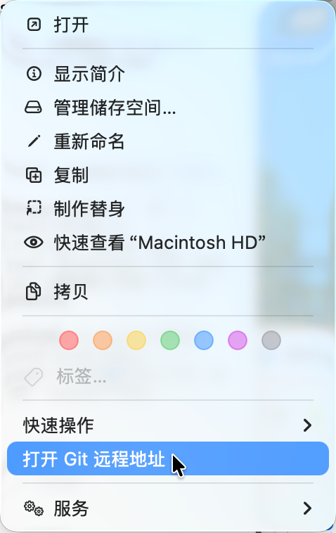

# `JobsGitRemoteOpener`


<!-- jobs-toc:start -->
<!-- jobs-toc:source {"v":2,"token":"[toc]"} -->
<details>
<summary>📚 目录（点击展开 / 收起）</summary>

- [🔥 前言](#jobs-toc-heading-1)
- [一、适用场景](#jobs-toc-heading-2)
- [二、环境先决条件](#jobs-toc-heading-3)
- [三、运行方式](#jobs-toc-heading-4)
- [四、实现边界](#jobs-toc-heading-5)
- [五、排查说明](#jobs-toc-heading-6)
- [六、本仓目录与脚本入口](#repository-layout-and-entrypoints)
  - [【MacOS】卸载打开Git远程地址Finder扩展.command](#jobs-toc-heading-8)
  - [EnableFinderExtension.zsh](#jobs-toc-heading-9)

</details>
<!-- jobs-toc:end -->

---

## <span id="jobs-toc-heading-1" data-jobs-toc="v2">🔥 <font id=前言>前言</font></span><!-- jobs-toc:heading-end -->



`JobsGitRemoteOpener` 是一个 [**Swift**](https://www.swift.org/) macOS App + Finder Sync Extension 工程，用来把“打开 Git 远程地址”放到 Finder 右键一级菜单区域。

本工程源码、文档与版本由 [MacOS@Extension](../README.md) 统一管理，工程目录随总仓一起取得，保留独立构建、安装与卸载能力。

## <span id="jobs-toc-heading-2" data-jobs-toc="v2">一、适用场景 <a href="#前言" style="font-size:17px; color:green;"><b>🔼</b></a> <a href="#🔚" style="font-size:17px; color:green;"><b>🔽</b></a></span><!-- jobs-toc:heading-end -->

- 在 Finder 中右键一个 Git 仓库文件夹或仓库子目录。
- 通过系统默认浏览器打开仓库 `remote` 对应网页。
- 支持常见地址：

  | remote 形式 | 打开结果 |
  | --- | --- |
  | `https://github.com/org/repo.git` | `https://github.com/org/repo` |
  | `git@github.com:org/repo.git` | `https://github.com/org/repo` |
  | `ssh://git@gitlab.com/org/repo.git` | `https://gitlab.com/org/repo` |
  | `git@ssh.dev.azure.com:v3/org/project/repo` | `https://dev.azure.com/org/project/_git/repo` |

## <span id="jobs-toc-heading-3" data-jobs-toc="v2">二、环境先决条件 <a href="#前言" style="font-size:17px; color:green;"><b>🔼</b></a> <a href="#🔚" style="font-size:17px; color:green;"><b>🔽</b></a></span><!-- jobs-toc:heading-end -->

| 检查项 | 要求 | 说明 |
| --- | --- | --- |
| 系统版本 | macOS `12.0` 及以上 | 工程 `MACOSX_DEPLOYMENT_TARGET` 为 `12.0`，功能依赖 Finder Sync Extension。 |
| 开发工具 | [**Xcode**](https://developer.apple.com/xcode) + `xcodebuild` | 手动运行用 Xcode；根目录批量安装脚本会调用 `xcodebuild` 构建主 App 和扩展。 |
| Finder 扩展 | 系统设置中启用 `打开 Git 远程地址` | 构建阶段会注册并尝试启用扩展；如果菜单未出现，先确认系统设置里的 Finder 扩展开关。 |
| Git 仓库结构 | 目标目录存在可解析的 `.git` 信息 | 支持普通仓库、子模块和 worktree；优先读取真实 Git 配置，子模块 `.git` 指针失效时回退读取父仓 `.gitmodules`，不依赖 `/usr/bin/git`。 |
| 默认浏览器 | 系统默认浏览器可打开网页 | 点击菜单后会把 remote 地址转成网页地址并交给 macOS 默认浏览器打开。 |

建议运行前先做基础自检：

```shell
xcode-select -p
xcodebuild -version
pluginkit -m -p com.apple.FinderSync -A -v | grep JobsGitRemote
```

## <span id="jobs-toc-heading-4" data-jobs-toc="v2">三、运行方式 <a href="#前言" style="font-size:17px; color:green;"><b>🔼</b></a> <a href="#🔚" style="font-size:17px; color:green;"><b>🔽</b></a></span><!-- jobs-toc:heading-end -->

1. 用 [**Xcode**](https://developer.apple.com/xcode) 打开 `JobsGitRemoteOpener.xcodeproj`。
2. 选择 `JobsGitRemoteOpener` Scheme，直接运行主 App。
3. Xcode 构建阶段会自动注册并启用 `com.jobs.JobsGitRemoteOpener.FinderSyncExtension`，成功后会重启 Finder 刷新右键菜单缓存。
4. 回到 Finder，右键 Git 仓库文件夹，点击 `打开 Git 远程地址`。
5. 首次重新安装后，构建阶段可能会等待几十秒，用来等 `pluginkit` 从空状态异步登记到可启用状态。

## <span id="jobs-toc-heading-5" data-jobs-toc="v2">四、实现边界 <a href="#前言" style="font-size:17px; color:green;"><b>🔼</b></a> <a href="#🔚" style="font-size:17px; color:green;"><b>🔽</b></a></span><!-- jobs-toc:heading-end -->

- Finder Sync Extension 可以进入 Finder 右键一级菜单区域，但最终位置由 macOS 决定，不能保证排在系统菜单项前面。
- 扩展默认监控 `/`，用于覆盖 Finder 中任意位置的文件夹右键菜单。
- 扩展不调用 `/usr/bin/git`，优先直接读取 `.git/config`，减少终端环境依赖。
- 支持普通仓库、子模块、worktree 这类 `.git` 文件指向真实 Git 目录的结构；如果子模块 `.git` 文件指向的真实 Git 目录不存在，会向上查找父仓 `.gitmodules` 并读取对应子模块 remote。
- Finder Sync Extension 保留 App Sandbox；本机自用版通过 `com.apple.security.temporary-exception.files.absolute-path.read-only` 给 `/` 增加只读例外，否则菜单可以出现，但点击后读取仓库 `.git/config` 会被 macOS 沙盒拦截。

## <span id="jobs-toc-heading-6" data-jobs-toc="v2">五、排查说明 <a href="#前言" style="font-size:17px; color:green;"><b>🔼</b></a> <a href="#🔚" style="font-size:17px; color:green;"><b>🔽</b></a></span><!-- jobs-toc:heading-end -->

- 右键菜单未出现：
  - 确认 `JobsGitRemoteFinderSync.entitlements` 保留了 `com.apple.security.app-sandbox`；Finder Sync Extension 去掉 sandbox 后可能无法被 `pluginkit` 登记出来。
  - 确认系统设置中 Finder 扩展已经启用，或点击 App 内的 `重新启用扩展`。
  - 重新打开 Finder 窗口。
  - 重新编译后构建阶段会重新启用扩展，并自动重启 Finder。
  - 也可以执行下面命令确认扩展已启用，输出行前面有 `+` 表示启用：

    ```shell
    pluginkit -m -p com.apple.FinderSync -A -v | grep JobsGitRemote
    ```

  - 如果已经注册但没有 `+`，执行下面命令启用：

    ```shell
    pluginkit -e use -i com.jobs.JobsGitRemoteOpener.FinderSyncExtension
    ```

- 点击后没有打开浏览器：
  - 确认 `JobsGitRemoteFinderSync.entitlements` 保留了 `com.apple.security.app-sandbox`。
  - 确认 `JobsGitRemoteFinderSync.entitlements` 里有 `com.apple.security.temporary-exception.files.absolute-path.read-only`，并包含 `/`。
  - 确认仓库存在 `remote`。
  - 优先读取当前分支 upstream remote，其次读取 `origin`，最后读取第一个 remote。
  - 如果右键的是子模块目录，且子模块 `.git` 文件指向的 `../.git/modules/...` 不存在，确认父仓 `.gitmodules` 仍保留该子模块的 `path` 和 `url`。
  - 暂不处理需要额外登录或自定义跳转规则的私有 Git 服务。

- 查看扩展调试日志：

  ```shell
  log stream --predicate 'process == "JobsGitRemoteFinderSync"' --style compact
  ```

  ```shell
  tail -n 200 "$HOME/Library/Containers/com.jobs.JobsGitRemoteOpener.FinderSyncExtension/Data/Library/Application Support/JobsGitRemoteFinderSync/FinderSync.log"
  ```

## 六、<span id="repository-layout-and-entrypoints">本仓目录与脚本入口</span> <a href="#前言" style="font-size:17px; color:green;"><b>🔼</b></a> <a href="#🔚" style="font-size:17px; color:green;"><b>🔽</b></a>

以下为本工程源码与维护入口；依赖环境、Git 元数据、构建缓存和生成产物略去。

```text
.
├── 【MacOS】卸载打开Git远程地址Finder扩展.command/
│   ├── 【MacOS】卸载打开Git远程地址Finder扩展.command
│   └── README.md
├── assets/
├── icon.png
├── JobsGitRemoteFinderSync/
│   ├── FinderSync.swift
│   ├── GitRemoteResolver.swift
│   ├── Info.plist
│   └── JobsGitRemoteFinderSync.entitlements
├── JobsGitRemoteOpener/
│   ├── AppDelegate.swift
│   ├── Info.plist
│   ├── JobsGitRemoteOpener.entitlements
│   └── MainViewController.swift
├── JobsGitRemoteOpener.xcodeproj/
├── README.md
└── Scripts/
    └── EnableFinderExtension.zsh
```

* `JobsGitRemoteOpener/` 保存宿主 APP；`JobsGitRemoteFinderSync/` 保存 Finder 扩展与菜单逻辑；`JobsGitRemoteOpener.xcodeproj/` 保存工程和构建阶段配置。
* `Scripts/` 保存构建后自动注册入口；同名 `.command/` 包保存卸载脚本与其详细说明。

### <span id="jobs-toc-heading-8" data-jobs-toc="v2">[【MacOS】卸载打开Git远程地址Finder扩展.command](./【MacOS】卸载打开Git远程地址Finder扩展.command/【MacOS】卸载打开Git远程地址Finder扩展.command)</span><!-- jobs-toc:heading-end -->

> **目的：** 卸载 JobsGitRemoteOpener 的 Finder 扩展，移除打开 Git 远程地址入口并保留工程源码。

* 阅读自述并回车，检查系统工具，显示当前扩展注册状态。
* 停用扩展，停止宿主 APP 和扩展进程，再注销相应 Finder Sync 注册。
* 清理对应构建 APP、运行标记、旧日志及 Automator 服务残留；源码目录保留。
* 刷新 Services 缓存并重启 Finder，显示结束提示与系统临时目录中的日志位置。

### <span id="jobs-toc-heading-9" data-jobs-toc="v2">[EnableFinderExtension.zsh](./Scripts/EnableFinderExtension.zsh)</span><!-- jobs-toc:heading-end -->

> **目的：** 在 Xcode 构建后注册、启用 JobsGitRemoteOpener 扩展并刷新 Finder。

* 由 Xcode Build Phase 传入构建目录和 APP 名称后自动调用，日志写入系统临时目录。
  * 外层安装器设置 `JOBS_SKIP_FINDER_EXTENSION_BUILD_PHASE=1`：跳过，由外层统一处理。
* 读取扩展状态并停止旧宿主进程，定位本次构建 APP 内的扩展。
  * 扩展目录缺失：保留刷新标记，交给后续 APP 启动处理。
* 注册并请求启用扩展，轮询系统状态；成功后重启 Finder 并清理标记。
  * 未确认启用：保留标记和日志；该构建阶段入口最终返回成功，不把它视作菜单已生效的证明。

<a id="🔚" href="#前言" style="font-size:17px; color:green; font-weight:bold;">我是有底线的➤点我回到首页</a>
