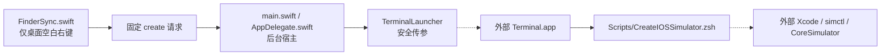
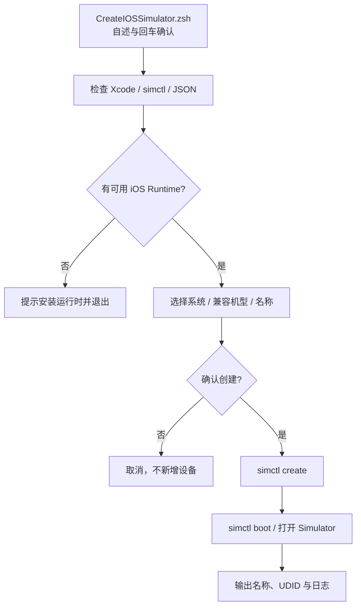

# `JobsIOSSimulatorCreator` 新建 iOS 模拟器


<!-- jobs-toc:start -->
<!-- jobs-toc:source {"v":2,"token":"[toc]"} -->
<details>
<summary>📚 目录（点击展开 / 收起）</summary>

- [🔥 前言](#%E5%89%8D%E8%A8%80)
- [一、安装与使用](#installation)
- [二、依赖、自检与影响范围](#requirements)
- [三、目录与安装单元](#layout)
- [四、模块与业务流程](#flow)
- [五、构建、验证与常见问题](#verification)

</details>
<!-- jobs-toc:end -->

---

## 🔥 <span id="前言">前言</span>

**桌面空白处右键 → 新建 iOS 模拟器 → Terminal 选择系统版本和机型 → 创建并启动。** 独立宿主与 Finder Sync 扩展，由 Jobs 维护；状态：维护中，功能核对日期 **2026-10-20**。

| 入口 / 行为 | 结果 |
| --- | --- |
| 系统桌面空白处 | 显示“新建 iOS 模拟器”；桌面上的本仓其它开发菜单全部隐藏。 |
| 文件夹背景、选中的文件或文件夹 | 不显示“新建 iOS 模拟器”；其它扩展仍按自己的项目条件显示。 |
| 系统版本与设备 | 读取当前 Xcode 的可用 iOS Runtime，按兼容信息选择 iPhone / iPad；不硬编码 iOS 版本和机型。 |
| 选择与取消 | 优先复用健康的 fzf，缺失时使用编号选择；取消、EOF 或无交互输入均不会创建。 |
| 创建结果 | 自动命名并避开已有同名设备，创建并启动新设备；失败保留日志和已创建 UDID 便于重试。 |

本工程是 [MacOS@Extension](../README.md) 中的普通源码目录，包含独立 `.xcodeproj`、Scheme、Bundle ID、安装与卸载入口；没有独立 Git 或子模块。业务从[原初始化脚本](../../../JobsCommand@iOS/其他/【MacOS】📱双击初始化iOS模拟器.command/README.md)整理，脚本随 App 打包，不依赖原脚本仍在磁盘上。不执行原脚本的 Simulator 清场，不影响已有设备。

## 一、<span id="installation">安装与使用</span> <a href="#前言" style="font-size:17px; color:green;"><b>🔼</b></a> <a href="#🔚" style="font-size:17px; color:green;"><b>🔽</b></a>

1、推荐运行[总安装器](../【MacOS】🧩安装Finder扩展.command)，只勾选“新建 iOS 模拟器”后点击安装；也可双击[独立安装脚本](./【MacOS】安装iOS模拟器Finder扩展.command/【MacOS】安装iOS模拟器Finder扩展.command)。独立入口先显示自述，直接回车跳过，输入任意字符后回车安装。

2、首次按系统提示启用 `JobsIOSSimulatorCreator` 的 Finder 扩展。右键后若系统询问控制 Terminal，允许后继续；授权由系统管理。宿主是无 Dock 图标的后台转发进程，终端派发完成即退出。

3、在桌面空白处右键“新建 iOS 模拟器”，阅读终端自述并回车，再选择可用系统版本与兼容机型。脚本自动生成设备名，最后回车创建并启动，任意非空输入取消。

4、创建成功会启动新设备，并打开所选 Xcode 配套的 Simulator 或 Device Hub。Device Hub 中按终端输出的设备名选中设备即可；新建的是 CoreSimulator 设备，不会在桌面生成一个文件夹。窗口启动失败时，终端保留新 UDID，可在 Xcode 中找到该设备。

5、卸载使用[独立卸载脚本](./【MacOS】卸载iOS模拟器Finder扩展.command/【MacOS】卸载iOS模拟器Finder扩展.command)或总卸载器；独立入口显示注册路径后要求输入 `YES`。卸载只移除右键扩展及核验过的宿主 App，已创建的模拟器和系统运行时保留。

## 二、<span id="requirements">依赖、自检与影响范围</span> <a href="#前言" style="font-size:17px; color:green;"><b>🔼</b></a> <a href="#🔚" style="font-size:17px; color:green;"><b>🔽</b></a>

| 依赖 | 健康检查 / 边界 |
| --- | --- |
| [**macOS**](https://www.apple.com/macos/) 12.0+ | 两个 target 的部署目标为 12.0，桌面菜单依赖 Finder Sync。 |
| [**Xcode**](https://developer.apple.com/xcode/) | 完整 Xcode、有效开发目录、macOS SDK（构建）和可用 `simctl`（创建）；只装 Command Line Tools 不够。 |
| [**iOS Simulator**](https://developer.apple.com/documentation/xcode/running-your-app-on-simulated-or-physical-devices) | 至少一个本机可用 iOS Runtime；缺失时明确提示在 Xcode 的 Components / Platforms 安装，不自动下载。兼容传统 Simulator 与本机 Xcode 27.1 的 Device Hub。 |
| zsh / osascript / JXA | 系统工具，JSON 通过 JXA 解析，不需要 Python、Node、Ruby 或额外包运行创建流程。Ruby 仅用于开发回归。 |
| [**fzf**](https://github.com/junegunn/fzf) | 可选，先检查可执行性；没有可用版本时改用编号选择，不自动安装或升级。 |

本地依赖链为 `FinderSync → 后台宿主 → Terminal → zsh / JXA → 所选 Xcode simctl → 可用 iOS Runtime`。只查询环境并新增所选设备，不修改 `xcode-select`、代理、Shell 配置、其它设备或运行时。创建新设备会使用磁盘空间，设备数据由 CoreSimulator 管理。

只读自检和直接终端入口（在本工程目录）：

```shell
/bin/zsh ./Scripts/CreateIOSSimulator.zsh --help
/bin/zsh ./Scripts/CreateIOSSimulator.zsh --check
/bin/zsh ./Scripts/CreateIOSSimulator.zsh
```

自检不会创建、启动、删除设备或安装工具。运行时固定从 App 的资源目录取得脚本，工程复制到任意目录后仍可独立构建和安装。

## 三、<span id="layout">目录与安装单元</span> <a href="#前言" style="font-size:17px; color:green;"><b>🔼</b></a> <a href="#🔚" style="font-size:17px; color:green;"><b>🔽</b></a>

```text
./
├── JobsIOSSimulatorCreator.xcodeproj/  # 宿主 + 内嵌 Finder 扩展
├── JobsIOSSimulatorCreator/           # main / AppDelegate / Terminal 转发
├── JobsIOSSimulatorFinderSync/        # 仅桌面空白菜单
├── Scripts/                          # 创建业务与构建后启用入口
├── Tests/                            # 原生协议及隔离脚本回归
├── 【MacOS】安装iOS模拟器Finder扩展.command/
└── 【MacOS】卸载iOS模拟器Finder扩展.command/
```

| 标识 | 值 |
| --- | --- |
| 宿主 / Scheme | `JobsIOSSimulatorCreator` |
| Finder 扩展产品 | `JobsIOSSimulatorFinderSync.appex` |
| 宿主 Bundle ID | `com.jobs.iossimulatorcreator` |
| 扩展 Bundle ID | `com.jobs.iossimulatorcreator.findersync` |
| 安装面板功能 ID | `ios-simulator-create` |
| 唯一业务 URL | `jobsiossimulatorcreator://simulator/create`，拒绝其它动作和附加参数 |

总安装器产物位于仓库 `work/JobsIOSSimulatorCreatorDerivedData/`，独立安装器产物位于本工程 `work/DerivedData/`。系统直接注册相应位置的 App / appex，使用期间保留该目录，清理前先卸载。两种安装方式使用相同 Bundle ID，不同时维护多份注册副本。

## 四、<span id="flow">模块与业务流程</span> <a href="#前言" style="font-size:17px; color:green;"><b>🔼</b></a> <a href="#🔚" style="font-size:17px; color:green;"><b>🔽</b></a>





## 五、<span id="verification">构建、验证与常见问题</span> <a href="#前言" style="font-size:17px; color:green;"><b>🔼</b></a> <a href="#🔚" style="font-size:17px; color:green;"><b>🔽</b></a>

在本工程目录只编译源码、跳过扩展注册：

```shell
JOBS_SKIP_FINDER_EXTENSION_BUILD_PHASE=1 xcodebuild \
  -project ./JobsIOSSimulatorCreator.xcodeproj \
  -scheme JobsIOSSimulatorCreator \
  -configuration Debug \
  -derivedDataPath ./work/VerificationDerivedData \
  build
```

- 运行测试与脚本职责见 [Scripts 说明](./Scripts/README.md)；开发验证只使用临时夹具，不创建真实模拟器。
- 菜单没有出现：确认扩展已启用、App 与 appex 签名有效、注册路径还存在，然后重新打开桌面右键菜单。Finder 菜单注册机制依据 [Apple Finder Sync 文档](https://developer.apple.com/library/archive/documentation/General/Conceptual/ExtensibilityPG/Finder.html)。
- 没有可用系统：到 Xcode 的 Components / Platforms 下载 iOS Runtime，再重试。运行时与设备是不同对象，说明见 [Apple 添加模拟器文档](https://developer.apple.com/documentation/safari-developer-tools/adding-additional-simulators)。
- Xcode 27 没有旧 `Simulator.app`：脚本会核验同一 Xcode 内的 Device Hub 并打开，不因此阻断创建。新的设备管理方式见 [Apple Device Hub 文档](https://developer.apple.com/documentation/xcode/managing-your-simulated-and-physical-devices-in-device-hub)。
- 无法打开 Terminal：在系统设置的“隐私与安全性 → 自动化”检查宿主控制 Terminal 的权限；不自动修改 TCC 数据库。
- 创建后启动失败：保留 UDID 和日志，修复环境后在 Xcode / Simulator 中启动；程序不以删除新设备掩盖失败。
- 本工程无服务器、API、假数据模式或网络图片；列表只来自本机真实 CoreSimulator，空列表提供修复提示，重新运行即可重新读取。

桌面路径修复：沙盒中的 `NSHomeDirectoryForUser` 仍可能返回容器 Home，导致只监控 `Data/Desktop` 别名而收不到真实桌面的菜单回调。现用 `getpwuid_r(getuid())` 取得真实 Home，保留系统桌面别名，并监控根目录 `/` 接收 Finder 回调；菜单层按桌面完整路径白名单过滤，普通文件夹背景及所有选中项菜单均隐藏。白名单命中不依赖桌面文件属性读取权限。

验证日期 **2026-10-20（Asia/Shanghai）**：Xcode **27.1 / 27A9275**、macOS arm64 的 Debug 双 target 构建与 ad-hoc 深度签名验证通过；脚本业务 25 项 / 140 断言、安装注册 10 项 / 66 断言、原生传输与菜单 66 断言、父安装映射 19 项 / 108 断言通过。真实只读 `--check` 已核验同一 Xcode 的 Device Hub 与本机可用 iOS 清单。桌面范围回归 `Tests/DesktopFinderMenuTests.rb` 直接执行真实菜单源码，177 条 Swift 菜单断言通过。

本机已完成 8 个相关扩展的增量构建、深度签名和原路径启用校验，并统一刷新一次 Finder；其它四项扩展的注册路径与启用状态保留。现行产物使用总安装器的 `work/<工程名>DerivedData/` 位置。**真实桌面与普通文件夹空白右键均已验证：桌面只新增“新建 iOS 模拟器”；普通空文件夹保留原有通用菜单，不显示模拟器入口。** [桌面验收截图](../work/JobsIOSSimulatorDesktopMenu.png)与[普通文件夹验收截图](../work/JobsIOSSimulatorFolderMenu.png)位于本机 `work/` 产物目录，未由 Git 跟踪。没有创建或启动真实模拟器，系统自动化授权和实际创建仍按实机运行验收。

桌面与普通文件夹菜单已完成实机验证；编译、菜单与隔离回归不替代真实系统授权和创建设备的验收。原生回归在本工程目录可用以下命令独立运行，输出程序位于系统临时目录：

```shell
swiftc \
  ./JobsIOSSimulatorShared/IOSSimulatorRequest/IOSSimulatorRequest.swift \
  ./JobsIOSSimulatorShared/IOSSimulatorMenuContext/IOSSimulatorMenuContext.swift \
  ./JobsIOSSimulatorCreator/IOSSimulatorTerminalLauncher/IOSSimulatorTerminalLauncher.swift \
  ./JobsIOSSimulatorCreator/IOSSimulatorModel/IOSSimulatorModel.swift \
  ./Tests/IOSSimulatorTransportTests.swift \
  -o /tmp/JobsIOSSimulatorTransportTests
/tmp/JobsIOSSimulatorTransportTests
```

<a id="🔚" href="#前言" style="font-size:17px; color:green; font-weight:bold;">我是有底线的➤点我回到首页</a>
