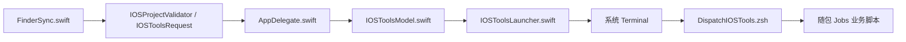
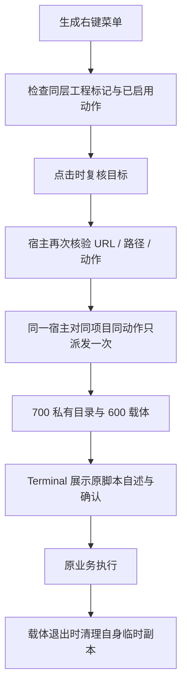

# JobsIOSTools：iOS / CocoaPods 辅助工具


<!-- jobs-toc:start -->
<!-- jobs-toc:source {"v":2,"token":"[toc]"} -->
<details>
<summary>📚 目录（点击展开 / 收起）</summary>

- [🔥 前言](#%E5%89%8D%E8%A8%80)
- [一、菜单显示范围](#project-scope)
- [二、JobsCodeSnippets 的目标与更新](#code-snippets)
- [三、安装、选择与卸载](#installation)
- [四、资源、日志与只读验证](#resources-and-checks)
- [五、模块与业务流程](#flow)

</details>
<!-- jobs-toc:end -->

---

## 🔥 <span id="前言">前言</span>

在 [**Finder**](https://support.apple.com/zh-cn/102339) 中右键一个 iOS 项目文件夹，打开“iOS / CocoaPods 辅助工具”子菜单，在 [**Terminal**](https://support.apple.com/guide/terminal/welcome/mac) 执行下表十一项工具。十一项可在[总管理面板](../【MacOS】🧩管理Finder扩展.command)分别勾选，共用一个 App 与 Finder Sync Extension；安装菜单不会执行工具业务。

| 菜单 | 功能标识 | 当前功能 |
| --- | --- | --- |
| 禁用 Xcode 脚本沙盒 | `ios-disable-sandbox` | 为目标工程设置 `ENABLE_USER_SCRIPT_SANDBOXING = NO`，未找到 `.xcodeproj` 时保留拖入工程交互。 |
| 安装 CocoaPods | `ios-install-cocoapods` | 保留原 CocoaPods / Ruby / Homebrew / fzf 体检、安装与可选升级交互，影响当前用户工具环境。 |
| CocoaPods 源：CDN → GitHub | `ios-pods-source-github` | 运行原 Specs 源切换流程，影响 CocoaPods 仓库配置。 |
| 提取项目中所有 Pod 相关文件 | `ios-extract-pods` | 提取 podspec、关联 JobsPodspecKit.rb 与根 Podfile 系列到桌面时间戳目录；保留可选 ZIP 交互。 |
| Pod Install | `ios-pod-install` | 仅同层有普通 `Podfile` 和 `*.xcodeproj` 时显示；直接进入 Terminal 现有交互 Shell 执行 `pod install`，不包裹输入输出或自动回答 Podfile 提示。 |
| Pod Update | `ios-pod-update` | 执行原 `pod update`，Apple Silicon 保留 Rosetta 分支；成功后可创建桌面 workspace 链接，修改依赖及锁文件。 |
| 查询 Xcode 工程依赖关系 | `ios-xcode-dependencies` | 生成原 Markdown / 图形依赖报告，Graphviz 环境检查与安装升级保留原确认；没有 podspec 时报告可为空。 |
| 更新 CocoaPods 本地仓库 | `ios-pod-repo-update` | 原脚本实际执行 `pod install --repo-update`，同时刷新 Specs 与安装项目依赖；保留为当前目录普通文件增加执行权限的原行为。 |
| 自检当前本地 Pod 能否编译 | `ios-pod-build-check` | 只对同层普通 `*.podspec` 文件显示；多个时选择一个，从父目录发现兄弟依赖，保留智能依赖 / 兼容重试及源码编译与 lint 结果区分。 |
| 安装 / 升级 JobsCodeSnippets | `ios-code-snippets` | 对齐当前用户 Xcode 代码片段目录，首次安装或保护本地内容后升级。 |
| 清理 iOS/Xcode 构建产物 | `ios-clean-build-artifacts` | 只对识别为 iOS 的工程显示；预览白名单产物，精确输入 `CLEAN` 后清理当前工程 `build/`、`DerivedData/` 与归属明确的默认 DerivedData `Build/`。保留 Pods、锁文件、源码及其它工程产物。 |

清理入口仅保留“清理 iOS/Xcode 构建产物”：先预览当前工程白名单，输入 `CLEAN` 才删除。旧 `ios-clean-cache` 功能配置、安装 / 卸载参数与 URL 自动映射到此动作，不再提供单独缓存清理菜单或调用依赖重置脚本；不删除 Pods、锁文件或其它工程的 DerivedData。

`Pod Install` 与 `Pod Update` 相邻，构建产物清理也归入此子菜单；不再从 `JobsTerminalOpener` 添加这两项外层菜单。总面板中的 Pod Install 仍使用 `pod_install` 选择标识，安装时映射为本包动作；IPA 重签由 `JobsIPAResigner` 独立提供。

## 一、<span id="project-scope">菜单显示范围</span> <a href="#前言" style="font-size:17px; color:green;"><b>🔼</b></a> <a href="#🔚" style="font-size:17px; color:green;"><b>🔽</b></a>

只接受一个普通本地项目文件夹，或该文件夹内部空白处；当前层须直接存在 `*.xcodeproj`、`*.xcworkspace`、`Podfile`、`Package.swift` 或普通 `*.podspec` 文件之一。系统桌面空白、普通文件、目录包、符号链接、多选和不匹配目录不显示本包菜单。目录识别不递归查找父子工程。

本地 Pod 编译自检另要求同层普通 `*.podspec` 文件；子目录中的 `.podspec` 与 `.podspec.json` 不满足该项条件。`Pod Install` 要求同层普通 `Podfile` 和至少一个 `*.xcodeproj` 目录包，不要求已有 workspace；构建产物清理额外识别 Xcode 工程内的 iOS 平台配置，并排除 Flutter 根目录。其余八项按一般 iOS 工程条件显示。Finder 菜单、宿主和 Terminal 分发器分别复核目标，菜单打开后项目变化时停止。

工程标记扩展按表中大小写精确匹配；隐藏的 `.Current.podspec` 普通文件同样有效，名称以 `.podspec` 结尾的目录不算 Pod 定义。菜单出现后，每个原脚本继续核验自身所需的 Podfile、工具链及配置。本地 Pod 自检从 Finder 启动时不修补其它仓库的 `x.command` 文案。

## 二、<span id="code-snippets">JobsCodeSnippets 的目标与更新</span> <a href="#前言" style="font-size:17px; color:green;"><b>🔼</b></a> <a href="#🔚" style="font-size:17px; color:green;"><b>🔽</b></a>

右键项目只决定菜单能否出现，实际安装 / 升级目标始终是**当前用户资源库中的 `Developer/Xcode/UserData/CodeSnippets`**。不在所选 iOS 工程执行提交或拉取，不把片段复制到工程内。

点击后打开 Terminal，展示目标与来源；先回车确认自述，再输入任意字符执行，直接回车跳过。目标缺失或为空时首次安装；已有独立 Git 仓库时按当前分支的明确上游更新。在完整副本中保护暂存、未暂存及未跟踪内容，再取得并合并远端，不创建 commit 或推送。可快进时更新分支；存在分叉时保留不创建 commit 的暂存合并结果，由本人审阅提交后再升级。

拉取、合并或恢复本地内容仍有冲突时，实际安装目录保持更新前原状，终端显示手动合并指引，失败候选与备份保留在代码片段目标的同级私有目录。发布前再次比较原目录，发现并发改动即停止，不覆盖用户的新修改。成功后保留原始备份，Xcode 由本人重新打开。

菜单分发器要求随 App 携带 `Scripts/Tools/【MacOS】⚙️双击安装JobsCodeSnippets.command`，并传入 `--finder <项目绝对路径>` 做资格校验。规范源为 [JobsCommand@iOS 中的独立脚本](../../../JobsCommand@iOS/配置相关/【MacOS】⚙️双击安装JobsCodeSnippets.command/【MacOS】⚙️双击安装JobsCodeSnippets.command)；完整参数、Git 边界与日志见[独立脚本说明](../../../JobsCommand@iOS/配置相关/【MacOS】⚙️双击安装JobsCodeSnippets.command/README.md)。安装后的 App 只读取自身资源，不读取另一仓库。

随包代码片段脚本与规范源逐字节一致，摘要登记在 `SourceManifest.json`；维护规范源后须同步该副本并重新安装菜单，以更新 App 资源。

安装 / 卸载 Finder 菜单只管理本包与功能选择，不安装、升级或移除已经存在的代码片段。

## 三、<span id="installation">安装、选择与卸载</span> <a href="#前言" style="font-size:17px; color:green;"><b>🔼</b></a> <a href="#🔚" style="font-size:17px; color:green;"><b>🔽</b></a>

菜单安装与卸载统一使用 [图形管理入口](./【MacOS】管理iOS辅助工具Finder扩展.app)。直接打开面板，选择“安装 / 更新”或“卸载”并勾选当前范围内的功能；默认空选，点击操作按钮即确认。每项显示等待、正在安装 / 卸载、成功或失败；底部日志实时滚动，可选择复制或复制全部。运行中锁定选择和关闭入口，结束后保留结果与日志。首次打开或面板源码更新后会在后台编译，失败以桌面提示和启动日志说明。

原同名 `.command` 入口保留，终端只负责唤起独立 GUI，随后结束启动脚本；本次启动任务结束后自动关闭对应终端页，安装 / 卸载、进度与实时日志均由 GUI 后台处理。已有交互 Shell 中手工调用时保留原工作会话。内部实现为 `Scripts/ManageExtension.zsh`；完整仓内单功能入口使用总面板的受限范围。可独立复制的包须整体保留 `.command`、`.app`、Scripts、工程源码和资源。

启动器按自身位置定位配套文件，不依赖本机固定目录或启动时的工作目录。`.command` 会把当前包目录传给同名 App；直接打开 App 无法定位 `Scripts` 时，按提示选择同时包含同名 App 与 `Scripts/` 的原始目录，取消选择不会执行安装或卸载。

每项失败后，点击红色带下划线的“失败，见日志”，会新建 Terminal 会话并用 `cat` 显示本次完整会话日志；现有任务继续，已有终端保留。“日志文件”按钮仍用于在 Finder 中定位原始日志。

需要完整 Xcode、macOS SDK、当前用户图形桌面与本工程源码。优先使用 [总管理面板](../【MacOS】🧩管理Finder扩展.command) 在 iOS 分组勾选一项或多项，切换安装 / 更新或卸载；本目录管理入口也支持按 `--features` 指定范围。省略范围时处理全部十一项，未知标识停止。

在本 README 所在目录执行，只安装代码片段菜单，或仅卸载该菜单：

```shell
/bin/zsh ./【MacOS】管理iOS辅助工具Finder扩展.command \
  --action install \
  --features ios-code-snippets

/bin/zsh ./【MacOS】管理iOS辅助工具Finder扩展.command \
  --action uninstall \
  --features ios-code-snippets
```

`--features` 接受逗号分隔标识，也支持 `--features=...`；例如 `ios-pod-install,ios-clean-build-artifacts`。安装与已有功能配置取并集，成功构建后保存，不关闭未选但已启用的功能。卸载只减去指定功能，仍有其它项时保留同一个 App 与扩展登记，全部关闭后才注销并移除核验为本包的构建 App。

当前用户应用支持目录的 `JobsIOSTools/EnabledFeatures.txt` 保存选择，不改写签名后的 App 资源。宿主和扩展优先读取真实用户配置；空配置表示全部关闭，读取失败保守关闭，无配置才使用随包缺省值。`JOBS_INSTALL_FEATURES` 是未指定 CLI 范围时的兼容输入，明确参数优先。最低部署目标 macOS 12、Swift 语言模式 5.0（工程配置）。

项目源码、iOS 工程、片段仓库和其它业务产物保留；安装 / 卸载菜单不安装、升级或删除代码片段，也不执行 Pod、清理或项目改写。两种操作会刷新 Finder，请先结束文件搬移。内部 `Scripts/ManageExtension.zsh` 的 `--skip-finder-restart` 将刷新交给外层；`--action ... --non-interactive` 仅供面板或已确认的总管理器调用，会实际执行，不能用于只读检查；公开启动器只唤起 GUI。

## 四、<span id="resources-and-checks">资源、日志与只读验证</span> <a href="#前言" style="font-size:17px; color:green;"><b>🔼</b></a> <a href="#🔚" style="font-size:17px; color:green;"><b>🔽</b></a>

| 路径 | 职责 |
| --- | --- |
| [IOSToolsRequest.swift](./JobsIOSToolsShared/IOSToolsRequest/IOSToolsRequest.swift) | 固定动作、标题与 URL 参数校验。 |
| [IOSProjectValidator.swift](./JobsIOSToolsShared/IOSProjectValidator/IOSProjectValidator.swift) | 项目识别、Pod 专项门禁与用户功能配置读取。 |
| [FinderSync.swift](./JobsIOSToolsFinderSync/FinderSync.swift) | 菜单生成与点击时重新读取目标。 |
| [IOSToolsLauncher.swift](./JobsIOSTools/IOSToolsLauncher/IOSToolsLauncher.swift) | 私有 Terminal 载体与按参数传递路径。 |
| [DispatchIOSTools.zsh](./Scripts/Tools/DispatchIOSTools.zsh) | 固定映射、目标复核与随包脚本执行。 |
| [SourceManifest.json](./Scripts/Tools/SourceManifest.json) | 规范源路径、源与打包资源摘要。 |

安装器在本目录 `work/DerivedData` 保存产物；根管理器使用上级 `work/JobsIOSToolsDerivedData`。系统从已注册路径启动扩展，不能把注册产物当作普通缓存删除。宿主 ID 为 `com.jobs.JobsIOSTools`，扩展 ID 为 `com.jobs.JobsIOSTools.FinderSyncExtension`。

[脚本说明](./Scripts/README.md)与[随包资源说明](./Scripts/Tools/README.md)分别说明构建挂载与原脚本适配。宿主资源阶段复制整个 Tools 目录；外部安装器与隔离构建使用 `JOBS_SKIP_FINDER_EXTENSION_BUILD_PHASE=1` 跳过自定义注册阶段。Xcode 自身仍可能登记临时宿主 URL，隔离构建结束应精确注销测试产物。工程只依赖 macOS SDK 中的 AppKit / Foundation / FinderSync，没有外部 Swift 包或 CocoaPods 构建依赖；业务所需工具仍沿用原脚本体检策略。

业务开始前用 `--plan` 只检查固定动作、项目资格与资源存在，不运行脚本：

```shell
/bin/zsh ./Scripts/Tools/DispatchIOSTools.zsh \
  --plan \
  ios-code-snippets \
  "$PWD/示例iOS工程"
```

安装日志、卸载日志和每项原脚本业务日志位于系统临时目录，具体文件名由入口自述显示；宿主派发日志为 `JobsIOSTools.log`。Terminal 中可看到动作、项目路径、实际随包脚本来源及业务错误。

隔离回归从本目录运行，不执行安装或注册、不访问用户片段仓库：

```shell
ruby ./Tests/IOSToolsTests.rb
ruby ../Tests/IOSToolsInstallerIntegrationTests.rb
ruby ../Tests/IOSToolsCodeSnippetsTests.rb
```

源码映射、Shell 语法及临时假业务验证不替代重新安装后的 Finder 菜单、Terminal 自动化权限与真实远端更新验收。

本目录隔离回归覆盖各随包动作、旧清理标识迁移、隐藏 / 普通 Pod 定义门禁、配置合并 / 逐项移除、严格 URL 解析、两种系统 URL 回调去重和中文 / 引号 / 换行路径传递；Debug 构建与签名验证独立完成。验证不会执行清理、CocoaPods 安装、依赖更新或 Pod 编译。

## 五、<span id="flow">模块与业务流程</span> <a href="#前言" style="font-size:17px; color:green;"><b>🔼</b></a> <a href="#🔚" style="font-size:17px; color:green;"><b>🔽</b></a>





<a id="🔚" href="#前言" style="font-size:17px; color:green; font-weight:bold;">我是有底线的➤点我回到首页</a>
