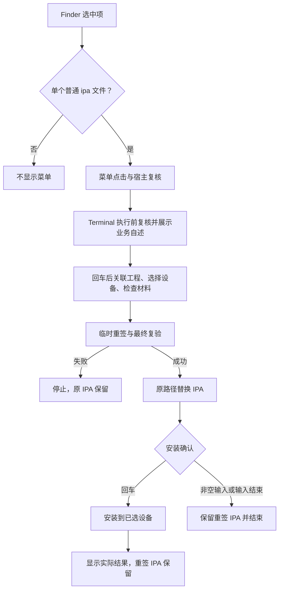

# `JobsIPAResigner` IPA 免编译重签


<!-- jobs-toc:start -->
<!-- jobs-toc:source {"v":2,"token":"[toc]"} -->
<details>
<summary>📚 目录（点击展开 / 收起）</summary>

- [🔥 前言](#%E5%89%8D%E8%A8%80)
- [一、当前功能与菜单边界](#features)
- [二、安装、启用与卸载](#installation)
  - [2.1、安装与首次使用](#install)
  - [2.2、卸载影响与确认](#uninstall)
- [三、右键操作与结果](#usage)
- [四、工程结构与派发](#layout)
- [五、日志、验证与排查](#diagnostics)

</details>
<!-- jobs-toc:end -->

---

## 🔥 <span id="前言">前言</span>

在 [**Finder**](https://support.apple.com/guide/mac-help/welcome/mac) 中只选中一个普通 `.ipa` 文件，右键选择“IPA 免编译重签”，再到 [**Terminal**](https://support.apple.com/guide/terminal/welcome/mac) 阅读说明并回车。所选 IPA 自动传入，后续关联工程、选择设备、检查签名材料并重签；通过最终验证后覆盖原 IPA，再询问是否安装到设备。

由 Jobs 维护，当前为 [MacOS@Extension](../README.md) 中的独立功能目录；有自己的工程、Scheme、宿主、扩展及安装 / 卸载入口，不新增独立 [**Git**](https://git-scm.com/) 仓库。重签业务完整打包在 App 内，安装后不依赖原 `JobsCommand@iOS` 目录。

<span style="color:red"><b>重签成功会覆盖所选 IPA，不自动备份旧包。需要保留旧签名时，请先复制备份。跳过安装不撤销已经完成的文件替换。</b></span>

## 一、<span id="features">当前功能与菜单边界</span> <a href="#前言" style="font-size:17px; color:green;"><b>🔼</b></a> <a href="#🔚" style="font-size:17px; color:green;"><b>🔽</b></a>

| 功能 | 当前行为 |
| --- | --- |
| 显示菜单 | 只选一个普通 `.ipa` 文件时显示，后缀不区分大小写。 |
| 隐藏菜单 | 其它后缀、目录、文件包、符号链接、多选、目录或桌面空白处均不显示。 |
| 请求复核 | 点击菜单、宿主接收与 Terminal 执行前重新核验目标；失效时停止。 |
| 工程关联 | 回车从 IPA 向上找工程；也可拖入目录，按主 App Bundle ID 验证归属。 |
| 设备选择 | 单台自动选中，多台使用 [**fzf**](https://formulae.brew.sh/formula/fzf)；无设备可重扫或手填硬件 UDID。 |
| 签名检查 | 保持原团队与 Bundle ID，为主 App 和各扩展匹配描述文件、共同证书私钥及权限。 |
| 材料不足 | 提示人工到 [**Xcode**](https://developer.apple.com/xcode) 刷新，首次检查后最多额外复检三轮。 |
| 文件交付 | 临时副本签名、权限回读、最终解包复验通过后，在原路径替换 IPA。 |
| 可选安装 | 替换后直接回车安装；任意非空输入，包括空格，结束；不自动卸载或启动 App。 |

适用于自有、未加密的 [**iOS**](https://developer.apple.com/ios/) Development / Ad Hoc IPA，`Payload` 下只含一个主 App。需要有效描述文件、钥匙串中匹配的证书私钥，以及已被描述文件授权的设备。关联工程必须通过 Bundle ID 校验；没有跳过工程或只安装模式。

不支持 App Store 加密包、跨团队迁移、Watch App、[**macOS**](https://www.apple.com/macos/) / tvOS 包及嵌套 XPC 服务；不登录 Apple、不申请证书、不自动续期描述文件、不编译源码。具体的工程查找、权限恢复、描述文件匹配、默认值及失败边界见[完整业务说明](../../../JobsCommand@iOS/其他/【MacOS】✍️IPA免编译重签.command/README.md)。

## 二、<span id="installation">安装、启用与卸载</span> <a href="#前言" style="font-size:17px; color:green;"><b>🔼</b></a> <a href="#🔚" style="font-size:17px; color:green;"><b>🔽</b></a>

### 2.1、<span id="install">安装与首次使用</span> <a href="#前言" style="font-size:17px; color:green;"><b>🔼</b></a> <a href="#🔚" style="font-size:17px; color:green;"><b>🔽</b></a>

1、准备 [**macOS**](https://www.apple.com/macos/) 12.0+ 和完整 [**Xcode**](https://developer.apple.com/xcode)，完成首次启动组件配置；重签及设备安装还要求 `xcrun` 能找到可用的 `otool`、`devicectl`。安装器不下载 Xcode，也不修改 `xcode-select`。

2、双击[安装入口](./【MacOS】安装IPA免编译重签Finder扩展.command)。阅读自述后直接回车安装；任意非空输入跳过，`Ctrl+C` 或输入结束取消。也可从[总安装面板](../README.md)单独勾选本功能，功能标识为 `ipa-resign`。

3、安装器构建当前工程，核验宿主 / 扩展身份及签名，精确注销同 ID 的旧副本登记，注册当前产物并刷新 Finder。安装本身不重签 IPA，也不安装手机 App；旧副本的 App 文件保留。

4、仅选中一个普通 `.ipa` 后右键。首次派发按系统提示允许宿主控制 Terminal；若菜单未出现，在系统设置的 Finder 扩展中检查 `JobsIPAResigner` 是否启用。

独立安装的产物位于 `./work/DerivedData/Build/Products/Debug/JobsIPAResigner.app`，系统从该位置加载扩展，安装后请保留。总安装器使用上级 `work/` 中本功能对应的构建目录；两种入口处理同一个扩展 ID。

### 2.2、<span id="uninstall">卸载影响与确认</span> <a href="#前言" style="font-size:17px; color:green;"><b>🔼</b></a> <a href="#🔚" style="font-size:17px; color:green;"><b>🔽</b></a>

双击[卸载入口](./【MacOS】卸载IPA免编译重签Finder扩展.command)，先回车查看待处理路径，再输入精确 `YES` 才停用、注销并移除已登记的本功能 App，随后刷新 Finder。其它输入取消；删除前复核 App 名称、Bundle ID 和真实目录类型。

卸载保留源码、原独立脚本及已经重签的 IPA；不会恢复旧 IPA、撤销签名或卸载手机上的 App。Finder 会在安装 / 卸载时刷新，文件操作请先完成。

## 三、<span id="usage">右键操作与结果</span> <a href="#前言" style="font-size:17px; color:green;"><b>🔼</b></a> <a href="#🔚" style="font-size:17px; color:green;"><b>🔽</b></a>

1、右键所选 `.ipa`，点击“IPA 免编译重签”；Terminal 显示内置自述，回车进入流程，`Ctrl+C` 取消。

2、关联工程。直接回车从 IPA 所在目录向上查找；失败时拖入对应工程文件夹，主 App Bundle ID 必须匹配。

3、选择目标设备并完成材料检查。多设备才需要 [**fzf**](https://formulae.brew.sh/formula/fzf)；缺失时通过可用 [**Homebrew**](https://brew.sh/) 提示安装 / 修复，回车跳过并结束，输入任意字符才执行。没有健康 Homebrew 时停止并提示人工准备。

4、重签与最终复验通过后覆盖原 IPA。失败发生在替换前时原文件保留；安装阶段失败时保留已经重签的 IPA，不回滚到旧签名。

5、显示安装目标后，直接回车安装到已选设备；任何非空输入结束。安装使用 `devicectl`，最多等待 180 秒，命令及结构化结果都成功才显示成功。超时后检查设备实际状态再决定是否重试。

右键启动优先读取当前用户的 Xcode 描述文件缓存。需要手动放置 `.mobileprovision` 时，请按 [Scripts 说明](./Scripts/README.md#profiles)使用独立脚本旁的 `描述文件/` 目录；右键临时副本不会自动读取源码目录中的该目录。



## 四、<span id="layout">工程结构与派发</span> <a href="#前言" style="font-size:17px; color:green;"><b>🔼</b></a> <a href="#🔚" style="font-size:17px; color:green;"><b>🔽</b></a>

```text
./
├── README.md
├── JobsIPAResigner.xcodeproj/        # 宿主与 Finder 扩展
├── JobsIPAResigner/                 # App 生命周期、宿主校验与 Terminal 派发
├── JobsIPAResignerFinderSync/       # 菜单显示及点击复核
├── JobsIPAResignShared/             # 普通 IPA 校验、URL 数据与系统工厂
├── Scripts/                        # 完整重签脚本、构建后注册、就近说明
├── Tests/                          # 菜单、参数传递与安装登记隔离回归
├── 【MacOS】安装IPA免编译重签Finder扩展.command
└── 【MacOS】卸载IPA免编译重签Finder扩展.command
```

| 配置项 | 当前值（依据工程与源码，2026-10-23） |
| --- | --- |
| 工程 / Scheme | `JobsIPAResigner.xcodeproj` / `JobsIPAResigner` |
| 宿主 Bundle ID | `com.jobs.JobsIPAResigner` |
| 扩展产品 / Bundle ID | `JobsIPAResignerFinderSync.appex` / `com.jobs.JobsIPAResigner.FinderSyncExtension` |
| URL | `jobsiparesigner://resign?path=...`，只接收一个合法 IPA 路径 |
| 语言 / 系统 | `SWIFT_VERSION = 5.0`，`MACOSX_DEPLOYMENT_TARGET = 12.0`；实际编译器随 Xcode |
| 依赖 | 宿主使用系统 [**AppKit**](https://developer.apple.com/documentation/appkit)、[**FinderSync**](https://developer.apple.com/documentation/findersync)、[**Foundation**](https://developer.apple.com/documentation/foundation)；重签使用系统 [**zsh**](https://www.zsh.org/)、Xcode 工具链，fzf 按多设备分支需要 |

宿主将打包的 `ResignIPA.command` 复制到本次私有临时目录，使用单行启动命令把载体交给 Terminal。所选路径按数据参数传递；宿主派发结束后退出，不等待重签或安装结束。正常结束时清理启动载体及业务临时副本，保留业务日志和原路径上的重签结果；强制终止可能留下临时文件。


Xcode 的 `Enable Finder Extension` Build Phase 会注册并启用当前构建扩展，成功后刷新 Finder。外层安装器与隔离构建使用 `JOBS_SKIP_FINDER_EXTENSION_BUILD_PHASE=1` 跳过这段注册；Xcode 自身仍可能自动登记构建产物，隔离构建后需按本次精确产物路径检查并清理登记。详细行为见 [Scripts 注册说明](./Scripts/README.md#registration)。

## 五、<span id="diagnostics">日志、验证与排查</span> <a href="#前言" style="font-size:17px; color:green;"><b>🔼</b></a> <a href="#🔚" style="font-size:17px; color:green;"><b>🔽</b></a>

| 日志 / 现象 | 位置或处理方式 |
| --- | --- |
| 安装日志 | 系统临时目录中的 `JobsIPAResignerInstall.log` |
| 卸载日志 | 系统临时目录中的 `【MacOS】卸载IPA免编译重签Finder扩展.log` |
| 宿主派发 | 系统临时目录中的 `JobsIPAResigner.log`；菜单点击后无 Terminal 时先查看 |
| 构建后注册 | 系统临时目录中的 `JobsIPAResignerBuildPhase.log`，失败保留 `JobsIPAResignerNeedsFinderRestart` 标记 |
| 重签与安装 | 系统临时目录中的 `IPA免编译重签.时间戳.进程号.log`，终端结束时打印实际路径 |
| 没有菜单 | 核对后缀、普通文件类型与单选状态；检查 Finder 扩展开关 |
| 启动失败 | 检查宿主日志、Terminal 自动化权限、已安装 App 是否仍在原构建位置 |
| 材料不足 | 对照终端报告更新原团队各 Target 的描述文件、设备授权和证书私钥 |
| 安装失败 | 查看原始工具错误，检查设备连接、解锁、信任及开发者模式；不自动卸载旧 App |

当前菜单判型、URL / Shell 参数传递、私有载体清理与安装登记的隔离回归已通过，宿主 / 扩展类型检查、Shell 语法及工程 plist 检查通过。回归入口为 `./Tests/IPAResignMenuTests.rb`、`./Tests/IPAResignTransportTests.swift`、`./Tests/InstallerRegistrationTests.rb`，不会操作真实 IPA 或安装手机 App。

在本功能目录运行菜单与安装登记回归；依赖系统 [**Ruby**](https://www.ruby-lang.org/) 和 Xcode 工具链：

```shell
ruby ./Tests/IPAResignMenuTests.rb
ruby ./Tests/InstallerRegistrationTests.rb
ruby ../Tests/IPAResignInstallerIntegrationTests.rb
```

临时目录中的完整 Debug 构建、深度签名和打包业务脚本字节校验已通过，构建产生的临时扩展与宿主登记已精确注销；未启用扩展或刷新 Finder。真实 Finder 菜单、Terminal 首次自动化权限、实际签名材料与真机安装仍需分别验收。

<a id="🔚" href="#前言" style="font-size:17px; color:green; font-weight:bold;">我是有底线的➤点我回到首页</a>
