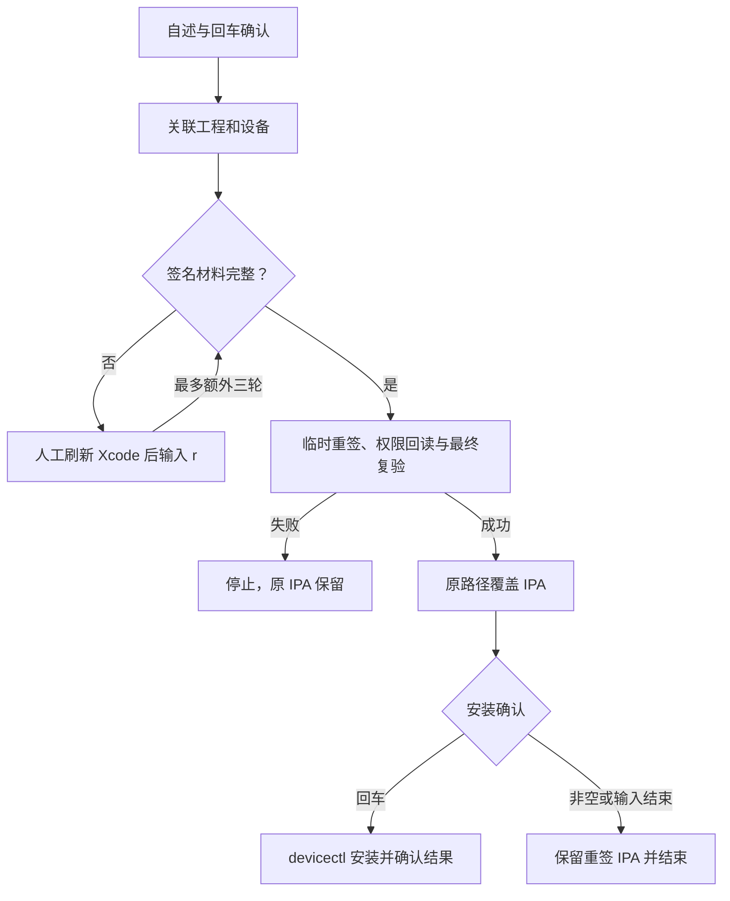

# `JobsIPAResigner` 脚本说明


<!-- jobs-toc:start -->
<!-- jobs-toc:source {"v":2,"token":"[toc]"} -->
<details>
<summary>📚 目录（点击展开 / 收起）</summary>

- [🔥 前言](#%E5%89%8D%E8%A8%80)
- [一、目录与入口](#entrypoints)
- [二、重签流程、依赖与副作用](#business)
- [三、描述文件位置与右键临时副本](#profiles)
- [四、构建后注册与安装入口](#registration)
- [五、日志、临时文件与验证边界](#logs-and-cleanup)

</details>
<!-- jobs-toc:end -->

---

## 🔥 <span id="前言">前言</span>

[ManageExtension.zsh](./ManageExtension.zsh) 是本功能的内部管理器，由上级 `.command` 启动器唤起的独立 App 调用；启动器结束后，安装 / 卸载确认、逐项状态和实时日志都在 GUI 内处理。正常使用从上级管理入口进入，后台非交互参数仅由面板提交已确认的计划。

本目录的 [ManagementPanel.swift](./ManagementPanel.swift) 与 [FinderManagerGUI.zsh](./FinderManagerGUI.zsh) 负责随包面板和编译缓存。总进度按已处理项 / 本次所选项显示计数和百分比；成功与失败计入已处理，等待中和执行中不计入，100% 表示全部处理完毕，结果以成功 / 失败汇总为准。安装 / 更新和卸载分别计时；点击时只清零并启动当前操作计时，后台全部结束或启动失败时只冻结当前耗时。每秒刷新 `HH:mm:ss`（小时可超过 24），执行时显示“安装用时 / 卸载用时”，结束显示“安装总用时 / 卸载总用时”。两份耗时只在当前面板会话内独立保留。安装成功显示绿色“✅ 安装成功”。切换操作会显示该操作已有的耗时。支持独立复制时须连同上级 App、启动脚本、源码及资源整体保留。

日志区上方的分隔条可上下拖动，窗口也可调整大小；功能列表与日志分别滚动，并保留操作按钮。日志右键提供“全选”，也可用 `⌘A` 全选后 `⌘C` 复制；拖动不会清空日志或改变功能勾选。

本目录保存“IPA 免编译重签”的完整终端业务脚本与 [**Xcode**](https://developer.apple.com/xcode) 构建后注册入口。业务脚本随宿主 App 打包，注册脚本由 Xcode Build Phase 调用；各自的入口、确认和日志分别说明。

[返回功能说明](../README.md)，工程材料、权限匹配与完整操作过程见[原独立脚本说明](../../../../JobsCommand@iOS/其他/【MacOS】✍️IPA免编译重签.command/README.md)。

## 一、<span id="entrypoints">目录与入口</span> <a href="#前言" style="font-size:17px; color:green;"><b>🔼</b></a> <a href="#🔚" style="font-size:17px; color:green;"><b>🔽</b></a>

| 文件 | 职责与调用方式 |
| --- | --- |
| [ResignIPA.command](./ResignIPA.command) | 完整重签业务；打包为 App 资源，由 Terminal 执行，也可独立终端调用 |
| [EnableFinderExtension.zsh](./EnableFinderExtension.zsh) | 构建后注册并启用当前精确路径的 Finder 扩展，成功后刷新 Finder |
| `描述文件/` | 可选目录；独立执行本目录业务脚本时放置有效 `.mobileprovision` |

以下命令以当前 `Scripts/` 目录为基准，示例文件与 UDID 需要换成实际值：

```shell
/bin/zsh ./ResignIPA.command

/bin/zsh ./ResignIPA.command \
  './待处理/App.ipa'

/bin/zsh ./ResignIPA.command \
  './待处理/App.ipa' \
  '目标设备UDID'
```

| 位置参数 | 缺省行为 |
| --- | --- |
| 第一个：IPA 路径 | 提示输入或拖入单个 IPA；输入 `q` 退出 |
| 第二个：硬件 UDID | 扫描真实 iPhone / iPad；单台自动选中，多台使用 fzf，未找到时提供重扫 / 手填入口 |

参数只预填 IPA 和设备，不会跳过运行自述、工程关联或安装确认。该脚本没有 `--file`、`--check`、`--help` 或无交互模式，不能套用其它扩展的命名选项。单独检查语法不会重签或安装：

```shell
/bin/zsh -n ./ResignIPA.command
/bin/zsh -n ./EnableFinderExtension.zsh
```

## 二、<span id="business">重签流程、依赖与副作用</span> <a href="#前言" style="font-size:17px; color:green;"><b>🔼</b></a> <a href="#🔚" style="font-size:17px; color:green;"><b>🔽</b></a>

1、在可交互终端展示内置说明，回车确认后建立本次日志和临时副本；`Ctrl+C` 取消。[**Finder**](https://support.apple.com/guide/mac-help/welcome/mac) 已预填所选 IPA；独立运行可以在提示处拖入路径。

2、关联对应工程并验证主 App Bundle ID，再选择设备。工程回车自动从 IPA 目录向上查找，失败后可以重试或手动拖入目录。

3、检查系统工具和 Xcode 工具链，解包并为主 App / 每个扩展恢复权限；拒绝损坏、加密或不支持的包。描述文件、设备授权、证书私钥和权限都匹配后才重签。

4、材料不足时暂停，按提示人工打开 Xcode 刷新；输入 `r` 复检，首次检查后最多额外三轮。脚本不自动登录 Apple、不续期材料、不重新编译。

5、临时副本从内向外签名，回读权限并对最终 IPA 解包复验，通过后原路径覆盖原文件。<span style="color:red"><b>不自动保留旧版本；替换前请自行备份。</b></span>

6、替换成功后，直接回车安装到已选设备；任何非空输入（包括空格）或输入结束则结束。安装超时为 180 秒，失败时保留重签 IPA，不回滚、不自动卸载旧 App，也不自动启动 App。

业务使用系统 [**zsh**](https://www.zsh.org/)、原生 plist / 签名工具及 `xcrun otool`、`devicectl`，不需要 Python、Node 或 Ruby。多设备选择才自检 [**fzf**](https://formulae.brew.sh/formula/fzf)；需安装 / 修复时借助健康 [**Homebrew**](https://brew.sh/)，回车跳过并退出、输入任意字符才执行，不自动安装 Homebrew。



## 三、<span id="profiles">描述文件位置与右键临时副本</span> <a href="#前言" style="font-size:17px; color:green;"><b>🔼</b></a> <a href="#🔚" style="font-size:17px; color:green;"><b>🔽</b></a>

业务搜索当前用户的 Xcode UserData 与旧版 MobileDevice 描述文件缓存，以及**当前实际执行脚本**旁的 `描述文件/`，在这些目录中递归查找 `.mobileprovision`。私钥必须位于钥匙串，放入描述文件不能替代私钥。

独立调用本目录 `ResignIPA.command` 时，可以使用以下布局：

```text
./
├── ResignIPA.command
├── EnableFinderExtension.zsh
├── README.md
└── 描述文件/                    # 可选，手动准备
    ├── 主App.mobileprovision
    └── 扩展.mobileprovision
```

Finder 入口把打包脚本复制到每次请求的私有临时目录再运行，因此默认使用 Xcode 缓存；不会把本目录或 App 资源旁的 `描述文件/` 一起复制。需要使用该补充目录时，在可交互终端独立调用这里的脚本，或使用原独立脚本及其相邻 `描述文件/`。

当原 IPA 内嵌描述文件缺失时，提示提供的“原始描述文件”只用于确认团队与 App ID 前缀，可以过期；有效的新文件仍须位于上述搜索目录。主 App 和各扩展分别匹配，不共用一份不适合的材料。

## 四、<span id="registration">构建后注册与安装入口</span> <a href="#前言" style="font-size:17px; color:green;"><b>🔼</b></a> <a href="#🔚" style="font-size:17px; color:green;"><b>🔽</b></a>

`EnableFinderExtension.zsh` 只在 `JobsIPAResigner.app` 的有效 Xcode 构建上下文中处理固定扩展 `com.jobs.JobsIPAResigner.FinderSyncExtension`。它注册并启用当前构建产物，轮询核对当前完整扩展路径的 `+` 状态，成功后重启 [**Finder**](https://support.apple.com/guide/mac-help/welcome/mac)。旧副本已启用不算当前路径成功。

注册、启用或刷新失败时写日志并保留 `JobsIPAResignerNeedsFinderRestart` 标记，供宿主初始化重试；Build Phase 仍允许构建继续，**构建成功不代表扩展已启用**。缺少构建上下文时拒绝执行，不能把它当成独立安装入口。

外层安装器及隔离构建设置 `JOBS_SKIP_FINDER_EXTENSION_BUILD_PHASE=1`，跳过本脚本的注册与 Finder 刷新。Xcode 自身仍可能自动登记产物，需要按本次精确产物路径另行检查；这个开关不代表系统登记完全没有副作用。安装 / 卸载请使用[工程根目录的成对入口](../README.md#installation)。

## 五、<span id="logs-and-cleanup">日志、临时文件与验证边界</span> <a href="#前言" style="font-size:17px; color:green;"><b>🔼</b></a> <a href="#🔚" style="font-size:17px; color:green;"><b>🔽</b></a>

| 内容 | 位置与保留行为 |
| --- | --- |
| 单次业务日志 | 系统临时目录中的 `IPA免编译重签.时间戳.进程号.log`；结束时打印完整路径，保留用于排查 |
| 业务工作目录 | 系统临时目录中的 `jobs-ipa-resign.*`，保存解包、权限、检查报告和安装 JSON；正常退出时清理 |
| 右键启动载体 | 系统临时目录中的 `JobsIPAResigner-*`，只含本次 `launch.zsh` 与业务副本；正常结束后精确清理 |
| 构建后注册日志 | 系统临时目录中的 `JobsIPAResignerBuildPhase.log` |
| 注册重试标记 | 系统临时目录中的 `JobsIPAResignerNeedsFinderRestart` |

业务结果只有原路径上替换后的 IPA，不生成桌面报告或额外结果目录。强制终止可能留下临时文件；安装超时后需检查设备实际状态。日志记录路径、签名检查与工具错误，分享前核对其中的工程和设备信息。

`zsh -n` 只验证语法；目标类型、URL / Shell 参数及取消分支需要隔离测试，真实 IPA 材料、权限回读、Finder 可见性与设备安装需分别验证。不要以静态通过代替实际重签或安装成功。

<a id="🔚" href="#前言" style="font-size:17px; color:green; font-weight:bold;">我是有底线的➤点我回到首页</a>
