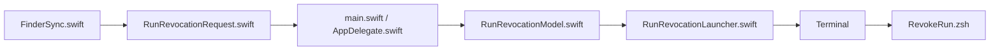
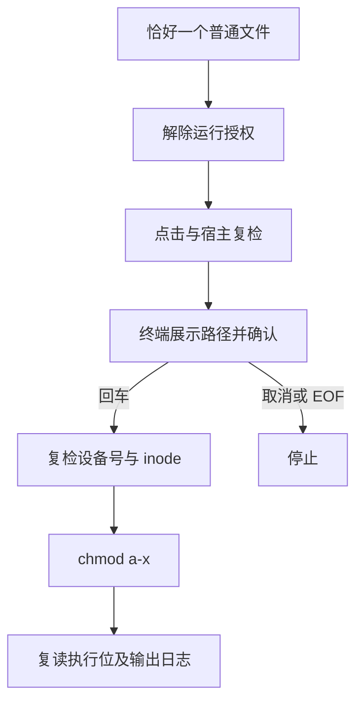

# `JobsRunAuthorizationRevoker` 单文件解除运行授权


<!-- jobs-toc:start -->
<!-- jobs-toc:source {"v":2,"token":"[toc]"} -->
<details>
<summary>📚 目录（点击展开 / 收起）</summary>

- [🔥 前言](#%E5%89%8D%E8%A8%80)
- [一、安装与卸载](#installation)
  - [【MacOS】管理解除运行授权Finder扩展.command](#jobs-toc-heading-3)
- [二、操作与独立调用](#usage)
- [三、工程结构与分发](#layout)
- [四、验证与排查](#verification)

</details>
<!-- jobs-toc:end -->

---

## 🔥 <span id="前言">前言</span>

**选中一个可执行格式文件 → 右键“🔓 解除运行授权” → Terminal 核对路径并回车 → 清除该文件所有执行位。** 由 Jobs 维护，当前状态：维护中。

| 能力 | 当前行为 |
| --- | --- |
| 显示范围 | 仅单个脚本或原生可执行文件；普通文档（即使有执行位）、目录、应用包、符号链接、多选和空白菜单隐藏。 |
| 权限状态 | 有任一 POSIX 执行位时，“🔓 解除运行授权”可点、“🔒 运行授权”置灰；无执行位时反向置灰，两项保留显示。 |
| 权限操作 | `/bin/chmod a-x`，清除所有者、组和其它用户的 POSIX 执行位，保留读写位；不受当前 `umask` 过滤。 |
| 交互 | Terminal 展示文件路径后，回车继续；任意非空输入（包括空格）、Ctrl+C 或 EOF 停止。 |
| 只读入口 | `--check --file <绝对路径>`，不创建日志、不修改权限。 |
| 安全边界 | 不执行目标、不递归、不提权、不改内容、ACL 或隔离属性；执行前按设备号和 inode 复核目标，成功后复读执行位。 |

Finder 支持 `command/sh/bash/zsh/ksh/csh/tcsh/fish/py/pyw/rb/pl/swift/js/mjs/lua/tcl/awk/expect/scpt/applescript`（后缀不区分大小写）、无扩展名且以 `#!` 开头的脚本，以及单架构或 Universal Mach-O 的 `MH_EXECUTE` 文件；不把动态库、对象文件或 Java 类视为原生可执行。执行状态按 POSIX `0111` 的任一执行位判断，与解除全部执行位的语义一致。两项须分别安装；格式资格与是否已授权独立。独立终端脚本仍保留普通单文件的通用权限操作语义。

这是 [macOS Finder](https://support.apple.com/guide/mac-help/welcome/mac) 的独立 App + Finder Sync 工程，与[运行授权](../JobsRunAuthorizer/README.md)分别安装、分别卸载，并接入[总管理面板](../README.md)。整个目录可独立复制；不依赖兄弟工程或外部脚本，不建立内部 Git。[Windows 对应功能](../../WindowsOS@Extension/JobsRunAuthorizationRevoker/README.md)通过当前用户的文件执行权限实现。

**清除执行位不等于恢复某次授权前的完整权限快照，也不能阻止解释器读取脚本。** ACL、系统策略与文件可信性不属于本入口的处理范围。需要再次增加执行位时使用“运行授权”。

## 一、<span id="installation">安装与卸载</span> <a href="#前言" style="font-size:17px; color:green;"><b>🔼</b></a> <a href="#🔚" style="font-size:17px; color:green;"><b>🔽</b></a>

菜单安装与卸载统一使用 [图形管理入口](./【MacOS】管理解除运行授权Finder扩展.app)。直接打开面板，选择“安装 / 更新”或“卸载”并勾选当前范围内的功能；默认空选，点击操作按钮即确认。每项显示等待、正在安装 / 卸载、成功或失败；底部日志实时滚动，可选择复制或复制全部。运行中锁定选择和关闭入口，结束后保留结果与日志。首次打开或面板源码更新后会在后台编译，失败以桌面提示和启动日志说明。

原同名 `.command` 入口保留，终端只负责唤起独立 GUI，随后结束启动脚本；本次启动任务结束后自动关闭对应终端页，安装 / 卸载、进度与实时日志均由 GUI 后台处理。已有交互 Shell 中手工调用时保留原工作会话。内部实现为 `Scripts/ManageExtension.zsh`；完整仓内单功能入口使用总面板的受限范围。可独立复制的包须整体保留 `.command`、`.app`、Scripts、工程源码和资源。

启动器按自身位置定位配套文件，不依赖本机固定目录或启动时的工作目录。`.command` 会把当前包目录传给同名 App；直接打开 App 无法定位 `Scripts` 时，按提示选择同时包含同名 App 与 `Scripts/` 的原始目录，取消选择不会执行安装或卸载。

每项失败后，点击红色带下划线的“失败，见日志”，会新建 Terminal 会话并用 `cat` 显示本次完整会话日志；现有任务继续，已有终端保留。“日志文件”按钮仍用于在 Finder 中定位原始日志。

### <span id="jobs-toc-heading-3" data-jobs-toc="v2">[【MacOS】管理解除运行授权Finder扩展.command](./【MacOS】管理解除运行授权Finder扩展.command)</span><!-- jobs-toc:heading-end -->

> **目的：** 独立构建并启用“解除运行授权”菜单。

- 展示本地源码、产物和日志位置，选择安装模式后立即执行，无需终端二次确认。
- 检查完整 [**Xcode**](https://developer.apple.com/xcode/) 与 macOS SDK，构建两个 target 并核验 Bundle ID 和签名。
- 精确注销同 ID 旧副本登记，注册当前 App / appex，启动后台初始化并刷新 Finder。
- 产物保留在 `./work/DerivedData/Build/Products/Debug/JobsRunAuthorizationRevoker.app`；日志为系统临时目录中的 `JobsRunAuthorizationRevokerInstall.log`。

**卸载模式：**

> **目的：** 移除本功能菜单及已登记产物。

- 选择卸载模式后立即执行，不要求终端二次确认。
- 只停用固定扩展并注销记录，删除名称、Bundle ID 和目录类型均核验通过的 App，刷新 Finder。
- 保留源码和所有用户文件；卸载不改变任何文件权限。日志为系统临时目录中的 管理入口同名 `.log`（以面板底部日志为准）。

依赖 macOS 12.0+、完整 Xcode、Finder Sync、Terminal 和系统 zsh；无第三方业务依赖。第一次派发可能要求允许 App 自动化控制 Terminal。总管理器的产物位于总仓 `work/`，安装器会处理同 ID 旧登记，构建产物应保留供系统运行。

## 二、<span id="usage">操作与独立调用</span> <a href="#前言" style="font-size:17px; color:green;"><b>🔼</b></a> <a href="#🔚" style="font-size:17px; color:green;"><b>🔽</b></a>

1、右键一个已有执行位的可执行格式文件，选择“🔓 解除运行授权”。桌面上的单个文件也适用；桌面空白处没有此项。

2、在 Terminal 核对路径和影响范围，再按回车。目标被删除、替换或变成链接时停止。

3、查看修改前后权限和私有日志位置，例如 `755 → 644`、`751 → 640`。无执行位时解除菜单置灰；失败显示真实退出码，不尝试 `sudo`。

在本工程目录执行：

```shell
/bin/zsh ./Scripts/RevokeRun.zsh \
  --file "/目标目录/脚本.command"
```

只读检查：

```shell
/bin/zsh ./Scripts/RevokeRun.zsh \
  --check \
  --file "/目标目录/脚本.command"
```

参数必须精确匹配；多余参数、相对路径、多文件、目录、链接和特殊设备均拒绝。中文、空格、引号和换行按单个数据参数传递。日志目录为系统临时目录中的 `JobsRunAuthorizationRevoker.XXXXXXXX/`，权限 `700`，`run.log` 为 `600`；确认前不创建它。确认期间替换检测和修改后执行位复查不能构成对恶意并发文件系统替换的原子事务。

## 三、<span id="layout">工程结构与分发</span> <a href="#前言" style="font-size:17px; color:green;"><b>🔼</b></a> <a href="#🔚" style="font-size:17px; color:green;"><b>🔽</b></a>

```text
./
├── JobsRunAuthorizationRevoker.xcodeproj/    # 两个 target 和共享 Scheme
├── JobsRunAuthorizationRevoker/             # main、AppDelegate、Model、Terminal 载体
├── JobsRunAuthorizationRevokerFinderSync/   # 单文件菜单及点击复检
├── JobsRunRevocationShared/                 # 校验器、URL 请求、本地系统工厂
├── Scripts/                                # RevokeRun.zsh、构建后登记
├── Tests/                                  # 临时文件、菜单和注册替身回归
└── 【MacOS】管理解除运行授权Finder扩展.command
```

| 配置 | 当前值（2026-10-24，依据工程与源码） |
| --- | --- |
| App / Scheme | `JobsRunAuthorizationRevoker` |
| App Bundle ID | `com.jobs.JobsRunAuthorizationRevoker` |
| Extension Bundle ID | `com.jobs.JobsRunAuthorizationRevoker.FinderSyncExtension` |
| URL | `jobsrunrevoker://revoke?path=...` |
| 工具链 | <u>[**Swift**](https://www.swift.org/)</u> 语言模式 5.0、macOS deployment target 12.0，编译器随 Xcode。 |
| target / 业务 Swift 文件 | 2 个 target、8 个手写业务 Swift 文件；排除测试、脚本和配置。 |
| 网络、数据库、业务窗口、第三方直接依赖 | 均无；没有依赖锁文件。 |





构建后注册脚本只采信当前精确路径，失败保留重试标记。隔离构建应设置 `JOBS_SKIP_FINDER_EXTENSION_BUILD_PHASE=1`；Xcode 自身可能登记临时产物，仍应核对并精确注销。完整[脚本说明](./Scripts/README.md)包含日志与注册边界。

## 四、<span id="verification">验证与排查</span> <a href="#前言" style="font-size:17px; color:green;"><b>🔼</b></a> <a href="#🔚" style="font-size:17px; color:green;"><b>🔽</b></a>

在本工程目录运行隔离回归；仅对临时文件修改权限，不登记真实菜单：

```shell
ruby ./Tests/RunRevocationCommandTests.rb
ruby ./Tests/RunRevocationMenuTests.rb
ruby ./Tests/InstallerRegistrationTests.rb
```

| 现象 | 排查 |
| --- | --- |
| 菜单不显示 | 只选一个普通文件，检查 Finder 扩展开关；目录和多选不会显示。 |
| Terminal 不出现 | 查看系统临时目录中的 `JobsRunAuthorizationRevoker.log`，检查自动化权限。 |
| 操作失败 | 查看业务 `run.log` 中 chmod 原始错误、文件身份与修改前后权限；当前用户可能无权修改。 |
| 通过解释器仍能运行脚本 | 执行位控制直接执行，读取脚本由读权限和解释器决定。 |

源码和隔离回归不能替代真实 Finder、Terminal 自动化和目标文件的实机验收。

<a id="🔚" href="#前言" style="font-size:17px; color:green; font-weight:bold;">我是有底线的➤点我回到首页</a>
