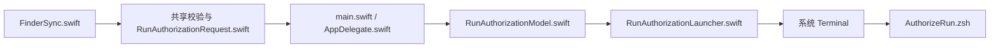
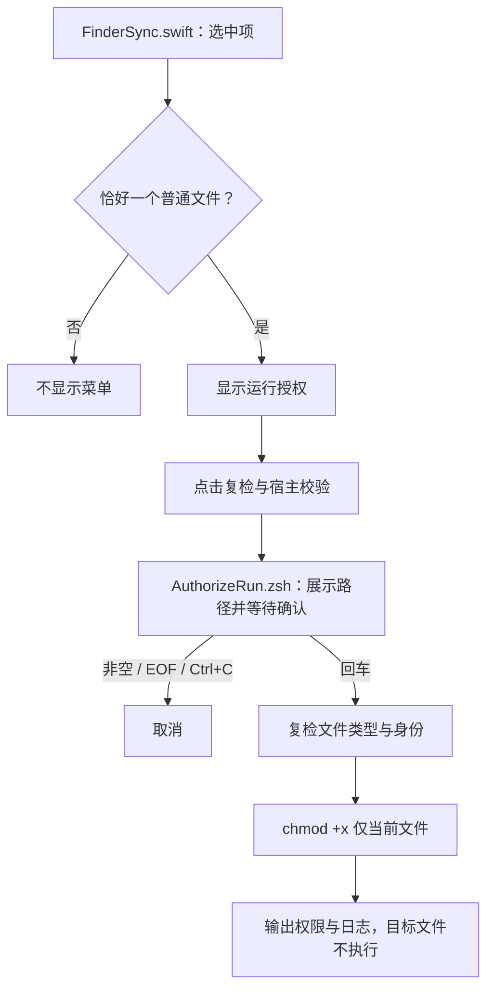

# `JobsRunAuthorizer` 单文件运行授权


<!-- jobs-toc:start -->
<!-- jobs-toc:source {"v":2,"token":"[toc]"} -->
<details>
<summary>📚 目录（点击展开 / 收起）</summary>

- [🔥 前言](#%E5%89%8D%E8%A8%80)
- [一、安装与卸载](#installation)
- [二、操作与风险边界](#usage)
- [三、工程结构与配置](#layout)
- [四、验证与排查](#verification)

</details>
<!-- jobs-toc:end -->

---

## 🔥 <span id="前言">前言</span>

**选中一个可执行格式文件 → 右键“🔒 运行授权” → Terminal 核对路径并回车 → 仅执行 `chmod +x`。** 本功能延续原“⚙️运行授权.command”的权限语义，由 Jobs 维护；状态：维护中，功能核对日期 **2026-10-22**。

| Finder 目标 | 菜单行为 |
| --- | --- |
| 单个脚本或原生可执行文件，尚无执行位 | 显示“🔒 运行授权”且可点击；“🔓 解除运行授权”显示并置灰。 |
| 已有任一执行位 | “🔒 运行授权”显示并置灰；“🔓 解除运行授权”可点击。 |
| README、文本、图片等普通文档 | 两项均隐藏，即使文档误加了执行位。 |
| 文件夹、应用包、工程包 | 不显示。 |
| 符号链接、多选、目录或桌面空白处 | 不显示。 |
| 打开菜单后目标不存在或变成目录 | 点击复核文件格式与当前执行位，宿主再次复核格式；失效时停止。 |
| Terminal 等待确认期间目标被替换 | 执行前复检设备号与 inode，身份变化时停止。 |

授权只改变该文件的执行权限，保持当前 `umask` 对 `chmod +x` 的实际限制；不递归、不运行文件、不提权、不修改文件内容或隔离属性。终端在确认前展示目标，直接回车继续；任意非空输入（包括空格）、`Ctrl+C` 或 EOF 取消。确认后授权失败会保留真实退出码和日志。

Finder 支持 `command/sh/bash/zsh/ksh/csh/tcsh/fish/py/pyw/rb/pl/swift/js/mjs/lua/tcl/awk/expect/scpt/applescript`（后缀不区分大小写）、无扩展名且以 `#!` 开头的脚本，以及单架构或 Universal Mach-O 的 `MH_EXECUTE` 文件；不把动态库、对象文件或 Java 类视为原生可执行。执行状态按 POSIX `0111` 的任一执行位判断，与解除全部执行位的语义一致。两项须分别安装；格式资格与是否已授权独立。独立终端脚本仍保留普通单文件的通用权限操作语义。

本工程是 [MacOS@Extension](../README.md) 中的普通源码目录，包含独立工程、Scheme、Bundle ID、统一管理入口，没有独立 Git 或子模块配置。整个文件夹可单独复制后安装；业务脚本随 App 打包，不依赖原脚本仍在磁盘上。

## 一、<span id="installation">安装与卸载</span> <a href="#前言" style="font-size:17px; color:green;"><b>🔼</b></a> <a href="#🔚" style="font-size:17px; color:green;"><b>🔽</b></a>

菜单安装与卸载统一使用 [图形管理入口](./【MacOS】管理运行授权Finder扩展.app)。直接打开面板，选择“安装 / 更新”或“卸载”并勾选当前范围内的功能；默认空选，点击操作按钮即确认。每项显示等待、正在安装 / 卸载、成功或失败；底部日志实时滚动，可选择复制或复制全部。运行中锁定选择和关闭入口，结束后保留结果与日志。首次打开或面板源码更新后会在后台编译，失败以桌面提示和启动日志说明。

原同名 `.command` 入口保留，终端只负责唤起独立 GUI，随后结束启动脚本；本次启动任务结束后自动关闭对应终端页，安装 / 卸载、进度与实时日志均由 GUI 后台处理。已有交互 Shell 中手工调用时保留原工作会话。内部实现为 `Scripts/ManageExtension.zsh`；完整仓内单功能入口使用总面板的受限范围。可独立复制的包须整体保留 `.command`、`.app`、Scripts、工程源码和资源。

启动器按自身位置定位配套文件，不依赖本机固定目录或启动时的工作目录。`.command` 会把当前包目录传给同名 App；直接打开 App 无法定位 `Scripts` 时，按提示选择同时包含同名 App 与 `Scripts/` 的原始目录，取消选择不会执行安装或卸载。

每项失败后，点击红色带下划线的“失败，见日志”，会新建 Terminal 会话并用 `cat` 显示本次完整会话日志；现有任务继续，已有终端保留。“日志文件”按钮仍用于在 Finder 中定位原始日志。

双击[管理入口（安装模式）](./【MacOS】管理运行授权Finder扩展.command)，在面板选择安装 / 更新并勾选功能，点击操作按钮后后台执行。入口检查完整 [**Xcode**](https://developer.apple.com/xcode/) 和 macOS SDK，构建当前工程并验证 Bundle ID 与签名，注销同 ID 的旧扩展路径和旧宿主 URL 登记，再注册当前产物、初始化后台宿主并刷新 Finder。安装过程中不会给任何文件授权，也不会下载依赖或修改 `xcode-select`。

独立构建产物位于 `./work/DerivedData/Build/Products/Debug/JobsRunAuthorizer.app`，系统从此路径启动扩展，安装后请保留。总安装入口使用总仓 `work/`，两种入口安装同一个功能时会精确注销旧登记；旧 App 文件保留。安装日志为系统临时目录中的 `JobsRunAuthorizerInstall.log`。

双击[管理入口（卸载模式）](./【MacOS】管理运行授权Finder扩展.command)，在面板选择卸载并勾选功能，点击操作按钮后后台执行并刷新 Finder。入口只禁用固定扩展，注销其记录，并删除名称、Bundle ID、非符号链接目录均核验通过的已登记 App；源码、原脚本和所有曾授权文件保留。卸载不撤销已经增加的执行权限。日志为系统临时目录中的 管理入口同名 `.log`（以面板底部日志为准）。

依赖为 macOS 12.0+、完整 Xcode、系统 Finder Sync、Terminal 和系统 zsh；业务不依赖 Homebrew、Python、Node 或 Ruby。Ruby 仅用于隔离回归。首次点击时按系统提示允许宿主自动化控制 Terminal；菜单未出现时在系统设置的 Finder 扩展中检查 `JobsRunAuthorizer`。

## 二、<span id="usage">操作与风险边界</span> <a href="#前言" style="font-size:17px; color:green;"><b>🔼</b></a> <a href="#🔚" style="font-size:17px; color:green;"><b>🔽</b></a>

1、在 Finder 中只选中一个尚无执行位的可执行格式文件，打开右键菜单选择“🔒 运行授权”。桌面上的单个普通文件也可以；桌面空白处没有入口。

2、Terminal 展示目标路径及影响范围；核对后回车增加执行权限。目标文件在等待期间被替换时，设备号与 inode 校验会阻止继续授权。

3、终端显示授权前后权限和日志位置。已有执行位时授权菜单置灰；只有拥有文件权限的当前用户能够成功修改，失败不会尝试 `sudo`。

增加执行权限不会验证文件可信性，也不会替用户运行目标。需要清除全部执行位时安装并使用[解除运行授权](../JobsRunAuthorizationRevoker/README.md)；该入口执行 `chmod a-x`，不猜测或恢复授权前的完整权限快照，两项菜单分别安装与卸载。

独立终端调用（在本工程目录）：

```shell
/bin/zsh ./Scripts/AuthorizeRun.zsh \
  --file "/目标目录/脚本.command"
```

只读检查无需交互，不修改权限或创建日志：

```shell
/bin/zsh ./Scripts/AuthorizeRun.zsh \
  --check \
  --file "/目标目录/脚本.command"
```

参数、确认策略及日志说明见 [Scripts 说明](./Scripts/README.md)。

## 三、<span id="layout">工程结构与配置</span> <a href="#前言" style="font-size:17px; color:green;"><b>🔼</b></a> <a href="#🔚" style="font-size:17px; color:green;"><b>🔽</b></a>

```text
./
├── JobsRunAuthorizer.xcodeproj/       # 宿主、Finder 扩展、共享 Scheme
├── JobsRunAuthorizer/                # main / AppDelegate / Model / Terminal 派发
├── JobsRunAuthorizerFinderSync/      # 单文件菜单及点击时复检
├── JobsRunAuthorizationShared/       # 单文件校验、URL 请求与系统工厂
├── Scripts/                         # 权限业务及构建后注册
├── Tests/                           # 临时文件与系统命令替身回归
└── 【MacOS】管理运行授权Finder扩展.command
```

| 项目项 | 当前值 / 依据（2026-10-22） |
| --- | --- |
| 工程 / Scheme | `JobsRunAuthorizer.xcodeproj` / `JobsRunAuthorizer`。 |
| 宿主 Bundle ID | `com.jobs.JobsRunAuthorizer`。 |
| 扩展产品 / Bundle ID | `JobsRunAuthorizerFinderSync.appex` / `com.jobs.JobsRunAuthorizer.FinderSyncExtension`。 |
| Swift / 最低系统 | 工程 `SWIFT_VERSION = 5.0` / `MACOSX_DEPLOYMENT_TARGET = 12.0`，实际编译器随所选 Xcode。 |
| 安装单元 | 2 个 target：后台宿主与其内嵌 Finder 扩展，依据 `project.pbxproj`。 |
| 业务 Swift 文件 | 8 个：宿主 4、Finder 1、共享 3；按手写业务文件计，排除脚本、配置、测试与产物。 |
| 第三方直接依赖 | 0；依据工程 Frameworks 与无第三方包配置，无依赖锁文件。 |
| 窗口 / 网络 / 数据库 | 无业务窗口、服务接口、数据库或额外端权限；宿主使用 `LSUIElement` 后台派发。 |

Finder 使用 `jobsrunauthorizer://authorize?path=...` 把单文件请求交给宿主。宿主在冷启动阶段注册 URL 接收器，校验路径后把打包的 `AuthorizeRun.zsh` 复制到本次私有临时载体，由 Terminal 执行；派发完成后退出，不等待授权结束。临时启动载体清理与业务日志保留分别处理。





Xcode 的 `Enable Finder Extension` Build Phase 调用 `./Scripts/EnableFinderExtension.zsh` 注册当前产物，只采信当前精确扩展路径的启用状态；成功后刷新 Finder，失败留下 `JobsRunAuthorizerNeedsFinderRestart` 标记供宿主重试。外层安装器与隔离构建通过 `JOBS_SKIP_FINDER_EXTENSION_BUILD_PHASE=1` 跳过此脚本的注册及 Finder 刷新。Xcode 自己仍可能执行 `RegisterWithLaunchServices`，设置 `REGISTER_APP_WITH_LAUNCH_SERVICES=NO` 也不能保证不登记；隔离构建后须检查并按本次精确临时产物路径注销。直接在 Xcode 中构建默认会执行本项目的注册和 Finder 刷新。

## 四、<span id="verification">验证与排查</span> <a href="#前言" style="font-size:17px; color:green;"><b>🔼</b></a> <a href="#🔚" style="font-size:17px; color:green;"><b>🔽</b></a>

脚本静态检查与隔离回归覆盖单文件边界、权限变化、原 `umask`、取消和非交互输入、特殊字符路径、目标替换，以及注册路径匹配；隔离测试不注册真实扩展、刷新 Finder 或操作真实业务文件。实际构建、系统签名、真实菜单和 Terminal 自动化分别验收，静态通过不代表已安装到当前电脑。

2026-10-22 的隔离验证结果：`RunAuthorizationCommandTests.rb` 15 项 / 192 断言，`RunAuthorizationTransportTests.swift` 38 断言，`RunAuthorizationMenuTests.rb` 1 项 / 4 个 Ruby 断言及 76 个真实 Swift 菜单断言，`InstallerRegistrationTests.rb` 15 项 / 97 断言，均通过；注册回归包含 `TMPDIR` 有无末尾斜杠的安装与卸载日志路径检查。工程及两 target 的 Info.plist、entitlements 通过 `plutil -lint`。临时目录 Debug 构建、深度签名检查和打包业务资源字节一致检查通过；Xcode 自动登记的临时宿主及扩展已按精确路径注销。未运行真实安装器，Finder 与 Terminal 的实际交互仍待安装后验收。

在本工程目录运行 Ruby 回归：

```shell
ruby ./Tests/RunAuthorizationCommandTests.rb
ruby ./Tests/RunAuthorizationMenuTests.rb
ruby ./Tests/InstallerRegistrationTests.rb
```

原生路径传递测试使用临时产物，不运行 Terminal：

```shell
JOBS_TEST_OUTPUT_DIR="$(/usr/bin/mktemp -d "${TMPDIR:-/tmp}/JobsRunAuthorizerTests.XXXXXXXX")"
/usr/bin/xcrun swiftc \
  -framework AppKit \
  -framework FinderSync \
  ./JobsRunAuthorizationShared/JobsAuthorizationFactories.swift \
  ./JobsRunAuthorizationShared/RunAuthorizationValidator/RunAuthorizationValidator.swift \
  ./JobsRunAuthorizationShared/RunAuthorizationRequest/RunAuthorizationRequest.swift \
  ./JobsRunAuthorizer/RunAuthorizationLauncher/RunAuthorizationLauncher.swift \
  ./Tests/RunAuthorizationTransportTests.swift \
  -o "${JOBS_TEST_OUTPUT_DIR}/RunAuthorizationTransportTests"
"${JOBS_TEST_OUTPUT_DIR}/RunAuthorizationTransportTests"
```

| 现象 | 排查 |
| --- | --- |
| 没有菜单 | 只选一个可执行格式文件；确认不是文件夹、文件包或符号链接，并检查扩展开关。 |
| 菜单已显示，点击后无 Terminal | 查看系统临时目录中的 `JobsRunAuthorizer.log`，核对宿主请求和派发阶段及 Terminal 自动化权限。 |
| 授权失败 | 终端查看原始 `chmod` 错误与权限变化；目标可能已移动、替换或不允许当前用户修改。 |
| 旧副本仍响应 | 重新运行安装入口，核对日志中旧扩展及宿主 URL 的精确注销路径。 |
| 卸载后文件仍可执行 | 卸载只移除菜单，不撤销已经授权的执行位。 |

宿主固定日志 `JobsRunAuthorizer.log`、构建后注册日志 `JobsRunAuthorizerBuildPhase.log` 均位于系统临时目录。每次业务操作单独保留私有日志，具体路径以 Terminal 输出为准。

<a id="🔚" href="#前言" style="font-size:17px; color:green; font-weight:bold;">我是有底线的➤点我回到首页</a>
