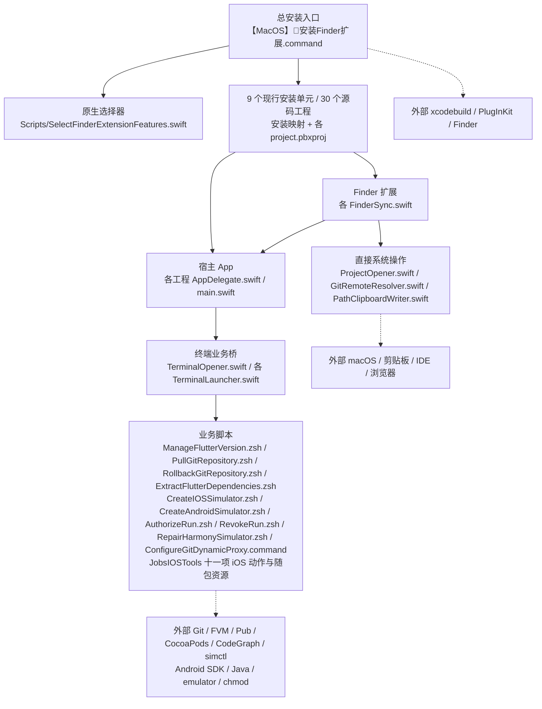
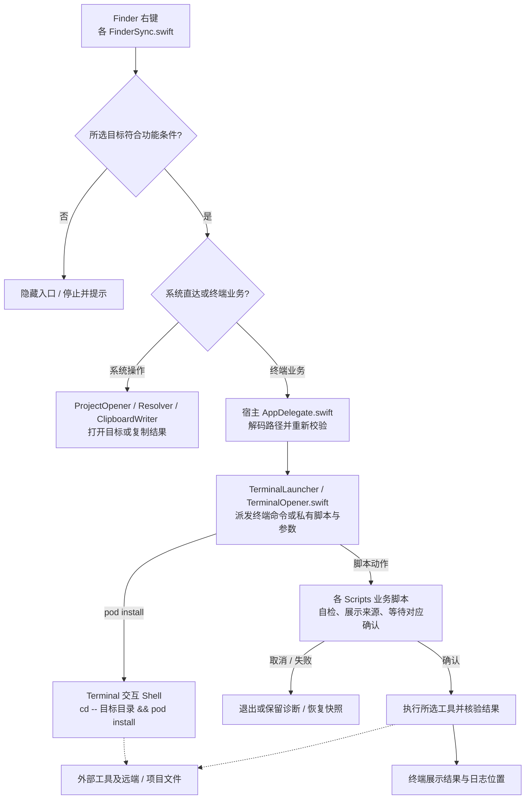
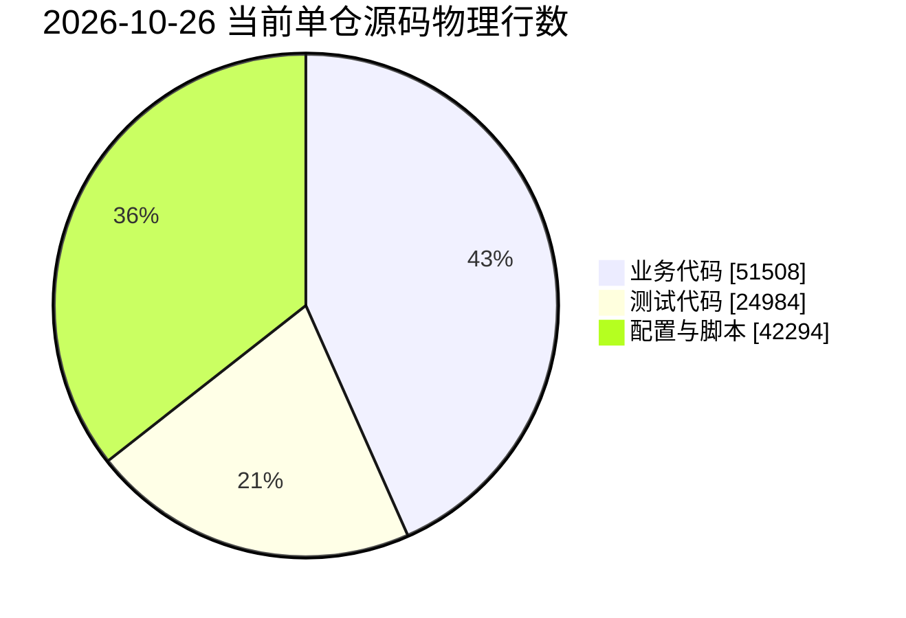

> IDE 和 Git 九项功能由 [JobsProjectTools](JobsProjectTools/README.md) 统一管理。IDE 先排除空目录：Android Studio 仅 Android / Flutter 官方或鸿蒙项目，VSCode 仅非 iOS 的非空普通目录，Xcode 仅明确的 iOS 工程；六项 Git 进入固定顺序的“Git操作”子菜单，仅有效 Git 工作树普通目录及其内部空白处显示。旧独立入口转交统一包。

> Flutter 菜单由 [JobsFlutterTools](JobsFlutterTools/README.md)：固定顺序的“Flutter开发相关辅助工具”，内含原生 / OpenHarmony SDK 安装切换、项目 Java 管理、“Flutter项目修复”和 iOS / Android / OpenHarmony打包子菜单，以及原生/Harmony 双层体检与清理维护。修复组包含“修复 Dart 相对 import 为 package 引用”，只在 Flutter 项目根文件夹或其内部空白处显示。旧 Flutter 单项安装入口转到统一包；构建、依赖和 SDK 维护使用项目 FVM，白名单产物清理与相对 import 修复无需 SDK。详细菜单、显示条件与执行边界见功能说明。

> 桌面六项由 [JobsDesktopTools](./JobsDesktopTools/README.md) 统一生成：新建 iOS → Android → Harmony 连续排列，再接 Android 修复 → Harmony 修复 → 动态显示／隐藏文件；六叶仍逐项安装。普通文件夹背景保留文件显示开关。旧六个独立入口转交同一聚合包。

# `MacOS@Extension`


<!-- jobs-toc:start -->
<!-- jobs-toc:source {"v":2,"token":"[toc]"} -->
<details>
<summary>📚 目录（点击展开 / 收起）</summary>

- [🔥 前言](#jobs-toc-heading-1)
- [一、环境先决条件](#environment-prerequisites)
- [二、工程索引](#jobs-toc-heading-3)
- [三、运行方式](#jobs-toc-heading-4)
  - [3.1、原生 UI 勾选安装](#jobs-toc-heading-5)
  - [3.2、已安装 App 内调整 Terminal 功能](#jobs-toc-heading-6)
  - [3.3、单工程手动运行](#jobs-toc-heading-7)
- [四、维护边界](#jobs-toc-heading-8)
- [五、源码取得与单仓管理](#single-repository-management)
- [六、本仓目录与脚本入口](#repository-layout-and-entrypoints)
  - [【MacOS】🧩安装Finder扩展.command](#jobs-toc-heading-11)
  - [【MacOS】🧩卸载Finder扩展.command](#jobs-toc-heading-12)
- [七、项目统计与复核口径](#project-statistics)
  - [7.1、工具链与锁定状态](#jobs-toc-heading-14)
  - [7.2、源码与部署管理](#jobs-toc-heading-15)
  - [7.3、界面、功能与后端边界](#jobs-toc-heading-16)
  - [7.4、模块依赖与核心运行流程](#jobs-toc-heading-17)
  - [7.5、功能实现矩阵](#jobs-toc-heading-18)
  - [7.6、业务代码占比与聚合边界](#jobs-toc-heading-19)
- [八、直接依赖、来源与风险](#direct-dependencies)
- [九、运行、构建与验证补充](#run-and-verify)

</details>
<!-- jobs-toc:end -->

---

## <span id="jobs-toc-heading-1" data-jobs-toc="v2">🔥 <font id=前言>前言</font></span><!-- jobs-toc:heading-end -->

**项目定位：** 面向 Jobs 与 macOS 开发人员的 Finder 日常开发工具集合。**状态：维护中**（基于当前源码与提交活动）；负责人 **Jobs** / [**JobsKits**](https://github.com/JobsKits)，未登记其他维护团队。功能、工程与代码规模的复核日期见统计章。

IDE 菜单共同排除空目录与仅含 `.DS_Store`、`Thumbs.db`、`desktop.ini` 的目录，其余隐藏项（含 `.git`）算内容；普通文件、链接、多选不显示三个 IDE 入口。具体工程标记与工作区引用规则见 [IDE 说明](./JobsProjectTools/README.md)。

右键菜单在名称前使用功能对应的 emoji，不同功能不重复，同一功能的兼容入口和 Windows 入口保持一致。运行授权两项仅对脚本或原生可执行格式显示：已有任一 POSIX 执行位时“🔓 运行授权”置灰、“🔒 解除运行授权”可点；无执行位时反向置灰。普通文档即使误加了执行位也不显示这两项。

30 个工程的源码由本仓统一管理，取得与更新方式见[源码取得与单仓管理](#single-repository-management)。

本仓由父仓 [`JobsGenesis`](../../README.md) 的 [`.gitmodules`](../../.gitmodules) 直接登记；`OS@Extension/` 只是普通分类目录，没有独立 Git：

```ini
[submodule "MacOS@Extension"]
    path = OS@Extension/MacOS@Extension
    url = ../MacOS_Extension.git
    branch = main
```

`path` 是相对父仓的本地路径，`url` 使用真实远端仓名；本仓根部 `.git` 指向 `../../.git/modules/MacOS@Extension`，不为源码工程重建子 Git。父仓已配置线路的解析如下：

| 父仓地址 | 本仓解析地址 |
| --- | --- |
| `ssh://git@github.com/JobsKits/JobsGenesis.git` | `ssh://git@github.com/JobsKits/MacOS_Extension.git` |
| `git@gitee.com:JobsGo/JobsGenesis.git` | `git@gitee.com:JobsGo/MacOS_Extension.git` |

两平台须拥有父仓 gitlink 引用的提交；`branch = main` 不能代替固定提交，父仓关联提交并推送后才会随远端克隆分发。

> **52 个 Finder 安装选项，按用途分为 6 组。每组单独提供“全选 / 全不选”，窗口底部也保留针对全部功能的“全选 / 全不选”。** 2026-10-26 依据选择器和根安装映射去重，共 9 个现行安装单元；Flutter 的十九项子功能与 iOS 的十一项辅助工具可逐项安装，同包只构建一次。

| 安装分组 | 选项数 | 可逐项勾选的功能 |
| --- | --- | --- |
| IDE | 3 | 用 Android Studio / VSCode / Xcode 打开项目 |
| Git | 6 | 拉取到最新、提交回退、打开远程地址、复制远程地址、动态代理、空白 Commit 并 Push |
| 通用 | 7 | 复制绝对路径、运行授权、解除运行授权、显示 / 隐藏文件、用终端打开、清理 Android / OpenHarmony 构建产物、更新代码地图 |
| Flutter | 19 | Flutter开发相关辅助工具；运行、依赖、SDK、打包、体检、生成、修复和清理归入该入口 |
| iOS / CocoaPods | 12 | `Pod Install`、`Pod Update` 相邻，iOS 构建产物清理、其它 iOS 辅助工具及 IPA 免编译重签分别勾选 |
| 模拟器 | 5 | 新建 iOS / Android / Harmony 模拟器、Android / Harmony 模拟器检测与修复 |

`MacOS@Extension` 用来收纳 Jobs 本机自用的 <u>[**Swift**](https://www.swift.org/)</u> macOS App + Finder Sync Extension 工程。2026-10-26 按根层 `.xcodeproj/project.pbxproj` 核对，共 30 个源码工程；其中 21 个兼容 / 单项桌面、Flutter、IDE、Git 工程保留源码与兼容入口，不计入上面的 9 个现行安装单元。主要能力包括打开 Git 远程地址、复制 Git 远程地址、复制文件或文件夹绝对路径、分别用 [**Xcode**](https://developer.apple.com/xcode/)、[**Visual Studio Code**](https://code.visualstudio.com/) 和 [**Android Studio**](https://developer.android.com/studio) 打开项目、用终端打开文件或文件夹所在目录、在合法 iOS 工程直接执行 `pod install`、在合法 [**Flutter**](https://flutter.dev/) 工程体检工具链、按声明与配置生成代码、查看当前 SDK 版本、通过子菜单选择 iOS / Android / OpenHarmony打包、通过 [**FVM**](https://fvm.app/) 安装或切换 SDK、提取已解析的 Pub 第三方依赖、执行 `flutter pub get`、清理项目产物与维护缓存、更新普通文件夹中的 [**CodeGraph**](https://github.com/colbymchenry/codegraph) 代码地图、拉取 Git 到最新、在终端选择 soft / hard 提交回退，在桌面右键新建并启动 iOS / Android / Harmony 模拟器，以及在 Git 管理的当前文件夹创建无文件变更的空白 Commit 并 Push。

[JobsIOSTools](./JobsIOSTools/README.md) 在“iOS / CocoaPods 辅助工具”子菜单提供以下十一项功能，全部业务资源随 App 打包；安装菜单本身不执行清理、依赖安装或工程改写。`Pod Install` 和 iOS 构建产物清理也在此子菜单内。

| iOS 辅助菜单 | 对应脚本 / 作用 |
| --- | --- |
| `Pod Install` | 在现有交互 Shell 直接执行 `cd -- <安全引用的目标路径> && pod install`，保留 Podfile 原生交互 |
| `Pod Update` | `【MacOS】⬆️Pod_Update.command`；在目标工程执行依赖更新，与 `Pod Install` 相邻 |
| 清理 iOS/Xcode 构建产物 | 当前工程白名单产物预览后输入 `CLEAN` 删除；保留依赖、锁文件及其它工程产物 |
| 禁用 CocoaPods 构建沙盒 | `【MacOS】⚙️双击禁用沙盒保证Cocoapods构建流程.command`；修改目标工程的构建沙盒配置 |
| 安装 CocoaPods | `【MacOS】⚙️双击安装Cocoapods.command`；按原脚本检查并安装工具链 |
| CocoaPods 源从 CDN 切换到 GitHub | `【MacOS】⚙️双击更换Cocoapods源[-]CDN[+]Github.command`；执行原源切换流程 |
| 提取项目全部 Pod 相关文件 | `【MacOS】⏳提取项目中所有的pod相关文件.command`；按脚本导出项目 Pod 文件 |
| 查询 Xcode 工程依赖关系 | `【MacOS】🔍查询Xcode工程依赖关系.command`；查看目标工程的依赖信息 |
| 更新 CocoaPods 本地仓库 | `【MacOS】⬆️双击更新Cocoapods本地仓库.command`；更新本机 Specs 仓库 |
| 自检当前本地 Pod 编译 | `【MacOS】自检具体的某个本地pod是否能编译通过.command`；仅在目标文件夹直接包含普通 `*.podspec` 文件时展示 |
| 安装 / 升级 JobsCodeSnippets | `【MacOS】⚙️双击安装JobsCodeSnippets.command`；对齐当前用户 Xcode `UserData/CodeSnippets`，首次安装或保护本地改动后升级，不操作所选 iOS 工程的 Git |

iOS 识别与专项门禁见[独立包说明](./JobsIOSTools/README.md)。`Pod Install` 要求同层普通 `Podfile` 和 `*.xcodeproj`；构建清理要求识别为 iOS 工程并排除 Flutter 根目录。本地 Pod 入口只认同层普通 `*.podspec`，子目录中的定义和 `.podspec.json` 不满足。其余八项按一般 iOS 工程条件展示；多选、普通文件和不匹配目录不加入这些菜单。

JobsCodeSnippets 点击后在 Terminal 中确认，固定处理当前用户 Xcode 的代码片段目录。已有安装时在完整副本保护暂存、未暂存及未跟踪内容，再取得并合并远端，全程不创建 commit 或推送；若有分叉，合并结果保留暂存供本人审阅提交。仍有冲突或更新失败时原安装目录保持更新前原状，终端给出手动合并指引并保留备份。菜单安装 / 卸载不安装、升级或移除代码片段；详见[功能边界](./JobsIOSTools/README.md#code-snippets)。

| 右键入口 | 检查与执行结果 |
| --- | --- |
| [显示 / 隐藏文件](./JobsHiddenFilesToggler/README.md) | 系统桌面或任意文件夹空白处按状态显示“👁️ 显示文件”或“🙈 隐藏文件”，点击应用标题对应的目标并刷新 Finder，不弹终端。文件、文件夹及多选的选中项菜单均不显示。刷新时 Finder 窗口可能短暂消失，避免在 Finder 复制、移动文件时切换。 |
| [新建 iOS 模拟器](./JobsIOSSimulatorCreator/README.md) | 仅桌面空白处右键打开 Terminal，读取本机可用 iOS Runtime，选择兼容 iPhone / iPad 并创建、启动；不关闭已有设备，不自动下载运行时。 |
| [新建 Android 模拟器](./JobsAndroidSimulatorCreator/README.md) | 仅桌面空白处右键打开 Terminal，首屏回车后检查并自动补齐 SDK / Java / 工具，选择匹配主机架构的系统映像及机型，新建并启动 AVD，保留已有设备。 |
| [Android 模拟器检测与修复](./JobsAndroidSimulatorRepairer/README.md) | 仅桌面空白右键；终端检查已启动的 Android 模拟器安装位置与 `/data` 空间，按需修复、清理编译缓存或卸载指定包；容量配置先停机备份，不执行 Wipe Data；卸载会删除对应应用数据。Windows [对应包](../WindowsOS@Extension/JobsAndroidSimulatorRepairer/README.md)独立安装。 |
| [新建 Harmony 模拟器](./JobsHarmonySimulatorCreator/README.md) | 仅系统桌面空白；Terminal 选择已下载 Release 镜像，官方 Emulator 创建并核验唯一实例，按需启动。Mac ARM，缺工具从 SDL 免登录镜像补齐；缺系统镜像走官方 CLI 下载，展示许可后本人回车同意。 |
| [Harmony 模拟器检测与修复](./JobsHarmonySimulatorRepairer/README.md) | 仅系统桌面空白；检查官方 Emulator、镜像和实例状态，按精确实例启动或确认后冷启动，完整备份后可修复失效 SDK 路径，不重置用户数据。Windows [对应包](../WindowsOS@Extension/JobsHarmonySimulatorRepairer/README.md)独立安装。 |
| [运行授权](./JobsRunAuthorizer/README.md) | 仅单个可执行格式普通文件显示，已有任一执行位时授权置灰；Terminal 展示目标并等待确认后执行 `chmod +x`，执行位受进程 `umask` 影响。不递归、不执行该文件；文件夹、目录包、符号链接、多选和空白处均不显示。 |
| [解除运行授权](./JobsRunAuthorizationRevoker/README.md) | 仅单个可执行格式普通文件，无执行位时解除置灰；Terminal 核对后执行 `chmod a-x` 清除全部执行位，保留读写位、内容、ACL 与隔离属性，不执行文件；与运行授权分别安装。Windows 使用当前用户文件执行权限，见对应包。 |
| [IPA 免编译重签](./JobsIPAResigner/README.md) | 仅单个 `.ipa` 普通文件显示，后缀大小写均可；目录、包、符号链接、多选和空白隐藏。Terminal 承接完整重签流程，确认后处理，验证成功原路径替换 IPA，再回车可选安装到设备。 |
| [Git操作](./JobsProjectTools/README.md) | 仅有效 Git 普通文件夹及其内部空白处显示，含拉取到最新、打开 / 复制远程地址、动态代理、空白 Commit 并 Push。仓库根、子目录、子模块和 worktree 均检测；普通非 Git 目录、文件、多选和桌面空白隐藏。 |
| [配置 Git 动态代理](./JobsGitProxyConfigurator/README.md) | 从“Git操作”进入 Terminal，安装、只读检查或恢复用户级 Git 入口。系统代理可用时优先，失败再直连；不固定 VPN 品牌或端口。Windows [对应独立包](../WindowsOS@Extension/JobsGitProxyConfigurator/README.md)继续提供其桌面入口。 |
| [拉取 Git 到最新](./JobsGitPuller/README.md) | 非 Git 目录静默退出；未提交内容列出后回车确认。先快照再合并，冲突可回滚、`YES` 放弃未提交内容后重试、输入 commit 信息提交后重试；空信息直接回车即可。保留本地提交、不推送、不递归子模块。Windows [对应独立包](../WindowsOS@Extension/JobsGitPuller/README.md)采用相同流程。 |
| [Flutter 项目体检](./JobsFlutterDoctor/README.md) | 仅精确 Flutter 根目录；Terminal 运行项目 SDK 的 doctor，命令失败或报告警告 / 错误均保留非零退出码。 |
| [Flutter 自动化生产代码](./JobsFlutterCodegen/README.md) | 仅精确 Flutter 根目录；Terminal 先 pub get，再按依赖与配置执行生成任务。默认不 clean、不主动传冲突删除参数；生成器仍会改写管理产物，先保存修改。 |
| [Flutter打包](./JobsFlutterPackager/README.md) | 仅精确 Flutter 根目录；Finder 子菜单选择 iOS / Android / OpenHarmony；Terminal 仅选择 Android APK / AAB 或鸿蒙 HAP / APP，默认 release。使用工程对应 SDK 与已有签名，鸿蒙要求已适配的 `ohos/` 平台；扩展自包含。 |
| [查看当前 Flutter SDK 版本](./JobsFlutterSdkInspector/README.md) | 只读显示实际 SDK 来源、Flutter / Dart 版本与项目约束。 |
| [从终端运行 Flutter 项目](./JobsFlutterRunner/README.md) | 只在精确 Flutter 项目根显示；Terminal 选设备，内置缺失 iOS 模拟器创建；launchd 独立托管 Flutter，实时日志、热重载、停止，关闭终端继续运行。 |
| [提取 Flutter 第三方依赖](./JobsFlutterDependencyExtractor/README.md) | 精确 Flutter 项目，终端输入或拖入目标，直接回车默认系统桌面；复制全部已解析 Pub 第三方源码（含间接 / dev），保留许可证并输出版本清单。只读源目录，缺缓存或解析过期停止提示 pub get。Windows [独立包](../WindowsOS@Extension/JobsFlutterDependencyExtractor/README.md)采用同一引擎。 |
| 用 Xcode 打开项目 | 仅非空且有明确 iPhone 平台配置的当前层工程目录或有效 iOS workspace/project 工程包；Flutter 根目录优先排除，纯 macOS 工程、单独 Package.swift / Podfile 不算 iOS。直接打开，不检查安装或跳下载页。 |
| 用 VSCode 打开项目 | 仅非空、非 iOS 普通目录；macOS 工程和纯 Swift Package 可以显示。先复核资格，再检查 VSCode，未安装时停止并打开 [官方下载页](https://code.visualstudio.com/download)。 |
| 用 Android Studio 打开项目 | 仅非空 Android 原生、Flutter 官方或 Flutter 鸿蒙项目根目录；不能只凭目录名或普通 Gradle 文件猜测。先复核资格，再检查 Android Studio，缺失时打开官方下载页。 |
| `Pod Install` | 目标同层同时存在普通文件 `Podfile` 和至少一个 `*.xcodeproj` 目录包即显示入口，无需已有 workspace。点击后打开 Terminal，在现有交互 Shell 中直接执行单行 `cd -- <安全引用的目标路径> && pod install`；安装交互和错误由 `pod` / `Podfile` 原生处理。 |
| 更新代码地图（.codegraph） | 更新所选文件夹的代码地图；每次检查完整工具链并显示健康 / 异常。缺失工具时在 Terminal 等待回车确认，通过 [**Homebrew**](https://brew.sh/) 补齐 [**Node.js**](https://nodejs.org/) / [**npm**](https://docs.npmjs.com/)，再安装官方 CodeGraph 包。已有健康工具直接复用。 |
| 安装/切换 Flutter SDK（FVM） | 仅对根 `pubspec.yaml` 声明 Flutter SDK 依赖的文件夹显示；右键后直接进入 Terminal，后台宿主不显示管理窗口。在终端体检 Homebrew、FVM、[**fzf**](https://formulae.brew.sh/formula/fzf) 及实际依赖链，查询官方历史和最新发行版，用 fzf 单选精确版本，最终回车执行安装或切换、非空输入取消。详见[独立工程说明](./JobsFlutterVersionMgr/README.md)。 |

工程产物清理先识别再显示：iOS 入口位于 `iOS / CocoaPods 辅助工具 → 清理 iOS/Xcode 构建产物`；[JobsTerminalOpener](./JobsTerminalOpener/README.md#build-artifacts) 的 `清理 Android / OpenHarmony 构建产物` 仅在 Flutter、Android、OpenHarmony 工程文件夹及其内部空白菜单显示。Flutter 根目录中的该入口只清 Android / OpenHarmony 平台产物，保留 iOS 产物及 `.dart_tool/`。Flutter 的完整白名单清理归入 `Flutter开发相关辅助工具 → Flutter清理维护工具 → 清理当前 Flutter 项目构建产物`，无需 Flutter/FVM，包含已识别的平台产物；同组的 `依赖与缓存维护` 保留原维护工具。各类产物清理均先预览、输入 `CLEAN` 才删除；支持范围与保护边界见该工程 README。Windows 的[对应独立包](../WindowsOS@Extension/JobsBuildArtifactCleaner/README.md)仅支持 Flutter / Android，保留 iOS 目录。

<strong id="desktop-menu-scope">桌面与文件夹菜单范围</strong>

| 右键场景 | 本仓加入的菜单 |
| --- | --- |
| 系统桌面空白处 | 固定按新建 iOS → Android → Harmony、Android 修复 → Harmony 修复、动态显示／隐藏文件排列，仅过滤未启用叶子 |
| 普通文件夹背景 | 按状态提供“👁️ 显示文件”或“🙈 隐藏文件”，按项目条件显示开发菜单；有效 Git 工作树显示“Git操作”，不加入模拟器创建或检测修复 |
| 选中一个本地普通文件（含桌面上的文件） | 仅可执行格式显示“运行授权”和“解除运行授权”并按权限互斥置灰；普通文档隐藏这两项；仅 `.ipa` 文件另提供“IPA 免编译重签” |
| 选中文件夹、目录包、多选或空白处 | 保留原有条件菜单，“运行授权”“解除运行授权”和“IPA 免编译重签”隐藏；选中项菜单不加入模拟器创建或检测修复菜单 |

系统自带的“新建文件夹”“更改墙纸”等菜单继续由 macOS 管理。规则按系统桌面真实路径判断，不会把其它位置名为 `Desktop` 的普通目录当作桌面。

隐藏文件菜单根据当前状态只显示一个下一步动作：“👁️ 显示文件”或“🙈 隐藏文件”；异常状态置灰。菜单范围限定为空白处，切换状态则对当前用户的整个 Finder 生效。它只改变显示偏好，不更改文件名、权限或隐藏属性；安装、宿主初始化及卸载都不会切换该状态，卸载后保留最后一次选择。独立安装与验证见 [JobsHiddenFilesToggler](./JobsHiddenFilesToggler/README.md)。

桌面范围隔离回归直接编译菜单源码，验证桌面专用功能的显示范围；Git 仓库门禁与子菜单顺序另由 `JobsProjectTools/Tests/MenuTests.py` 覆盖：

```shell
ruby ./Tests/DesktopFinderMenuTests.rb
```

<strong id="single-repository-quick-look">源码与工程边界速览</strong>

30 个 Finder 扩展工程均为本仓中的普通源码目录，源码、文档和版本由 `MacOS@Extension` 统一管理。各功能工程使用普通目录，不使用工程内 `.gitmodules`、gitlink 或 `.git` 关联；克隆或更新本仓即可一并取得全部工程源码，无需递归下载子模块。

安装面板按叶功能独立选择，并按九个现行安装单元去重构建。桌面、IDE／Git、Flutter、iOS 分别由聚合包维持菜单顺序；旧工程和原名单项安装／卸载入口保留兼容，六个桌面旧入口只启停各自叶子。Terminal 当前三项、iOS 辅助十一项均可逐项选择。文档目录转换统一使用根目录的 [目录过滤器](./.jobs-markdown-toc/README.md)。

## 一、<span id="environment-prerequisites">环境先决条件</span> <a href="#前言" style="font-size:17px; color:green;"><b>🔼</b></a> <a href="#🔚" style="font-size:17px; color:green;"><b>🔽</b></a>

| 检查项 | 最低要求 | 说明 |
| --- | --- | --- |
| 系统版本 | macOS `12.0` 及以上 | 30 个源码工程的 `MACOSX_DEPLOYMENT_TARGET` 均为 `12.0`，并依赖 macOS 的 Finder Sync Extension 机制。 |
| 开发工具 | [**Xcode**](https://developer.apple.com/xcode) 可正常打开 `.xcodeproj` | 手动运行需要 Xcode；批量安装脚本还需要 `xcodebuild`。首次换机器构建时，按 Xcode 提示完成本机签名配置。 |
| 命令行工具 | `xcodebuild`、`pluginkit`、`pkill`、`killall` 可用 | `xcodebuild` 负责构建 App，`pluginkit` 负责注册和启用 Finder Sync Extension，`pkill pkd` 和 `killall Finder` 用来刷新扩展发现索引与 Finder 菜单缓存。 |
| 安装选择 | 系统 `osascript` 与 AppKit 可用 | 根目录安装脚本会打开 macOS 原生复选框窗口，不再依赖 fzf。 |
| 扩展工程 | 本仓现行安装工程源码完整 | 源码随本仓一起取得。安装脚本会列出缺失的 `.xcodeproj` 路径并停止；恢复完整源码后重试。 |
| Finder 扩展权限 | 系统设置中允许对应 Finder 扩展 | 构建或安装后，如果右键菜单未出现，先到系统设置的扩展管理里确认对应 Finder 扩展已启用，再重新打开 Finder 窗口。 |
| 功能权限 | 按扩展 README 单独确认 | `JobsTerminalOpener` 需要允许控制 `Terminal.app`，iOS / Flutter 依赖操作还要求终端环境已安装 [**CocoaPods**](https://cocoapods.org/) 或 Flutter；代码地图操作会体检实际依赖链，缺失组件时等待回车确认，再按需经 Homebrew 补齐 Node/npm 并安装 CodeGraph；空白 Commit 操作需要 Git 可用、当前分支可推送且暂存区为空；`JobsGitRemoteOpener` 和 `JobsGitRemoteCopier` 需要读取目标仓库的 `.git/config`；`JobsPathCopier` 和 `JobsGitRemoteCopier` 主要依赖系统剪贴板。 |
| Android 模拟器创建 | [**Android SDK Command-line Tools**](https://developer.android.com/tools)、可运行的 Java / JBR、`sdkmanager`、`avdmanager`、`emulator` 与匹配主机架构的系统映像 | 仅使用本机选定 SDK；缺少 SDK / 命令行工具时提示修复，能补齐的组件展示来源与目标后等待输入；回车跳过安装，不自动接受许可证。`--check` 只读，不下载或创建设备。 |
| Android 模拟器检测修复 | 可用的 `adb`；调整容量并冷启动另需 `emulator` 与目标 AVD 配置 | 只处理已启动的本机模拟器；`--check` 只读。应用卸载与容量变更要求精确 `YES`，不自动 Wipe Data；容量写入后须启动复测，不能保证已有用户分区随配置增大。 |
| Harmony 模拟器创建 | Apple Silicon 原生 Terminal、官方 DevEco Emulator 6.1.0 Beta1+ 及已下载 Release 镜像 | `-help` 核验创建与镜像查询能力；没有本地镜像时读取官方清单并下载所选项，复检后继续。Windows 平行实现支持 x86_64（x64），本目录只实现 Mac ARM；macOS 27 尚未实际 DevEco SDK 验收。 |

常用自检命令：

```shell
xcode-select -p
xcodebuild -version
pluginkit -m -p com.apple.FinderSync -A -v
osascript -e 'return "AppKit UI 可用"'
```

在本仓根目录运行安装器集成回归，核对当前选择器与现行安装工程的映射，以及工程缺失时的停止提示；测试只使用隔离目录，不构建或注册扩展：

```shell
ruby ./Tests/FlutterInstallerIntegrationTests.rb
ruby ./Tests/AndroidSimulatorInstallerIntegrationTests.rb
ruby ./Tests/HarmonySimulatorInstallerIntegrationTests.rb
ruby ./Tests/IOSToolsInstallerIntegrationTests.rb
```

## <span id="jobs-toc-heading-3" data-jobs-toc="v2">二、工程索引 <a href="#前言" style="font-size:17px; color:green;"><b>🔼</b></a> <a href="#🔚" style="font-size:17px; color:green;"><b>🔽</b></a></span><!-- jobs-toc:heading-end -->

| 工程 | 入口文案 | 核心用途 | 打开方式 |
| --- | --- | --- | --- |
| [JobsFlutterTools](./JobsFlutterTools/README.md) | `Flutter开发相关辅助工具` | 统一 Flutter 开发、体检、修复与清理维护；下列七个旧 Flutter 工程保留兼容源码，安装均转交本包。 | `./JobsFlutterTools/JobsFlutterTools.xcodeproj` |
| [JobsProjectTools](./JobsProjectTools/README.md) | IDE 三项、Git操作六项 | 三个 IDE 一级入口，六项 Git 子菜单仅有效工作树普通文件夹显示。 | `./JobsProjectTools/JobsProjectTools.xcodeproj` |
| [JobsIOSTools](./JobsIOSTools/README.md) | iOS / CocoaPods 十一项 | 统一 Pod Install、构建产物清理及九项工程工具；本地 Pod 编译自检仅同层 `*.podspec` 显示。 | `./JobsIOSTools/JobsIOSTools.xcodeproj` |
| `./JobsGitRemoteOpener` | `打开 Git 远程地址` | 右键 Git 仓库文件夹，打开 `remote` 对应网页。 | `./JobsGitRemoteOpener/JobsGitRemoteOpener.xcodeproj` |
| `./JobsGitRemoteCopier` | `复制 Git 远程地址` | 常规入口转交 Git 子菜单；旧源码保留远程地址解析与复制实现。 | `./JobsGitRemoteCopier/JobsGitRemoteCopier.xcodeproj` |
| `./JobsPathCopier` | `复制绝对路径` | 右键任意一个本地文件或文件夹，把绝对路径写入剪贴板。 | `./JobsPathCopier/JobsPathCopier.xcodeproj` |
| [JobsDesktopTools](./JobsDesktopTools/README.md) | 六项桌面功能聚合 | 三项新建连续、再两项修复及动态隐藏开关，逐叶选装；普通目录背景仅保留隐藏开关。 | `./JobsDesktopTools/JobsDesktopTools.xcodeproj` |
| [JobsHiddenFilesToggler](./JobsHiddenFilesToggler/README.md) | `显示 / 隐藏文件` | 仅桌面及文件夹空白处，直接切换 Finder 隐藏文件显示并刷新。 | `./JobsHiddenFilesToggler/JobsHiddenFilesToggler.xcodeproj` |
| [JobsRunAuthorizer](./JobsRunAuthorizer/README.md) | `🔓 运行授权` | 仅单个可执行格式文件；已有执行位时置灰；终端确认后执行 `chmod +x`，不递归、不运行文件。 | `./JobsRunAuthorizer/JobsRunAuthorizer.xcodeproj` |
| [JobsRunAuthorizationRevoker](./JobsRunAuthorizationRevoker/README.md) | `🔒 解除运行授权` | 仅单个可执行格式文件；无执行位时置灰；终端确认清除全部执行位，不递归、不运行文件。 | `./JobsRunAuthorizationRevoker/JobsRunAuthorizationRevoker.xcodeproj` |
| [JobsIPAResigner](./JobsIPAResigner/README.md) | `IPA 免编译重签` | 仅单个 `.ipa` 普通文件；终端确认后重签、验证、原路径替换，可选安装到设备。 | `./JobsIPAResigner/JobsIPAResigner.xcodeproj` |
| `./JobsXcodeOpener` | `用 Xcode 打开项目` | 仅非空的明确 iOS 工程目录或有效关联工作区/工程包；Flutter 根目录排除，纯 macOS 工程及 Package.swift 不自动当 iOS。 | `./JobsXcodeOpener/JobsXcodeOpener.xcodeproj` |
| `./JobsVSCodeOpener` | `用 VSCode 打开项目` | 非空、非 iOS 普通目录；菜单、点击和宿主复核。IDE 缺失时打开官方下载页。 | `./JobsVSCodeOpener/JobsVSCodeOpener.xcodeproj` |
| `./JobsAndroidStudioOpener` | `用 Android Studio 打开项目` | 仅非空 Android 原生 / Flutter 官方或鸿蒙根目录；菜单、点击和宿主复核，IDE 缺失时打开官方下载页。 | `./JobsAndroidStudioOpener/JobsAndroidStudioOpener.xcodeproj` |
| [JobsFlutterVersionMgr](./JobsFlutterVersionMgr/README.md) | `安装/切换 Flutter SDK（FVM）` | 检查 Flutter 项目，终端体检依赖后用 fzf 选择历史或最新 SDK，通过 FVM 安装或切换。 | `./JobsFlutterVersionMgr/JobsFlutterVersionMgr.xcodeproj` |
| [JobsFlutterDoctor](./JobsFlutterDoctor/README.md) | `Flutter 项目体检` | Terminal 检查当前项目 SDK 与开发工具链，保留异常诊断状态。 | `./JobsFlutterDoctor/JobsFlutterDoctor.xcodeproj` |
| [JobsFlutterCodegen](./JobsFlutterCodegen/README.md) | `Flutter 自动化生产代码` | 按项目依赖与配置生成代码，危险选项交互确认。 | `./JobsFlutterCodegen/JobsFlutterCodegen.xcodeproj` |
| [JobsFlutterPackager](./JobsFlutterPackager/README.md) | `Flutter打包` | 统一 Finder 子菜单选择 iOS / Android / OpenHarmony；终端仅选择包型，严格限 Flutter 根目录。 | `./JobsFlutterPackager/JobsFlutterPackager.xcodeproj` |
| [JobsFlutterSdkInspector](./JobsFlutterSdkInspector/README.md) | `查看当前 Flutter SDK 版本` | 只读核对实际 SDK 版本与来源。 | `./JobsFlutterSdkInspector/JobsFlutterSdkInspector.xcodeproj` |
| [JobsFlutterRunner](./JobsFlutterRunner/README.md) | `从终端运行 Flutter 项目` | 终端选择设备、内置 iOS 模拟器初始化、独立后台运行与日志重连。 | `./JobsFlutterRunner/JobsFlutterRunner.xcodeproj` |
| [JobsFlutterDependencyExtractor](./JobsFlutterDependencyExtractor/README.md) | `提取 Flutter 第三方依赖` | 只读实际 Pub 解析，导出源码、许可证、manifest；目标回车默认桌面。 | `./JobsFlutterDependencyExtractor/JobsFlutterDependencyExtractor.xcodeproj` |
| [JobsGitPuller](./JobsGitPuller/README.md) | `拉取 Git 到最新` | 保护未提交改动，合并当前分支 upstream，冲突提供回滚、放弃、提交后三选一。 | `./JobsGitPuller/JobsGitPuller.xcodeproj` |
| [JobsGitRollback](./JobsGitRollback/README.md) | `Git操作 → Git 提交回退` | 仅有效 Git 文件夹，终端选择远端快照 soft / 历史 soft / hard；识别子 Git，hard 输入 `YES`。安装转交统一项目工具。 | `./JobsGitRollback/JobsGitRollback.xcodeproj` |
| [JobsIOSSimulatorCreator](./JobsIOSSimulatorCreator/README.md) | `新建 iOS 模拟器` | 仅桌面空白右键，选择已安装运行时和兼容机型，新建并启动设备。 | `./JobsIOSSimulatorCreator/JobsIOSSimulatorCreator.xcodeproj` |
| [JobsAndroidSimulatorCreator](./JobsAndroidSimulatorCreator/README.md) | `新建 Android 模拟器` | 仅桌面空白右键；SDK 体检、架构匹配、独立创建并启动 AVD。 | `./JobsAndroidSimulatorCreator/JobsAndroidSimulatorCreator.xcodeproj` |
| [JobsAndroidSimulatorRepairer](./JobsAndroidSimulatorRepairer/README.md) | `Android 模拟器检测与修复` | 桌面空白入口；模拟器安装空间诊断、确认后修复与受保护的 AVD 配置调整。 | `./JobsAndroidSimulatorRepairer/JobsAndroidSimulatorRepairer.xcodeproj` |
| [JobsHarmonySimulatorCreator](./JobsHarmonySimulatorCreator/README.md) | `新建 Harmony 模拟器` | 仅系统桌面空白，Mac ARM 官方 Emulator CLI 创建本地镜像实例；保留现有设备与许可交互。 | `./JobsHarmonySimulatorCreator/JobsHarmonySimulatorCreator.xcodeproj` |
| [JobsHarmonySimulatorRepairer](./JobsHarmonySimulatorRepairer/README.md) | `Harmony 模拟器检测与修复` | 仅桌面空白；官方 CLI 诊断、按实例冷启动及完整备份后的 SDK 路径修复。 | `./JobsHarmonySimulatorRepairer/JobsHarmonySimulatorRepairer.xcodeproj` |
| [JobsGitProxyConfigurator](./JobsGitProxyConfigurator/README.md) | `配置 Git 动态代理` | 常规入口转交 Git 子菜单，Terminal 安装、检查或恢复用户级动态入口；保留完整业务源码。 | `./JobsGitProxyConfigurator/JobsGitProxyConfigurator.xcodeproj` |
| `./JobsTerminalOpener` | 3 个可独立勾选的 Terminal 功能 | `用终端打开`、Android / OpenHarmony构建产物清理、`更新代码地图（.codegraph）`；iOS、Git 和 Flutter 专属动作由对应子菜单提供。 | `./JobsTerminalOpener/JobsTerminalOpener.xcodeproj` |

30 个工程均为本仓管理的普通源码目录；旧工程保留构建与卸载能力，现行安装按统一单元处理。每个工程根目录统一提供裸露的安装 / 卸载双击脚本，说明见各自 README 的「安装与卸载」章节；使用、自检与项目选择说明同样见各自 README。

各子功能的独立安装入口统一为：直接回车安装，输入任意字符（包括空格）后回车跳过。根目录总安装入口按回车后进入功能勾选面板，选好功能再点击“安装”。

## <span id="jobs-toc-heading-4" data-jobs-toc="v2">三、运行方式 <a href="#前言" style="font-size:17px; color:green;"><b>🔼</b></a> <a href="#🔚" style="font-size:17px; color:green;"><b>🔽</b></a></span><!-- jobs-toc:heading-end -->

### <span id="jobs-toc-heading-5" data-jobs-toc="v2">3.1、原生 UI 勾选安装 <a href="#前言" style="font-size:17px; color:green;"><b>🔼</b></a> <a href="#🔚" style="font-size:17px; color:green;"><b>🔽</b></a></span><!-- jobs-toc:heading-end -->

1、双击根目录脚本 `./【MacOS】🧩安装Finder扩展.command`。

2、脚本打印内置自述后，按回车继续，检查系统工具及现行安装工程的 `.xcodeproj`。

3、任一工程文件缺失时，脚本列出具体路径并停止；从本仓恢复完整源码后重新运行。检查通过后打开 macOS 原生复选框窗口。

4、在 IDE、Git、通用、Flutter、iOS / CocoaPods、模拟器六组中逐项勾选。每组的“全选 / 全不选”只作用于本组，底部同名按钮作用于全部 52 项；选好后点击“安装”，空选时按钮置灰。底部按钮固定显示；选项超出屏幕高度时，仅中间列表滚动，所有子功能均可到达。IDE / Git 九项、Terminal 三项、Flutter 十九项、iOS 十一项分别归并为一次工程构建；全部源码工程应随本仓完整取得。

5、确认后，脚本会调用 `xcodebuild` 构建相关 App，清理同 Bundle ID 的旧 LaunchServices / PlugInKit 记录，注册并启用 Finder Sync Extension，最后重启 `pkd` 和 Finder 刷新右键菜单缓存。

安装面板中 `Pod Install` 与 `Pod Update` 相邻排列，iOS 构建产物清理也在 iOS 分组。iOS 子功能安装会与已安装选择取并集：只勾选“Pod Update”不会关闭已装的其它 iOS 菜单。配置保存在当前用户的应用支持目录 `JobsIOSTools/EnabledFeatures.txt`，不改构建后的签名资源；独立卸载入口支持按 `--features` 删除指定项，根总卸载菜单的 iOS 项卸载全部十一项。安装面板取消或空选均不写配置。

Flutter 分组直接列出运行、依赖、SDK / Java、三端打包、两类体检、四项修复和两项清理维护。只要本次选中至少一个 Flutter 子功能，注册成功后就按本次勾选替换其菜单配置；不与旧全选配置取并集。配置位于当前用户应用支持目录的 `JobsFinderExtensions/flutter-tools-features.conf`，存储动作标识。没有选中 Flutter 时保留现有安装。独立 Flutter 安装入口启用全部十九项，卸载删除该配置；空的右键子菜单自动隐藏。

### <span id="jobs-toc-heading-6" data-jobs-toc="v2">3.2、已安装 App 内调整 Terminal 功能 <a href="#前言" style="font-size:17px; color:green;"><b>🔼</b></a> <a href="#🔚" style="font-size:17px; color:green;"><b>🔽</b></a></span><!-- jobs-toc:heading-end -->

1、打开已经安装的 `JobsTerminalOpener` App。

2、在“可选功能”区域查看六个独立复选框；每个功能单独占一行，并显示对应的适用条件。

3、勾选后点击“保存功能选择”，关闭当前 Finder 右键菜单并重新右键即可生效，不需要重新编译或重新安装。

4、六项记录保留兼容；当前外层菜单只使用“用终端打开”、Android / OpenHarmony产物清理和代码地图。Pod Install 与 iOS 构建清理由 iOS 包配置，空白 Commit 由项目工具包配置；修改旧 Terminal 对应复选框不会重新加入外层菜单。

### <span id="jobs-toc-heading-7" data-jobs-toc="v2">3.3、单工程手动运行 <a href="#前言" style="font-size:17px; color:green;"><b>🔼</b></a> <a href="#🔚" style="font-size:17px; color:green;"><b>🔽</b></a></span><!-- jobs-toc:heading-end -->

1、进入目标工程目录。

2、用 [**Xcode**](https://developer.apple.com/xcode) 打开对应 `.xcodeproj`。

3、选择同名 Scheme 运行主 App。

4、App 或 Xcode Build Phase 会注册并启用 Finder Sync Extension。

5、回到 Finder，右键符合条件的文件或文件夹，点击对应一级菜单入口。

## <span id="jobs-toc-heading-8" data-jobs-toc="v2">四、维护边界 <a href="#前言" style="font-size:17px; color:green;"><b>🔼</b></a> <a href="#🔚" style="font-size:17px; color:green;"><b>🔽</b></a></span><!-- jobs-toc:heading-end -->

- 每个源码工程保持独立目录与 `.xcodeproj`；当前桌面、IDE / Git、iOS 和 Flutter 分别使用统一包管理多项功能。安装器按用户功能逐项选择、按现行安装单元去重构建；保留旧单项工程作实现参考与兼容，不重新启用重复外层菜单。
- Finder Sync Extension 菜单位置由 macOS 决定，本目录只保证扩展注册、启用和菜单动作逻辑。
- 如果 `pluginkit` 显示扩展前缀为 `+`，但 Finder 右键菜单仍缺少对应入口，优先重新运行根目录安装脚本；脚本会清理旧会话、旧 DerivedData 或散落 appex 留下的同 Bundle ID 注册记录。
- 新增同类工程时优先沿用 `JobsGitRemoteOpener` 的主 App 注册流程、Build Phase 启用脚本和 README 结构。
- 根目录只做工程索引；每个工程的具体使用、排查和卸载说明写在各自 `README.md`。

[**Homebrew**](https://brew.sh/) 安装路径由用户选择：已有可运行安装时复用；确实需要安装时先强提示，只有精确输入大写 `YES` 才选择系统标准目录，其它输入或直接回车选择当前用户的 `.local/homebrew`。`YES` 只表示选择路径，权限与密码由官方安装器实际处理；有管理员权限也可以选用户目录。选定路径失败立即停止，不自动切换；`Ctrl+C` / 输入结束取消整个任务。

## 五、<span id="single-repository-management">源码取得与单仓管理</span> <a href="#前言" style="font-size:17px; color:green;"><b>🔼</b></a> <a href="#🔚" style="font-size:17px; color:green;"><b>🔽</b></a>

从 [**GitHub**](https://github.com/JobsKits/MacOS_Extension) 或 [**Gitee**](https://gitee.com/JobsGo/MacOS_Extension) 取得本仓，30 个工程源码随仓库一起检出，不需要 `--recurse-submodules`。例如：

```shell
git clone https://github.com/JobsKits/MacOS_Extension.git
cd MacOS_Extension
```

已有工作区使用本仓现行分支和 upstream 正常更新；未提交改动先保留、审阅，再按日常 Git 流程处理。工程目录不再单独提交或推送，版本审阅与提交统一在本仓进行。

原根目录的子模块下载、关联修复和 `gitmodules` 更新三个入口已撤销。安装器只检查本仓工程文件是否完整；缺失时列出具体路径并停止，由使用者恢复完整源码后重试。各工程原有独立构建、安装及卸载能力保持不变。

新克隆后，在本仓根目录安装一次文档过滤器；维护本地 `[toc]`，正常整文件暂存时生成远端折叠目录。命令和首次接入边界见 [目录过滤器说明](./.jobs-markdown-toc/README.md)。

```shell
node ./.jobs-markdown-toc/MarkdownToc.mjs install
node ./.jobs-markdown-toc/MarkdownToc.mjs verify
```

## 六、<span id="repository-layout-and-entrypoints">本仓目录与脚本入口</span> <a href="#前言" style="font-size:17px; color:green;"><b>🔼</b></a> <a href="#🔚" style="font-size:17px; color:green;"><b>🔽</b></a>

以下为本仓统一管理的源码与维护入口；依赖环境、Git 元数据、构建缓存和生成产物略去，工程仅列目录。

```text
.
├── .gitignore
├── .gitattributes
├── .jobs-markdown-toc/  # 本仓文档目录工具与精确清单
├── 【MacOS】🧩卸载Finder扩展.command
├── 【MacOS】🧩安装Finder扩展.command
├── icon.png
├── JobsGitRemoteCopier/  # 本仓普通源码目录
├── JobsGitRemoteOpener/  # 本仓普通源码目录
├── JobsPathCopier/  # 本仓普通源码目录
├── JobsDesktopTools/      # 六项桌面功能统一排序、逐叶选装
├── JobsHiddenFilesToggler/  # 桌面 / 文件夹空白处切换隐藏文件显示
├── JobsRunAuthorizer/  # 单文件运行授权
├── JobsRunAuthorizationRevoker/ # 单文件清除全部执行位
├── JobsIPAResigner/  # 单个 IPA 文件免编译重签与可选设备安装
├── JobsXcodeOpener/  # 本仓普通源码目录
├── JobsVSCodeOpener/  # 本仓普通源码目录
├── JobsAndroidStudioOpener/  # 本仓普通源码目录
├── JobsFlutterDoctor/                  # Flutter 项目体检
├── JobsFlutterCodegen/                 # Flutter 自动化生产代码
├── JobsFlutterPackager/                # Flutter打包
├── JobsFlutterSdkInspector/             # 查看 SDK 版本
├── JobsFlutterRunner/  # 本仓普通源码目录
├── JobsFlutterVersionMgr/  # 本仓普通源码目录
├── JobsFlutterDependencyExtractor/  # 本仓普通源码目录
├── JobsGitPuller/  # 本仓普通源码目录
├── JobsIOSSimulatorCreator/  # 桌面右键新建 iOS 模拟器
├── JobsAndroidSimulatorCreator/  # 桌面右键新建 Android 模拟器
├── JobsAndroidSimulatorRepairer/ # 桌面右键检测与修复 Android 模拟器
├── JobsHarmonySimulatorCreator/  # 桌面右键新建 Harmony 模拟器
├── JobsHarmonySimulatorRepairer/ # 桌面右键检测与修复 Harmony 模拟器
├── JobsGitProxyConfigurator/  # 用户级 Git 动态代理
├── JobsIOSTools/  # iOS / CocoaPods 十一项辅助菜单及专项门禁
├── JobsTerminalOpener/  # 本仓普通源码目录
├── README.md
├── Scripts/
│   ├── README.md
│   └── SelectFinderExtensionFeatures.swift
├── Tests/
│   ├── DesktopFinderMenuTests.rb
│   ├── AndroidSimulatorInstallerIntegrationTests.rb
│   └── FlutterInstallerIntegrationTests.rb
└── work/
    └── README.md
```

* 原有四个扩展工程均为普通源码目录；本仓统一维护各工程、总安装 / 卸载入口及 `Scripts/SelectFinderExtensionFeatures.swift` 原生选择界面。
  * [JobsGitRemoteCopier](./JobsGitRemoteCopier/README.md)、[JobsGitRemoteOpener](./JobsGitRemoteOpener/README.md)、[JobsPathCopier](./JobsPathCopier/README.md)、[JobsTerminalOpener](./JobsTerminalOpener/README.md)。
* 三个 IDE 工程也由本仓统一管理，各自保留独立构建和安装能力：[JobsXcodeOpener](./JobsXcodeOpener/README.md)、[JobsVSCodeOpener](./JobsVSCodeOpener/README.md)、[JobsAndroidStudioOpener](./JobsAndroidStudioOpener/README.md)。
* [JobsRunAuthorizer](./JobsRunAuthorizer/README.md)：单个可执行格式文件的“🔓 运行授权”入口，已有执行位时置灰；Terminal 确认后按原脚本语义执行 `chmod +x`，不递归、不执行文件。独立安装 / 卸载脚本直接放在该目录内。
* [JobsRunAuthorizationRevoker](./JobsRunAuthorizationRevoker/README.md)：独立的“解除运行授权”入口，Terminal 确认后以 `chmod a-x` 清除全部执行位，复读权限，不执行文件；安装 / 卸载和日志独立。
* [JobsIPAResigner](./JobsIPAResigner/README.md)：单个 `.ipa` 普通文件的“IPA 免编译重签”入口；完整业务脚本随 App 打包，保持原团队与 Bundle ID，验证成功后原路径替换 IPA，再按确认可选安装。独立安装 / 卸载入口与本包 README 平级，总面板可单独勾选。
* [JobsFlutterRunner](./JobsFlutterRunner/README.md)：独立 Flutter 运行扩展；Terminal 选设备，launchd 独立托管，关闭终端后继续；仅打包运行脚本与 JXA helper。
* [JobsFlutterVersionMgr](./JobsFlutterVersionMgr/README.md)：独立安装工程，提供 Flutter SDK 安装 / 切换功能，包含宿主、Finder 扩展、终端脚本、独立安装和卸载入口；Windows 对应实现见[平行仓库](../WindowsOS@Extension/README.md)。
* [JobsFlutterDependencyExtractor](./JobsFlutterDependencyExtractor/README.md)：独立安装工程，包含 Flutter 依赖提取宿主与 Finder 扩展；[桌面脚本源包](./JobsFlutterDependencyExtractor/【MacOS】提取Flutter第三方依赖.command/README.md)可整体拷走使用。
* [JobsGitPuller](./JobsGitPuller/README.md)：独立安装工程，包含宿主、Finder 扩展及安装 / 卸载入口；拉取 Git 与冲突三选一在 Terminal 内执行。
* [JobsGitRollback](./JobsGitRollback/README.md)：提交回退独立源码与完整随包业务；安装 / 卸载转交统一“Git操作”单项，支持子模块、嵌套 Git 和 linked worktree，不递归回退子仓。
* [JobsIOSSimulatorCreator](./JobsIOSSimulatorCreator/README.md)：独立的桌面空白右键入口，后台宿主转发至 Terminal 选择运行时、机型和名称；不清理已有模拟器，内含独立安装 / 卸载脚本。
* [JobsAndroidSimulatorCreator](./JobsAndroidSimulatorCreator/README.md)：独立的桌面空白右键入口，SDK / Java 体检后选择机型和架构匹配映像，固定以 `--create` 新建；不删除或覆盖已有 AVD，内含独立安装 / 卸载脚本。
* [JobsAndroidSimulatorRepairer](./JobsAndroidSimulatorRepairer/README.md)：独立桌面空白右键修复入口，内置核心脚本，不依赖原双击脚本或其它扩展；卸载菜单保留 AVD、备份和日志。
* [JobsHarmonySimulatorCreator](./JobsHarmonySimulatorCreator/README.md)：独立的系统桌面空白入口，以官方 `Emulator -create` 新建并复查实例；要求 Mac ARM / DevEco 6.1.0 Beta1+，缺工具从 SDL 免登录镜像补齐；缺系统镜像时读取官方清单并下载所选 Release 镜像，展示许可后由本人回车同意，不覆盖既有设备。
* [JobsHarmonySimulatorRepairer](./JobsHarmonySimulatorRepairer/README.md)：独立桌面空白诊断修复，使用官方 CLI 核对实例并按选择启动、冷启动或完整备份后修复失效 SDK 路径；保留应用与用户数据，不清锁或重置实例。
* [JobsGitProxyConfigurator](./JobsGitProxyConfigurator/README.md)：保留完整动态代理脚本与旧独立工程，安装 / 卸载入口转交项目工具包对应单项。仅安装菜单不会执行 Git 配置；卸载菜单保留已安装的 Git 运行态，需从配置脚本选择恢复。
* [JobsIOSTools](./JobsIOSTools/README.md)：独立 iOS 辅助菜单包；十一项可分别安装，资源内含完整业务，本地 Pod 编译只对直接含 `*.podspec` 的目录显示。独立安装 / 卸载入口与 README 平级。
* [Scripts 目录说明](./Scripts/README.md)：安装器使用的原生功能选择界面及调用约定。
* [目录过滤器说明](./.jobs-markdown-toc/README.md)：本仓自包含转换工具与精确文档清单；本地保留 `[toc]`，整文件暂存时自动生成折叠目录。受控文档按根工具精确清单登记，新增文档与安装映射分别核对。
* [work 目录说明](./work/README.md)：本地 DerivedData、生成 App 与扩展的保存位置及 Git 忽略边界。安装器直接从其中注册 App / appex，清理前应先通过对应卸载入口停用、注销，不能把它当作可随手删除的纯缓存；复制 Git 地址扩展使用工程专用卸载入口。
* 总卸载菜单保留旧独立工程的兼容清理项，并提供统一 Flutter 与 iOS 辅助包入口；iOS 项会卸载全部十一项并清理其功能配置，逐项卸载使用该包的独立入口。

### <span id="jobs-toc-heading-11" data-jobs-toc="v2">[【MacOS】🧩安装Finder扩展.command](./【MacOS】🧩安装Finder扩展.command)</span><!-- jobs-toc:heading-end -->

> **目的：** 选择并安装本目录的 Finder 右键功能，刷新菜单使其生效。

* 阅读自述并回车，检查系统工具与现行安装工程。
  * 任一工程缺失：列出具体 `.xcodeproj` 路径并停止；恢复本仓完整源码后重试。
* 在原生复选框窗口按六组逐项勾选，使用组内或底部全部功能的“全选 / 全不选”，再点击“安装”；IDE / Git 九项、Terminal 三项、iOS 十一项分别归并为一次工程安装。
  * 未选择项目时“安装”置灰；点击取消或关闭窗口退出安装。
* 构建选中的宿主 APP，清理同 Bundle ID 的过期注册，注册并启用对应 Finder 扩展，保存 Terminal 功能选择并合并已安装的 iOS 子功能。
* 对成功安装项刷新 pkd / Finder，汇总结果与日志；失败项在终端显示具体原因。

### <span id="jobs-toc-heading-12" data-jobs-toc="v2">[【MacOS】🧩卸载Finder扩展.command](./【MacOS】🧩卸载Finder扩展.command)</span><!-- jobs-toc:heading-end -->

> **目的：** 批量卸载菜单中选定的 Finder 扩展，并清理相关构建残留。

* 阅读自述并回车，检查 fzf、扩展管理与进程工具。
* 在菜单勾选所需工程或全选，再回车确认卸载；包括 Git 打开、路径复制、运行授权 / 解除运行授权、三个 IDE、Flutter SDK 管理 / 查看、打包 / 运行 / 体检 / 生成 / 依赖提取、Git 拉取 / 动态代理、iOS 辅助工具、iOS / Android / Harmony 模拟器创建、Android / Harmony 检测修复及 Terminal。
  * 取消选择：退出；复制 Git 地址扩展使用其工程专用卸载入口。
* 停用并注销选中扩展，停止对应宿主与扩展进程，清理构建 APP、运行标记和旧 Automator 服务。
* 保留工程源码，刷新 Services 缓存并重启 Finder，汇总成功项、失败项与日志位置。

## 七、<span id="project-statistics">项目统计与复核口径</span> <a href="#前言" style="font-size:17px; color:green;"><b>🔼</b></a> <a href="#🔚" style="font-size:17px; color:green;"><b>🔽</b></a>

本章按当前功能清单、工程目录与源码核对运行边界；源码规模使用下方标明日期的当前单仓快照。本仓没有根 `.codegraph/`，未创建索引。

### <span id="jobs-toc-heading-14" data-jobs-toc="v2">7.1、工具链与锁定状态 <a href="#前言" style="font-size:17px; color:green;"><b>🔼</b></a> <a href="#🔚" style="font-size:17px; color:green;"><b>🔽</b></a></span><!-- jobs-toc:heading-end -->

| 类别 | 名称 / 版本 | 依据与锁文件入库状态 |
| --- | --- | --- |
| 语言 / SDK | Swift 语言模式 `5.0`；macOS SDK 随所选 Xcode | 30 个 `*.xcodeproj/project.pbxproj` 的 `SWIFT_VERSION`（2026-10-24）；不是编译器版本锁。 |
| 构建工具 | Xcode 未固定精确版本；工程 `LastUpgradeCheck = 2650` | 此字段仅为工程升级检查记录，最低可构建 Xcode 版本待实机矩阵核实；用 `xcodebuild -version` 记录实际环境。 |
| 最低系统 | macOS `12.0` | 30 个工程全部 target 的 `MACOSX_DEPLOYMENT_TARGET`（2026-10-24）。 |
| 安装 / 维护 | 系统 zsh、osascript、swiftc、PlugInKit、Git；Ruby 用于隔离测试 | 未设精确版本；本机版本由环境自检确认，不把本机输出视为仓库版本约束。 |
| Node 工具链 | 文档 Node.js `20+`；CodeGraph `1.6.2` 安装链要求 `>=20 <25`，修复使用 Homebrew `node@24` | `.jobs-markdown-toc/README.md` 与 Terminal 工程 `TerminalOpener.swift`；CodeGraph 兼容范围于 2026-10-20 复核，健康既有工具先复用，非精确补丁版本锁。 |
| 功能工具 | FVM / fzf / Flutter / Dart；Pod 功能直接使用终端环境中的 CocoaPods；CodeGraph 经健康检查复用 | 工具按功能使用现有环境或原有安装链，版本来源与风险见[依赖清单](#direct-dependencies)。 |
| Android 模拟器工具链 | SDK Command-line Tools、Java / Android Studio JBR、Android Emulator 与系统映像均未锁精确版本 | `JobsAndroidSimulatorCreator/Scripts/CreateAndroidSimulator.zsh` 逐层体检并自动补齐，按主机硬件选择 `arm64-v8a` / `x86_64` 映像；只使用选定 SDK，SDK 许可证由本人确认。 |
| 依赖锁定 | 无已入库 `Package.resolved`、`Podfile.lock`、`pubspec.lock` 或 npm 锁文件 | 扩展源码没有第三方 SPM / Pod 包依赖；目标项目自己的锁文件属于操作对象，不属于扩展依赖。源码版本统一由本仓提交记录；这不替代外部工具自身的版本锁。 |

### <span id="jobs-toc-heading-15" data-jobs-toc="v2">7.2、源码与部署管理 <a href="#前言" style="font-size:17px; color:green;"><b>🔼</b></a> <a href="#🔚" style="font-size:17px; color:green;"><b>🔽</b></a></span><!-- jobs-toc:heading-end -->

本仓自有源码、功能目录与配套说明统一管理。功能目录不是独立后端服务，用户运行的是本地菜单、宿主、终端和工具链；安装单元与功能数量按下方当前目录及清单说明读取。

### <span id="jobs-toc-heading-16" data-jobs-toc="v2">7.3、界面、功能与后端边界 <a href="#前言" style="font-size:17px; color:green;"><b>🔼</b></a> <a href="#🔚" style="font-size:17px; color:green;"><b>🔽</b></a></span><!-- jobs-toc:heading-end -->

| 端 / 单位 | 页面数 | 子页面数 | 页面路由数 | 统计依据与排除项（2026-10-22） |
| --- | --- | --- | --- | --- |
| macOS / `NSViewController` | `7` | `0` | `0` | 七个宿主的 `MainViewController.swift`，对应 Git 打开、Git 复制、路径复制、三个 IDE、Terminal。未发现子控制器导航或页面路由表。 |
| 独立安装面板 | 不并入页面数 | — | — | `Scripts/SelectFinderExtensionFeatures.swift` 使用 `NSWindow` / `NSObject`，是安装工具界面；按控制器单位排除。 |
| iOS / Android / Web | 不适用 | 不适用 | 不适用 | 本仓未交付这些平台的前端。Finder 菜单、`NSAlert`、文件选择对话框、终端及外部 IDE 窗口不计页面；无 H5 / 跨端页面容器。 |

2026-10-22 的 14 个宿主 `Info.plist` URL Scheme 基线（Terminal、VSCode、FVM、SDK 查看、Flutter 打包 / 体检 / 代码生成 / 运行、Git 拉取 / 动态代理、依赖提取、运行授权、iOS / Android 模拟器创建）用于 Finder 到宿主的进程间请求，**不算 Web 页面路由或后端 RPC 接口**。2026-10-26 按 `Scripts/SelectFinderExtensionFeatures.swift` 和根安装器映射核对，现行选择标识为 `52` 项、安装单元为 `9` 个 App + 各自 Finder Extension；其余源码工程保留兼容，二者不与页面数混算。

| 后端统计项 | 结果与依据（2026-10-26） |
| --- | --- |
| 对外接口：HTTP / RPC / MQ | 均为 `0`；各宿主、FinderSync 与终端脚本未提供对外监听服务。下载与 Git 网络请求是客户端出站调用，不计入。 |
| 服务模块 / 部署单元 | 后端服务 `0`；现行本地部署单元为 9 组宿主 App / 内嵌 appex，依据根安装映射去重；本仓含 30 个源码工程；不计为后端服务。 |
| 核心业务表 | `0`；未声明自有业务数据库。目标 `.codegraph` 的 SQLite 由外部工具管理。 |
| 业务状态机 | 后端业务状态机 `0`；安装、确认、冲突恢复是本地操作流程，不作为订单等服务业务对象计数。 |
| 外部系统集成 | 无支付 / 短信 / ERP 等业务服务；Git 托管、官方 SDK / 包源及 IDE 为条件工具集成，详见依赖表，目标服务地址随项目配置变化。 |
| 定时 Job / 批处理消费者 | `0` 个常驻调度任务 / 消费者；入口均由用户操作触发，无后台定时同步。 |
| 中间件 | 未声明 Redis、MQ、搜索或对象存储服务；操作目标的依赖不计入扩展自身。 |
| 运行时规模 | QPS、日增数据、存储量不适用；本地耗时、缓存体积未测量，不给出推算值。 |

本地工具没有“页面 : 接口”的业务映射，因此不应用页面与接口比例校验。

### <span id="jobs-toc-heading-17" data-jobs-toc="v2">7.4、模块依赖与核心运行流程 <a href="#前言" style="font-size:17px; color:green;"><b>🔼</b></a> <a href="#🔚" style="font-size:17px; color:green;"><b>🔽</b></a></span><!-- jobs-toc:heading-end -->

以下为可编辑 [**Mermaid**](https://mermaid.js.org) 源码，虚线表示外部系统或进程边界，节点标出真实入口文件。





各动作确认方式不同：运行授权 / 解除运行授权先展示单文件目标并等待终端确认，FVM 最终回车执行，空白提交须 `YES`，Git 拉取冲突三选一；具体交互沿用[前述运行说明](#前言)与对应工程文档。

### <span id="jobs-toc-heading-18" data-jobs-toc="v2">7.5、功能实现矩阵 <a href="#前言" style="font-size:17px; color:green;"><b>🔼</b></a> <a href="#🔚" style="font-size:17px; color:green;"><b>🔽</b></a></span><!-- jobs-toc:heading-end -->

| 类目 | 是否涉及 / 实现方式与证据 |
| --- | --- |
| 网络与安全 | 涉及出站 HTTPS、Git 认证复用；无自有 OAuth / JWT / Session 服务、接口加解密或证书绑定实现。FVM 官方清单和来源校验在 `JobsFlutterVersionMgr/Scripts/ManageFlutterVersion.zsh`；Git 网络能力由 Git 承担，不复制用户密钥。 |
| 持久化 / 缓存 / 迁移 | 涉及功能选择配置、终端日志、恢复快照、构建缓存；`JobsTerminalShared/FinderMenuFeatureConfiguration.swift` 位于 Terminal 工程，FVM 脚本保留项目配置字段；无自有数据库 / 通用数据库迁移层。 |
| 端能力 | 涉及 Finder Sync、剪贴板、LaunchServices、AppleEvent / Terminal，见各 `FinderSync.swift`、宿主 `AppDelegate.swift`；蓝牙、推送、定位、相机、相册、生物识别、扫码、NFC、支付未实现，复制路径不计系统分享能力。 |
| 国际化 / 埋点 / 崩溃 | 当前中文菜单与文案；未发现本仓多语言资源表、分析 SDK、崩溃上传 SDK。系统 Console / 终端日志用于诊断。 |
| 热更新 / CI / 多环境 | 无热更新服务与 dev / test / prod API 配置；各工程 Debug / Release。本仓未配置 CI；`Tests/FlutterInstallerIntegrationTests.rb` 为本地隔离集成检查，工程测试各自维护。 |
| 后端工程能力 | 幂等、限流、降级、熔断、分布式锁、业务事务、链路追踪、灰度、对账均无服务端实现；安装去重、临时目录权限和 Git 快照是本地安全机制。 |
| 权限 / 隐私 / 脱敏 | 各工程 `*.entitlements`、`Info.plist` 管理 Finder / 自动化权限；外部路径与远程地址进入日志时需按各实现脱敏，复制 Git 地址按功能保留原始值。未发现已入库 `PrivacyInfo.xcprivacy`，发布前需按实际 API / 数据行为复核，不宣称已经完成商店隐私验收。 |

### <span id="jobs-toc-heading-19" data-jobs-toc="v2">7.6、业务代码占比与聚合边界 <a href="#前言" style="font-size:17px; color:green;"><b>🔼</b></a> <a href="#🔚" style="font-size:17px; color:green;"><b>🔽</b></a></span><!-- jobs-toc:heading-end -->

<strong id="current-source-statistics">当前单仓源码规模（2026-10-26）</strong>

依据本仓 `git ls-files -c -o --exclude-standard` 合并候选、按相对路径去重，统计现存普通 UTF-8 文本；包含未提交与未跟踪源码，排除 Markdown、资源、锁文件、第三方、生成代码、`xcuserdata`、`work` 与常规依赖 / 构建目录。纳入 Swift、Dart、JXA、Shell、Ruby、Python、C++ / 头文件、JS/MJS、AppleScript、Xcode / plist / entitlements / Scheme / JSON / YAML 和 Git 属性 / 忽略配置、FVM 配置。行数含空行与注释；`Tests/` 独立计为测试，其余运行时 Swift / Dart / JXA 及各功能业务 zsh（排除构建后启用、聚合菜单安装管理与旧菜单退役脚本）、Git 动态代理核心 command 计为业务，根 `Scripts` 安装选择器和其它工具 / 配置计为配置与脚本。此快照包含当前磁盘上的自有源码与并行新增工程，不代表已提交或远端发布。

| 类别 | 文件数 | 物理行数 | 行数占比 |
| --- | --- | --- | --- |
| 业务代码 | `264` | `51508` | `43.36%` |
| 测试代码 | `104` | `24984` | `21.03%` |
| 配置与脚本 | `301` | `42294` | `35.61%` |
| 纳入合计 | `669` | `118786` | `100.00%` |



## 八、<span id="direct-dependencies">直接依赖、来源与风险</span> <a href="#前言" style="font-size:17px; color:green;"><b>🔼</b></a> <a href="#🔚" style="font-size:17px; color:green;"><b>🔽</b></a>

统计日期 **2026-10-26**。30 个 Xcode 工程未声明外部 SPM / Pod 直接源码包，因此构建链接的第三方包数为 `0`；Jobs 工程是自有模块，不当作第三方库。下表列直接调用的外部工具，均为公开官方来源、私库地址不适用；每项按功能条件使用，不将工具自身的传递依赖或目标项目依赖计入包总数。许可证链接核对上游声明，不替代实际分发版本的 LICENSE / NOTICE。

| 直接工具 | 版本 / 来源 | 许可证 | 用途与仍在使用 |
| --- | --- | --- | --- |
| Git | 未锁定；[官方公库](https://git-scm.com/) / 系统 CLI | [GPL-2.0](https://github.com/git/git/blob/master/COPYING) | 是；远程解析、拉取、空白提交与源码版本管理。 |
| Homebrew | 健康安装复用；缺失时官方稳定发行版，未锁精确版；[公库](https://github.com/Homebrew/brew) | [BSD-2-Clause](https://github.com/Homebrew/brew/blob/master/LICENSE.txt) | 是，按功能需要；依赖安装 / 修复。 |
| FVM | 健康版本能力检测；[公库](https://github.com/leoafarias/fvm)，未锁精确版 | [MIT](https://github.com/leoafarias/fvm/blob/main/LICENSE) | 是；当前目标 Flutter SDK 管理。 |
| fzf | 未锁定；[公库](https://github.com/junegunn/fzf) | [MIT](https://github.com/junegunn/fzf/blob/master/LICENSE) | 是；SDK 单选、Flutter 打包产物选择（旧 CLI 未指定平台时也选择平台）与卸载选择菜单。 |
| Flutter / Dart | 目标项目精确 SDK 或健康本机工具；[Flutter](https://github.com/flutter/flutter) / [Dart](https://github.com/dart-lang/sdk) 公库 | [Flutter BSD-3-Clause](https://github.com/flutter/flutter/blob/master/LICENSE) / [Dart BSD-3-Clause](https://github.com/dart-lang/sdk/blob/main/LICENSE) | 是；pub get、打包、选版验证、运行自有提取引擎；未将 SDK 源码打入扩展。 |
| Node.js / npm | 文档 Node `20+`；CodeGraph 缺失安装链为 `node@24`；精确补丁未锁定；[Node](https://nodejs.org/) / [npm](https://docs.npmjs.com/) | [Node MIT 及附带第三方条款](https://github.com/nodejs/node/blob/main/LICENSE)；npm 分发条款须随实际版本复核 | 是；文档目录、FVM JSON 辅助与 CodeGraph 安装链。 |
| CodeGraph | 健康 CLI 复用；代码注释和行为基线 `1.6.2`，macOS 安装未锁精确包版本；[公有 npm 包](https://www.npmjs.com/package/@colbymchenry/codegraph) | [MIT](https://github.com/colbymchenry/codegraph/blob/main/LICENSE) | 是；用户触发代码地图创建 / 同步；源码位于 Terminal 工程 `TerminalOpener.swift`。 |
| Ruby / CocoaPods | 复用本机终端环境，精确版由使用者和目标工程决定；[Ruby](https://www.ruby-lang.org/) / [CocoaPods](https://github.com/CocoaPods/CocoaPods) 公有来源 | [Ruby / BSD-2-Clause 双选](https://www.ruby-lang.org/en/about/license.txt)；[CocoaPods MIT](https://github.com/CocoaPods/CocoaPods/blob/master/LICENSE) | 是；Pod 入口直接执行 `pod install`，Ruby 也用于本地测试。 |
| Android SDK 工具 / 系统映像 | 复用选定 SDK 的 `sdkmanager` / `avdmanager` / `emulator`，只列稳定频道与匹配主机架构的映像；精确版未锁定；[官方工具说明](https://developer.android.com/tools/sdkmanager) | [Android SDK 许可协议](https://developer.android.com/studio/terms)；各组件的开源许可、LICENSE / NOTICE 按实际安装包核对 | 是；仅 Android AVD 创建 / 启动。首屏回车后自动补齐必要工具，选定映像后直接安装；不全量升级、不自动接受许可证，不随扩展分发 SDK 二进制。 |
| Java / JBR | 优先验证现有 `JAVA_HOME`、Android Studio 内置 JBR 或本机 Java；均不可用时自动补齐用户目录内的官方 Temurin 21，并校验归档及运行能力；[官方运行环境说明](https://developer.android.com/build/jdks) | 依所用 JDK / JBR 发行版的 LICENSE / NOTICE 核对；[Temurin 官方来源](https://adoptium.net/temurin/releases/) | 是；运行 Android SDK 命令行工具；复用健康依赖，仅调整本次进程环境，不改全局 Java 配置。 |
| Xcode / Apple 系统框架、IDE 与浏览器 | Xcode / AppKit / FinderSync 随环境；VSCode、Android Studio 按本机安装 | Apple SDK 与各 IDE 自身产品许可；本仓不再分发其二进制 | 是；系统集成与打开目标；不并入第三方源码包数。 |

**风险与处置：** 多数工具浮动或由目标工程决定，首次安装与升级需记录实际 `--version`，健康检查通过仍需验收新版本；尤其 macOS CodeGraph 没有固定 npm 版本，不能把行为基线视为已锁定。Git 的 GPL-2.0 单独标注，当前按外部 CLI 调用，若将工具二进制或源码随产品分发须按该版本条款复核。npm 与 IDE 的完整分发许可仍待核实。未实施安全公告 / 归档状态的全量版本审计，不能声称无漏洞或所有上游均在维护。

Android 新建流程在首屏说明自动补齐范围并等待回车；之后沿 SDK / Java / 命令行工具 / Emulator 逐层体检，缺失或损坏时自动修复一次并立即复检。没有系统映像时自动读取官方列表，选中映像后直接安装；SDK 许可证仍由本人阅读确认，`--check` 始终只读。官方已在 [sdkmanager 文档](https://developer.android.com/tools/sdkmanager)标记弃用并推荐 Android CLI，当前脚本兼容已有 Command-line Tools，不声称覆盖替代 CLI。Android SDK 与 Java 的完整许可依具体分发版本核对。

## 九、<span id="run-and-verify">运行、构建与验证补充</span> <a href="#前言" style="font-size:17px; color:green;"><b>🔼</b></a> <a href="#🔚" style="font-size:17px; color:green;"><b>🔽</b></a>

[环境先决条件](#environment-prerequisites)与既有运行、安装、卸载章节保留完整操作说明。开发时可在根目录仅构建一个工程，以下示例为 VSCode 工程：

```shell
xcodebuild \
  -project ./JobsVSCodeOpener/JobsVSCodeOpener.xcodeproj \
  -scheme JobsVSCodeOpener \
  -configuration Debug \
  -derivedDataPath ./work/JobsVSCodeOpenerDerivedData \
  CODE_SIGNING_ALLOWED=NO \
  JOBS_SKIP_FINDER_EXTENSION_BUILD_PHASE=1 \
  build
```

此命令用于源码构建检查，跳过自有扩展注册 Build Phase；`CODE_SIGNING_ALLOWED=NO` 的产物不能作为已通过签名或 Finder 加载验收。Xcode 自身可能仍登记 App，隔离构建时须按测试产物精确路径处理。用户正式安装使用原安装入口完成签名、注册和刷新，不把上述命令当作安装。

| 环境 / 问题 | 配置与处理 |
| --- | --- |
| dev / test / prod | 未设置服务器环境；Debug / Release 在各 `project.pbxproj`。Terminal 功能配置由安装选择与 `FinderMenuFeatureConfiguration.swift` 管理；测试使用临时项目，避免写真实仓库。 |
| 启动 | 用 Xcode 运行同名宿主 Scheme，或按第三章根安装入口部署；FVM、拉取、提取、模拟器创建宿主只做后台转发，不应期待独立管理窗口。 |
| 测试 | 本仓运行 `ruby ./Tests/FlutterInstallerIntegrationTests.rb`；工程 `Tests/` 按各自 README 运行；文档只读检查 `node ./.jobs-markdown-toc/MarkdownToc.mjs verify`。 |
| 菜单缺失 | 检查 Finder 扩展启用、签名与同 Bundle ID 旧注册；按既有维护章节处理，不能仅以构建成功认定真实菜单可用。 |
| 找不到子工程 / 工具 | 工程缺失时恢复本仓完整源码；缺 Xcode Command Line Tools 或对应 SDK 时先修环境。目标路径、Pod 同层 `Podfile` / `*.xcodeproj` 或 Flutter 根声明不合法时修目标，不绕过门禁。 |
| 网络 / 离线 | 本仓没有 API 假数据模式；FVM 官方列表失败仅可选就绪缓存，其余联网工具依原实现停止并展示来源与错误。 |

本章统计与图按静态源码核对；未因文档维护执行真实安装、卸载、依赖下载、构建、Finder 重启或远端推送。签名加载和全部菜单交互仍以对应设备的实际验收为准。

<a id="🔚" href="#前言" style="font-size:17px; color:green; font-weight:bold;">我是有底线的➤点我回到首页</a>
