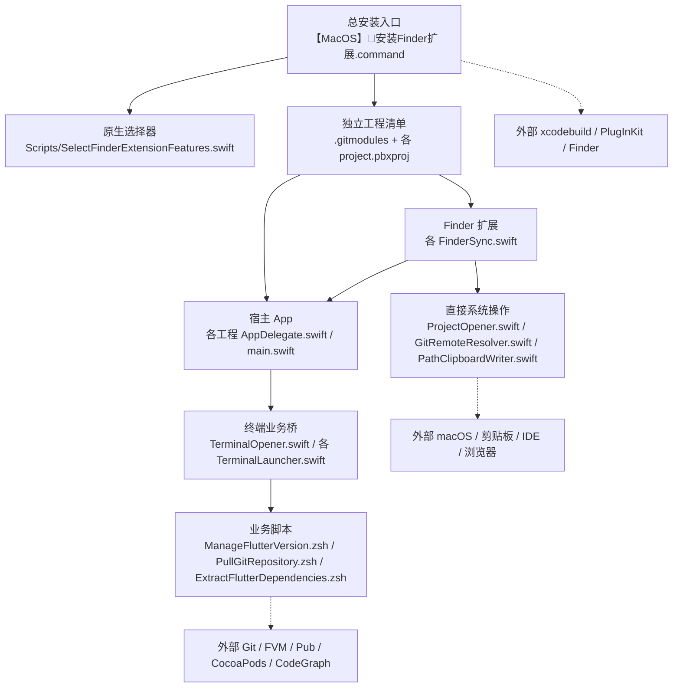
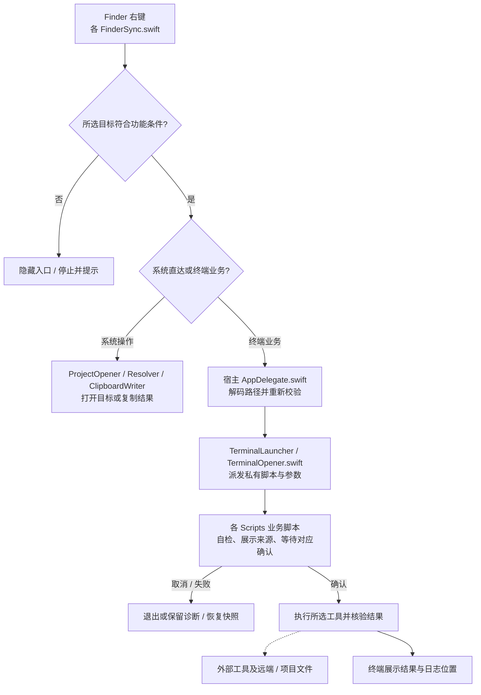

# `MacOS@Extension`


<!-- jobs-toc:start -->
<!-- jobs-toc:source {"v":2,"token":"[toc]"} -->
<details>
<summary>📚 目录（点击展开 / 收起）</summary>

- [🔥 前言](#jobs-toc-heading-1)
- [一、环境先决条件](#environment-prerequisites)
- [二、工程索引](#jobs-toc-heading-3)
- [三、运行方式](#jobs-toc-heading-4)
  - [3.1、原生 UI 勾选安装](#jobs-toc-heading-5)
  - [3.2、已安装 App 内调整 Terminal 功能](#jobs-toc-heading-6)
  - [3.3、单工程手动运行](#jobs-toc-heading-7)
- [四、维护边界](#jobs-toc-heading-8)
- [五、Git 子模块脚本](#git-submodule-scripts)
  - [【MacOS】⏬下载配置当前Git子模块（可向下同步递归）.command](#jobs-toc-heading-10)
  - [【MacOS】🧭更新引用Git父仓=\>子仓.command](#jobs-toc-heading-11)
  - [【MacOS】🧾更新gitmodules.command](#jobs-toc-heading-12)
- [六、本仓目录与脚本入口](#repository-layout-and-entrypoints)
  - [【MacOS】🧩安装Finder扩展.command](#jobs-toc-heading-14)
  - [【MacOS】🧩卸载Finder扩展.command](#jobs-toc-heading-15)
- [七、项目统计与复核口径](#project-statistics)
  - [7.1、工具链与锁定状态](#jobs-toc-heading-17)
  - [7.2、建库与提交历史](#jobs-toc-heading-18)
  - [7.3、界面、功能与后端边界](#jobs-toc-heading-19)
  - [7.4、模块依赖与核心运行流程](#jobs-toc-heading-20)
  - [7.5、功能实现矩阵](#jobs-toc-heading-21)
  - [7.6、业务代码占比与聚合边界](#jobs-toc-heading-22)
- [八、直接依赖、来源与风险](#direct-dependencies)
- [九、运行、构建与验证补充](#run-and-verify)

</details>
<!-- jobs-toc:end -->

---

## <span id="jobs-toc-heading-1" data-jobs-toc="v2">🔥 <font id=前言>前言</font></span><!-- jobs-toc:heading-end -->

**项目定位：** 面向 Jobs 与 macOS 开发人员的 Finder 日常开发工具集合。**状态：维护中**（基于当前源码与提交活动）；负责人 **Jobs** / [**JobsKits**](https://github.com/JobsKits)，未登记其他维护团队。下述功能、工程数量与统计章统一核验于 **2026-10-19**。

子仓下载与关联操作见 [Git 子模块脚本](#git-submodule-scripts)。

> **14 个 Finder 右键功能，可逐项勾选：`打开 Git 远程地址`｜`复制 Git 远程地址`｜`复制绝对路径`｜`用 Xcode 打开项目`｜`用 VSCode 打开项目`｜`用 Android Studio 打开项目`｜`安装/切换 Flutter SDK（FVM）`｜`拉取 Git 到最新`｜`提取 Flutter 第三方依赖`｜`用终端打开`｜`安装/升级 Pod`｜`flutter pub get`｜`更新代码地图（.codegraph）`｜`空白 Commit 并 Push`。** 其中 `JobsTerminalOpener` 工程内含后 5 项。

`MacOS@Extension` 用来收纳 Jobs 本机自用的 <u>[**Swift**](https://www.swift.org/)</u> macOS App + Finder Sync Extension 工程。当前目录下有十个 Finder 扩展工程，共提供十四个右键增强动作：打开 Git 远程地址、复制 Git 远程地址、复制文件或文件夹绝对路径、分别用 [**Xcode**](https://developer.apple.com/xcode/)、[**Visual Studio Code**](https://code.visualstudio.com/) 和 [**Android Studio**](https://developer.android.com/studio) 打开项目、用终端打开文件或文件夹所在目录、在合法 iOS 工程安装或升级 Pod 依赖、在合法 [**Flutter**](https://flutter.dev/) 工程通过 [**FVM**](https://fvm.app/) 安装或切换 SDK、提取已解析的 Pub 第三方依赖、执行 `flutter pub get`、更新普通文件夹中的 [**CodeGraph**](https://github.com/colbymchenry/codegraph) 代码地图、拉取 Git 到最新，以及在 Git 管理的当前文件夹创建无文件变更的空白 Commit 并 Push。

| 右键入口 | 检查与执行结果 |
| --- | --- |
| [拉取 Git 到最新](./JobsGitPuller/README.md) | 非 Git 目录静默退出；未提交内容列出后回车确认。先快照再合并，冲突可回滚、`YES` 放弃未提交内容后重试、输入 commit 信息提交后重试；空信息直接回车即可。保留本地提交、不推送、不递归子模块。Windows [对应独立包](../Windows@Extension/JobsGitPuller/README.md)采用相同流程。 |
| [提取 Flutter 第三方依赖](./JobsFlutterDependencyExtractor/README.md) | 精确 Flutter 项目，终端输入或拖入目标，直接回车默认系统桌面；复制全部已解析 Pub 第三方源码（含间接 / dev），保留许可证并输出版本清单。只读源目录，缺缓存或解析过期停止提示 pub get。Windows [独立包](../Windows@Extension/JobsFlutterDependencyExtractor/README.md)采用同一引擎。 |
| 用 Xcode 打开项目 | 直接打开目标项目；开发和安装扩展已以 Xcode 为前提，不再检查安装状态或跳转下载页。 |
| 用 VSCode 打开项目 | 先检查 VSCode；未安装时停止并打开 [官方下载页](https://code.visualstudio.com/download)。 |
| 用 Android Studio 打开项目 | 先检查 Android Studio；未安装时停止并打开 [官方下载页](https://developer.android.com/studio)。 |
| 安装/升级 Pod | 目标同层必须齐全：`Podfile`、`*.xcodeproj`、`*.xcworkspace`。缺任一项不显示入口，宿主也会在打开 Terminal 前拒绝。符合条件后，没有 `Pods/Manifest.lock` 执行 `pod install`，已有则执行 `pod update`；新克隆即便带 `Podfile.lock` 也先安装。 |
| 更新代码地图（.codegraph） | 更新所选文件夹的代码地图；缺失工具时在 Terminal 等待回车确认，通过 [**Homebrew**](https://brew.sh/) 补齐 [**Node.js**](https://nodejs.org/) / [**npm**](https://docs.npmjs.com/)，再安装官方 CodeGraph 包。已有健康工具直接复用。 |
| 安装/切换 Flutter SDK（FVM） | 仅对根 `pubspec.yaml` 声明 Flutter SDK 依赖的文件夹显示；右键后直接进入 Terminal，后台宿主不显示管理窗口。在终端体检 Homebrew、FVM、[**fzf**](https://formulae.brew.sh/formula/fzf) 及实际依赖链，查询官方历史和最新发行版，用 fzf 单选精确版本，最终回车执行安装或切换、非空输入取消。详见[独立工程说明](./JobsFlutterVersionMgr/README.md)。 |

<strong id="submodule-quick-look">父子仓多平台地址速览</strong>

十个扩展工程均通过 `./.gitmodules` 和 gitlink 作为独立子仓管理，地址使用相对写法。复制 Git 地址、Flutter 版本管理、Git 拉取与 Flutter 依赖提取工程的真实登记如下：

```ini
[submodule "JobsGitRemoteCopier"]
    path = JobsGitRemoteCopier
    url = ../JobsGitRemoteCopier.git
    branch = main
[submodule "JobsFlutterVersionMgr"]
    path = JobsFlutterVersionMgr
    url = ../JobsFlutterVersionMgr.git
    branch = main
[submodule "JobsGitPuller"]
    path = JobsGitPuller
    url = ../JobsGitPuller.git
    branch = main
[submodule "JobsFlutterDependencyExtractor"]
    path = JobsFlutterDependencyExtractor
    url = ../JobsFlutterDependencyExtractor.git
    branch = main
```

三个 IDE 工程的登记使用相同规则：

| 本地子仓目录 | `.gitmodules` 地址 | 跟踪分支 |
| --- | --- | --- |
| `JobsAndroidStudioOpener/` | `../JobsAndroidStudioOpener.git` | `main` |
| `JobsVSCodeOpener/` | `../JobsVSCodeOpener.git` | `main` |
| `JobsXcodeOpener/` | `../JobsXcodeOpener.git` | `main` |

父仓仅记录十个子仓的固定提交号，不重复跟踪其源码。各子仓根目录的 `.git` 文件指向父仓实际 Git 目录下各自的 `modules/<子仓名>/`；各自提交历史、分支和已有远端保持独立。

下表展示原生 Git 从父仓地址解析相对 URL 的结果，前提是全新克隆且没有本地 URL 覆盖。前两行来自本地已配置的 [**GitHub**](https://github.com) / [**Gitee**](https://gitee.com) 远端；自建平台仅为结构示例，未部署。

| 平台 | 父仓克隆地址 | 复制 Git 地址子仓解析地址 | Flutter 版本管理子仓解析地址 |
| --- | --- | --- | --- |
| GitHub | `git@github.com:JobsKits/MacOS_Extension.git` | `git@github.com:JobsKits/JobsGitRemoteCopier.git` | `git@github.com:JobsKits/JobsFlutterVersionMgr.git` |
| Gitee | `git@gitee.com:JobsGo/MacOS_Extension.git` | `git@gitee.com:JobsGo/JobsGitRemoteCopier.git` | `git@gitee.com:JobsGo/JobsFlutterVersionMgr.git` |
| 自建平台，仅结构示例 | `ssh://git@git.example.com:2222/team/MacOS_Extension.git` | `ssh://git@git.example.com:2222/team/JobsGitRemoteCopier.git` | `ssh://git@git.example.com:2222/team/JobsFlutterVersionMgr.git` |

Git 拉取与 Flutter 依赖提取子仓在两条已配置父仓线路上的解析结果为：

| 父仓线路 | 父仓地址 | Git 拉取子仓解析地址 | Flutter 依赖提取子仓解析地址 |
| --- | --- | --- | --- |
| GitHub `origin` | `git@github.com:JobsKits/MacOS_Extension.git` | `git@github.com:JobsKits/JobsGitPuller.git` | `git@github.com:JobsKits/JobsFlutterDependencyExtractor.git` |
| Gitee `gitee` | `git@gitee.com:JobsGo/MacOS_Extension.git` | `git@gitee.com:JobsGo/JobsGitPuller.git` | `git@gitee.com:JobsGo/JobsFlutterDependencyExtractor.git` |

三个 IDE 子仓沿用同一解析规则，例如 `../JobsXcodeOpener.git` 在 GitHub 对应 `git@github.com:JobsKits/JobsXcodeOpener.git`，在 Gitee 对应 `git@gitee.com:JobsGo/JobsXcodeOpener.git`。父仓现有远端使用 SSH；子仓已有的 HTTPS `origin` / `gitee` 不会因登记而被改写。

Flutter 版本管理子仓实际保留 `origin = https://github.com/JobsKits/JobsFlutterVersionMgr.git`，并配置 `gitee = https://gitee.com/JobsGo/JobsFlutterVersionMgr.git`；本地工作分支为 `main`。这些是子仓自身的远端，和父仓 `.gitmodules` 中供新克隆解析的相对 URL 分别管理。

Git 拉取与 Flutter 依赖提取子仓各自保留 HTTPS `origin`，分别指向 `https://github.com/JobsKits/JobsGitPuller.git` 和 `https://github.com/JobsKits/JobsFlutterDependencyExtractor.git`；Gitee 远端别名实际均为 `main`，分别指向 `https://gitee.com/JobsGo/JobsGitPuller.git` 和 `https://gitee.com/JobsGo/JobsFlutterDependencyExtractor.git`。远端别名与本地 `main` 分支是不同概念，登记不改写这些配置。

`path` 是本地目录，`url` 是远端仓库位置；相对 URL 跟随父仓默认远端的平台、组织、协议与端口，前提是该平台已有对应子仓及父仓锁定的提交。已有克隆须核对默认远端和本地子模块配置，仅新增 remote 不会切换线路。

**下载脚本的 Gitee 传输规则：** `【MacOS】⏬下载配置当前Git子模块（可向下同步递归）.command` 在本次运行中，将 `git@gitee.com:`、`ssh://git@gitee.com/`、`ssh://git@gitee.com:22/` 开头的标准地址统一通过 `https://gitee.com/` 访问，保留账号、真实仓名和分支；即使设置 `GIT_URL_STYLE=ssh`，这类 Gitee 地址仍使用 HTTPS。各层首次克隆和后续拉取都继承该规则，历史子模块中的 SSH 地址无需新电脑先配置 SSH 密钥。

规则通过追加进程级 `GIT_CONFIG_COUNT` / `url.https://gitee.com/.insteadOf` 配置传给子进程，不写入全局 Git 配置，也不依赖其它工程路径。GitHub、其它主机及非 `22` 的自定义 SSH 端口保持原规则。克隆或递归更新失败会返回非零状态，停止本轮同步并保留错误；不会再输出该项同步成功。各仓清单与浅克隆参数保留；全量同步默认逐仓复用已有工作区，空或缺失目录才首次克隆，不批量删除旧仓名目录、多层子树或缓存。未提交内容须逐仓处理，精确 `YES` 仅放弃当前仓自己的内容。

## 一、<span id="environment-prerequisites">环境先决条件</span> <a href="#前言" style="font-size:17px; color:green;"><b>🔼</b></a> <a href="#🔚" style="font-size:17px; color:green;"><b>🔽</b></a>

| 检查项 | 最低要求 | 说明 |
| --- | --- | --- |
| 系统版本 | macOS `12.0` 及以上 | 十个工程的 `MACOSX_DEPLOYMENT_TARGET` 均为 `12.0`，并依赖 macOS 的 Finder Sync Extension 机制。 |
| 开发工具 | [**Xcode**](https://developer.apple.com/xcode) 可正常打开 `.xcodeproj` | 手动运行需要 Xcode；批量安装脚本还需要 `xcodebuild`。首次换机器构建时，按 Xcode 提示完成本机签名配置。 |
| 命令行工具 | `xcodebuild`、`pluginkit`、`pkill`、`killall` 可用 | `xcodebuild` 负责构建 App，`pluginkit` 负责注册和启用 Finder Sync Extension，`pkill pkd` 和 `killall Finder` 用来刷新扩展发现索引与 Finder 菜单缓存。 |
| 安装选择 | 系统 `osascript` 与 AppKit 可用 | 根目录安装脚本会打开 macOS 原生复选框窗口，不再依赖 fzf。 |
| 扩展工程 | 已同步 Finder 扩展子工程 | 如果刚拉取父仓但还没同步子工程，安装脚本会先拉起 `./【MacOS】⏬下载配置当前Git子模块（可向下同步递归）.command`，同步结束并复检通过后再回到安装流程。 |
| Finder 扩展权限 | 系统设置中允许对应 Finder 扩展 | 构建或安装后，如果右键菜单未出现，先到系统设置的扩展管理里确认对应 Finder 扩展已启用，再重新打开 Finder 窗口。 |
| 功能权限 | 按扩展 README 单独确认 | `JobsTerminalOpener` 需要允许控制 `Terminal.app`，iOS / Flutter 依赖操作还要求终端环境已安装 [**CocoaPods**](https://cocoapods.org/) 或 Flutter；代码地图操作会体检实际依赖链，缺失组件时等待回车确认，再按需经 Homebrew 补齐 Node/npm 并安装 CodeGraph；空白 Commit 操作需要 Git 可用、当前分支可推送且暂存区为空；`JobsGitRemoteOpener` 和 `JobsGitRemoteCopier` 需要读取目标仓库的 `.git/config`；`JobsPathCopier` 和 `JobsGitRemoteCopier` 主要依赖系统剪贴板。 |

常用自检命令：

```shell
xcode-select -p
xcodebuild -version
pluginkit -m -p com.apple.FinderSync -A -v
osascript -e 'return "AppKit UI 可用"'
```

在本仓根目录运行安装器集成回归，核对十四项功能、十个工程的选择映射，以及子模块缺失时的统一下载补齐分支；测试只使用隔离目录，不构建或注册扩展：

```shell
ruby ./Tests/FlutterInstallerIntegrationTests.rb
```

## <span id="jobs-toc-heading-3" data-jobs-toc="v2">二、工程索引 <a href="#前言" style="font-size:17px; color:green;"><b>🔼</b></a> <a href="#🔚" style="font-size:17px; color:green;"><b>🔽</b></a></span><!-- jobs-toc:heading-end -->

| 工程 | 入口文案 | 核心用途 | 打开方式 |
| --- | --- | --- | --- |
| `./JobsGitRemoteOpener` | `打开 Git 远程地址` | 右键 Git 仓库文件夹，打开 `remote` 对应网页。 | `./JobsGitRemoteOpener/JobsGitRemoteOpener.xcodeproj` |
| `./JobsGitRemoteCopier` | `复制 Git 远程地址` | 右键 Git 仓库文件夹、子目录或文件，复制 `remote` 原始地址。 | `./JobsGitRemoteCopier/JobsGitRemoteCopier.xcodeproj` |
| `./JobsPathCopier` | `复制绝对路径` | 右键任意一个本地文件或文件夹，把绝对路径写入剪贴板。 | `./JobsPathCopier/JobsPathCopier.xcodeproj` |
| `./JobsXcodeOpener` | `用 Xcode 打开项目` | 直接打开目标项目；优先 workspace，同优先级多个候选时明确选择。 | `./JobsXcodeOpener/JobsXcodeOpener.xcodeproj` |
| `./JobsVSCodeOpener` | `用 VSCode 打开项目` | 检查 VSCode 后打开项目目录；缺失时打开官方下载页。 | `./JobsVSCodeOpener/JobsVSCodeOpener.xcodeproj` |
| `./JobsAndroidStudioOpener` | `用 Android Studio 打开项目` | 检查 Android Studio 后打开项目目录；缺失时打开官方下载页。 | `./JobsAndroidStudioOpener/JobsAndroidStudioOpener.xcodeproj` |
| [JobsFlutterVersionMgr](./JobsFlutterVersionMgr/README.md) | `安装/切换 Flutter SDK（FVM）` | 检查 Flutter 项目，终端体检依赖后用 fzf 选择历史或最新 SDK，通过 FVM 安装或切换。 | `./JobsFlutterVersionMgr/JobsFlutterVersionMgr.xcodeproj` |
| [JobsFlutterDependencyExtractor](./JobsFlutterDependencyExtractor/README.md) | `提取 Flutter 第三方依赖` | 只读实际 Pub 解析，导出源码、许可证、manifest；目标回车默认桌面。 | `./JobsFlutterDependencyExtractor/JobsFlutterDependencyExtractor.xcodeproj` |
| [JobsGitPuller](./JobsGitPuller/README.md) | `拉取 Git 到最新` | 保护未提交改动，合并当前分支 upstream，冲突提供回滚、放弃、提交后三选一。 | `./JobsGitPuller/JobsGitPuller.xcodeproj` |
| `./JobsTerminalOpener` | 5 个可独立勾选的 Terminal 功能 | 包含 `用终端打开`、`安装/升级 Pod`、`flutter pub get`、`更新代码地图（.codegraph）`和空白 Commit Push；安装时或 App 内均可逐项决定是否显示。 | `./JobsTerminalOpener/JobsTerminalOpener.xcodeproj` |

十个工程均为独立 Git 子模块，可独立构建与卸载，父仓记录固定提交。每个工程的使用、自检、项目选择与独立卸载说明见各自 README。

## <span id="jobs-toc-heading-4" data-jobs-toc="v2">三、运行方式 <a href="#前言" style="font-size:17px; color:green;"><b>🔼</b></a> <a href="#🔚" style="font-size:17px; color:green;"><b>🔽</b></a></span><!-- jobs-toc:heading-end -->

### <span id="jobs-toc-heading-5" data-jobs-toc="v2">3.1、原生 UI 勾选安装 <a href="#前言" style="font-size:17px; color:green;"><b>🔼</b></a> <a href="#🔚" style="font-size:17px; color:green;"><b>🔽</b></a></span><!-- jobs-toc:heading-end -->

1、双击根目录脚本 `./【MacOS】🧩安装Finder扩展.command`。

2、脚本打印内置自述后，按回车继续；如果检测到任一子模块的 `.xcodeproj` 缺失，会先拉起 `./【MacOS】⏬下载配置当前Git子模块（可向下同步递归）.command`。

3、子模块同步结束并复检通过后，脚本会重新进入安装流程并打开 macOS 原生复选框窗口；十个工程共用这一补齐流程。

4、逐项勾选需要安装的右键菜单功能，也可点击“全选”或“全不选”，选好后点击“安装”；没有勾选时安装按钮置灰。功能列表与底部按钮固定显示，中间区域不滚动。`JobsTerminalOpener` 的五项选择会归并为一次工程构建；`JobsGitPuller` 和 `JobsFlutterDependencyExtractor` 与其它工程一样，可由子模块下载器补齐。

5、确认后，脚本会调用 `xcodebuild` 构建相关 App，清理同 Bundle ID 的旧 LaunchServices / PlugInKit 记录，注册并启用 Finder Sync Extension，最后重启 `pkd` 和 Finder 刷新右键菜单缓存。

### <span id="jobs-toc-heading-6" data-jobs-toc="v2">3.2、已安装 App 内调整 Terminal 功能 <a href="#前言" style="font-size:17px; color:green;"><b>🔼</b></a> <a href="#🔚" style="font-size:17px; color:green;"><b>🔽</b></a></span><!-- jobs-toc:heading-end -->

1、打开已经安装的 `JobsTerminalOpener` App。

2、在“可选功能”区域查看五个独立复选框；每个功能单独占一行，并显示对应的适用条件。

3、勾选后点击“保存功能选择”，关闭当前 Finder 右键菜单并重新右键即可生效，不需要重新编译或重新安装。

4、这里仅管理 `JobsTerminalOpener` 内的五项 Terminal 功能；另外九个独立 Finder 扩展仍由根安装脚本选择安装。

### <span id="jobs-toc-heading-7" data-jobs-toc="v2">3.3、单工程手动运行 <a href="#前言" style="font-size:17px; color:green;"><b>🔼</b></a> <a href="#🔚" style="font-size:17px; color:green;"><b>🔽</b></a></span><!-- jobs-toc:heading-end -->

1、进入目标工程目录。

2、用 [**Xcode**](https://developer.apple.com/xcode) 打开对应 `.xcodeproj`。

3、选择同名 Scheme 运行主 App。

4、App 或 Xcode Build Phase 会注册并启用 Finder Sync Extension。

5、回到 Finder，右键符合条件的文件或文件夹，点击对应一级菜单入口。

## <span id="jobs-toc-heading-8" data-jobs-toc="v2">四、维护边界 <a href="#前言" style="font-size:17px; color:green;"><b>🔼</b></a> <a href="#🔚" style="font-size:17px; color:green;"><b>🔽</b></a></span><!-- jobs-toc:heading-end -->

- 每个扩展工程保持独立目录、独立 `.xcodeproj`、独立 Bundle ID 和独立卸载脚本；三个 IDE 入口各用一个独立工程。`JobsTerminalOpener` 是当前兼容例外，同一工程承载五项 Terminal 菜单动作，但安装器仍按单个右键功能提供独立复选框；Pod 安装与升级合为其中一项，不拆成两个开关。
- Finder Sync Extension 菜单位置由 macOS 决定，本目录只保证扩展注册、启用和菜单动作逻辑。
- 如果 `pluginkit` 显示扩展前缀为 `+`，但 Finder 右键菜单仍缺少对应入口，优先重新运行根目录安装脚本；脚本会清理旧会话、旧 DerivedData 或散落 appex 留下的同 Bundle ID 注册记录。
- 新增同类工程时优先沿用 `JobsGitRemoteOpener` 的主 App 注册流程、Build Phase 启用脚本和 README 结构。
- 根目录只做工程索引；每个工程的具体使用、排查和卸载说明写在各自 `README.md`。

[**Homebrew**](https://brew.sh/) 安装路径由用户选择：已有可运行安装时复用；确实需要安装时先强提示，只有精确输入大写 `YES` 才选择系统标准目录，其它输入或直接回车选择当前用户的 `.local/homebrew`。`YES` 只表示选择路径，权限与密码由官方安装器实际处理；有管理员权限也可以选用户目录。选定路径失败立即停止，不自动切换；`Ctrl+C` / 输入结束取消整个任务。

## 五、<span id="git-submodule-scripts">Git 子模块脚本</span> <a href="#前言" style="font-size:17px; color:green;"><b>🔼</b></a> <a href="#🔚" style="font-size:17px; color:green;"><b>🔽</b></a>

### <span id="jobs-toc-heading-10" data-jobs-toc="v2">[【MacOS】⏬下载配置当前Git子模块（可向下同步递归）.command](./【MacOS】⏬下载配置当前Git子模块（可向下同步递归）.command)</span><!-- jobs-toc:heading-end -->

> **目的：** 将选中的子仓及可选的后代子模块更新到各自远端目标分支最新版本，并维护入口父仓关联。

* 确认自述后读取脚本清单、检查远端，尝试拉取父仓。
* 父仓有未提交改动：跳过父仓拉取，继续处理子仓。
* 在主菜单选择同步范围；“切换同步深度”可在默认“向下递归”和“仅直属子模块”之间切换，当前深度适用于各同步动作。
  * 全量同步：逐项同步清单内全部目标，按目录状态复用或首次克隆。
  * 只更新已有：更新清单内已存在的子仓；一个都没有时转全量同步。
  * 指定子模块：回车勾选或取消，空格确认开始。
  * 添加地址：输入新仓地址，自动用仓名作为目录，本轮登记并同步。
* 补齐关联配置，检查并处理目标子仓目录。
  * 目录为空或缺失：首次克隆；已有有效 Git 工作区：保留目录、缓存及后代，直接更新。
  * 已有 `modules/` 缓存时先核验并恢复空工作区；非 Git 非空目录保护并停止。
  * 子仓有未提交、已暂存或未跟踪内容：红字加粗显示该仓绝对路径并循环等待；精确输入 `YES` 只放弃当前仓自己的未提交内容，或在外部处理后回车复检。其它输入继续复检；无交互或输入结束则停止。
* 拉取并强制对齐远端目标分支最新提交：优先使用该层 `.gitmodules` 显式 `branch`，`.` 继承直接父仓分支；未设置时优先 `main`，不存在则使用远端默认分支。
  * 使用 `checkout -B` 和 `reset --hard`：目标本地分支未推送的独有提交可能被覆盖。
* 按当前深度同步：默认逐层读取所选子仓下的 `.gitmodules`，将已登记后代同步到各自远端目标分支最新提交；仅直属模式不下载或更新下层代码。
  * 只处理本层所选子树，不向上扫描，也不接管未登记的嵌套仓库。
  * 递归更新本层前先检查当前已有后代；各仓单独确认，子模块 HEAD 与父仓 gitlink 的普通差异不作为源码未提交反复提示。
  * `YES` 清理仅作用于当前仓：`reset --hard HEAD` 与 `clean -fd`；保留忽略文件和独立嵌套 Git 仓，残留冲突须外部处理后复检。
  * `PRUNE_STALE_GITMODULES` 默认 `0`，保留清单外旧登记；主动设为 `1` 时，每个旧登记另用红字加粗列明目录和后代删除范围，逐项精确输入 `YES` 才删除，其它输入、输入结束或非交互则停止；演练只展示，删除前仍逐仓检查已有后代。
  * 深层只下载更新，不自动暂存或提交其父仓的 gitlink；递归后这些父仓可能显示子模块指针改动，保留待审阅。
* 整理入口父仓 Git 元数据与来源日志。
* 默认自动提交入口父仓的关联变化，不自动推送。
  * 设置 `AUTO_PARENT_COMMIT=0`：跳过提交；`AUTO_PARENT_PUSH=1`：启用父仓推送。

### <span id="jobs-toc-heading-11" data-jobs-toc="v2">[【MacOS】🧭更新引用Git父仓=>子仓.command](./【MacOS】🧭更新引用Git父仓=%3E子仓.command)</span><!-- jobs-toc:heading-end -->

> **目的：** 修复目录改名、旧路径残留或元数据指向错误，让父仓关联符合当前磁盘布局。

* 扫描父仓第一层实际带 `.git` 的子目录，读取远端和已有登记。
  * 远端缺失、元数据归属不明或属于链接工作树：停止修复。
* 展示磁盘目录、父仓状态与清理计划，确认后备份关联状态。
  * 直接回车：跳过；输入任意字符后回车：执行；`--dry-run`：只预览。
* 按现存目录对齐 `.gitmodules`，保留仍存在条目的 URL、分支及扩展字段。
  * 目录缺失，包括尚未下载：移除旧登记和旧子模块指针，磁盘文件保留。
* 修复可证明失效的工作树指向，暂存各子仓当前提交号，用官方命令归集元数据并补齐父仓本地登记。
* 核对磁盘目录、清单和父仓子模块指针是否一致，输出状态；不拉取代码、不提交、不推送。

### <span id="jobs-toc-heading-12" data-jobs-toc="v2">[【MacOS】🧾更新gitmodules.command](./【MacOS】🧾更新gitmodules.command)</span><!-- jobs-toc:heading-end -->

> **目的：** 将新放入的直属子仓完整纳入父仓子模块管理，保留已有登记与指针。

* 读取已有登记，扫描直属子仓，预检远端、提交、索引和元数据冲突。
  * 有冲突或缺少必要信息：停止，展示问题。
* 生成增量计划，保留已有 URL、分支、扩展字段、子模块指针和暂缺目录登记。
  * `--dry-run` 或 `DRY_RUN=1`：只预览，不执行关联写入。
* 确认计划后备份关联配置和父仓索引。
  * 直接回车：跳过；输入任意字符后回车：执行。
* 补齐 `.gitmodules` 和缺失的子模块指针，初始化本地登记，将元数据归集到父仓。
* 核验父子关系和子仓提交号；仅暂存必要关联，不联网拉取、不提交、不推送。

## 六、<span id="repository-layout-and-entrypoints">本仓目录与脚本入口</span> <a href="#前言" style="font-size:17px; color:green;"><b>🔼</b></a> <a href="#🔚" style="font-size:17px; color:green;"><b>🔽</b></a>

以下为当前检出的源码与维护入口；依赖环境、Git 元数据、构建缓存和生成产物略去，独立子仓仅列目录。

```text
.
├── .gitignore
├── .gitmodules
├── .gitattributes
├── .jobs-markdown-toc/  # 本仓文档目录工具与精确清单
├── 【MacOS】⏬下载配置当前Git子模块（可向下同步递归）.command
├── 【MacOS】🧩卸载Finder扩展.command
├── 【MacOS】🧩安装Finder扩展.command
├── 【MacOS】🧭更新引用Git父仓=>子仓.command
├── 【MacOS】🧾更新gitmodules.command
├── icon.png
├── JobsGitRemoteCopier/  # 独立 Git 子仓
├── JobsGitRemoteOpener/  # 独立 Git 子仓
├── JobsPathCopier/  # 独立 Git 子仓
├── JobsXcodeOpener/  # 独立 Git 子仓
├── JobsVSCodeOpener/  # 独立 Git 子仓
├── JobsAndroidStudioOpener/  # 独立 Git 子仓
├── JobsFlutterVersionMgr/  # 独立 Git 子仓
├── JobsFlutterDependencyExtractor/  # 独立 Git 子仓
├── JobsGitPuller/  # 独立 Git 子仓
├── JobsTerminalOpener/  # 独立 Git 子仓
├── README.md
├── Scripts/
│   ├── README.md
│   └── SelectFinderExtensionFeatures.swift
├── Tests/
│   └── FlutterInstallerIntegrationTests.rb
└── work/
    └── README.md
```

* 原有四个扩展工程均为独立 Git 子仓；本仓维护总安装 / 卸载入口、三个 Git 入口及 `Scripts/SelectFinderExtensionFeatures.swift` 原生选择界面。
  * [JobsGitRemoteCopier](./JobsGitRemoteCopier/README.md)、[JobsGitRemoteOpener](./JobsGitRemoteOpener/README.md)、[JobsPathCopier](./JobsPathCopier/README.md)、[JobsTerminalOpener](./JobsTerminalOpener/README.md)。
* 三个 IDE 工程也通过 Git 子模块独立管理：[JobsXcodeOpener](./JobsXcodeOpener/README.md)、[JobsVSCodeOpener](./JobsVSCodeOpener/README.md)、[JobsAndroidStudioOpener](./JobsAndroidStudioOpener/README.md)。
* [JobsFlutterVersionMgr](./JobsFlutterVersionMgr/README.md)：独立 Git 子模块，提供 Flutter SDK 安装 / 切换功能，包含宿主、Finder 扩展、终端脚本、独立安装和卸载入口；Windows 对应实现见[平行仓库](../Windows@Extension/README.md)。
* [JobsFlutterDependencyExtractor](./JobsFlutterDependencyExtractor/README.md)：独立 Git 子模块，包含 Flutter 依赖提取宿主与 Finder 扩展；[桌面脚本源包](./JobsFlutterDependencyExtractor/【MacOS】提取Flutter第三方依赖.command/README.md)可整体拷走使用。
* [JobsGitPuller](./JobsGitPuller/README.md)：独立 Git 子模块，包含宿主、Finder 扩展及安装 / 卸载入口；拉取 Git 与冲突三选一在 Terminal 内执行。
* [Scripts 目录说明](./Scripts/README.md)：安装器使用的原生功能选择界面及调用约定。
* [目录过滤器说明](./.jobs-markdown-toc/README.md)：本仓自包含转换工具与精确文档清单；本地保留 `[toc]`，整文件暂存时自动生成折叠目录。各子仓独立接入，父仓不跨越子仓管理文档。
* [work 目录说明](./work/README.md)：本地 DerivedData、生成 App 与扩展的保存位置及 Git 忽略边界。安装器直接从其中注册 App / appex，清理前应先通过对应卸载入口停用、注销，不能把它当作可随手删除的纯缓存；复制 Git 地址扩展使用子仓专用卸载入口。
* 总卸载菜单管理九个宿主，包括三个 IDE 扩展、Flutter 版本管理、Git 拉取与 Flutter 依赖提取；`JobsGitRemoteCopier/` 的复制 Git 地址扩展使用其子仓卸载脚本。

### <span id="jobs-toc-heading-14" data-jobs-toc="v2">[【MacOS】🧩安装Finder扩展.command](./【MacOS】🧩安装Finder扩展.command)</span><!-- jobs-toc:heading-end -->

> **目的：** 选择并安装本目录的 Finder 右键功能，刷新菜单使其生效。

* 阅读自述并回车，检查系统工具与十个扩展工程。
  * 任一子模块工程缺失：先运行同层子模块下载脚本，复检通过后重新进入安装器；十个子模块共用同一流程。
* 在原生复选框窗口逐项勾选或使用“全选 / 全不选”，再点击“安装”；Terminal 的五项功能归并为一次工程安装。
  * 未选择项目时“安装”置灰；点击取消或关闭窗口退出安装。
* 构建选中的宿主 APP，清理同 Bundle ID 的过期注册，注册并启用对应 Finder 扩展，保存 Terminal 功能选择。
* 对成功安装项刷新 pkd / Finder，汇总结果与日志；失败项在终端显示具体原因。

### <span id="jobs-toc-heading-15" data-jobs-toc="v2">[【MacOS】🧩卸载Finder扩展.command](./【MacOS】🧩卸载Finder扩展.command)</span><!-- jobs-toc:heading-end -->

> **目的：** 批量卸载菜单中选定的 Finder 扩展，并清理相关构建残留。

* 阅读自述并回车，检查 fzf、扩展管理与进程工具。
* 在菜单勾选“打开 Git 远程地址”“复制绝对路径”、三个 IDE 打开入口、“安装/切换 Flutter SDK（FVM）”、“拉取 Git 到最新”、“提取 Flutter 第三方依赖”、“用终端打开”或全选，再回车确认卸载。
  * 取消选择：退出；复制 Git 地址扩展使用其子仓专用卸载入口。
* 停用并注销选中扩展，停止对应宿主与扩展进程，清理构建 APP、运行标记和旧 Automator 服务。
* 保留工程源码，刷新 Services 缓存并重启 Finder，汇总成功项、失败项与日志位置。

## 七、<span id="project-statistics">项目统计与复核口径</span> <a href="#前言" style="font-size:17px; color:green;"><b>🔼</b></a> <a href="#🔚" style="font-size:17px; color:green;"><b>🔽</b></a>

本章所有数量的统一统计日期为 **2026-10-19（Asia/Shanghai）**，取当前磁盘工作树；Git 历史单独取父仓 `HEAD`。本仓及十个子仓均无根 `.codegraph/`，依据源码、工程配置与 Git 清单复核，未建立代码索引。后续功能、依赖或工程变化时同步更新本章；数字超过一个迭代周期须重新核验。

### <span id="jobs-toc-heading-17" data-jobs-toc="v2">7.1、工具链与锁定状态 <a href="#前言" style="font-size:17px; color:green;"><b>🔼</b></a> <a href="#🔚" style="font-size:17px; color:green;"><b>🔽</b></a></span><!-- jobs-toc:heading-end -->

| 类别 | 名称 / 版本 | 依据与锁文件入库状态 |
| --- | --- | --- |
| 语言 / SDK | Swift 语言模式 `5.0`；macOS SDK 随所选 Xcode | 十个 `*.xcodeproj/project.pbxproj` 的 `SWIFT_VERSION`；不是编译器版本锁。 |
| 构建工具 | Xcode 未固定精确版本；工程 `LastUpgradeCheck = 2650` | 此字段仅为工程升级检查记录，最低可构建 Xcode 版本待实机矩阵核实；用 `xcodebuild -version` 记录实际环境。 |
| 最低系统 | macOS `12.0` | 十个工程全部 target 的 `MACOSX_DEPLOYMENT_TARGET`。 |
| 安装 / 维护 | 系统 zsh、osascript、swiftc、PlugInKit、Git；Ruby 用于隔离测试 | 未设精确版本；本机版本由环境自检确认，不把本机输出视为仓库版本约束。 |
| Node 工具链 | 文档 Node.js `20+`；CodeGraph 安装链使用 Homebrew `node@24` | `.jobs-markdown-toc/README.md` 与 Terminal 子仓 `TerminalOpener.swift`；健康既有工具先复用，非精确补丁版本锁。 |
| 功能工具 | FVM / fzf / Flutter / Dart；Pod 功能使用 Ruby / CocoaPods，目标需要时使用 Bundler；CodeGraph 经健康检查复用 | 工具按功能运行时发现，版本来源与风险见[依赖清单](#direct-dependencies)。 |
| 依赖锁定 | 无已入库 `Package.resolved`、`Podfile.lock`、`pubspec.lock` 或 npm 锁文件 | 扩展源码没有第三方 SPM / Pod 包依赖；目标项目自己的锁文件属于操作对象，不属于扩展依赖。父仓 `.gitmodules` + gitlink 固定子仓提交，不能替代子仓工具锁。 |

### <span id="jobs-toc-heading-18" data-jobs-toc="v2">7.2、建库与提交历史 <a href="#前言" style="font-size:17px; color:green;"><b>🔼</b></a> <a href="#🔚" style="font-size:17px; color:green;"><b>🔽</b></a></span><!-- jobs-toc:heading-end -->

| 项目 | 父仓结果 | 口径 / 依据 |
| --- | --- | --- |
| 托管平台建库时间 | 待核实 | 本地 Git 不保存远端仓库创建时间，不拿首个提交冒充建库时间。 |
| 首次提交 | `2026-06-28 20:40:54 +08:00`，`ab9f8b365ed742f8aa8dc640a371500e2f608487` | `git log --reverse --format='%aI %H'` 的首行。 |
| 最近提交 | `2026-10-19 02:31:49 +08:00`，`c1dd89431599f6d1e7620339f9287976245871cb` | `git log -1 --format='%aI %H'`；不含未提交修改。 |
| 提交数 | `22` | `git rev-list --count HEAD`；仅父仓当前分支可达历史，不累加十个子仓。 |
| 贡献者 | `1` | `git shortlog -sn --all` 按作者身份行数；不等同于当前维护团队规模。 |
| 历史完整性 | 非浅克隆 | `git rev-parse --is-shallow-repository` 为 `false`；以上均为 2026-10-19 本地已取得的历史。 |

在对应 Git 根复核：

```shell
git log --reverse --format='%aI %H %an'
git log -1 --format='%aI %H %an'
git rev-list --count HEAD
git shortlog -sn --all
git rev-parse --is-shallow-repository
```

### <span id="jobs-toc-heading-19" data-jobs-toc="v2">7.3、界面、功能与后端边界 <a href="#前言" style="font-size:17px; color:green;"><b>🔼</b></a> <a href="#🔚" style="font-size:17px; color:green;"><b>🔽</b></a></span><!-- jobs-toc:heading-end -->

| 端 / 单位 | 页面数 | 子页面数 | 页面路由数 | 统计依据与排除项（2026-10-19） |
| --- | --- | --- | --- | --- |
| macOS / `NSViewController` | `7` | `0` | `0` | 七个宿主的 `MainViewController.swift`，对应 Git 打开、Git 复制、路径复制、三个 IDE、Terminal。未发现子控制器导航或页面路由表。 |
| 独立安装面板 | 不并入页面数 | — | — | `Scripts/SelectFinderExtensionFeatures.swift` 使用 `NSWindow` / `NSObject`，是安装工具界面；按控制器单位排除。 |
| iOS / Android / Web | 不适用 | 不适用 | 不适用 | 本仓未交付这些平台的前端。Finder 菜单、`NSAlert`、文件选择对话框、终端及外部 IDE 窗口不计页面；无 H5 / 跨端页面容器。 |

五个宿主 `Info.plist` 声明本地 URL Scheme（Terminal、VSCode、FVM、Git 拉取、依赖提取），它们负责 Finder 到宿主的进程间请求，**不算 Web 页面路由或后端 RPC 接口**。右键功能数按选择器中的独立功能标识去重为 `14`，部署按 `.gitmodules` 工程去重为 `10` 个 App + 各自 Finder Extension；二者不与页面数混算。

| 后端统计项 | 结果与依据（2026-10-19） |
| --- | --- |
| 对外接口：HTTP / RPC / MQ | 均为 `0`；各宿主、FinderSync 与终端脚本未提供对外监听服务。下载与 Git 网络请求是客户端出站调用，不计入。 |
| 服务模块 / 部署单元 | 后端服务 `0`；本地部署单元为十组宿主 App / 内嵌 appex，依据十个 Xcode 工程；不计为十个后端服务。 |
| 核心业务表 | `0`；未声明自有业务数据库。目标 `.codegraph` 的 SQLite 由外部工具管理。 |
| 业务状态机 | 后端业务状态机 `0`；安装、确认、冲突恢复是本地操作流程，不作为订单等服务业务对象计数。 |
| 外部系统集成 | 无支付 / 短信 / ERP 等业务服务；Git 托管、官方 SDK / 包源及 IDE 为条件工具集成，详见依赖表，目标服务地址随项目配置变化。 |
| 定时 Job / 批处理消费者 | `0` 个常驻调度任务 / 消费者；入口均由用户操作触发，Git 子模块批量同步不等同于后台定时任务。 |
| 中间件 | 未声明 Redis、MQ、搜索或对象存储服务；操作目标的依赖不计入扩展自身。 |
| 运行时规模 | QPS、日增数据、存储量不适用；本地耗时、缓存体积未测量，不给出推算值。 |

本地工具没有“页面 : 接口”的业务映射，因此不应用页面与接口比例校验。

### <span id="jobs-toc-heading-20" data-jobs-toc="v2">7.4、模块依赖与核心运行流程 <a href="#前言" style="font-size:17px; color:green;"><b>🔼</b></a> <a href="#🔚" style="font-size:17px; color:green;"><b>🔽</b></a></span><!-- jobs-toc:heading-end -->

以下为可编辑 [**Mermaid**](https://mermaid.js.org) 源码，虚线表示外部系统或进程边界，节点标出真实入口文件。





各动作确认方式不同：FVM 最终回车执行，空白提交须 `YES`，Git 拉取冲突三选一；具体交互沿用[前述运行说明](#前言)与对应子仓文档。

### <span id="jobs-toc-heading-21" data-jobs-toc="v2">7.5、功能实现矩阵 <a href="#前言" style="font-size:17px; color:green;"><b>🔼</b></a> <a href="#🔚" style="font-size:17px; color:green;"><b>🔽</b></a></span><!-- jobs-toc:heading-end -->

| 类目 | 是否涉及 / 实现方式与证据 |
| --- | --- |
| 网络与安全 | 涉及出站 HTTPS、Git 认证复用；无自有 OAuth / JWT / Session 服务、接口加解密或证书绑定实现。FVM 官方清单和来源校验在 `JobsFlutterVersionMgr/Scripts/ManageFlutterVersion.zsh`；Git 网络能力由 Git 承担，不复制用户密钥。 |
| 持久化 / 缓存 / 迁移 | 涉及功能选择配置、终端日志、恢复快照、构建缓存；`JobsTerminalShared/FinderMenuFeatureConfiguration.swift` 位于 Terminal 子仓，FVM 脚本保留项目配置字段；无自有数据库 / 通用数据库迁移层。 |
| 端能力 | 涉及 Finder Sync、剪贴板、LaunchServices、AppleEvent / Terminal，见各 `FinderSync.swift`、宿主 `AppDelegate.swift`；蓝牙、推送、定位、相机、相册、生物识别、扫码、NFC、支付未实现，复制路径不计系统分享能力。 |
| 国际化 / 埋点 / 崩溃 | 当前中文菜单与文案；未发现本仓多语言资源表、分析 SDK、崩溃上传 SDK。系统 Console / 终端日志用于诊断。 |
| 热更新 / CI / 多环境 | 无热更新服务与 dev / test / prod API 配置；各工程 Debug / Release。父仓未配置 CI；`Tests/FlutterInstallerIntegrationTests.rb` 为本地隔离集成检查，子仓测试各自维护。 |
| 后端工程能力 | 幂等、限流、降级、熔断、分布式锁、业务事务、链路追踪、灰度、对账均无服务端实现；安装去重、临时目录权限和 Git 快照是本地安全机制。 |
| 权限 / 隐私 / 脱敏 | 各工程 `*.entitlements`、`Info.plist` 管理 Finder / 自动化权限；外部路径与远程地址进入日志时需按各实现脱敏，复制 Git 地址按功能保留原始值。未发现已入库 `PrivacyInfo.xcprivacy`，发布前需按实际 API / 数据行为复核，不宣称已经完成商店隐私验收。 |

### <span id="jobs-toc-heading-22" data-jobs-toc="v2">7.6、业务代码占比与聚合边界 <a href="#前言" style="font-size:17px; color:green;"><b>🔼</b></a> <a href="#🔚" style="font-size:17px; color:green;"><b>🔽</b></a></span><!-- jobs-toc:heading-end -->

日期：**2026-10-19**。以父仓及 `.gitmodules` 中十个已检出独立子仓的 `git ls-files -c -o --exclude-standard` 并集取现存普通文本文件，按相对路径去重；子仓当前无继续嵌套的 `.gitmodules`。这覆盖工作树既有未提交内容：包含父仓新 Swift 选择器、VSCode 请求 / 入口及两个新子仓的未跟踪文档工具，不能当作远端已发布统计。历史仅父仓、LOC 聚合父子仓，口径明确分开。

行数为物理文本行，**包含空行和注释**。业务代码：非测试 Swift / Dart 和三份 FVM、Git 拉取、依赖提取 zsh；测试代码：`Tests/` 下的代码；配置与脚本：其余自有命令、启用 / 卸载脚本、文档目录工具、Xcode 配置、plist、entitlements、Scheme、JSON 和 Git 配置。文档 `.md`、图片等资源、锁文件、`xcuserdata`、第三方、生成代码、`.git`、`node_modules`、`Pods`、`.dart_tool`、`build`、`DerivedData` 与 `work` 排除。自有独立分发的源码副本按物理文件分别计入，不以内容相同合并。

| 类别 | 文件数 | 行数 | 行数占比 |
| --- | --- | --- | --- |
| 业务代码 | `59` | `11,402` | `30.53%` |
| 测试代码 | `16` | `4,579` | `12.26%` |
| 配置与脚本 | `131` | `21,360` | `57.20%` |
| 纳入合计 | `206` | `37,341` | `100.00%` |
| 第三方源码（排除） | 纳入候选中未发现 | — | 不参与分母 |


| 聚合范围 | 文件数 / 行数（2026-10-19，同上口径） |
| --- | --- |
| 父仓自身 | `12 / 6,093` |
| `JobsGitRemoteCopier` | `15 / 2,398` |
| `JobsGitRemoteOpener` | `15 / 2,334` |
| `JobsPathCopier` | `15 / 2,430` |
| `JobsTerminalOpener` | `23 / 5,230` |
| `JobsAndroidStudioOpener` | `17 / 2,111` |
| `JobsVSCodeOpener` | `19 / 2,498` |
| `JobsXcodeOpener` | `17 / 2,075` |
| `JobsFlutterVersionMgr` | `23 / 3,649` |
| `JobsGitPuller` | `23 / 3,081` |
| `JobsFlutterDependencyExtractor` | `27 / 5,442` |

## 八、<span id="direct-dependencies">直接依赖、来源与风险</span> <a href="#前言" style="font-size:17px; color:green;"><b>🔼</b></a> <a href="#🔚" style="font-size:17px; color:green;"><b>🔽</b></a>

统计日期 **2026-10-19**。十个 Xcode 工程未声明外部 SPM / Pod 直接源码包，因此构建链接的第三方包数为 `0`；Jobs 子仓是自有模块，不当作第三方库。下表列直接调用的外部工具，均为公有来源、私库地址不适用；每项按功能条件使用，不将工具自身的传递依赖或目标项目依赖计入包总数。许可证链接核对上游声明，不替代实际分发版本的 LICENSE / NOTICE。

| 直接工具 | 版本 / 来源 | 许可证 | 用途与仍在使用 |
| --- | --- | --- | --- |
| Git | 未锁定；[官方公库](https://git-scm.com/) / 系统 CLI | [GPL-2.0](https://github.com/git/git/blob/master/COPYING) | 是；远程解析、拉取、空白提交与父子仓管理。 |
| Homebrew | 健康安装复用；缺失时官方稳定发行版，未锁精确版；[公库](https://github.com/Homebrew/brew) | [BSD-2-Clause](https://github.com/Homebrew/brew/blob/master/LICENSE.txt) | 是，按功能需要；依赖安装 / 修复。 |
| FVM | 健康版本能力检测；[公库](https://github.com/leoafarias/fvm)，未锁精确版 | [MIT](https://github.com/leoafarias/fvm/blob/main/LICENSE) | 是；当前目标 Flutter SDK 管理。 |
| fzf | 未锁定；[公库](https://github.com/junegunn/fzf) | [MIT](https://github.com/junegunn/fzf/blob/master/LICENSE) | 是；SDK 单选及部分维护菜单。 |
| Flutter / Dart | 目标项目精确 SDK 或健康本机工具；[Flutter](https://github.com/flutter/flutter) / [Dart](https://github.com/dart-lang/sdk) 公库 | [Flutter BSD-3-Clause](https://github.com/flutter/flutter/blob/master/LICENSE) / [Dart BSD-3-Clause](https://github.com/dart-lang/sdk/blob/main/LICENSE) | 是；pub get、选版验证、运行自有提取引擎；未将 SDK 源码打入扩展。 |
| Node.js / npm | 文档 Node `20+`；CodeGraph 缺失安装链为 `node@24`；精确补丁未锁定；[Node](https://nodejs.org/) / [npm](https://docs.npmjs.com/) | [Node MIT 及附带第三方条款](https://github.com/nodejs/node/blob/main/LICENSE)；npm 分发条款须随实际版本复核 | 是；文档目录、FVM JSON 辅助与 CodeGraph 安装链。 |
| CodeGraph | 健康 CLI 复用；代码注释和行为基线 `1.6.2`，macOS 安装未锁精确包版本；[公有 npm 包](https://www.npmjs.com/package/@colbymchenry/codegraph) | [MIT](https://github.com/colbymchenry/codegraph/blob/main/LICENSE) | 是；用户触发代码地图创建 / 同步；源码位于 Terminal 子仓 `TerminalOpener.swift`。 |
| Ruby / CocoaPods / Bundler | 复用本机，目标有 Gemfile 时使用对应 Bundler，精确版由目标工程决定；[Ruby](https://www.ruby-lang.org/) / [CocoaPods](https://github.com/CocoaPods/CocoaPods) / [Bundler](https://bundler.io/) 公有来源 | [Ruby / BSD-2-Clause 双选](https://www.ruby-lang.org/en/about/license.txt)；[CocoaPods MIT](https://github.com/CocoaPods/CocoaPods/blob/master/LICENSE)；Bundler 具体版本许可待核实 | 是，Pod 功能条件依赖；Ruby 也用于本地测试。 |
| Xcode / Apple 系统框架、IDE 与浏览器 | Xcode / AppKit / FinderSync 随环境；VSCode、Android Studio 按本机安装 | Apple SDK 与各 IDE 自身产品许可；本仓不再分发其二进制 | 是；系统集成与打开目标；不并入第三方源码包数。 |

**风险与处置：** 多数工具浮动或由目标工程决定，首次安装与升级需记录实际 `--version`，健康检查通过仍需验收新版本；尤其 macOS CodeGraph 没有固定 npm 版本，不能把行为基线视为已锁定。Git 的 GPL-2.0 单独标注，当前按外部 CLI 调用，若将工具二进制或源码随产品分发须按该版本条款复核。npm、Bundler 与 IDE 的完整分发许可仍待核实。未实施安全公告 / 归档状态的全量版本审计，不能声称无漏洞或所有上游均在维护。

## 九、<span id="run-and-verify">运行、构建与验证补充</span> <a href="#前言" style="font-size:17px; color:green;"><b>🔼</b></a> <a href="#🔚" style="font-size:17px; color:green;"><b>🔽</b></a>

[环境先决条件](#environment-prerequisites)与既有运行、安装、卸载章节保留完整操作说明。开发时可在根目录仅构建一个工程，以下示例为 VSCode 子仓：

```shell
xcodebuild \
  -project ./JobsVSCodeOpener/JobsVSCodeOpener.xcodeproj \
  -scheme JobsVSCodeOpener \
  -configuration Debug \
  -derivedDataPath ./work/JobsVSCodeOpenerDerivedData \
  CODE_SIGNING_ALLOWED=NO \
  JOBS_SKIP_FINDER_EXTENSION_BUILD_PHASE=1 \
  build
```

此命令用于源码构建检查，跳过自有扩展注册 Build Phase；`CODE_SIGNING_ALLOWED=NO` 的产物不能作为已通过签名或 Finder 加载验收。Xcode 自身可能仍登记 App，隔离构建时须按测试产物精确路径处理。用户正式安装使用原安装入口完成签名、注册和刷新，不把上述命令当作安装。

| 环境 / 问题 | 配置与处理 |
| --- | --- |
| dev / test / prod | 未设置服务器环境；Debug / Release 在各 `project.pbxproj`。Terminal 功能配置由安装选择与 `FinderMenuFeatureConfiguration.swift` 管理；测试使用临时项目，避免写真实仓库。 |
| 启动 | 用 Xcode 运行同名宿主 Scheme，或按第三章根安装入口部署；FVM、拉取、提取宿主只做后台转发，不应期待独立管理窗口。 |
| 测试 | 父仓运行 `ruby ./Tests/FlutterInstallerIntegrationTests.rb`；子仓 `Tests/` 按各自 README 运行；文档只读检查 `node ./.jobs-markdown-toc/MarkdownToc.mjs verify`。 |
| 菜单缺失 | 检查 Finder 扩展启用、签名与同 Bundle ID 旧注册；按既有维护章节处理，不能仅以构建成功认定真实菜单可用。 |
| 找不到子工程 / 工具 | 缺子仓走统一下载补齐；缺 Xcode Command Line Tools 或对应 SDK 时先修环境。目标路径、Pod 三件套或 Flutter 根声明不合法时修目标，不绕过门禁。 |
| 网络 / 离线 | 本仓没有 API 假数据模式；FVM 官方列表失败仅可选就绪缓存，其余联网工具依原实现停止并展示来源与错误。 |

本章统计与图按静态源码核对；未因文档维护执行真实安装、卸载、依赖下载、构建、Finder 重启或远端推送。签名加载和全部十四项右键交互仍以对应设备的实际验收为准。

<a id="🔚" href="#前言" style="font-size:17px; color:green; font-weight:bold;">我是有底线的➤点我回到首页</a>
