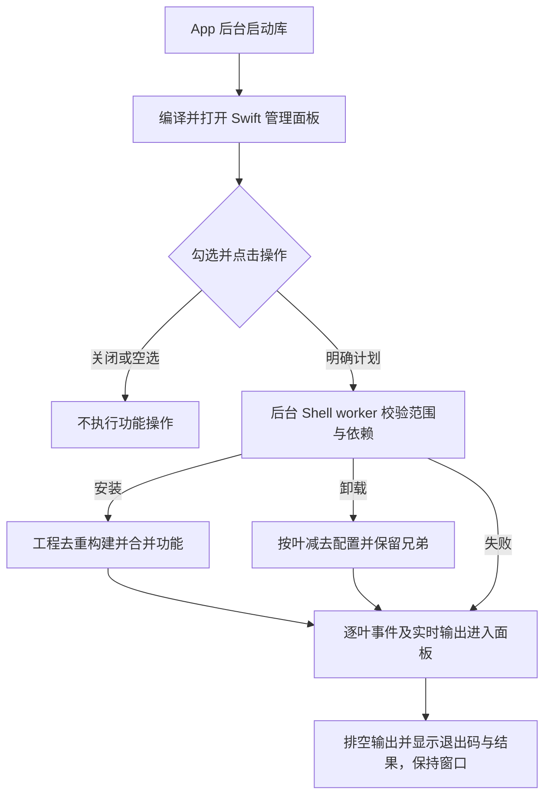

# `Scripts`：Finder 功能管理选择器


<!-- jobs-toc:start -->
<!-- jobs-toc:source {"v":2,"token":"[toc]"} -->
<details>
<summary>📚 目录（点击展开 / 收起）</summary>

- [🔥 前言](#jobs-toc-heading-1)
- [一、目录与调用关系](#directory-and-caller)
- [二、功能标识与工程映射](#feature-identifiers)
- [三、运行方式与执行边界](#run-and-check)
  - [3.1、通过总管理器选择安装或卸载](#jobs-toc-heading-5)
  - [3.2、只预览选择窗口](#jobs-toc-heading-6)
  - [3.3、只做编译检查](#jobs-toc-heading-7)
- [四、返回结果与调用流程](#return-contract)
- [五、日志与常见问题](#logs-and-troubleshooting)

</details>
<!-- jobs-toc:end -->

---

## <span id="jobs-toc-heading-1" data-jobs-toc="v2">🔥 <font id=前言>前言</font></span><!-- jobs-toc:heading-end -->

本目录维护 [**macOS**](https://www.apple.com/macos/) 原生 [**Finder**](https://support.apple.com/zh-cn/102339) 扩展管理窗口及后台启动库。面板用 [**Swift**](https://www.swift.org/) 与 [**AppKit**](https://developer.apple.com/documentation/appkit) 展示选择、逐项执行状态和底部实时日志；通过后台 Shell 管理器完成构建、注册、启停及配置保存。推荐双击[无终端 App 入口](../【MacOS】🧩管理Finder扩展.app)。

**当前为 60 项可选功能、10 个现行安装工程（2026-10-29 按选择器标识及管理器映射去重），按 IDE、Git、通用、Flutter、iOS / CocoaPods、模拟器六组展示。每组及窗口底部均提供“全选 / 全不选”；组内按钮只影响本组，底部按钮控制全部功能。默认全部不勾选，顶部可切换“安装 / 更新”或“卸载”；切换会清空选择。没有勾选时执行按钮立即置灰且回车无法提交，重新勾选后实时恢复。底栏固定显示；窗口按控件尺寸选择两列或三列，矮屏收紧间距，超高时仅中间功能列表滚动。** 本目录和全部功能工程由当前仓库统一管理，源码获取与安装环境见[仓库 README](../README.md)。

导航：[目录与调用关系](#directory-and-caller) · [功能标识](#feature-identifiers) · [运行方式](#run-and-check) · [返回结果](#return-contract) · [日志与排查](#logs-and-troubleshooting)

## 一、<span id="directory-and-caller">目录与调用关系</span> <a href="#前言" style="font-size:17px; color:green;"><b>🔼</b></a> <a href="#🔚" style="font-size:17px; color:green;"><b>🔽</b></a>

```text
./
├── README.md                                # 本目录说明
├── SelectFinderExtensionFeatures.swift      # 原生管理窗口、后台 Process 与日志
├── FinderManagerGUI.zsh                     # App 引导、启动终端页收尾与编译缓存
└── ManageFinderExtensions.zsh               # 内部管理编排、后台安装与卸载
```

| 文件或调用方 | 职责 |
| --- | --- |
| [面板源码](./SelectFinderExtensionFeatures.swift) | 六组复选框、逐项状态、活动指示、按已处理项计数的总进度与百分比、安装 / 卸载独立计时、可复制的实时日志。接受 `--action`、`--scope`、`--manager`；后台执行时禁止修改计划和关闭窗口。 |
| [启动支持库](./FinderManagerGUI.zsh) | 从同名 App 后台启动，按需编译并原子替换缓存；缺源码或编译失败时弹出 GUI 错误并提供启动日志。自包含功能包随包携带同一支持库和 `ManagementPanel.swift`。 |
| [原管理入口](../【MacOS】🧩管理Finder扩展.command) | 只负责唤起独立 App 并结束启动脚本；不执行安装或卸载，随后精确关闭本次启动终端页。 |
| [内部管理器](./ManageFinderExtensions.zsh) | 在面板内执行已确认的计划，校验范围、安装 / 更新或逐叶卸载，并输出各叶状态事件，不要求终端二次确认。 |

选择器源码必须保留在 `./SelectFinderExtensionFeatures.swift`。根管理器按自身所在目录定位它，编译产物缓存在 `../work/SelectFinderExtensionFeatures`，源码更新后自动重新编译，无须依赖终端当前目录。

后台先校验系统命令、Xcode 与注册工具等公共环境；这些必要条件失败时停止本次任务。工程源码只在处理当前勾选的安装单元前检查：缺少该工程的 `.xcodeproj/project.pbxproj` 时，日志列出真实缺失路径，该单元所属的已选功能标记失败，其它有效安装单元继续构建和登记；最后仍以非零退出码报告存在失败。未勾选工程不参与此次源码检查；卸载不要求工程源码，但仍校验卸载所需的系统命令和对应管理入口。

## 二、<span id="feature-identifiers">功能标识与工程映射</span> <a href="#前言" style="font-size:17px; color:green;"><b>🔼</b></a> <a href="#🔚" style="font-size:17px; color:green;"><b>🔽</b></a>

窗口按用途分六组；`JobsProjectTools` 的九项、`JobsTerminalOpener` 的六项与 `JobsIOSTools` 的十一项均可分别勾选，安装器各归并为一次工程构建。Git 六项在实际 Finder 中归入“Git操作”，只对有效 Git 普通文件夹显示。“用 [**Sourcetree**](https://www.sourcetreeapp.com/) 打开”已移除，旧配置也不会显示，旧 ID 仅兼容卸载。“Git 提交回退”在 Terminal 选择远端快照 soft、历史 soft 或历史 hard；hard 必须精确输入 `YES`，安装器不执行回退。iOS 组前两项相邻显示 `Pod Install`、`Pod Update`，实际命令仍为小写 `pod install` / `pod update`；构建清理也在 iOS 子菜单，该组另含 IPA 重签。Flutter 的二十二个可执行叶子菜单均单独勾选，统一映射到 `JobsFlutterTools`，只构建注册一次。旧 `flutter-tools` 标识兼容全部动作；旧打包与体检标识分别展开三平台、两种体检。

| 用途分组 | 选项数 |
| --- | --- |
| IDE 项目打开 | 3 |
| Git 工具 | 7 |
| 文件与通用工具 | 11 |
| Flutter 工具 | 22 |
| iOS / CocoaPods 工具 | 12 |
| 模拟器工具 | 5 |

| 分组 | 窗口文案 | 返回标识 | 安装工程 |
| --- | --- | --- | --- |
| 项目工具 | 打开 [**Git**](https://git-scm.com/) 远程地址 | `git_remote` | `JobsProjectTools` |
| 项目工具 | 复制 Git 远程地址 | `git_remote_copier` | `JobsProjectTools` |
| 独立扩展 | 复制绝对路径 | `path_copier` | `JobsPathCopier` |
| 独立扩展 | 新建文件 | `file-create` | [JobsFileCreator](../JobsFileCreator/README.md) |
| 独立扩展 | 运行授权 | `run-authorize` | `JobsRunAuthorizer` |
| 独立扩展 | 解除运行授权 | `run-revoke` | `JobsRunAuthorizationRevoker` |
| 桌面工具 | 显示 / 隐藏文件 | `hidden-files-toggle` | `JobsDesktopTools` |
| 项目工具 | 用 [**Xcode**](https://developer.apple.com/xcode) 打开项目 | `xcode_opener` | `JobsProjectTools` |
| 项目工具 | 用 [**Visual Studio Code**](https://code.visualstudio.com/) 打开项目，窗口写作 `VSCode` | `vscode_opener` | `JobsProjectTools` |
| 项目工具 | 用 [**Android Studio**](https://developer.android.com/studio?hl=zh-c) 打开项目 | `android_studio_opener` | `JobsProjectTools` |
| 旧标识 | 安装/切换 Flutter SDK（[**FVM**](https://fvm.app/)） | `flutter_version_manager` | `JobsFlutterVersionMgr`（安装转交 `JobsFlutterTools`） |
| 项目工具 | 拉取 Git 到最新 | `git-pull` | `JobsProjectTools` |
| 项目工具 | Git 提交回退 | `git-rollback` | `JobsProjectTools`；资源来自 `JobsGitRollback` |
| 旧标识 | 提取 Flutter 第三方依赖 | `flutter-dependency-extract` | `JobsFlutterDependencyExtractor`（安装转交统一包） |
| 旧标识 | 查看当前 Flutter SDK 版本 | `flutter_sdk_version` | `JobsFlutterSdkInspector`（安装转交统一包） |
| 旧标识 | Flutter打包 | `flutter-package` | `JobsFlutterPackager`（安装转交统一包） |
| Flutter 子功能 | 从终端运行 Flutter 项目 | `flutter-run` | `JobsFlutterTools` |
| 旧标识 | Flutter 项目体检 | `flutter-doctor` | `JobsFlutterDoctor`（安装转交统一包） |
| Flutter 子功能 | Flutter 自动化生产代码 | `flutter-codegen` | `JobsFlutterTools` |
| 独立扩展 | 新建 [**iOS**](https://developer.apple.com/ios/) 模拟器 | `ios-simulator-create` | `JobsDesktopTools` |
| 独立扩展 | 新建 [**Android**](https://developer.android.com/) 模拟器 | `android-simulator-create` | `JobsDesktopTools` |
| 独立扩展 | Android 模拟器检测与修复 | `android-simulator-repair` | `JobsDesktopTools` |
| 独立扩展 | 新建 Harmony 模拟器 | `harmony-simulator-create` | `JobsDesktopTools` |
| 独立扩展 | Harmony 模拟器检测与修复 | `harmony-simulator-repair` | `JobsDesktopTools` |
| 项目工具 | 配置 Git 动态代理 | `git-proxy-configure` | `JobsProjectTools` |
| Terminal 内含 | 用终端打开 | `terminal_open` | `JobsTerminalOpener` |
| Terminal 内含 | 📄 用终端查看文件内容；仅单个普通文件，超过阈值须在终端输入 `YES` | `file_content` | `JobsTerminalOpener`；内部动作 `file-content` |
| Terminal 内含 | 🧩 合并分卷；完整选择同目录同组分卷 | `file_merge` | `JobsTerminalOpener`；内部动作 `file-merge` |
| Terminal 内含 | ✂️ 拆分文件；单个普通文件 | `file_split` | `JobsTerminalOpener`；内部动作 `file-split` |
| iOS / CocoaPods | Pod Install，在 Terminal 直接执行 `pod install` 安装项目 [**CocoaPods**](https://cocoapods.org/) 依赖 | `pod_install` | `JobsIOSTools`；内部动作 `ios-pod-install` |
| iOS / CocoaPods | IPA 免编译重签 | `ipa-resign` | `JobsIPAResigner` |
| Flutter 子功能 | SDK、依赖、打包、体检、修复、清理维护，逐项见下表 | `flutter-<动作>` | `JobsFlutterTools` |
| Terminal 内含 | 清理 Android / OpenHarmony 构建产物；仅 Flutter、Android、OpenHarmony 工程文件夹及内部空白菜单 | `clean_build_artifacts` | `JobsTerminalOpener` |
| Terminal 内含 | 更新代码地图（`.codegraph`），使用 [**CodeGraph**](https://github.com/colbymchenry/codegraph) | `codegraph_bootstrap` | `JobsTerminalOpener` |
| 项目工具 | 在终端创建空白 Commit 并 Push | `git_empty_commit_push` | `JobsProjectTools` |
| iOS 辅助工具 | 清理 iOS/Xcode 构建产物 | `ios-clean-build-artifacts` | `JobsIOSTools` |
| iOS 辅助工具 | 禁用 CocoaPods 构建沙盒 | `ios-disable-sandbox` | `JobsIOSTools` |
| iOS 辅助工具 | 安装 CocoaPods | `ios-install-cocoapods` | `JobsIOSTools` |
| iOS 辅助工具 | CocoaPods 源：CDN → GitHub | `ios-pods-source-github` | `JobsIOSTools` |
| iOS 辅助工具 | 提取项目所有 Pod 相关文件 | `ios-extract-pods` | `JobsIOSTools` |
| iOS 辅助工具 | Pod Update | `ios-pod-update` | `JobsIOSTools` |
| iOS 辅助工具 | 查询 Xcode 工程依赖关系 | `ios-xcode-dependencies` | `JobsIOSTools` |
| iOS 辅助工具 | 更新 CocoaPods 本地仓库 | `ios-pod-repo-update` | `JobsIOSTools` |
| iOS 辅助工具 | 检查本地 Pod 能否编译（仅同层 `.podspec`） | `ios-pod-build-check` | `JobsIOSTools` |
| iOS 辅助工具 | 安装 / 升级 JobsCodeSnippets | `ios-code-snippets` | `JobsIOSTools`；固定处理当前用户 Xcode 代码片段目录，所选工程只用于菜单资格校验 |

Flutter 子功能安装取现有配置与本次选择的并集，卸载只减去所选动作；配置保存在当前用户应用支持目录 `JobsFinderExtensions/flutter-tools-features.conf`，每次新建右键菜单及点击都会校验；没有选中 Flutter 时保留现有安装。独立 Flutter 管理入口同样打开受限范围的原生面板，可逐项勾选，不再使用终端 fzf 选择操作。管理窗口默认空选，不从旧配置自动勾选。

| Flutter 子菜单功能 | 窗口返回标识 | 配置动作 |
| --- | --- | --- |
| 一键配置 Flutter 项目 | `flutter-project-setup` | `project-setup` |
| 从终端运行 Flutter 项目 | `flutter-run` | `run` |
| 拉取 Flutter 第三方依赖 | `flutter-pub-get` | `pub-get` |
| 提取 Flutter 第三方依赖 | `flutter-extract` | `extract` |
| 导入 Flutter 第三方依赖 | `flutter-import-dependencies` | `import-dependencies` |
| 查看当前 Flutter 项目的 SDK 版本 | `flutter-sdk-version` | `sdk-version` |
| 安装 / 切换 Flutter SDK 版本 | `flutter-sdk-manage` | `sdk-manage` |
| 安装 / 切换 Flutter@OpenHarmony SDK | `flutter-ohos-sdk-manage` | `ohos-sdk-manage` |
| 安装 / 切换 Java 环境 | `flutter-java-manage` | `java-manage` |
| 下载 Gradle 插件 | `flutter-gradle-download` | `gradle-download` |
| Flutter 自动化生产代码 | `flutter-codegen` | `codegen` |
| 打包 iOS | `flutter-package-ios` | `package-ios` |
| 打包 Android | `flutter-package-android` | `package-android` |
| 打包 OpenHarmony | `flutter-package-ohos` | `package-ohos` |
| 原生 Flutter 项目体检 | `flutter-native-doctor` | `native-doctor` |
| OpenHarmony Flutter 环境体检 | `flutter-harmony-doctor` | `harmony-doctor` |
| 修复 Android SDK / platforms 缺失 | `flutter-repair-android` | `repair-android` |
| 修复 Flutter 项目中文路径 | `flutter-repair-imports` | `repair-imports` |
| 修复 Flutter 插件 namespace | `flutter-repair-namespace` | `repair-namespace` |
| 修复 Dart 相对 import 为 package 引用 | `flutter-repair-package-imports` | `repair-package-imports` |
| 清理当前 Flutter 项目构建产物 | `flutter-clean-build-artifacts` | `clean-build-artifacts` |
| 依赖与缓存维护 | `flutter-maintenance` | `maintenance` |

选择器不判断目标项目是否满足各项右键功能的条件，也不会执行 Pod、Flutter、代码地图、Git 推送、运行授权、代理配置或模拟器创建。各工程负责运行时检查与实际动作；模拟器检测修复只处理模拟器，安装菜单不运行诊断、卸载或容量修改；“运行授权”只在选中单个本地普通文件时显示，点击后到 Terminal 确认执行 `chmod +x`；配对“解除运行授权”由独立工程通过 `chmod a-x` 清除全部执行位，同样只接受单个普通文件，文件夹、目录包、多选及空白处隐藏；“新建 iOS 模拟器”“新建 Android 模拟器”“Android 模拟器检测与修复”“新建 Harmony 模拟器”和“Harmony 模拟器检测与修复”由同一个 `JobsDesktopTools` 聚合扩展承载、按叶启停，仅在系统桌面空白处使用，无须 Flutter 项目。Git 代理配置现行入口位于“Git操作”，点击后才打开配置流程，菜单安装和登记不执行代理业务。Android 入口使用本机 SDK、Java / JBR 与架构匹配系统映像，安装选择器不安装或接受这些组件的许可证。Harmony 创建入口要求 Mac ARM 与官方 Emulator 创建能力，缺工具从 SDL 补齐，缺镜像由官方 CLI 下载，许可原文展示后由本人回车同意；安装选择器不创建实例或接受许可。Harmony 检测修复入口只使用已有工具，按实例启动或冷启动；失效 SDK 路径先完整备份再修复，操作均在业务终端确认。详见[仓库功能说明](../README.md)与 [Android 工程依赖](../JobsAndroidSimulatorCreator/README.md)。

“Flutter打包”已归入统一的 `JobsFlutterTools` 安装单元，仅在真实 Flutter 项目根目录显示；Finder 子菜单选择 iOS / Android / OpenHarmony，Terminal 仅选择 Android APK / AAB 或鸿蒙 HAP / APP。安装选择器不检查或安装鸿蒙 SDK，工具链与平台检查由[打包业务脚本](../JobsFlutterPackager/Scripts/README.md)负责。

“显示 / 隐藏文件”是 `JobsDesktopTools` 聚合包中的独立叶，标识为 `hidden-files-toggle`，仅在系统桌面和任意文件夹空白处出现；点击直接反转当前用户 Finder 的显示偏好并刷新 Finder，不打开 Terminal。安装器通过 `--initialize-finder-extension` 初始化宿主，不切换显示状态；卸载仅移除菜单。详见 [独立功能说明](../JobsHiddenFilesToggler/README.md)。

“📃 新建文件…”由独立 `JobsFileCreator` 承载，标识 `file-create`，在“文件与通用工具”分组单独勾选；桌面和普通文件夹背景提供菜单，选中项、工具栏和侧边栏不显示。宿主弹出原生文件名输入框，默认 `未命名.txt`；确认后排他创建零字节文件并由 Finder 定位，取消不写入，遇到同名文件、目录或符号链接不覆盖。安装和初始化仅登记菜单，不创建文件；Windows 不增加该功能。详见[新建文件说明](../JobsFileCreator/README.md)。

该功能首次安装若出现“构建成功，但扩展一直未登记”，总管理器在后台初始化宿主后最多补一次精确路径的 PlugInKit 登记，再核验启用状态；仅重新发送启用命令不能补回缺失的记录。恢复失败仍标记本项失败，其它已成功的功能保留。

## 三、<span id="run-and-check">运行方式与执行边界</span> <a href="#前言" style="font-size:17px; color:green;"><b>🔼</b></a> <a href="#🔚" style="font-size:17px; color:green;"><b>🔽</b></a>

### <span id="jobs-toc-heading-5" data-jobs-toc="v2">3.1、通过总管理器选择安装或卸载 <a href="#前言" style="font-size:17px; color:green;"><b>🔼</b></a> <a href="#🔚" style="font-size:17px; color:green;"><b>🔽</b></a></span><!-- jobs-toc:heading-end -->

1、双击原[根管理脚本](../【MacOS】🧩管理Finder扩展.command)，终端仅唤起独立 GUI 后结束，本次启动页自动关闭，后续操作全部在 GUI。也可直接打开同名[根管理 App](../【MacOS】🧩管理Finder扩展.app)。后台按需编译面板，默认完整功能清单且空选；已有交互 Shell 中手工调用保留原工作会话。

2、选择安装 / 更新或卸载，再勾选一项或多项。每组按钮只改变本组，底部按钮改变当前范围内全部选项；计数即时更新，并按当前范围所有计数状态预留文字宽度，空选、部分选择和全选均完整显示；空选禁用执行。切换操作清空勾选；取消或关闭窗口结束流程。

3、点击操作按钮后留在面板内后台执行，不要求二次确认。每项显示等待中、安装中 / 卸载中、成功或失败；同工程叶子共同执行、工程只构建一次。总进度按已处理项 / 本次所选项显示计数和百分比；成功与失败计入已处理，等待中和执行中不计入，100% 表示全部处理完毕，结果以成功 / 失败汇总为准。安装 / 更新和卸载分别计时；点击时只清零并启动当前操作计时，后台全部结束或启动失败时只冻结当前耗时。每秒刷新 `HH:mm:ss`（小时可超过 24），执行时显示“安装用时 / 卸载用时”，结束显示“安装总用时 / 卸载总用时”。两份耗时只在当前面板会话内独立保留。安装成功显示绿色“✅ 安装成功”。切换操作会显示该操作已有的耗时。编译阶段只显示单项活动状态，不估算当前项内部百分比。卸载按叶减去配置，最后一项才移除共享扩展。

4、面板底部实时合并标准输出与错误输出，支持中文、无换行进度、文本选择、`⌘C`、复制日志及日志文件定位。拖动日志上方的横向分隔条可调整高度，窗口也可调整大小；功能列表和日志分别滚动，上下区域保留最小高度，操作按钮始终可用。日志右键提供“全选”，也可用 `⌘A` 全选；拖动不会清空日志或改变功能勾选。可关闭“自动滚动”查看历史；运行中禁用切换、勾选、重复执行和关闭，结束后保留结果并可再次操作。执行前关闭面板不安装或卸载；编译缓存和启动日志仍会保留。

面板使用普通窗口层级和应用事件循环，不置顶；切换到其它应用时可被遮挡，后台任务及日志仍继续更新。

窗口最小宽度同时容纳完整进度说明、日志标题及右侧工具按钮；单功能范围也保留这些内容的显示空间。

### <span id="jobs-toc-heading-6" data-jobs-toc="v2">3.2、只预览选择窗口 <a href="#前言" style="font-size:17px; color:green;"><b>🔼</b></a> <a href="#🔚" style="font-size:17px; color:green;"><b>🔽</b></a></span><!-- jobs-toc:heading-end -->

需要检查窗口与返回值时，在本 `README.md` 所在目录执行：

```shell
/usr/bin/xcrun swiftc -O ./SelectFinderExtensionFeatures.swift \
  -o "${TMPDIR:-/tmp/}SelectFinderExtensionFeatures" &&
"${TMPDIR:-/tmp/}SelectFinderExtensionFeatures" \
  --action uninstall \
  --scope git-pull,flutter-run
```

该命令需要本机图形桌面与 AppKit 可用，会激活原生窗口并等待点击按钮。它只将结果写到终端，不安装扩展，也不持久化勾选；没有桌面的自动化任务不应使用此方式验证。选择器自身不需要网络或额外第三方依赖。

### <span id="jobs-toc-heading-7" data-jobs-toc="v2">3.3、只做编译检查 <a href="#前言" style="font-size:17px; color:green;"><b>🔼</b></a> <a href="#🔚" style="font-size:17px; color:green;"><b>🔽</b></a></span><!-- jobs-toc:heading-end -->

以下命令不弹出选择窗口，也不调用安装器。编译产物保存在系统临时目录，命令结束后清理：

```shell
(
  selector_check_dir="$(/usr/bin/mktemp -d)" || exit 1
  trap '/bin/rm -f "$selector_check_dir/selector"; /bin/rmdir "$selector_check_dir"' EXIT
  /usr/bin/xcrun swiftc \
    -O ./SelectFinderExtensionFeatures.swift \
    -o "$selector_check_dir/selector"
)
```

编译检查不能替代真实窗口布局、按钮点击或 Finder 扩展安装验收。

在本目录执行以下命令，可在隔离 Shell 与临时目录核对选择标识、工程完整性检查和安装 / 卸载映射；不会构建或注册扩展：

```shell
ruby ../Tests/FlutterInstallerIntegrationTests.rb
ruby ../Tests/AndroidSimulatorInstallerIntegrationTests.rb
ruby ../Tests/IOSToolsInstallerIntegrationTests.rb
ruby ../Tests/FinderFeatureSelectionTests.rb
ruby ../Tests/FinderManagerPanelTests.rb
ruby ../Tests/TerminalFeaturePanelTests.rb
ruby ../Tests/FileCreatorInstallerIntegrationTests.rb
ruby ../Tests/FinderManagerPreflightTests.rb
```

`FinderManagerPreflightTests.rb` 只使用临时工程存在性夹具和假业务，覆盖未选工程缺失、所选共享工程多叶失败、全选时单工程缺失后继续、全局必要环境失败及无源码卸载；不会调用真实构建、登记、卸载或重启 Finder。

## 四、<span id="return-contract">返回结果与调用流程</span> <a href="#前言" style="font-size:17px; color:green;"><b>🔼</b></a> <a href="#🔚" style="font-size:17px; color:green;"><b>🔽</b></a>

| 用户操作或异常 | 选择器结果 | 管理器行为 |
| --- | --- | --- |
| 安装 / 更新，至少一项 | 后台启动 `--non-interactive --action install --features ID,...` | 按工程安装并合并功能，面板实时更新 |
| 卸载，至少一项 | 后台启动 `--non-interactive --action uninstall --features ID,...` | 只移除这些叶子，保留兄弟 |
| 空选 | 执行按钮置灰，回车不能提交 | 等待重新勾选或取消 |
| 切换操作 | 清空勾选，留在面板 | 必须重新选择，不执行旧计划 |
| 全选后确认 | 当前 `--scope` 内全部叶子；省略范围时为 60 项 | 点击管理按钮后直接按计划执行 |
| 执行前取消或关闭窗口 | `__CANCELLED__` | 正常退出，不执行功能操作 |
| 执行中关闭或 `⌘Q` | 拒绝关闭 | 等待当前任务结束，不强杀安装事务 |
| 选择器失败 | 非零退出码 | 停止并保留失败码 |
| `__NONE__` 或空文本 | 防御性未选择结果 | 正常退出 |
| 非法参数、操作或范围 | 标准错误说明，进程退出 2 | 不打开窗口，不产生计划 |
| 未知返回标识或范围外 ID | 校验失败 | 立即停止 |
| 所选工程缺少 `project.pbxproj` | 对应安装单元的叶子失败事件 | 记录真实缺失路径，继续其它已选有效工程；任务以非零码报告部分失败 |

未传 `--manager` 的兼容选择预览模式只返回计划。例如安装“用 Xcode 打开项目”和“用终端打开”，或仅卸载 Git 拉取，标准输出分别为：

```text
install|xcode_opener,terminal_open
uninstall|git-pull
```

面板参数为 `--action install|uninstall`（默认安装，可在面板切换）、`--scope ID,...`（仅显示范围内选项）和 `--manager /管理脚本绝对路径`（启用后台执行）。未知值、空范围、不可读取脚本和缺参数值均停止。不传 `--manager` 时只返回计划，单独预览不会安装或卸载。worker 用独占行 `JOBS_MANAGER_EVENT<TAB>叶ID<TAB>running|succeeded|failed<TAB>说明` 报告状态；未收到完成事件而提前退出的项目按失败显示。

调用关系可用 [**Mermaid**](https://mermaid.js.org) 表示：



修改功能时，选择器 `FeatureOption.all` 的输出顺序、`identifier`、`title`，以及根管理器的功能映射必须保持一致。`FeatureGroup` 只控制分组和显示顺序，每项必须恰好属于一组；分组重排不改变输出顺序。显示名称可以调整，返回标识不能只在一侧改名。

## 五、<span id="logs-and-troubleshooting">日志与常见问题</span> <a href="#前言" style="font-size:17px; color:green;"><b>🔼</b></a> <a href="#🔚" style="font-size:17px; color:green;"><b>🔽</b></a>

| 现象 | 检查方式 |
| --- | --- |
| App 提示找不到内部管理器，但同级有 `Scripts` | 核对准确文件 `./ManageFinderExtensions.zsh` 是否可读。App 可能被系统从隔离位置运行；选择同时包含同名 App 与 `Scripts` 的原始目录，或通过旁边的 `.command` 传入当前包位置。选择错误目录会显示实际查找路径，取消不执行操作。 |
| 总管理器提示缺少功能选择 UI | 确认 `./SelectFinderExtensionFeatures.swift` 存在，且 `Scripts` 与根管理器保持当前目录关系。 |
| 总管理器提示工程源码不完整 | 按日志中的真实 `.xcodeproj/project.pbxproj` 路径补齐对应功能目录的原始源码；只将该安装单元所属的已选功能标为失败，其它有效单元继续。未选工程缺失不阻塞本次安装；仅复制总管理器或创建空工程目录不能满足检查。 |
| 选择器编译失败 | 用上面的编译检查命令定位错误；不要用完整安装流程检查语法。 |
| 窗口没有出现或面板非零退出 | 检查是否在本机图形桌面运行、Xcode 与 AppKit 是否可用；编译失败弹窗提供本次启动日志位置。 |
| 上次勾选没有保留 | 属于当前行为：每次新建窗口都默认空选，切换操作也清空选择。Terminal 已安装功能的持久化配置由安装器或宿主 App 管理。 |
| 勾选 Terminal 多个功能，只构建一个工程 | 属于当前行为：功能逐项选择，工程去重构建。 |
| 安装器提示未知标识 | 对照两侧功能映射和本页上表，排除选择器与安装器版本不一致。 |

每次面板任务生成系统临时目录中的独立 `JobsFinderManager-UUID.log`，权限仅当前用户读写，窗口“日志文件”可定位完整文本。显示区超过约六十万 UTF-16 字符时裁为最近五十万，完整输出仍保存在磁盘；“复制日志”复制当前显示区，历史全文从日志文件取得。Shell 另有 `【MacOS】🧩管理Finder扩展.log`，初始化会覆盖，不替代面板会话日志。首次编译失败查看弹窗给出的 `JobsFinderManagerLaunch.*`；兼容纯选择预览不创建任务日志。

失败行的红色下划线“失败，见日志”可点击，会在新的 Terminal 会话中执行 `cat` 读取本次完整日志，包括窗口已裁掉的历史内容。当前没有逐项独立日志；同次任务各失败行指向同一份会话日志。仅失败状态启用，切换状态后不再响应；日志缺失、不可读或终端启动失败会显示提示。日志路径按独立参数安全引用，正文只作数据显示，已有终端与后台任务继续保留；“日志文件”按钮仍用于 Finder 定位。

在本 `README.md` 所在目录运行以下只读检查，显示 App 运行位置、包目录和准确的内部管理器路径；不打开面板、不弹目录选择、不编译、不安装或卸载。校验成功返回 `0`，缺失返回 `2`：

```shell
/bin/zsh ../【MacOS】🧩管理Finder扩展.app/Contents/MacOS/LaunchManager \
  --diagnose-paths
```

`--package-root <目录>` 是启动器传入的当前包位置，只在本次进程使用，不写入源码或保存为机器配置。直接 App 启动无法定位时使用系统目录选择窗口，校验同名 App 与准确 worker 同属所选目录；单功能包对应 `Scripts/ManageExtension.zsh`。Shell 中直接运行诊断只验证该次 Shell 路径，不代表 LaunchServices 启动时也没有隔离；目标机弹窗中的已查找路径可帮助区分。路径恢复不修改系统安全设置；独立包仍需保留源码及其运行依赖。

<a id="🔚" href="#前言" style="font-size:17px; color:green; font-weight:bold;">我是有底线的➤点我回到首页</a>

Flutter 打包的 `flutter-package-ohos` 复用现有叶标识，面板标题为“打包鸿蒙（HAP + APP）”；对应统一菜单 `package-ohos`，固定一次构建 HAP 与 APP，两者成功才整体成功。总面板与各随包 `ManagementPanel.swift` 保持同一完整功能清单。
