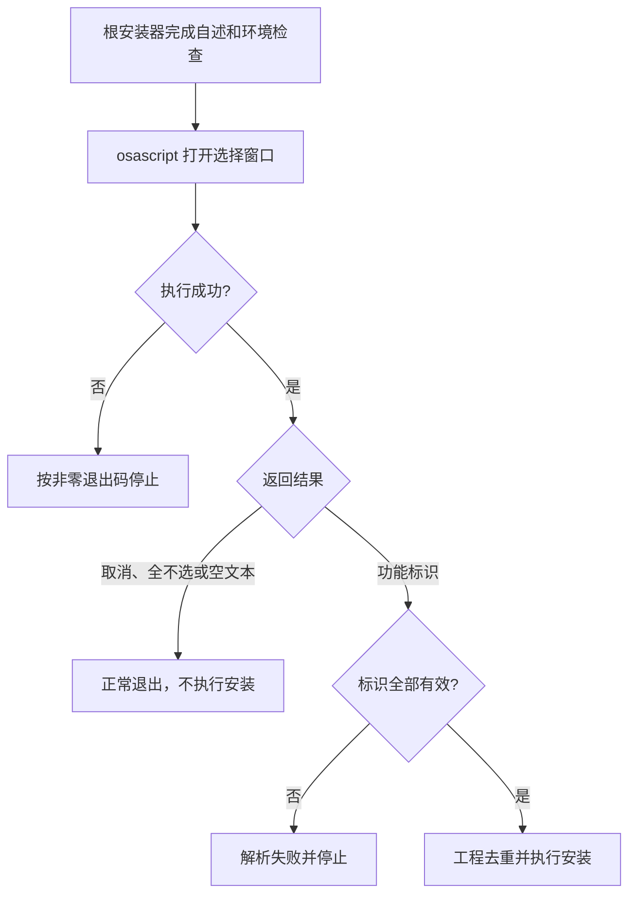

# `Scripts`：Finder 安装功能选择器


[toc]

---

## 🔥 <font id=前言>前言</font>

本目录维护总安装器使用的 [**macOS**](https://www.apple.com/macos/) 原生 [**Finder**](https://support.apple.com/zh-cn/102339) 功能选择窗口。选择器用 [**AppleScript**](https://developer.apple.com/library/archive/documentation/AppleScript/Conceptual/AppleScriptLangGuide/) 调用 [**AppKit**](https://developer.apple.com/documentation/appkit) 创建复选框，只向调用方返回选择结果；构建、注册、启用扩展和保存 Terminal 功能配置由[根目录安装器](../【MacOS】🧩安装Finder扩展.command)负责。

**当前为 11 项功能、7 个工程。每次打开窗口时，全部复选框默认选中。** 本目录是父仓维护的支持目录，仓库关系与安装环境见[父仓 README](../README.md)。

导航：[目录与调用关系](#directory-and-caller) · [功能标识](#feature-identifiers) · [运行方式](#run-and-check) · [返回结果](#return-contract) · [日志与排查](#logs-and-troubleshooting)

## 一、<span id="directory-and-caller">目录与调用关系</span> <a href="#前言" style="font-size:17px; color:green;"><b>🔼</b></a> <a href="#🔚" style="font-size:17px; color:green;"><b>🔽</b></a>

```text
./
├── README.md                                  # 本目录说明
└── SelectFinderExtensionFeatures.applescript   # 原生功能选择窗口
```

| 文件或调用方 | 职责 |
| --- | --- |
| [选择器源码](./SelectFinderExtensionFeatures.applescript) | Jobs 手写支持脚本，创建两组复选框，按固定顺序返回功能标识；不接受业务参数，不生成或保存配置。 |
| [根目录安装器](../【MacOS】🧩安装Finder扩展.command) | 通过 `osascript` 调用选择器，解析功能标识、校验未知值、按工程去重，再执行安装。 |
| [根目录卸载器](../【MacOS】🧩卸载Finder扩展.command) | 独立的卸载入口，不调用本选择器；卸载范围见父仓说明。 |

选择器必须保留在 `./SelectFinderExtensionFeatures.applescript`。根安装器按自身所在目录定位它，无须依赖终端当前目录。

## 二、<span id="feature-identifiers">功能标识与工程映射</span> <a href="#前言" style="font-size:17px; color:green;"><b>🔼</b></a> <a href="#🔚" style="font-size:17px; color:green;"><b>🔽</b></a>

窗口第一组显示六个独立扩展，第二组显示 `JobsTerminalOpener` 内的五项功能。Terminal 的五项可以分别勾选，安装器会归并为一次工程构建。

| 分组 | 窗口文案 | 返回标识 | 安装工程 |
| --- | --- | --- | --- |
| 独立扩展 | 打开 [**Git**](https://git-scm.com/) 远程地址 | `git_remote` | `JobsGitRemoteOpener` |
| 独立扩展 | 复制 Git 远程地址 | `git_remote_copier` | `JobsGitRemoteCopier` |
| 独立扩展 | 复制绝对路径 | `path_copier` | `JobsPathCopier` |
| 独立扩展 | 用 [**Xcode**](https://developer.apple.com/xcode) 打开项目 | `xcode_opener` | `JobsXcodeOpener` |
| 独立扩展 | 用 [**Visual Studio Code**](https://code.visualstudio.com/) 打开项目，窗口写作 `VSCode` | `vscode_opener` | `JobsVSCodeOpener` |
| 独立扩展 | 用 [**Android Studio**](https://developer.android.com/studio?hl=zh-c) 打开项目 | `android_studio_opener` | `JobsAndroidStudioOpener` |
| Terminal 内含 | 用终端打开 | `terminal_open` | `JobsTerminalOpener` |
| Terminal 内含 | 安装/升级 Pod，操作项目 [**CocoaPods**](https://cocoapods.org/) 依赖 | `pod_install` | `JobsTerminalOpener` |
| Terminal 内含 | 在终端执行 [**Flutter**](https://flutter.dev/) 的 `flutter pub get` | `flutter_pub_get` | `JobsTerminalOpener` |
| Terminal 内含 | 更新代码地图（`.codegraph`），使用 [**CodeGraph**](https://github.com/colbymchenry/codegraph) | `codegraph_bootstrap` | `JobsTerminalOpener` |
| Terminal 内含 | 在终端创建空白 Commit 并 Push | `git_empty_commit_push` | `JobsTerminalOpener` |

选择器不判断目标项目是否满足各项右键功能的条件，也不会执行 Pod、Flutter、代码地图或 Git 推送。各工程负责运行时检查与实际动作，详见[父仓功能说明](../README.md)。

## 三、<span id="run-and-check">运行方式与执行边界</span> <a href="#前言" style="font-size:17px; color:green;"><b>🔼</b></a> <a href="#🔚" style="font-size:17px; color:green;"><b>🔽</b></a>

### 3.1、通过总安装器选择并安装 <a href="#前言" style="font-size:17px; color:green;"><b>🔼</b></a> <a href="#🔚" style="font-size:17px; color:green;"><b>🔽</b></a>

1、先阅读[父仓运行说明](../README.md)，确认 Xcode、工程目录和签名环境可用。总安装器会构建、清理旧注册记录、注册并启用扩展，并在成功后重启 `pkd` 和 Finder。

2、双击 `../【MacOS】🧩安装Finder扩展.command`，阅读终端内置自述，按回车继续。

3、环境检查通过后打开选择窗口。勾选所需功能，点击“安装勾选项”；“全部安装”忽略当前勾选状态，直接返回全部 11 项；“取消”结束后续安装。

4、安装器解析结果并按工程去重，执行构建和注册，最后输出成功项、失败项和日志位置。

**边界：** 总安装器会在显示选择窗口前检查环境，并可能同步缺失的子模块；点击“取消”不能撤销已经完成的环境检查、日志初始化或子模块同步，只会阻止后续扩展安装。

### 3.2、只预览选择窗口 <a href="#前言" style="font-size:17px; color:green;"><b>🔼</b></a> <a href="#🔚" style="font-size:17px; color:green;"><b>🔽</b></a>

需要检查窗口与返回值时，在本 `README.md` 所在目录执行：

```shell
/usr/bin/osascript \
  ./SelectFinderExtensionFeatures.applescript
```

该命令需要本机图形桌面与 AppKit 可用，会激活原生窗口并等待点击按钮。它只将结果写到终端，不安装扩展，也不持久化勾选；没有桌面的自动化任务不应使用此方式验证。选择器自身不需要网络或额外第三方依赖。

### 3.3、只做语法编译检查 <a href="#前言" style="font-size:17px; color:green;"><b>🔼</b></a> <a href="#🔚" style="font-size:17px; color:green;"><b>🔽</b></a>

以下命令不弹出选择窗口，也不调用安装器。编译产物保存在系统临时目录，命令结束后清理：

```shell
(
  selector_check_dir="$(/usr/bin/mktemp -d)" || exit 1
  trap '[[ ! -f "$selector_check_dir/selector.scpt" ]] || /bin/rm "$selector_check_dir/selector.scpt"; /bin/rmdir "$selector_check_dir"' EXIT
  /usr/bin/osacompile \
    -o "$selector_check_dir/selector.scpt" \
    ./SelectFinderExtensionFeatures.applescript
)
```

语法编译不能替代真实窗口布局、按钮点击或 Finder 扩展安装验收。

## 四、<span id="return-contract">返回结果与调用流程</span> <a href="#前言" style="font-size:17px; color:green;"><b>🔼</b></a> <a href="#🔚" style="font-size:17px; color:green;"><b>🔽</b></a>

| 用户操作或异常 | 选择器结果 | 安装器行为 |
| --- | --- | --- |
| 安装勾选项，至少选中一项 | 按上表固定顺序输出逗号分隔的标识 | 解析、校验并安装所选工程。 |
| 安装勾选项，全部取消勾选 | `__NONE__` | 提示未选择功能，正常退出，不执行安装。 |
| 全部安装 | 全部 11 项标识，逗号分隔 | 安装全部七个工程。 |
| 取消 | `__CANCELLED__` | 提示取消，正常退出，不执行安装。 |
| `osascript` 执行失败 | 非零进程退出码 | 提示 UI 失败，按该退出码停止。 |
| 返回空文本 | 空字符串 | 按未选择功能处理。 |
| 返回未知功能标识 | 不属于上表的值 | 解析失败，立即停止。 |

例如只勾选“用 Xcode 打开项目”和“用终端打开”，标准输出为：

```text
xcode_opener,terminal_open
```

调用关系可用 [**Mermaid**](https://mermaid.js.org) 表示：



修改功能时，选择器的复选框顺序、`featureIdentifiers`、`featureCheckboxes`、“全部安装”返回值，以及根安装器的功能映射必须保持一致。显示名称可以调整，返回标识不能只在一侧改名。

## 五、<span id="logs-and-troubleshooting">日志与常见问题</span> <a href="#前言" style="font-size:17px; color:green;"><b>🔼</b></a> <a href="#🔚" style="font-size:17px; color:green;"><b>🔽</b></a>

| 现象 | 检查方式 |
| --- | --- |
| 总安装器提示缺少功能选择 UI | 确认 `./SelectFinderExtensionFeatures.applescript` 存在，且 `Scripts` 与根安装器保持当前目录关系。 |
| 脚本语法编译失败 | 用上面的 `osacompile` 命令定位错误；不要用完整安装流程检查语法。 |
| 窗口没有出现或 `osascript` 非零退出 | 检查是否在本机图形桌面运行、系统 `osascript` 与 AppKit 是否可用，并查看终端错误输出。 |
| 上次勾选没有保留 | 属于当前行为：每次新建窗口都默认全选。Terminal 已安装功能的持久化配置由安装器或宿主 App 管理。 |
| 勾选 Terminal 多个功能，只构建一个工程 | 属于当前行为：功能逐项选择，工程去重构建。 |
| 安装器提示未知标识 | 对照两侧功能映射和本页上表，排除选择器与安装器版本不一致。 |

选择器没有独立日志文件：直接运行时结果与错误显示在当前终端。通过根安装器运行时，查看其终端提示及系统临时目录中的 `【MacOS】🧩安装Finder扩展.log`；每次进入安装器运行初始化都会覆盖该日志。单独运行选择器不会更新此日志。

<a id="🔚" href="#前言" style="font-size:17px; color:green; font-weight:bold;">我是有底线的➤点我回到首页</a>
