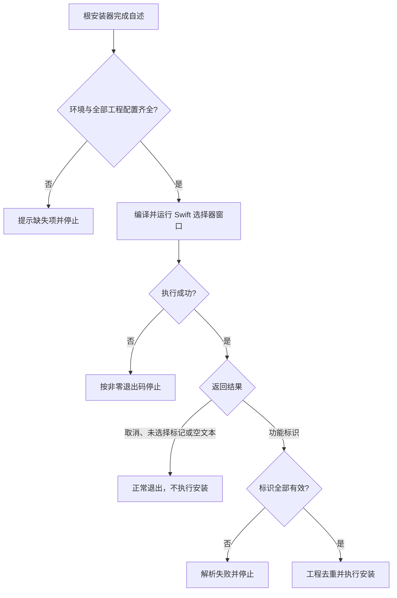

# `Scripts`：Finder 安装功能选择器


<!-- jobs-toc:start -->
<!-- jobs-toc:source {"v":2,"token":"[toc]"} -->
<details>
<summary>📚 目录（点击展开 / 收起）</summary>

- [🔥 前言](#jobs-toc-heading-1)
- [一、目录与调用关系](#directory-and-caller)
- [二、功能标识与工程映射](#feature-identifiers)
- [三、运行方式与执行边界](#run-and-check)
  - [3.1、通过总安装器选择并安装](#jobs-toc-heading-5)
  - [3.2、只预览选择窗口](#jobs-toc-heading-6)
  - [3.3、只做编译检查](#jobs-toc-heading-7)
- [四、返回结果与调用流程](#return-contract)
- [五、日志与常见问题](#logs-and-troubleshooting)

</details>
<!-- jobs-toc:end -->

---

## <span id="jobs-toc-heading-1" data-jobs-toc="v2">🔥 <font id=前言>前言</font></span><!-- jobs-toc:heading-end -->

本目录维护总安装器使用的 [**macOS**](https://www.apple.com/macos/) 原生 [**Finder**](https://support.apple.com/zh-cn/102339) 功能选择窗口。选择器用 [**Swift**](https://www.swift.org/) 调用 [**AppKit**](https://developer.apple.com/documentation/appkit) 创建复选框窗口，只向调用方返回选择结果；构建、注册、启用扩展和保存 Terminal 功能配置由[根目录安装器](../【MacOS】🧩安装Finder扩展.command)负责。

**当前为 23 项功能、19 个工程（2026-10-22，按安装器登记与工程去重）。每次打开窗口时，全部复选框默认选中；可点击“全不选”一键取消全部，也可以“全选”恢复。没有任何勾选时，“安装”按钮自动置灰，重新勾选后实时恢复。全部选项和底部按钮固定显示，中间区域不滚动；窗口按内容确定尺寸，较矮屏幕使用两列布局。** 本目录和全部功能工程由当前仓库统一管理，源码获取与安装环境见[仓库 README](../README.md)。

导航：[目录与调用关系](#directory-and-caller) · [功能标识](#feature-identifiers) · [运行方式](#run-and-check) · [返回结果](#return-contract) · [日志与排查](#logs-and-troubleshooting)

## 一、<span id="directory-and-caller">目录与调用关系</span> <a href="#前言" style="font-size:17px; color:green;"><b>🔼</b></a> <a href="#🔚" style="font-size:17px; color:green;"><b>🔽</b></a>

```text
./
├── README.md                                # 本目录说明
└── SelectFinderExtensionFeatures.swift      # 原生功能选择窗口
```

| 文件或调用方 | 职责 |
| --- | --- |
| [选择器源码](./SelectFinderExtensionFeatures.swift) | Jobs 手写支持工具，创建两组复选框，提供“全选”“全不选”快捷操作，按固定顺序返回功能标识；不接受业务参数，不生成或保存配置。 |
| [根目录安装器](../【MacOS】🧩安装Finder扩展.command) | 编译（带缓存）并运行选择器，解析功能标识、校验未知值、按工程去重，再执行安装。 |
| [根目录卸载器](../【MacOS】🧩卸载Finder扩展.command) | 独立的卸载入口，不调用本选择器；卸载范围见仓库说明。 |

选择器源码必须保留在 `./SelectFinderExtensionFeatures.swift`。根安装器按自身所在目录定位它，编译产物缓存在 `../work/SelectFinderExtensionFeatures`，源码更新后自动重新编译，无须依赖终端当前目录。

## 二、<span id="feature-identifiers">功能标识与工程映射</span> <a href="#前言" style="font-size:17px; color:green;"><b>🔼</b></a> <a href="#🔚" style="font-size:17px; color:green;"><b>🔽</b></a>

窗口第一组显示 18 个独立扩展，第二组显示 `JobsTerminalOpener` 内的五项功能。Terminal 的五项可以分别勾选，安装器会归并为一次工程构建。

| 分组 | 窗口文案 | 返回标识 | 安装工程 |
| --- | --- | --- | --- |
| 独立扩展 | 打开 [**Git**](https://git-scm.com/) 远程地址 | `git_remote` | `JobsGitRemoteOpener` |
| 独立扩展 | 复制 Git 远程地址 | `git_remote_copier` | `JobsGitRemoteCopier` |
| 独立扩展 | 复制绝对路径 | `path_copier` | `JobsPathCopier` |
| 独立扩展 | 运行授权 | `run-authorize` | `JobsRunAuthorizer` |
| 独立扩展 | 用 [**Xcode**](https://developer.apple.com/xcode) 打开项目 | `xcode_opener` | `JobsXcodeOpener` |
| 独立扩展 | 用 [**Visual Studio Code**](https://code.visualstudio.com/) 打开项目，窗口写作 `VSCode` | `vscode_opener` | `JobsVSCodeOpener` |
| 独立扩展 | 用 [**Android Studio**](https://developer.android.com/studio?hl=zh-c) 打开项目 | `android_studio_opener` | `JobsAndroidStudioOpener` |
| 独立扩展 | 安装/切换 Flutter SDK（[**FVM**](https://fvm.app/)） | `flutter_version_manager` | `JobsFlutterVersionMgr` |
| 独立扩展 | 拉取 Git 到最新 | `git-pull` | `JobsGitPuller` |
| 独立扩展 | 提取 Flutter 第三方依赖 | `flutter-dependency-extract` | `JobsFlutterDependencyExtractor` |
| 独立扩展 | 查看当前 Flutter SDK 版本 | `flutter_sdk_version` | `JobsFlutterSdkInspector` |
| 独立扩展 | Flutter打包 | `flutter-package` | `JobsFlutterPackager` |
| 独立扩展 | 运行 Flutter 项目 | `flutter-run` | `JobsFlutterRunner` |
| 独立扩展 | Flutter 项目体检 | `flutter-doctor` | `JobsFlutterDoctor` |
| 独立扩展 | Flutter 自动化生产代码 | `flutter-codegen` | `JobsFlutterCodegen` |
| 独立扩展 | 新建 [**iOS**](https://developer.apple.com/ios/) 模拟器 | `ios-simulator-create` | `JobsIOSSimulatorCreator` |
| 独立扩展 | 新建 [**Android**](https://developer.android.com/) 模拟器 | `android-simulator-create` | `JobsAndroidSimulatorCreator` |
| 独立扩展 | 配置 Git 动态代理 | `git-proxy-configure` | `JobsGitProxyConfigurator` |
| Terminal 内含 | 用终端打开 | `terminal_open` | `JobsTerminalOpener` |
| Terminal 内含 | `pod install`，在 Terminal 直接安装项目 [**CocoaPods**](https://cocoapods.org/) 依赖 | `pod_install` | `JobsTerminalOpener` |
| Terminal 内含 | 在终端执行 [**Flutter**](https://flutter.dev/) 的 `flutter pub get` | `flutter_pub_get` | `JobsTerminalOpener` |
| Terminal 内含 | 更新代码地图（`.codegraph`），使用 [**CodeGraph**](https://github.com/colbymchenry/codegraph) | `codegraph_bootstrap` | `JobsTerminalOpener` |
| Terminal 内含 | 在终端创建空白 Commit 并 Push | `git_empty_commit_push` | `JobsTerminalOpener` |

选择器不判断目标项目是否满足各项右键功能的条件，也不会执行 Pod、Flutter、代码地图、Git 推送、运行授权、代理配置或模拟器创建。各工程负责运行时检查与实际动作；“运行授权”只在选中单个本地普通文件时显示，点击后到 Terminal 确认执行 `chmod +x`，文件夹、目录包、多选及空白处隐藏；“新建 iOS 模拟器”“新建 Android 模拟器”和“配置 Git 动态代理”分别是独立扩展，仅在系统桌面空白处使用，无须 Flutter 项目。Git 代理宿主注册时只初始化扩展，点击菜单后才打开配置流程。Android 入口使用本机 SDK、Java / JBR 与架构匹配系统映像，安装选择器不安装或接受这些组件的许可证。详见[仓库功能说明](../README.md)与 [Android 工程依赖](../JobsAndroidSimulatorCreator/README.md)。

“Flutter打包”仍是一个安装单元，仅在真实 Flutter 项目根目录显示；Terminal 内选择 Android / iOS / 鸿蒙，鸿蒙再选择 HAP / APP。安装选择器不检查或安装鸿蒙 SDK，工具链与平台检查由[打包业务脚本](../JobsFlutterPackager/Scripts/README.md)负责。

## 三、<span id="run-and-check">运行方式与执行边界</span> <a href="#前言" style="font-size:17px; color:green;"><b>🔼</b></a> <a href="#🔚" style="font-size:17px; color:green;"><b>🔽</b></a>

### <span id="jobs-toc-heading-5" data-jobs-toc="v2">3.1、通过总安装器选择并安装 <a href="#前言" style="font-size:17px; color:green;"><b>🔼</b></a> <a href="#🔚" style="font-size:17px; color:green;"><b>🔽</b></a></span><!-- jobs-toc:heading-end -->

1、先阅读[仓库运行说明](../README.md)，确认 Xcode、全部工程目录和签名环境可用。全部工程源码随完整仓库取得；总安装器先检查每个 `.xcodeproj/project.pbxproj`，缺失时列出路径并停止，提示重新取得完整仓库。总安装器会构建、清理旧注册记录、注册并启用扩展，并在成功后重启 `pkd` 和 Finder。

2、双击 `../【MacOS】🧩安装Finder扩展.command`，阅读终端内置自述，按回车继续。

3、环境检查通过后编译（首次）并打开选择窗口。勾选所需功能，点击“安装”；“全不选”取消全部勾选并置灰安装按钮，方便只装单个功能；“全选”恢复全部勾选，再点击“安装”可安装全部功能；“取消”或关闭窗口结束后续安装。

4、安装器解析结果并按工程去重，执行构建和注册，最后输出成功项、失败项和日志位置。

**边界：** 总安装器在显示选择窗口前检查环境和本仓工程配置；工程缺失时不会下载独立工程。点击“取消”只会阻止后续扩展安装，已经完成的环境检查和日志初始化仍会保留。

### <span id="jobs-toc-heading-6" data-jobs-toc="v2">3.2、只预览选择窗口 <a href="#前言" style="font-size:17px; color:green;"><b>🔼</b></a> <a href="#🔚" style="font-size:17px; color:green;"><b>🔽</b></a></span><!-- jobs-toc:heading-end -->

需要检查窗口与返回值时，在本 `README.md` 所在目录执行：

```shell
/usr/bin/xcrun swiftc -O ./SelectFinderExtensionFeatures.swift \
  -o "${TMPDIR:-/tmp/}SelectFinderExtensionFeatures" &&
"${TMPDIR:-/tmp/}SelectFinderExtensionFeatures"
```

该命令需要本机图形桌面与 AppKit 可用，会激活原生窗口并等待点击按钮。它只将结果写到终端，不安装扩展，也不持久化勾选；没有桌面的自动化任务不应使用此方式验证。选择器自身不需要网络或额外第三方依赖。

### <span id="jobs-toc-heading-7" data-jobs-toc="v2">3.3、只做编译检查 <a href="#前言" style="font-size:17px; color:green;"><b>🔼</b></a> <a href="#🔚" style="font-size:17px; color:green;"><b>🔽</b></a></span><!-- jobs-toc:heading-end -->

以下命令不弹出选择窗口，也不调用安装器。编译产物保存在系统临时目录，命令结束后清理：

```shell
(
  selector_check_dir="$(/usr/bin/mktemp -d)" || exit 1
  trap '/bin/rm -f "$selector_check_dir/selector"; /bin/rmdir "$selector_check_dir"' EXIT
  /usr/bin/xcrun swiftc \
    -O ./SelectFinderExtensionFeatures.swift \
    -o "$selector_check_dir/selector"
)
```

编译检查不能替代真实窗口布局、按钮点击或 Finder 扩展安装验收。

在本目录执行以下命令，可在隔离 Shell 与临时目录核对选择标识、工程完整性检查和安装 / 卸载映射；不会构建或注册扩展：

```shell
ruby ../Tests/FlutterInstallerIntegrationTests.rb
ruby ../Tests/AndroidSimulatorInstallerIntegrationTests.rb
```

## 四、<span id="return-contract">返回结果与调用流程</span> <a href="#前言" style="font-size:17px; color:green;"><b>🔼</b></a> <a href="#🔚" style="font-size:17px; color:green;"><b>🔽</b></a>

| 用户操作或异常 | 选择器结果 | 安装器行为 |
| --- | --- | --- |
| 安装，至少选中一项 | 按上表固定顺序输出逗号分隔的标识 | 解析、校验并安装所选工程。 |
| 全不选或逐项取消全部勾选 | 不返回结果，窗口继续显示；安装按钮置灰，回车也不能确认 | 等待重新勾选或取消，不执行安装。 |
| 全选后点击安装 | 全部 23 项标识，逗号分隔 | 安装全部19 个工程。 |
| 取消或关闭窗口 | `__CANCELLED__` | 提示取消，正常退出，不执行安装。 |
| 选择器进程执行失败 | 非零进程退出码 | 提示 UI 失败，按该退出码停止。 |
| 异常返回未选择标记或空文本 | `__NONE__` 或空字符串 | 按未选择功能处理。 |
| 返回未知功能标识 | 不属于上表的值 | 解析失败，立即停止。 |

例如只勾选“用 Xcode 打开项目”和“用终端打开”，标准输出为：

```text
xcode_opener,terminal_open
```

调用关系可用 [**Mermaid**](https://mermaid.js.org) 表示：



修改功能时，选择器 `FeatureOption` 里的复选框顺序、`identifier`、`title`，以及根安装器的功能映射必须保持一致；验证时核对两侧顺序与所选工程。显示名称可以调整，返回标识不能只在一侧改名。

## 五、<span id="logs-and-troubleshooting">日志与常见问题</span> <a href="#前言" style="font-size:17px; color:green;"><b>🔼</b></a> <a href="#🔚" style="font-size:17px; color:green;"><b>🔽</b></a>

| 现象 | 检查方式 |
| --- | --- |
| 总安装器提示缺少功能选择 UI | 确认 `./SelectFinderExtensionFeatures.swift` 存在，且 `Scripts` 与根安装器保持当前目录关系。 |
| 总安装器提示工程源码不完整 | 根据日志核对缺失的 `.xcodeproj/project.pbxproj`，重新取得包含全部工程源码的完整仓库；仅复制总安装器或创建空工程目录不能满足检查。 |
| 选择器编译失败 | 用上面的编译检查命令定位错误；不要用完整安装流程检查语法。 |
| 窗口没有出现或选择器非零退出 | 检查是否在本机图形桌面运行、Xcode 与 AppKit 是否可用，并查看终端错误输出。 |
| 上次勾选没有保留 | 属于当前行为：每次新建窗口都默认全选。Terminal 已安装功能的持久化配置由安装器或宿主 App 管理。 |
| 勾选 Terminal 多个功能，只构建一个工程 | 属于当前行为：功能逐项选择，工程去重构建。 |
| 安装器提示未知标识 | 对照两侧功能映射和本页上表，排除选择器与安装器版本不一致。 |

选择器没有独立日志文件：直接运行时结果与错误显示在当前终端。通过根安装器运行时，查看其终端提示及系统临时目录中的 `【MacOS】🧩安装Finder扩展.log`；每次进入安装器运行初始化都会覆盖该日志。单独运行选择器不会更新此日志。

<a id="🔚" href="#前言" style="font-size:17px; color:green; font-weight:bold;">我是有底线的➤点我回到首页</a>
