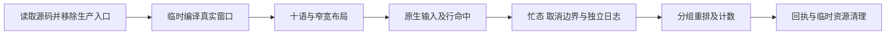

# 管理面板整行选择回归


<!-- jobs-toc:start -->
<!-- jobs-toc:source {"v":2,"token":"[toc]"} -->
<details>
<summary>📚 目录（点击展开 / 收起）</summary>

- [🔥 前言](#%E5%89%8D%E8%A8%80)
- [一、运行](#run)
- [二、覆盖范围](#coverage)
- [三、产物与参数](#artifacts)
- [四、验证流程](#flow)

</details>
<!-- jobs-toc:end -->

---

## 🔥 <span id="前言">前言</span>

使用 [**Ruby**](https://www.ruby-lang.org) 的 Minitest 编译真实 [**Swift**](https://www.swift.org/) 管理面板，在 [**AppKit**](https://developer.apple.com/documentation/appkit) 窗口中验证功能行选择。复选框保持原生鼠标、键盘和辅助功能动作，普通状态、图标和空白区域统一切换同一项；测试不运行后台 worker、安装器或扩展注册。

## 一、<span id="run">运行</span> <a href="#前言" style="font-size:17px; color:green;"><b>🔼</b></a> <a href="#🔚" style="font-size:17px; color:green;"><b>🔽</b></a>

在本目录执行，或从其它工作目录传入入口实际路径；源码由脚本自身位置解析。

```shell
ruby ./ManagerFeatureRowTests.rb
```

需要 [**MacOS**](https://www.apple.com/macos/) 图形登录会话、`xcrun swiftc`、Ruby 和 Minitest，不自动安装依赖。测试先确认并移除生产交互入口，再在临时进程内编译，并进入真实 `NSApplication.run` 循环后派发事件。涉及焦点和原生按钮跟踪，应与其它 GUI 回归串行运行，避免其它应用抢占 key window 导致一次输入会话失效。

## 二、<span id="coverage">覆盖范围</span> <a href="#前言" style="font-size:17px; color:green;"><b>🔼</b></a> <a href="#🔚" style="font-size:17px; color:green;"><b>🔽</b></a>

- 真实窗口命中复选框、标题、普通状态、图标和行内空白；预排原生 mouse-up 完成复选框跟踪，检查每次仅一个动作且只选中当前功能，并刷新全局计数。
- `1440×900` 与 `800×600` 两种屏幕布局、十种语言及代表性功能分组；主题／语言切换保留原生控件，不依赖英文计数格式。
- 原生 Space 与 unignored 原生复选框单元的辅助功能 press 各切换一次；任务忙碌、按下后开始任务均不可绕过禁用状态。
- 4 点拖动、越过行或列边界后返回、滚轮、不同窗口放开、失焦、窗口缩放、重新布局及隐藏恢复都使旧按下失效，末行半间隔不能延伸到列外提交。
- 失败状态保留独立日志命中，忙碌时仍可查看诊断且不切换选择。使用不存在的私有临时日志与注入错误展示器观测动作，不启动真实 Terminal。
- 实际分组移动与重新布局复用同一复选框、保留选择和行宽；分组标题按下／放开不切换功能。分组原生拖放完整流程继续由[已有偏好与布局回归](../PanelPreferencesTests.rb/README.md)覆盖，不把程序化重排当作物理拖动验收。

测试仅在独立 UserDefaults 域保存布局，结束时清理测试偏好、编译目录和临时文件，不修改真实管理面板偏好。

## 三、<span id="artifacts">产物与参数</span> <a href="#前言" style="font-size:17px; color:green;"><b>🔼</b></a> <a href="#🔚" style="font-size:17px; color:green;"><b>🔽</b></a>

默认不保留产物；显式设置目录时写入验证进程输出及成功后的源码 SHA-256 / 断言数回执。同名产物会覆盖，建议每轮使用独立目录。

```shell
JOBS_MANAGER_ROW_ARTIFACTS_DIR="${TMPDIR:-/tmp}/jobs-row-artifacts-$(date +%Y%m%d-%H%M%S)" \
  ruby ./ManagerFeatureRowTests.rb
```

产物为 `appkit-stdout.log` 与 `receipt.json`。`JOBS_FINDER_PANEL_TEST_SOURCE` 可显式指定其它面板源码验证随包副本；默认读取 `../../Scripts/SelectFinderExtensionFeatures.swift`。失败返回非零并输出具体断言，成功打印真实 AppKit 检查数量；隔离事件验证与已安装面板的人工点击验收分别记录。

## 四、<span id="flow">验证流程</span> <a href="#前言" style="font-size:17px; color:green;"><b>🔼</b></a> <a href="#🔚" style="font-size:17px; color:green;"><b>🔽</b></a>



<a id="🔚" href="#前言" style="font-size:17px; color:green; font-weight:bold;">我是有底线的➤点我回到首页</a>
