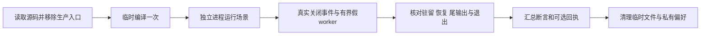

# 管理面板后台生命周期回归


<!-- jobs-toc:start -->
<!-- jobs-toc:source {"v":2,"token":"[toc]"} -->
<details>
<summary>📚 目录（点击展开 / 收起）</summary>

- [🔥 前言](#%E5%89%8D%E8%A8%80)
- [一、运行](#run)
- [二、覆盖范围](#coverage)
- [三、产物与参数](#artifacts)
- [四、验证流程](#flow)

</details>
<!-- jobs-toc:end -->

---

## 🔥 <span id="前言">前言</span>

使用 [**Ruby**](https://www.ruby-lang.org) 的 Minitest 编译真实 [**Swift**](https://www.swift.org/) 管理控制器，在独立 [**AppKit**](https://developer.apple.com/documentation/appkit) 进程中验证关闭、保留 Dock 图标并退到菜单栏、恢复和完全退出。仅启动本测试创建的有界假 worker，不执行真实安装、卸载或系统扩展注册。

## 一、<span id="run">运行</span> <a href="#前言" style="font-size:17px; color:green;"><b>🔼</b></a> <a href="#🔚" style="font-size:17px; color:green;"><b>🔽</b></a>

在本目录执行，或从任意工作目录传入本脚本实际路径；源码由入口自身位置解析。

```shell
ruby ./ManagerLifecycleTests.rb
```

需要 [**MacOS**](https://www.apple.com/macos/) 图形登录会话、可用的 `xcrun swiftc`、Ruby 和 Minitest，不自动安装依赖。测试确认并移除生产交互入口，临时编译一次，再为每个场景创建独立进程，避免事件循环与委托状态串扰。

## 二、<span id="coverage">覆盖范围</span> <a href="#前言" style="font-size:17px; color:green;"><b>🔼</b></a> <a href="#🔚" style="font-size:17px; color:green;"><b>🔽</b></a>

- 空闲时退到后台、完全退出和取消；重复关闭只保留一个询问，旧询问回调不能消费后来的新询问。
- 真实关闭询问按浅色／深色和十语言检查按钮、默认后台／Escape 取消、藏文字体，以及状态项切换语言后的辅助功能标签；系统模式下已打开的询问继续跟随应用外观变化。
- 询问打开后启动任务，再收到“完全退出”响应时保全任务；纯选择器取消继续返回结果，不因驻留挂住调用方。
- 实际窗口红色关闭、底部关闭、生产 Cmd-Q 菜单和真实 `NSApplication.terminate` 都在假任务运行中隐藏窗口，不提前退出应用循环。
- 隐藏后保留同一个 worker、计时器、日志存储及标准输出管道；功能结果完成后仍等进程退出，中文尾输出可见。
- 任务完成继续驻留后台，不抢前台；恢复原窗口保留选择、结果和日志，显式空闲退出才释放状态项并返回。
- 完整管理会话前台、后台及完成后保持 Dock 可见的 regular 策略；真实应用运行记录与控制器状态一致，重开委托恢复同窗、同 worker PID、同选择和日志存储，重复后台仍保留入口。纯选择器真实运行保持 accessory 并返回原 stdout 合同。
- 验证真实 `runModal` 挂接应用委托，结束后恢复原委托；忙时菜单的退出禁用和回调二次门禁同时有效。

生命周期竞态通过可注入回调驱动；主题／语言检查创建真实关闭询问，并以取消响应结束，不执行退出选项；不把这些隔离事件测试当作菜单栏／Dock 物理鼠标操作或已安装 App 的人工验收。每个 `runModal` 场景有 8 秒测试看门狗，真实询问的每轮取消有 1 秒回调等待；假 worker 只等待短时间、输出协议和临时回执，不运行其它业务。

## 三、<span id="artifacts">产物与参数</span> <a href="#前言" style="font-size:17px; color:green;"><b>🔼</b></a> <a href="#🔚" style="font-size:17px; color:green;"><b>🔽</b></a>

默认自动清理编译目录、假 worker、私有偏好及临时日志。显式指定产物目录时，保留各场景输出和成功后的源码 SHA-256 / 断言数回执；同名测试产物会覆盖，建议每轮独立目录。

```shell
JOBS_MANAGER_LIFECYCLE_ARTIFACTS_DIR="${TMPDIR:-/tmp}/jobs-lifecycle-artifacts-$(date +%Y%m%d-%H%M%S)" \
  ruby ./ManagerLifecycleTests.rb
```

`JOBS_FINDER_PANEL_TEST_SOURCE` 可指定另一份生产源码验证随包副本；默认读取 `../../Scripts/SelectFinderExtensionFeatures.swift`。假 worker 的回执位置通过测试子进程专用变量传入，`ZDOTDIR` 指向独立空目录，不加载用户 Shell 配置。未改变真实面板偏好、系统主题或后台任务。

成功时打印真实 AppKit 内部断言总数及独立进程数；断言失败或看门狗触发均非零退出，输出具体场景和原因。

## 四、<span id="flow">验证流程</span> <a href="#前言" style="font-size:17px; color:green;"><b>🔼</b></a> <a href="#🔚" style="font-size:17px; color:green;"><b>🔽</b></a>



<a id="🔚" href="#前言" style="font-size:17px; color:green; font-weight:bold;">我是有底线的➤点我回到首页</a>
