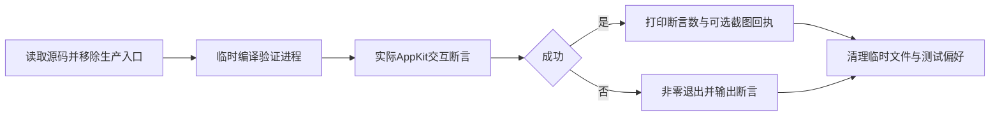

# 管理面板日志交互回归


<!-- jobs-toc:start -->
<!-- jobs-toc:source {"v":2,"token":"[toc]"} -->
<details>
<summary>📚 目录（点击展开 / 收起）</summary>

- [🔥 前言](#%E5%89%8D%E8%A8%80)
- [一、运行](#run)
- [二、覆盖范围](#coverage)
- [三、截图与回执](#artifacts)
- [四、流程](#flow)

</details>
<!-- jobs-toc:end -->

---

## 🔥 <span id="前言">前言</span>

使用 [**Ruby**](https://www.ruby-lang.org) 的 Minitest 驱动临时 [**Swift**](https://www.swift.org/) 进程，验证 [**AppKit**](https://developer.apple.com/documentation/appkit) 日志颜色、原生滚动和自动追尾。提取真实面板源码，确认并移除生产入口后才编译，不启动后台 worker、安装或注册扩展。

## 一、<span id="run">运行</span> <a href="#前言" style="font-size:17px; color:green;"><b>🔼</b></a> <a href="#🔚" style="font-size:17px; color:green;"><b>🔽</b></a>

在本目录执行，或从其它工作目录传入脚本实际路径；生产源码由脚本自身位置解析。

```shell
ruby ./ManagerLogInteractionTests.rb
```

需要 [**MacOS**](https://www.apple.com/macos/) 图形登录会话、`xcrun swiftc`、Ruby 和 Minitest；不自动安装依赖。仅创建临时窗口、独立 UserDefaults 域和临时日志，结束时清理测试偏好与临时目录，不修改真实面板偏好和系统主题。

## 二、<span id="coverage">覆盖范围</span> <a href="#前言" style="font-size:17px; color:green;"><b>🔼</b></a> <a href="#🔚" style="font-size:17px; color:green;"><b>🔽</b></a>

- 精确滚轮、普通滚轮通过实际日志文本视图响应链移动视口；浏览后追加输出与进度预览不抢回尾部。
- 完整手势与动量阶段对照普通 `NSScrollView` 的位移，验证保留系统计算；合成事件不等于物理触摸板人工验收。
- 日志专属实时滚动通知暂停拖条追尾，其它视图通知不影响日志；八个导航键暂停追尾，Home / End 保留原生首尾导航，重新勾选立即追尾。
- 两主题全部六种语义色对比度至少为 `4.5:1`；覆盖中英文、零失败成功汇总、非零退出码及带文件位置的标准编译诊断。
- 显式主题与进程内系统外观变化自动更新既有文字、背景，保留原文、选择范围和视口。
- 直接调用真实 `finishWorker` 验证成功、非零退出、零退出但单项失败、停止、权限阻塞及其优先级的汇总等级，不启动后台进程。
- ANSI CSI / OSC 控制清除后保留文字；窗口截断保留幸存语义，临时磁盘日志保留完整纯文本。

成功时打印真实 AppKit 内部断言数；失败时返回非零和具体断言。

## 三、<span id="artifacts">截图与回执</span> <a href="#前言" style="font-size:17px; color:green;"><b>🔼</b></a> <a href="#🔚" style="font-size:17px; color:green;"><b>🔽</b></a>

显式设置产物目录时保留日志视图两主题 PNG，以及成功后的源码 SHA-256 / 断言数回执；默认不保留产物。目录按需创建，同名测试产物会覆盖，建议每轮独立目录。

```shell
JOBS_LOG_TEST_ARTIFACTS_DIR="${TMPDIR:-/tmp}/jobs-log-artifacts-$(date +%Y%m%d-%H%M%S)" \
  ruby ./ManagerLogInteractionTests.rb
```

产物为日志滚动区截图 `log-light.png`、`log-dark.png`，完整纯文本夹具 `test-plain.log`、验证进程输出 `appkit-stdout.log` 及 `receipt.json`，仅含测试数据。`JOBS_FINDER_PANEL_TEST_SOURCE` 可显式指定另一份源码验证独立包副本；默认使用 `../../Scripts/SelectFinderExtensionFeatures.swift`。

## 四、<span id="flow">流程</span> <a href="#前言" style="font-size:17px; color:green;"><b>🔼</b></a> <a href="#🔚" style="font-size:17px; color:green;"><b>🔽</b></a>



<a id="🔚" href="#前言" style="font-size:17px; color:green; font-weight:bold;">我是有底线的➤点我回到首页</a>
